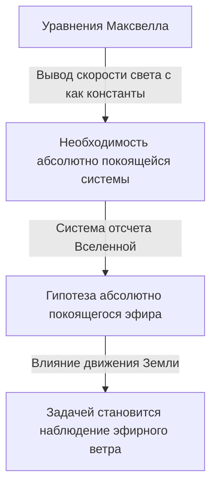

## 1. Введение: «Нечто», что, как считалось, заполняет Вселенную

В истории попыток человечества разгадать тайны природы вопрос «как свет распространяется в пространстве» очаровывал и сильно озадачивал многих гениев, от древнегреческих философов до современных физиков.

Наблюдая повседневные физические явления, мы видим, что для распространения звука необходимо такое вещество, как «воздух» или «вода», а для распространения морских волн необходима такая среда, как «морская вода». Из этой интуитивной и логичной аналогии родилась идея, что если свет имеет волновую природу, то должна существовать «неизвестная среда» для его распространения, заполняющая каждый уголок космоса. Эта призрачная среда и получила название «светоносный эфир» (Luminiferous aether).

Для многих физиков XIX века эфир был влиятельной объяснительной моделью. Однако теории и толкования не были единообразными; движение эфира и его взаимодействие с веществом оставались предметом дискуссий. Опыты по поиску эфирного ветра и последующее развитие теории побудили пересмотреть классическую идею среды для света и стали частью истории, приведшей к теории относительности. В статье рассматриваются происхождение и проверка этой концепции, а также её отличие от представлений современной физики.

## 2. Споры о природе света и рождение эфира

Споры о том, является ли свет «частицей» или «волной», ожесточенно велись в эпоху научной революции 17 века.

Исаак Ньютон, основываясь на прямолинейном распространении света и законах отражения, выдвинул «корпускулярную теорию света», утверждающую, что свет — это поток мельчайших частиц. Благодаря его огромному авторитету корпускулярная теория доминировала в физике на протяжении всего 18 века. Однако в то же время Христиан Гюйгенс утверждал, что для объяснения таких явлений, как дифракция и преломление света, свет следует рассматривать как волну, и выдвинул «волновую теорию света».

В XIX веке опыты Юнга по интерференции и теория Френеля дали веские основания объяснять интерференцию и дифракцию как волновые свойства света. Однако одно лишь волновое поведение логически не доказывает существование механической среды в вакууме. По аналогии с известными тогда волнами многие теории предполагали эфир как среду, переносящую свет.

### Странные свойства, требуемые от эфира

Однако, постулируя среду, называемую эфиром, физики столкнулись с серьезным противоречием. Открытие явления поляризации показало, что свет является поперечной волной (волной, колеблющейся перпендикулярно направлению распространения). В рамках физики того времени только «твердые тела» могли передавать поперечные волны. Газы и жидкости могут передавать только продольные волны (такие как звуковые волны).

Иными словами, эфир должен был быть «гигантским прозрачным твердым телом», простирающимся по всей Вселенной. Чтобы передавать волны с колоссальной скоростью света (около 300 000 километров в секунду), эфир должен был быть намного тверже стали и обладать чрезвычайно высокой упругостью. С другой стороны, поскольку Земля и планеты при вращении вокруг Солнца, казалось, не испытывали никакого сопротивления трения со стороны эфира, эфир должен был быть совершенно лишен трения и обладать крайне разреженными свойствами, позволяющими материи проходить сквозь него без сопротивления.

Таким образом, эфир оказался наделен физически противоречивыми и странными свойствами: «он тверже стали, но не имеет сопротивления, как идеальная жидкость».

## 3. Электромагнетизм Максвелла и абсолютно покоящаяся система эфира

Во второй половине 19 века Джеймс Клерк Максвелл завершил создание «уравнений Максвелла», которые стали основой электромагнетизма. Эти уравнения не только идеально описывали электрические и магнитные явления, но и содержали удивительное предсказание. Когда была рассчитана скорость распространения электромагнитных волн, она поразительно совпала со «скоростью света», измеренной в экспериментах того времени. Это теоретически доказало, что «свет — это разновидность электромагнитной волны».

В уравнениях Максвелла скорость света $c$ выводится как константа, определяемая диэлектрической и магнитной проницаемостью вакуума. Здесь возникла серьезная проблема. Когда мы говорим, что «скорость света является константой», «относительно чего» она постоянна?

Согласно принципу относительности ньютоновской механики, скорость всегда должна меняться в зависимости от состояния движения наблюдателя. Скорость мяча, брошенного из движущегося поезда, с точки зрения человека на земле, будет равна «скорости поезда + скорости мяча». Однако скорость света в уравнениях Максвелла не учитывала такую скорость наблюдателя.

Многие теоретики того времени рассматривали трактовки, связывавшие электромагнитное поле со средой или выделенной системой отсчёта; среди них были модели с неподвижным эфиром. Но сами уравнения Максвелла не доказывают существование механической среды или абсолютной системы покоя. В более поздних релятивистских формулировках скорость света в вакууме инвариантна между инерциальными системами, поэтому предполагать выделенную систему покоя не требуется.

## 4. Эксперимент Майкельсона-Морли: известный нулевой результат

Если космическое пространство заполнено абсолютно покоящимся эфиром, то Земля, вращаясь вокруг Солнца, постоянно движется сквозь море эфира. При взгляде с Земли из космоса должен дуть «эфирный ветер».

В 1887 году Альберт Майкельсон и Эдвард Морли провели новаторский эксперимент, чтобы зафиксировать этот «эфирный ветер». Они сконструировали чрезвычайно точный оптический прибор, названный «интерферометром Майкельсона».

Принцип эксперимента таков. Пучок света, испускаемый источником, разделяется полупрозрачным зеркалом в двух взаимно перпендикулярных направлениях. Один направляется параллельно эфирному ветру, а другой — перпендикулярно, отражается от зеркал в конце каждого пути и возвращается обратно. Если эфирный ветер существует, то, подобно тому, как пловец, переплывающий реку туда и обратно, испытывает влияние течения, во времени прохождения света туда и обратно должна возникнуть очень небольшая разница. Ожидалось, что при наложении двух возвратившихся световых лучей эта разница во времени будет наблюдаться как сдвиг «интерференционных полос».

Измерения не выявили смещения интерференционных полос той величины, которую предсказывала простая модель неподвижного эфира. В статье ожидаемое смещение оценивалось примерно в 0,4 полосы, тогда как зарегистрированный остаточный эффект был гораздо меньше. Авторы заключили, что возможное относительное движение Земли и эфира намного ниже ожидаемого уровня обнаружения. Это не означает, что смещение буквально равнялось нулю: точнее понимать результат как нулевой для конкретной классической модели эфирного ветра.

Результат был нулевым в том смысле, что эксперимент не обнаружил эфирный ветер ожидаемой величины. Это не означает, что прибор или измерения «провалились». Значение эксперимента состоит в том, что он ограничил сигнал, предсказанный конкретной классической моделью эфира, и стимулировал дальнейшие теоретические и экспериментальные исследования.

## 5. Сокращение Лоренца и решения ad hoc

Восприняв результаты эксперимента всерьез, физики изо всех сил пытались спасти теорию эфира. Джордж Фицджеральд и Хендрик Лоренц выдвинули поразительную гипотезу.

«Если объект движется сквозь эфир, не сокращается ли сам объект немного вдоль направления движения из-за давления эфирного ветра?»

Согласно этой «гипотезе сокращения Лоренца-Фицджеральда», плечи интерферометра Майкельсона-Морли также точно сокращаются вдоль направления движения, тем самым компенсируя разницу во времени прохождения света туда и обратно, что объясняло невозможность обнаружения эфирного ветра. Кроме того, Лоренц ввел понятие замедления времени (местного времени) в движущейся системе и завершил математическую структуру, известную как «преобразования Лоренца».

Гипотеза сокращения и теория Лоренца были попытками согласовать электродинамику и результаты экспериментов того времени. Сведение их задним числом к простым решениям ad hoc чрезмерно упрощает теоретический и экспериментальный контекст. Лоренц сохранял представление об абсолютном эфирном покое, однако та же математическая схема впоследствии стала центральной и для специальной теории относительности, которой система покоя эфира не требуется.

## 6. Эйнштейн и смена парадигмы: специальная теория относительности

В 1905 году молодой сотрудник патентного бюро Альберт Эйнштейн опубликовал статью, которая фундаментально решила эту запутанную проблему, исходя всего из двух простых принципов. Это была «специальная теория относительности».

Эйнштейн перестал беспокоиться о свойствах эфира и начал с совершенно новых предпосылок.
1. **Принцип относительности**: Во всех инерциальных системах (для наблюдателей, движущихся равномерно и прямолинейно) физические законы выполняются в совершенно одинаковой форме. Абсолютно покоящейся системы не существует.
2. **Принцип постоянства скорости света**: Скорость света в вакууме всегда постоянна (константа $c$) для всех наблюдателей, независимо от состояния движения источника света или состояния движения наблюдателя.

Принятие этих двух принципов приводит к удивительным выводам. Чтобы скорость света всегда оставалась постоянной, «пространство» должно сокращаться, а ход «времени» должен замедляться в зависимости от состояния движения наблюдателя. Стало ясно, что явление, которое Лоренц и другие считали «материальным сокращением, вызванным эфиром», на самом деле является относительным свойством самих времени и пространства.

Специальная теория относительности в изложении Эйнштейна 1905 года устранила необходимость предполагать механическую среду для света или абсолютно неподвижное пространство при описании электродинамики. Это логически не запрещает любое употребление слова «эфир». В 1920 году Эйнштейн использовал этот термин в ином смысле, обсуждая физические свойства пространства-времени в общей теории относительности; он не имел в виду механическую среду для света с определённым состоянием движения.

## 7. «Вакуум» в современной физике: призрак эфира

Хотя эфир был отброшен как ненужная концепция, идея о том, что «пустое пространство (вакуум)» действительно является «пустым», также отвергается современной физикой.

В квантовой теории поля вакуум описывается как состояние полей с наименьшей энергией; поля при этом испытывают квантовые флуктуации. Фраза о постоянном рождении и исчезновении частиц и античастиц может создать ошибочное представление о вакууме как о буквальном море непрерывно появляющихся и исчезающих частиц. Поля — например, электромагнитное поле и поле Хиггса — и описание частиц как возбуждений этих полей отличаются от классического механического эфира.

Кроме того, в общей теории относительности Эйнштейн описал само пространство-время как динамическую сущность, искривляемую гравитацией. В более поздние годы сам Эйнштейн однажды сказал, что в том смысле, что само пространство-время обладает физическими свойствами, «его также можно назвать эфиром в новом смысле» (однако он совершенно отличается от эфира как абсолютно покоящейся среды 19 века).

Называть тёмную материю или тёмную энергию современными версиями эфира, переносящего свет, некорректно. Тёмную материю выводят главным образом из её гравитационных эффектов и описывают как материю, которая не излучает, не поглощает и не отражает свет. Тёмная энергия — название того, чем объясняется ускоренное расширение Вселенной. Ни одна из них не предлагалась как среда для света; их физический смысл иной.

## 8. Заключение: чему нас учит история науки

История светоносного эфира — это чрезвычайно красивый пример того, как развивается наука.

В современной специальной теории относительности классический светоносный эфир не нужен в качестве среды для света. Исследования, вызванные этой гипотезой, способствовали проведению точных экспериментов и теоретической работе и стали частью истории, приведшей к теории относительности. Сам по себе эксперимент Майкельсона-Морли не опроверг все возможные значения слова «эфир» и не породил теорию относительности в одиночку.

Неудачи и ложные предпосылки в науке никогда не бывают напрасными. Они служат важными ступенями для освещения неизведанных областей. Призрачная среда, светоносный эфир, исчезла из физики, но знание «истинной природы пространства-времени», полученное человечеством в процессе его поиска, продолжает поддерживать наше понимание Вселенной и сегодня.
