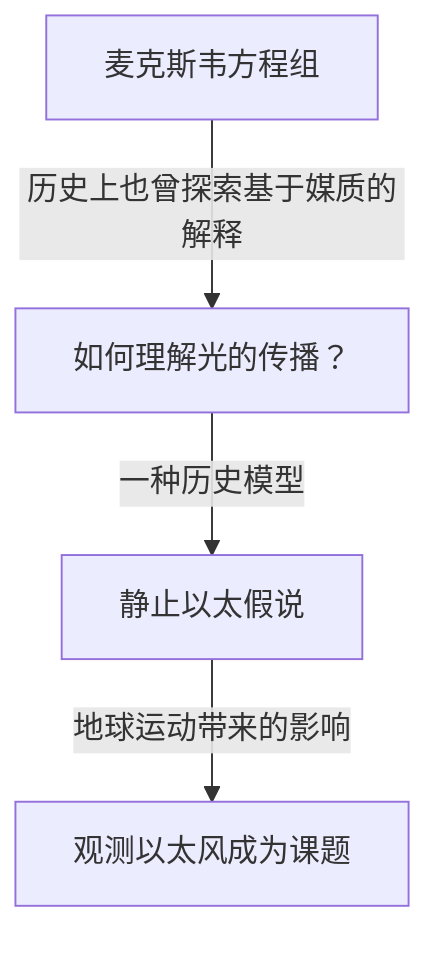

## 1. 导言：被认为充满宇宙的“某种东西”

在人类试图解开自然界奥秘的历史中，“光是如何在空间中传播的？”这个问题吸引了从古希腊哲学家到近代物理学家的众多天才，也让他们大为苦恼。

观察日常的物理现象，声音的传播需要“空气”或“水”等物质，海浪的传播则离不开“海水”这种介质。从这种极其直观且符合逻辑的类推中，产生了一个想法：如果光具有波的性质，那么传递光的“未知介质”一定充满着宇宙空间的每一个角落。这种虚幻的介质，就被称为“发光以太（Luminiferous aether）”。

对19世纪的许多物理学家来说，以太是一种有影响力的解释框架。不过，当时的理论和解释并不统一，人们也持续争论以太的运动及其与物质的相互作用。寻找以太风的实验以及后来的理论发展，促使人们重新审视光的经典媒质，并构成通向相对论的科学史的一部分。本文将梳理这一概念的起源与检验过程，并说明它与现代物理学概念的区别。

## 2. 围绕光本质的争论与以太的诞生

关于光的本质是“粒子”还是“波”的讨论，在17世纪科学革命时代展开了激烈的交锋。

艾萨克·牛顿以光的直线传播和反射定律为依据，提出了“微粒说”，认为光是微小粒子的流动。凭借其压倒性的权威，微粒说在整个18世纪统治了物理学界。但在同时代，克里斯蒂安·惠更斯主张为了解释光的衍射和折射等现象，应该将光视为波（波动），并提出了“波动说”。

19世纪，杨的干涉实验和菲涅耳的理论为将干涉与衍射解释为光的波动行为提供了有力证据。不过，仅凭波动行为并不能在逻辑上证明真空中存在机械媒质。受当时已知波动现象的类比启发，许多理论提出以太是传递光的媒质。

### 以太被要求具备的奇特性质

然而，在假设了以太这种介质之后，物理学家们面临着严重的矛盾。随着偏振现象的发现，人们得知光是横波（振动方向垂直于传播方向的波）。在当时的物理学框架下，只有“固体”才能传递横波。气体和液体只能传递纵波（如声波）。

也就是说，以太必须是遍布整个宇宙的“巨大透明固体”。为了以光速（每秒约30万公里）这种惊人的速度传递波，以太必须比钢铁硬得多，具有极强的弹性。另一方面，当星球和行星绕太阳公转时，似乎没有受到来自以太的任何摩擦阻力，因此以太又必须完全没有摩擦，并且极其稀薄，能让物质毫无阻力地穿过。

“既是比钢铁更硬的固体，又像完美流体一样没有阻力”，以太被迫背负了这种在物理学上无论如何思考都充满矛盾的奇特性质。

## 3. 麦克斯韦电磁学与以太的绝对静止系

19世纪后半叶，詹姆斯·克拉克·麦克斯韦完成了作为电磁学基础的“麦克斯韦方程组”。这个方程组不仅完美地描述了电磁现象，还包含了一个惊人的预言。当计算出电磁波的传播速度时，发现它与当时实验中测量到的“光速”惊人地一致。由此，理论上证明了“光是一种电磁波”。

在麦克斯韦方程组中，光速 $c$ 是作为一个由真空介电常数和磁导率决定的常数推导出来的。这里产生了一个大问题。当说“光速是常数”时，它是“相对于什么”恒定不变的呢？

根据牛顿力学的相对性原理，速度应该总是依赖于观察者的运动状态而改变。从行驶的列车上抛出的球的速度，在地面上的人看来是“列车的速度 + 球的速度”。但是，麦克斯韦方程组中的光速并没有考虑这种观察者的速度。

当时许多理论家研究了将电磁场与某种媒质或优先参考系联系起来的解释，其中包括假定以太静止的模型。但麦克斯韦方程组本身并不能证明机械媒质或绝对静止系的存在。在后来的相对论表述中，真空中的光速在惯性系之间保持不变，因此无需假定一个优先静止系。

## 4. 迈克尔逊-莫雷实验：一个著名的零结果

如果宇宙空间充满了绝对静止的以太，那么绕太阳公转的地球，就一直在以太之海中穿梭。从地球上看，宇宙中应该有“以太风”吹过。

1887年，阿尔伯特·迈克尔逊和爱德华·莫雷为了捕捉这种“以太风”，进行了一项具有划时代意义的实验。他们构建了一种极其精密的称为“迈克尔逊干涉仪”的光学装置。

实验原理如下：从光源发出的一束光通过半透镜（半透明的镜子）被分成正交的两个方向。一束向平行于以太风的方向传播，另一束向垂直的方向传播，然后分别被前方的镜子反射回来。如果存在以太风，就像在河中来回游泳的人会受水流影响一样，光往返的时间应该会产生微小的差异。当返回的两束光重叠时，这个时间差有望作为“干涉条纹”的移动被观测到。

测量并未发现简单静止以太模型所预测幅度的干涉条纹移动。论文给出的预期移动量约为0.4条纹，而报告的残余效应小得多。作者据此认为，地球与以太之间即使存在相对运动，也远低于预期的可探测水平。这并不意味着移动量在字面上恰好为零；更准确地说，这是针对某个特定经典以太风模型的零结果。

该实验的结果之所以称为零结果，是因为它没有探测到预期幅度的以太风信号。这并不表示装置或测量“失败”。它的重要性在于限制了某个特定经典以太模型所预测的信号，并推动了后续理论和实验研究。

## 5. 洛伦兹收缩与特设的解决方案

严肃对待实验结果的物理学家们绞尽脑汁试图拯救以太理论。乔治·斐兹杰惹和亨德里克·洛伦兹提出了一个惊人的假设。

“当物体在以太中运动时，由于以太风的压力，物体本身是否会沿着运动方向发生轻微的收缩呢？”

根据这个“洛伦兹-斐兹杰惹收缩假说”，迈克尔逊-莫雷干涉仪的臂也沿着运动方向精确地缩短了，因此光往返的时间差被抵消，结果就解释了为什么无法检测到以太风。此外，洛伦兹还引入了运动系中时间膨胀（局部时）的概念，完成了被称为“洛伦兹变换”的数学框架。

收缩假说和洛伦兹理论旨在协调当时的电动力学与实验结果。若以后见之明将它们简单归为权宜之计，就会过度简化当时的理论和实验背景。洛伦兹保留了绝对静止以太的设想；不过，同一数学框架后来也成为狭义相对论的核心，而狭义相对论并不要求以太静止系。

## 6. 爱因斯坦与范式转换：狭义相对论

1905年，身为专利局年轻职员的阿尔伯特·爱因斯坦发表了一篇论文，仅从两个简单的原理出发，从根本上解决了这个错综复杂的问题。这就是“狭义相对论”。

爱因斯坦停止了对以太性质的纠结，从一个全新的前提开始：
1. **相对性原理**：在所有惯性系（做匀速直线运动的观察者）中，物理定律的形式完全相同。不存在绝对静止系。
2. **光速不变原理**：真空中光的传播速度，无论光源和观察者的运动状态如何，对所有观察者来说总是恒定的（常数 $c$）。

接受这两个原理，就会得出一个惊人的结论。为了使光速保持不变，必须根据观察者的运动状态，让“空间”收缩，让“时间”变慢。洛伦兹等人认为是“由以太引起的物质收缩”的现象，实际上被证明是时间和空间本身的相对性质。

爱因斯坦于1905年提出的狭义相对论，不再需要假定光有机械媒质或空间存在绝对静止状态来描述电动力学。这并不意味着逻辑上禁止“以太”一词的一切用法。1920年，爱因斯坦在讨论广义相对论中的时空物理性质时，以不同含义使用了这个词；他指的不是具有运动状态的机械光媒质。

## 7. 现代物理学中的“真空”：以太的幽灵

虽然以太作为一个多余的概念被抛弃了，但“一无所有的空间（真空）”是真的“空无一物”的想法，也被现代物理学所否定。

在量子场论中，真空被描述为场的最低能量状态，而场具有量子涨落。说粒子和反粒子不断产生并湮灭，可能会让人误以为真空真的是一个粒子持续出现又消失的海洋。电磁场、希格斯场等场，以及把粒子描述为场的激发态的观点，都不同于经典机械以太。

此外，在广义相对论中，爱因斯坦将时空本身描述为会被引力弯曲的动态实体。爱因斯坦自己也在晚年说过，在时空本身具有物理性质的意义上，“也可以称其为新意义上的以太”（但这与19世纪作为绝对静止介质的以太完全不同）。

把暗物质或暗能量称为传递光的以太的现代版本并不准确。暗物质主要根据其引力效应推断，通常描述为不发射、吸收或反射光的物质。暗能量是对导致宇宙加速膨胀的未知因素所用的名称。二者都不是作为光的传播媒质提出的，物理含义也不同。

## 8. 结论：科学史给我们的启示

发光以太的故事，是展示科学如何进步的一个极其美丽的真实例子。

现代狭义相对论不需要以经典发光以太作为光的传播媒质。受这一假说启发的研究推动了精密实验和理论工作，成为通向相对论的科学史的一部分。迈克尔逊-莫雷实验本身并未否定“以太”一词所有可能的含义，也不是单独促成相对论的原因。

科学中的失败和错误前提，绝不是没有用的。它们是照亮未知领域不可或缺的垫脚石。发光以太这种虚幻的介质虽然从物理学中消失了，但在探索过程中人类获得的关于“时空真实面貌”的见解，至今仍支撑着我们对宇宙的理解。
