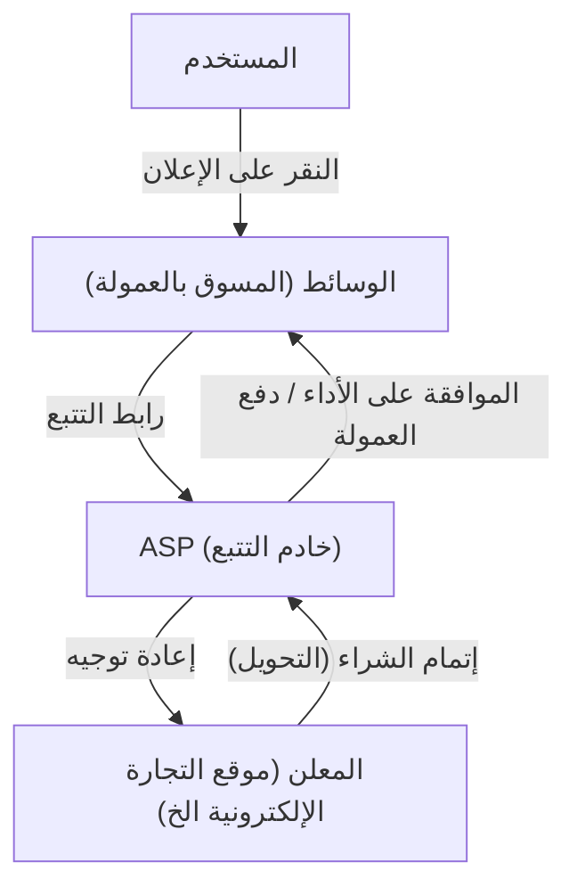
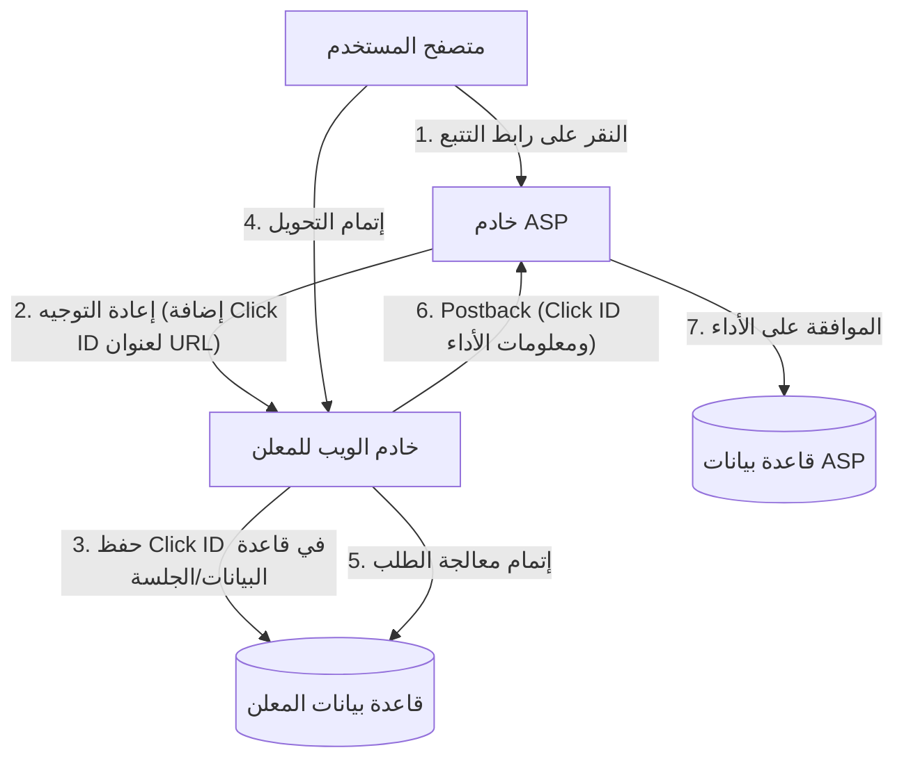

# آلية التسويق بالعمولة: الجانب التقني للتتبع والتحويل

في سوق الإعلانات على الإنترنت، يُعد التسويق بالعمولة أحد نماذج الإعلانات القائمة على الأداء. وغالبًا ما ترتبط العمولة بحدث متفق عليه، مثل البيع أو اكتساب عميل محتمل، لكن شروط الدفع تختلف بحسب البرنامج والعقد.

ومع ذلك، وخلف الكواليس، تعمل تقنيات تتبع متقدمة ومعقدة لتتبع سلوك المستخدم بدقة وتحديد أي وسائط (مسوق بالعمولة) أدت إحالتها إلى تحقيق الأداء.

في هذه المقالة، سنشرح بشكل شامل الجانب التقني للتسويق بالعمولة، بدءاً من دور شبكات التسويق بالعمولة (ASP - Affiliate Service Provider) التي تشكل جوهر نظام التسويق بالعمولة، مروراً بآلية عناوين URL الخاصة بالتتبع باستخدام إعادة التوجيه، وتقنيات التتبع من جانب العميل باستخدام ملفات تعريف الارتباط (Cookie) و التخزين المحلي (LocalStorage)، وصولاً إلى التتبع من جانب الخادم (S2S) كإجراء مضاد لميزة منع التتبع الذكي (ITP - Intelligent Tracking Prevention) التي حظيت باهتمام كبير في السنوات الأخيرة.

## 1. الصورة الشاملة لنظام التسويق بالعمولة البيئي

يتكون التسويق بالعمولة بشكل أساسي من أصحاب المصلحة الأربعة التاليين:

1. **المستخدم (المستهلك)**: يتصفح الوسائط، وينقر على الإعلانات، ويشتري المنتجات أو يشترك فيها.
2. **الوسائط (المسوق بالعمولة/الناشر)**: يعرّف بالمنتجات على موقعه الإلكتروني أو وسائل التواصل الاجتماعي الخاصة به، ويخلق حركة مرور (ترافيك).
3. **مزود خدمة التسويق بالعمولة (ASP)**: منصة تعمل كوسيط بين المعلنين والوسائط، وتقوم بإدارة التتبع، وقياس الأداء، ودفع العمولات.
4. **المعلن (التاجر)**: يقدم المنتجات أو الخدمات ويدفع تكاليف الإعلانات لـ ASP.

في هذا النظام البيئي، يعد ASP المحور التقني الأهم.

يعمل ASP كبنية بيانات تسجل معرّفات النقرات ومعلومات الأداء لمطابقة النقرات القادمة من الإعلانات بالنتائج اللاحقة. وتختلف دقة الطوابع الزمنية ومستوى التفاصيل وطريقة إسناد الأداء بحسب تنفيذ ASP والمعلن وشروط البرنامج.

## 2. الآلية الأساسية للتتبع (من جانب العميل)

تاريخياً، اعتمد التتبع في التسويق بالعمولة بشكل كبير على تقنيات جانب العميل (المتصفح). هنا، سنقوم بتفكيك وشرح تدفق التتبع القياسي التقليدي.

### 2.1. رابط التتبع وإعادة التوجيه

غالبًا ما تمر الروابط التي ينشرها المسوقون بالعمولة عبر عنوان تتبع URL تابع لـ ASP قبل الانتقال إلى موقع المعلن. لكن بعض الأنظمة تستخدم انتقالًا مباشرًا أو قياسًا من جانب الخادم، لذلك لا تتطلب كل التطبيقات إعادة توجيه عبر ASP.

مثال: `https://click.example-asp.com/track?aff_id=12345&campaign_id=67890`

عندما ينقر المستخدم على هذا الرابط، تحدث العملية التالية:

1. **تسجيل النقر**: يسجل ASP، وفقًا للتنفيذ والقواعد المنطبقة، وقت النقر ومعرّف الإعلان والمعلومات اللازمة للقياس. وإذا عالج عنوان IP أو User-Agent، فينبغي إدارة الغرض من الاستخدام والحاجة ومدة الاحتفاظ وضوابط الوصول بعناية.
2. **إنشاء معرف النقر**: يتم إنشاء "معرف النقر (Click ID)" لتعريف حدث النقر هذا بشكل فريد.
3. **تمرير المعرّف**: في بعض التطبيقات التقليدية، كان ASP يحفظ معرّف النقر في ملف تعريف ارتباط تابع لنطاقه. لكن هذه الطريقة لا تعمل في البيئات التي لا تسمح بملفات تعريف ارتباط الطرف الثالث. وتوجد طرق أخرى، مثل تمرير معرّف النقر إلى نطاق المعلن وحفظه ضمن الطرف الأول في الحدود المسموح بها.
4. **إعادة التوجيه**: للانتقال المؤقت تُستخدم عادةً استجابات مثل [HTTP 302](/ar/p/history-of-http/) (Found) أو 307 (Temporary Redirect) لنقل المستخدم إلى الصفحة المقصودة (LP) للمعلن. أما 301 (Moved Permanently) فيشير إلى انتقال دائم وقد يُخزّن مؤقتًا، لذا لا يناسب عادةً إعادة التوجيه المؤقتة المستخدمة لتسجيل النقرات. وقد يُضاف معرّف النقر إلى عنوان URL الوجهة.

### 2.2. دور Cookie و LocalStorage

يتجول المستخدم الذي وصل إلى موقع المعلن داخل الموقع، ويصل في النهاية إلى "التحويل (CV - Conversion)" مثل شراء منتج أو التسجيل كعضو.

في أحد تطبيقات التتبع التقليدية من جانب العميل، تُضمّن صفحة إتمام التحويل (صفحة الشكر) شفرة JavaScript أو علامة صورة يوفرها ASP وتسمى "علامة التحويل (CV tag)". ويعتمد ربط النقرة بالنتيجة على إمكان وصول المتصفح إلى المعرّف المحفوظ وعلى السماح باتصال العلامة.

عند تحميل علامة التحويل، تتم المعالجة التالية:

- **الحصول على المعرّف**: في التطبيقات التي تسمح بها إعدادات المتصفح والقواعد المعمول بها، يمكن الحصول على معرّف محفوظ ضمن نطاق الطرف الأول للمعلن أو من عنوان URL الوجهة. ولا يمكن افتراض أن المتصفح يستطيع قراءة ملف تعريف ارتباط تابع لطرف ثالث لدى ASP مباشرةً.
- **إرسال الأداء**: يُرسل معرّف النقر المتاح ومعلومات النتيجة (مثل مبلغ الشراء ورقم الطلب) إلى خادم ASP، وفقًا للعقد والموافقة والقواعد المنطبقة.

يمكن لبعض التطبيقات استخدام `LocalStorage` أو `SessionStorage` لحفظ حالة القياس ضمن موقع المعلن، بما يتوافق مع الموافقة والقواعد المنطبقة. لكن هذه المخازن مرتبطة بنطاق الموقع وتتأثر بميزات منع التتبع وإعدادات المستخدم والحذف اليدوي؛ ولا ينبغي اعتبارها نسخة احتياطية مضمونة أو معرّفًا دائمًا.

## 3. موجة حماية الخصوصية: تأثير ITP

يسهل تنفيذ التتبع من جانب العميل، لكن ملفات تعريف ارتباط الطرف الثالث وغيرها من التقنيات قد تتيح تتبع نشاط المستخدم بين مواقع متعددة، وهو ما أثار مخاوف تتعلق بالخصوصية.

مع تزايد [المخاوف بشأن الخصوصية](/ar/p/privacy-vs-convenience-big-data/) المتعلقة بجمع سجل سلوك المستخدمين عبر مواقع متعددة دون علمهم، بدأت شركات تطوير المتصفحات في فرض قيود صارمة على التتبع، بدءاً من **ITP (منع التتبع الذكي - Intelligent Tracking Prevention)** المدمج في متصفح Safari من Apple.

### تأثير ITP على التسويق بالعمولة

يقيّد ITP في WebKit ملفات تعريف الارتباط ومخازن البيانات التي قد تُستخدم للتتبع عبر المواقع في Safari. ويختلف الأثر بحسب إصدار المتصفح وسياق الاستخدام وطريقة الانتقال وكيفية إعداد التخزين. ومن أمثلته:

1. **ملفات تعريف ارتباط الطرف الثالث**: يحظر WebKit افتراضيًا ملفات تعريف ارتباط الطرف الثالث ضمن ITP. لذلك لا يمكن افتراض أن المتصفح في إعدادات Safari الافتراضية يستطيع قراءة ملف ASP الخاص بالطرف الثالث كما في بعض التطبيقات القديمة.
2. **ملفات تعريف الارتباط ومخازن البيانات التي تكتبها JavaScript**: في ظروف محددة، مثل الانتقال من نطاق مصنّف على أنه يتتبع المستخدم عبر المواقع إلى صفحة تحمل معلمات أو جزءًا من عنوان URL، قد يحد ITP صلاحية ملفات الارتباط التي تنشئها JavaScript في الصفحة المقصودة إلى 24 ساعة. كما قد تصبح ملفات الارتباط التي تكتبها JavaScript وبيانات مثل LocalStorage عرضة للحذف بعد فترة من عدم تفاعل المستخدم مع الموقع. ليست هذه قاعدة موحّدة تفرض حدًا قدره 24 ساعة أو 7 أيام على كل ملفات الارتباط.
3. **مخازن الطرف الثالث**: قد تُجزّأ مخازن مثل LocalStorage التابعة لطرف ثالث بحسب الموقع، أو تكون مؤقتة. وينبغي التحقق من سلوك إصدار WebKit الحالي وإعدادات المستخدم.

قد تجعل هذه القيود ربط بعض النتائج التي تحدث بعد فترة من النقر أصعب بالطرق القديمة. لكن الأثر وإمكانية القياس يختلفان بحسب التطبيق، ولا يمكن تعميم أثر محدد على العمولات أو عائد الاستثمار.

## 4. صعود التتبع من جانب الخادم (S2S) وإعادة الإرسال (Postback)

من الأساليب التي تنقل بعض معالجة القياس إلى الخادم **التتبع بين الخوادم (Server-to-Server / S2S)**، ويُشار إليه أيضًا باسم **طريقة إعادة الإرسال (Postback)**. يمكن لهذا الأسلوب تقليل بعض العلامات أو الاتصالات المباشرة من المتصفح، لكنه لا يتجاوز قيود ITP أو متطلبات الموافقة.

### بنية تتبع S2S

في تتبع S2S، لا يتم الاعتماد على ملفات تعريف ارتباط المتصفح أو علامات JavaScript، بل يتواصل خادم المعلن وخادم ASP بشكل مباشر (عبر واجهة برمجة التطبيقات API).

1. **النقر وإعادة التوجيه**: كما كان من قبل، ينقر المستخدم على رابط ASP. ينشئ ASP `Click ID` فريداً ويمرره إلى موقع المعلن كمعلمة عنوان URL عند إعادة التوجيه (مثال: `https://shop.example.com/?click_id=abcde12345`).
2. **الحفظ من جانب الخادم**: يستخرج خادم المعلن `click_id` من طلب مسموح به، ويحفظه عند الحاجة في جلسة أو قاعدة بيانات. ويمكن أيضًا إعداد ملف تعريف ارتباط من نطاق الطرف الأول عبر استجابة HTTP، لكن يجب مراعاة منع التتبع في المتصفح وخصائص ملف الارتباط وعمره وإعدادات المستخدم والموافقة والقواعد المنطبقة. لا يؤدي نقل المعالجة إلى الخادم وحده إلى إلغاء قيود ITP.
3. **إعادة الإرسال (Postback) عند التحويل**: في اللحظة التي يكمل فيها المستخدم عملية الشراء وتتأكد معالجة الطلب على خادم المعلن، يتم إرسال طلب HTTP (GET أو POST) مباشرة من خادم المعلن إلى نقطة النهاية (Postback URL) المحددة من قبل ASP.

### مزايا تتبع S2S

- **التحكم في مسار البيانات**: يمكن التحقق من البيانات أو تعديلها أو حذفها على الخادم قبل إرسالها إلى الشركاء. لكن ذلك لا يلغي الحاجة إلى الموافقة المناسبة وتقليل البيانات.
- **تقليل العمل في المتصفح في بعض البنى**: يمكن تقليل عدد العلامات التي تتصل مباشرةً من صفحة المستخدم بخوادم الجهات الخارجية.
- **إدارة الفقد والتكرار**: قد تفشل الاتصالات بين الخوادم أو تُعاد، وقد تتكرر الأحداث. لذا تلزم آليات إعادة المحاولة ومنع التكرار وتسجيل الأحداث.

### تحديات تتبع S2S

من التحديات عبء التنفيذ والتشغيل التقني. فمقارنةً بإضافة علامة JavaScript إلى HTML، قد يحتاج المعلن إلى استقبال المعلمات وتخزينها والتحقق منها، وإدارة المصادقة وإعادة المحاولة ومنع التكرار والمراقبة، مما قد يرفع التكلفة على الجهات الصغيرة. كما قد تظل بعض التطبيقات بحاجة إلى أحداث من متصفح المستخدم أو تطبيقه، فلا يضمن S2S وحده اكتمال القياس.

لذلك، تقوم منصات ASP في السنوات الأخيرة بجهود لخفض عوائق تنفيذ تتبع S2S من خلال توفير إضافات (Plugins) للمنصات الرئيسية مثل Shopify و WordPress.

## 5. تقنيات التتبع للجيل القادم

بالإضافة إلى تتبع S2S، يستمر التطور في النظام البيئي بأكمله.

### 5.1. البصمة الرقمية (Fingerprinting - التحديد البديل)
البصمة الرقمية أسلوب يحاول استخدام مجموعة من خصائص المتصفح والجهاز للتعرّف على المستخدم أو تتبعه. ولا تضمن هذه الخصائص تحديدًا ثابتًا وفريدًا، كما ينطوي هذا الأسلوب على مخاطر خصوصية وتواجهه تدابير من المتصفحات وسياسات المنصات والقواعد المعمول بها. لذلك لا ينبغي استخدامه بديلًا تلقائيًا لملفات تعريف الارتباط.

### 5.2. غرف البيانات النظيفة (Data Clean Rooms) و Google Tag Manager من جانب الخادم
تتيح غرف البيانات النظيفة وحاويات Google Tag Manager (GTM) من جانب الخادم خيارات لإدارة معالجة البيانات وإرسالها. لكن استخدامها وحده لا يضمن إخفاء الهوية أو الامتثال للقواعد أو حماية الخصوصية. يجب تحديد الغرض والموافقة والصلاحيات وتقليل البيانات وضوابط الوصول والمخرجات قبل إجراء التحليل المسموح به.

## الخلاصة

وراء كواليس التسويق بالعمولة، تتصادم التطورات التقنية مع موجة حماية الخصوصية بشدة، وتخضع آليات التتبع لتغييرات جذرية.

لكل من التتبع من جانب العميل ومن جانب الخادم أدوار وقيود مختلفة. ينبغي للمعلنين والمسوقين بالعمولة وASP توضيح غرض القياس وحدوده، واختيار البنية مع مراعاة القواعد المعمول بها وسياسات المنصات وحالة الموافقة وتقليل البيانات والأمن. لا يضمن S2S الدقة أو الخصوصية تلقائيًا؛ فهو يتطلب تصميمًا وتشغيلًا مناسبين.

سيصبح فهم بنية أنظمة إعلانات الدفع مقابل الأداء أكثر أهمية من أي وقت مضى للمهندسين والمسوقين العاملين في التسويق عبر الويب.

## مراجع تقنية

- [WebKit: Tracking Prevention in WebKit](https://webkit.org/tracking-prevention/)
- [WebKit: Intelligent Tracking Prevention 2.2](https://webkit.org/blog/8828/)
- [Google for Developers: Server-side tagging fundamentals](https://developers.google.com/tag-platform/learn/sst-fundamentals/2-what-is-sst)
- [IETF RFC 9110: HTTP Semantics, Redirection](https://www.rfc-editor.org/rfc/rfc9110.html)
- [WebKit: Tracking Prevention Policy](https://webkit.org/tracking-prevention-policy/)
