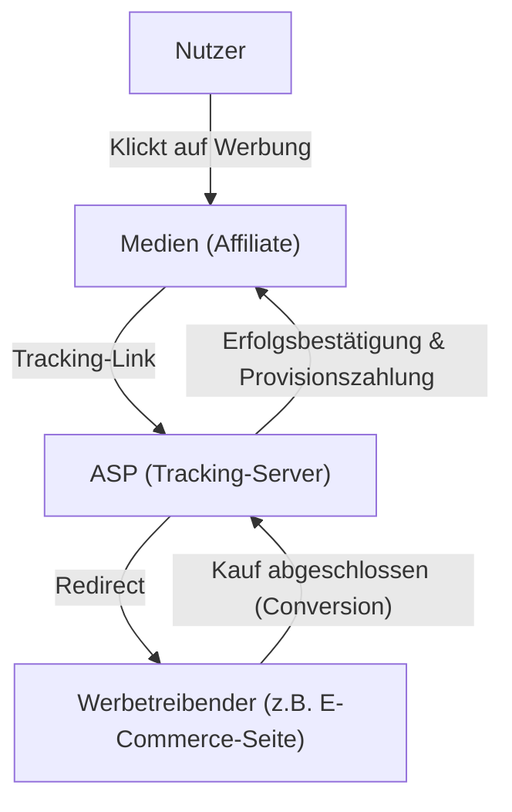
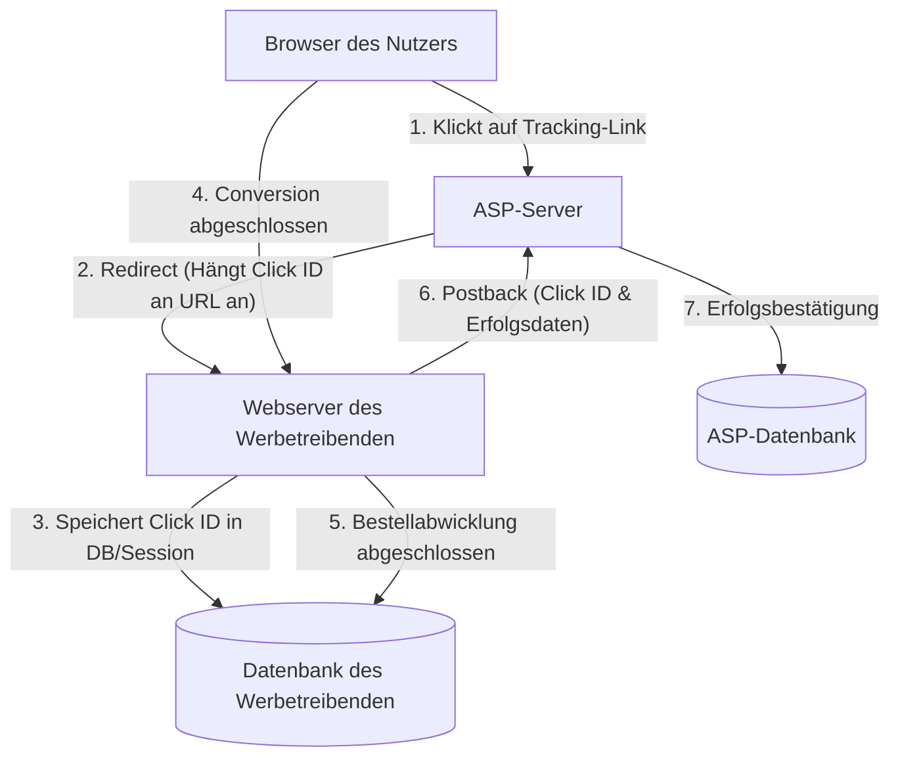

# So funktioniert Affiliate-Marketing: Die technische Seite von Tracking und Conversion

Im Internet-Werbemarkt spielt erfolgsbasierte Werbung (Affiliate-Marketing) eine äußerst wichtige Rolle. Da Werbetreibende (Merchants) nur für tatsächliche "Erfolge" wie Verkäufe oder Lead-Generierung eine Vergütung zahlen, ist dies weithin als kosteneffiziente Marketingmethode anerkannt.

Hinter den Kulissen arbeiten jedoch hochentwickelte und komplexe Tracking-Technologien, um das Nutzerverhalten genau zu verfolgen und zu bestimmen, über welche Medien (Affiliates) die Conversion erzielt wurde.

Dieser Artikel erklärt die technische Seite des Affiliate-Marketings: die Rolle des ASP (Affiliate Service Provider), Tracking-URLs mit Weiterleitungen, clientseitige Technologien wie Cookies und LocalStorage sowie Server-to-Server-Tracking (S2S). S2S verlagert einen Teil der Messung auf Server; es umgeht weder Browserbeschränkungen noch Einwilligungspflichten.

## 1. Das Gesamtbild des Affiliate-Ökosystems

Das Affiliate-Marketing besteht hauptsächlich aus den folgenden vier Stakeholdern:

1. **Nutzer (Konsumenten)**: Betrachten Medien, klicken auf Werbung und kaufen/bestellen Produkte.
2. **Medien (Affiliates/Publisher)**: Stellen Produkte auf ihren eigenen Websites oder in sozialen Netzwerken vor und generieren Traffic.
3. **ASP (Affiliate Service Provider)**: Eine Plattform, die als Vermittler zwischen Werbetreibenden und Medien fungiert und Tracking, Leistungsmessung sowie die Verwaltung von Provisionszahlungen übernimmt.
4. **Werbetreibende (Merchants)**: Bieten Produkte oder Dienstleistungen an und zahlen Werbegebühren an den ASP.

In diesem Ökosystem ist der ASP der wichtigste technische Knotenpunkt.

Der ASP kann als Datenknoten dienen, der erfasst und abgleicht, welcher Werbeklick zu einer gemeldeten Conversion geführt hat. Detailgrad, Zeitgenauigkeit und Attributionsregeln hängen von der Implementierung und den Vertragsbedingungen des jeweiligen Anbieters und Werbetreibenden ab.

## 2. Grundlegender Mechanismus des Trackings (Clientseitig)

Das Tracking im Affiliate-Marketing war historisch stark auf clientseitige (Browser-)Technologien angewiesen. Hier zerlegen und erklären wir den herkömmlichen Standard-Tracking-Flow.

### 2.1. Tracking-URL und Redirect

Viele Affiliate-Links verwenden eine Tracking-URL des ASP, bevor sie Besucher zur Website des Werbetreibenden weiterleiten. Andere Modelle messen Empfehlungen direkt oder serverseitig beim Werbetreibenden; eine Weiterleitung über einen ASP ist daher nicht immer erforderlich.

Beispiel: `https://click.example-asp.com/track?aff_id=12345&campaign_id=67890`

Wenn ein Nutzer auf diesen Link klickt, läuft folgender Prozess ab:

1. **Klick-Aufzeichnung**: Je nach Implementierung und geltenden Regeln erfasst der ASP die für die Messung erforderlichen Zeit- und Anzeigenkennungen. Werden IP-Adresse oder User-Agent verarbeitet, sind Zweck, Erforderlichkeit, Aufbewahrungsdauer und Zugriffskontrollen festzulegen.
2. **Generierung der Click ID**: Zur eindeutigen Identifizierung dieses Klick-Ereignisses wird eine "Click ID" generiert.
3. **Übergabe der Kennung**: Einige ältere Modelle speicherten die Click ID in einem ASP-Cookie. Das funktioniert nicht verlässlich, wenn Drittanbieter-Cookies blockiert sind. Andere Modelle übergeben die Kennung an die Domain des Werbetreibenden und speichern sie, sofern zulässig, in einem First-Party-Kontext.
4. **Weiterleitung**: Für vorübergehende Navigation werden üblicherweise [HTTP 302](/de/p/history-of-http/) (Found) oder 307 (Temporary Redirect) verwendet. 301 (Moved Permanently) bezeichnet einen dauerhaften Umzug und kann zwischengespeichert werden; für gewöhnliche Klickmessung ist sie daher meist ungeeignet. Manche Modelle ergänzen die Ziel-URL um die Click ID.

### 2.2. Die Rolle von Cookie und LocalStorage

Nachdem der Nutzer die Seite des Werbetreibenden erreicht hat, surft er auf der Seite und führt schließlich eine "Conversion (CV)" wie den Kauf eines Produkts oder die Registrierung als Mitglied durch.

Ein herkömmliches clientseitiges Modell bindet auf der Abschlussseite (Dankesseite) ein JavaScript- oder Bild-Tag des ASP ein, das sogenannte Conversion-Tag (CV-Tag). Ob sich Klick und Conversion damit verbinden lassen, hängt davon ab, ob der Browser die Kennung bereitstellt und die Tag-Anfrage zulässt.

Wenn das Conversion-Tag geladen wird, erfolgt folgende Verarbeitung:

- **Auslesen der Kennung**: Soweit die Implementierung dies zulässt, wird eine im First-Party-Bereich des Werbetreibenden gespeicherte Kennung oder eine Click ID aus der Ziel-URL ausgelesen. Ein direkter Zugriff auf ein ASP-Drittanbieter-Cookie kann nicht vorausgesetzt werden.
- **Übermittlung des Erfolgs**: Eine verfügbare Click ID und Conversion-Daten (etwa Kaufbetrag oder Bestellnummer) werden gemäß Vertrag, Einwilligung und geltenden Regeln an den ASP übermittelt.

Sofern Einwilligung und geltende Regeln dies erlauben, kann der Werbetreibende Messdaten auch in `LocalStorage` oder `SessionStorage` ablegen. Diese Speicher sind an eine Website gebunden und unterliegen Browser-Datenschutzfunktionen sowie den Einstellungen und Löschungen des Nutzers; sie sind weder ein garantiertes Cookie-Backup noch dauerhafte Kennungen.

## 3. Die Welle des Datenschutzes: Der Schock durch ITP

Clientseitiges Tracking ist zwar einfach zu implementieren, birgt jedoch ein großes Problem: das "übermäßige Tracking von Nutzern durch Third-Party-Cookies".

Aufgrund wachsender [Datenschutzbedenken](/de/p/privacy-vs-convenience-big-data/) hinsichtlich der Sammlung von Browserverläufen über mehrere Websites hinweg ohne Wissen der Nutzer, begannen Browserhersteller starke Tracking-Beschränkungen einzuführen, allen voran **ITP (Intelligent Tracking Prevention)** im Safari-Browser von Apple.

### Die Auswirkungen von ITP auf das Affiliate-Marketing

WebKits ITP schränkt in Safari Cookies und Speicher ein, die für Cross-Site-Tracking genutzt werden könnten. Die Auswirkungen hängen von Browser-Version, Nutzung, Navigationsweg und Speicherung ab. Beispiele:

1. **Drittanbieter-Cookies**: WebKit blockiert Drittanbieter-Cookies mit ITP standardmäßig. Herkömmliche Messung, die ein ASP-Cookie direkt im Browser ausliest, kann daher bei Safaris Standardeinstellungen nicht vorausgesetzt werden.
2. **Per JavaScript gesetzte Cookies und Speicher**: Bei bestimmten als Tracking eingestuften Links kann ITP die Laufzeit von JavaScript-Cookies auf der Zielseite auf 24 Stunden begrenzen. Per Skript beschreibbare Cookies und Daten wie LocalStorage können außerdem nach längerer Zeit ohne Nutzerinteraktion zur Löschung vorgesehen werden. Dies ist keine allgemeine 24-Stunden-/7-Tage-Regel für alle Cookies.
3. **Drittanbieter-Speicher**: Drittanbieter-LocalStorage und ähnliche Speicher können nach Website getrennt oder nur vorübergehend verfügbar sein. Für den konkreten Fall sind aktuelle WebKit-Angaben und Nutzereinstellungen maßgeblich.

Diese Einschränkungen können es erschweren, in manchen herkömmlichen Modellen einen Klick mit einer späteren Conversion zu verbinden. Auswirkungen auf Messung, Provisionen oder ROI unterscheiden sich je nach Implementierung und lassen sich nicht pauschal beziffern.

## 4. Serverseitiges Tracking (S2S) und der Aufstieg von Postback

Ein Ansatz ist **Server-to-Server-Tracking (S2S)**, auch **Postback-Methode** genannt, bei dem der Server des Werbetreibenden Conversion-Daten an den ASP sendet. Damit wird ein Teil der Messung auf einen Server verlagert; Browserbeschränkungen oder Einwilligungspflichten entfallen dadurch nicht.

### S2S-Tracking-Architektur

Beim S2S-Tracking kommunizieren der Server des Werbetreibenden und der Server des ASPs direkt (über eine API), ohne auf Browser-Cookies oder JavaScript-Tags angewiesen zu sein.

1. **Klick und Redirect**: Wie bisher klickt der Nutzer auf den Link des ASPs. Der ASP generiert eine eindeutige `Click ID` und übergibt sie beim Redirect als URL-Parameter an die Seite des Werbetreibenden (Beispiel: `https://shop.example.com/?click_id=abcde12345`).
2. **Serverseitige Speicherung**: Der Webserver liest `click_id` aus einer zulässigen Anfrage und speichert sie bei Bedarf in einer Sitzung oder Datenbank. Er kann für die eigene Domain auch per HTTP-Antwort ein Cookie setzen, unterliegt dabei jedoch Browser-Tracking-Schutz, Cookie-Attributen und -Laufzeit, Nutzereinstellungen, Einwilligung und geltenden Regeln. Serververarbeitung hebt ITP nicht auf.
3. **Postback bei Conversion**: Zu dem Zeitpunkt, an dem der Nutzer den Kauf abschließt und die Bestellverarbeitung auf dem Server des Werbetreibenden bestätigt wird, sendet der Server des Werbetreibenden direkt eine HTTP-Anfrage (GET oder POST) an den angegebenen Endpunkt (Postback URL) des ASPs.

### Vorteile des S2S-Trackings

- **Kontrolle des Datenflusses**: Felder können vor der Weitergabe geprüft, verändert oder entfernt werden. Angemessene Einwilligung und Datenminimierung bleiben erforderlich.
- **Weniger Browser-Verarbeitung möglich**: Manche Konfigurationen reduzieren Drittanbieter-Tags und direkte Anbieteranfragen auf einer Seite.
- **Steuerung von Wiederholungen und Duplikaten**: Auch Serveranfragen können scheitern, wiederholt oder doppelt verarbeitet werden. Wiederholungen, Deduplizierung, Ereignis-IDs und Überwachung müssen eingeplant werden.

### Herausforderungen des S2S-Trackings

Zu den Herausforderungen gehören Einführung und Betrieb. Der Werbetreibende muss möglicherweise Parameter entgegennehmen und speichern, Anfragen authentifizieren, Ereignisse wiederholen und deduplizieren sowie die Zustellung überwachen. Das kann kleine Unternehmen mehr kosten. Manche Ereignisse müssen weiterhin aus Browser oder App stammen; S2S allein deckt daher nicht zwingend den ganzen Messablauf ab.

Daher haben ASPs in den letzten Jahren Initiativen ergriffen, um die Hürden für die Einführung von S2S-Tracking zu senken, indem sie Plugins für wichtige Plattformen wie Shopify und WordPress anbieten.

## 5. Tracking-Technologien der nächsten Generation

Zusätzlich zum S2S-Tracking entwickelt sich das gesamte Ökosystem weiter.

### 5.1. Fingerprinting (Alternative Identifikation)
Fingerprinting kombiniert Merkmale eines Browsers oder Geräts, um es zu identifizieren oder zu verfolgen. Eine eindeutige oder verlässliche Identifizierung einer Person ist nicht garantiert. Die Methode birgt Datenschutzrisiken und kann Browser-Schutzmaßnahmen, Gesetzen und Plattformrichtlinien unterliegen; sie sollte nicht leichtfertig Cookies ersetzen.

### 5.2. Data Clean Rooms und Server-Side GTM
Data Clean Rooms und serverseitige Container von Google Tag Manager (GTM) sind Möglichkeiten, Datenverarbeitung und -weitergabe zu steuern. Ihre Nutzung anonymisiert Daten nicht automatisch und garantiert weder Rechtskonformität noch Datenschutz. Zweck, Einwilligung und Berechtigungen, Datenminimierung, Zugriffskontrollen und Ausgabebegrenzungen müssen entworfen und geprüft werden.

## Zusammenfassung

Hinter den Kulissen des Affiliate-Marketings prallen der technologische Fortschritt und die Welle des Datenschutzes heftig aufeinander, was zu tiefgreifenden Veränderungen bei den Tracking-Mechanismen führt.

Client- und serverseitige Verfahren haben unterschiedliche Aufgaben und Grenzen. Werbetreibende, Affiliates und ASPs sollten Zweck und Grenzen der Messung festlegen und geltende Gesetze und Plattformregeln, Einwilligung und Nutzerentscheidungen, Datenminimierung und Sicherheit berücksichtigen. S2S garantiert weder Genauigkeit noch Datenschutz automatisch; erforderlich sind sorgfältige Gestaltung und Betrieb.

Das Verständnis der Systemarchitektur erfolgsbasierter Werbung wird für alle Ingenieure und Vermarkter im Webmarketing-Bereich in Zukunft immer wichtiger werden.

## Quellen

- [WebKit: Tracking Prevention in WebKit](https://webkit.org/tracking-prevention/)
- [WebKit: Intelligent Tracking Prevention 2.2](https://webkit.org/blog/8828/)
- [Google for Developers: Server-side tagging fundamentals](https://developers.google.com/tag-platform/learn/sst-fundamentals/2-what-is-sst)
- [IETF RFC 9110: HTTP Semantics, Redirection](https://www.rfc-editor.org/rfc/rfc9110.html)
- [WebKit: Tracking Prevention Policy](https://webkit.org/tracking-prevention-policy/)
