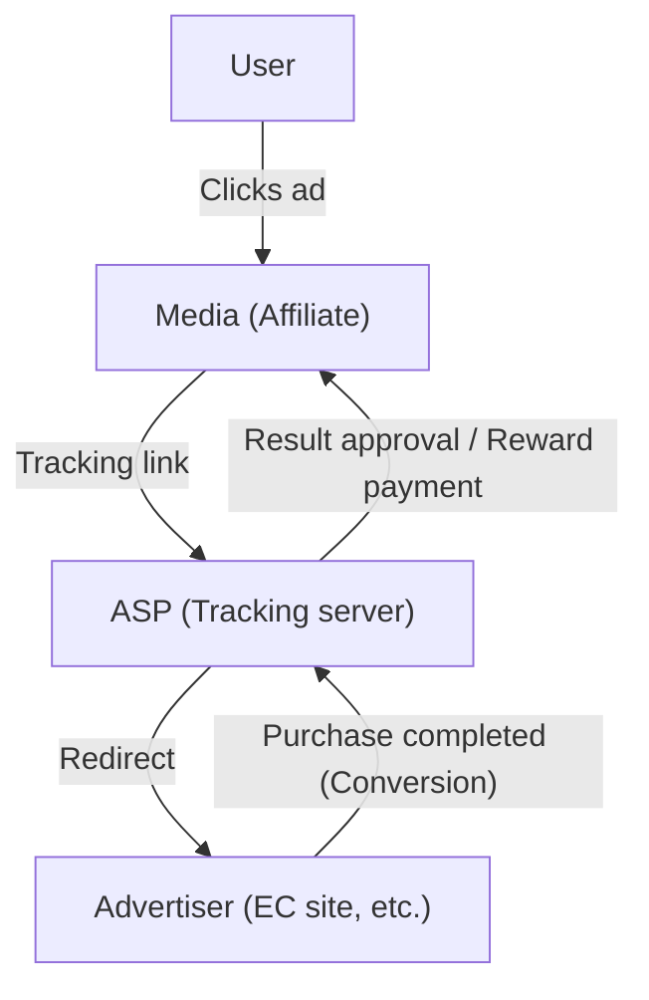
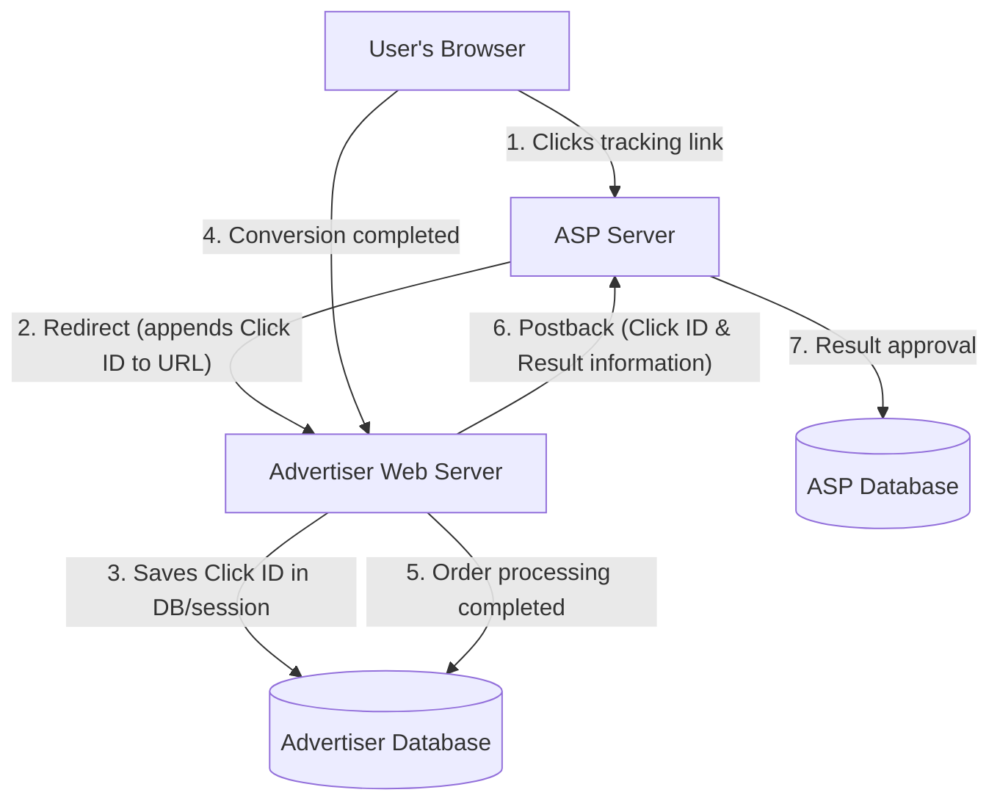

# The Mechanism of Affiliate Marketing: The Technical Backend of Tracking and Conversion

Performance-based advertising (affiliate marketing) plays an extremely important role in the internet advertising market. Because advertisers (merchants) only pay remuneration for "results" such as actual sales or lead generation, it is widely recognized as a highly cost-effective marketing method.

However, behind the scenes, highly sophisticated and complex tracking technologies are running to accurately track user behavior and determine which media (affiliate) referral generated the result.

This article explains the technical backend of affiliate marketing: the role of an ASP (Affiliate Service Provider), redirect-based tracking URLs, client-side technologies such as cookies and LocalStorage, and server-to-server (S2S) tracking. S2S moves part of the measurement process to servers; it does not bypass browser restrictions or consent requirements.

## 1. The Overall Picture of the Affiliate Ecosystem

The affiliate marketing ecosystem consists primarily of the following four stakeholders:

1. **Users (Consumers)**: Browse media and click on ads to purchase or sign up for products.
2. **Media (Affiliates/Publishers)**: Introduce products on their own websites and SNS to generate traffic.
3. **ASP (Affiliate Service Provider)**: A platform that mediates between advertisers and media, managing tracking, performance measurement, and reward payments.
4. **Advertisers (Merchants)**: Provide products and services, and pay advertising fees to ASPs.

In this ecosystem, the ASP serves as the central technical hub.

The ASP can act as a data hub that records and reconciles which advertising click led to a reported conversion. The granularity, timing precision, and attribution rules depend on each provider's and advertiser's implementation and contractual terms.

## 2. Basic Mechanism of Tracking (Client-Side)

Affiliate tracking has historically relied heavily on client-side (browser) technology. Here, we break down and explain the traditional standard tracking flow.

### 2.1. Tracking URLs and Redirects

Many affiliate links use an ASP tracking URL before sending the visitor to the advertiser. Other arrangements measure referrals directly or on the advertiser's server, so an ASP redirect is not required in every implementation.

Example: `https://click.example-asp.com/track?aff_id=12345&campaign_id=67890`

When a user clicks this link, the following process occurs:

1. **Recording the Click**: Depending on the implementation and applicable rules, the ASP records the time and advertising identifiers needed for measurement. If it handles IP addresses or User-Agent values, it should govern them with a defined purpose, necessity, retention period, and access controls.
2. **Generating a Click ID**: A "Click ID" is generated to uniquely identify this click event.
3. **Passing the Identifier**: Some legacy setups stored the Click ID in an ASP cookie. This cannot be assumed to work where third-party cookies are blocked. Other setups pass the Click ID to the advertiser's domain and, where permitted, store it in a first-party context.
4. **Redirect**: Temporary navigation commonly uses [HTTP 302](/en/p/history-of-http/) (Found) or 307 (Temporary Redirect). A 301 (Moved Permanently) indicates a permanent move and can be cached, so it is generally unsuitable for an ordinary click-measurement redirect. Some implementations append the Click ID to the destination URL.

### 2.2. The Role of Cookies and LocalStorage

Users who reach the advertiser's site navigate through it, ultimately leading to a "conversion (CV)" such as a product purchase or membership registration.

One traditional client-side setup embeds an ASP JavaScript or image tag, called a "conversion tag (CV tag)," on the conversion-completion page (the thank-you page). Whether it can connect a click to a conversion depends on browser access to the stored identifier and whether the tag's network request is allowed.

When the conversion tag loads, the following processes occur:

- **Reading the Identifier**: Where the implementation permits, the tag reads an identifier saved in the advertiser's first-party context or a Click ID passed in the destination URL. It cannot assume that the browser can directly read an ASP third-party cookie.
- **Sending the Result**: An available Click ID and conversion details (such as purchase amount or order number) are sent to the ASP in line with the contract, consent, and applicable rules.

Where consent and applicable rules allow, an advertiser may also store measurement state in `LocalStorage` or `SessionStorage`. These stores are scoped to a site and remain subject to browser privacy features and user settings or deletion; they are not guaranteed cookie backups or permanent identifiers.

## 3. The Wave of Privacy Protection: The Impact of ITP

Client-side tracking is easy to implement, but third-party cookies and similar mechanisms have raised privacy concerns because they can enable cross-site tracking.

Due to growing [privacy concerns](/en/p/privacy-vs-convenience-big-data/) over behavior histories being collected across multiple sites without the users' knowledge, browser vendors began introducing strict tracking limitations, spearheaded by **ITP (Intelligent Tracking Prevention)** built into Apple's Safari browser.

### The Impact of ITP on Affiliates

WebKit's ITP restricts cookies and storage that may be used for cross-site tracking in Safari. Effects depend on browser version and use, navigation path, and how storage is set. Examples include:

1. **Third-party cookies**: WebKit blocks third-party cookies by default under ITP. Traditional measurement that reads an ASP cookie directly in the browser therefore cannot be assumed to work with Safari's default settings.
2. **JavaScript-set cookies and storage**: In certain cases involving a classified tracking link, ITP can cap the lifetime of cookies set by JavaScript on the landing page at 24 hours. Script-writable cookies and data such as LocalStorage can also become eligible for deletion after a period without user interaction. This is not a universal 24-hour/7-day rule for all cookies.
3. **Third-party storage**: Third-party LocalStorage and similar stores may be partitioned by site or made ephemeral. Check current WebKit behavior and user settings for the actual case.

These restrictions can make it harder for some traditional setups to connect a click to a conversion that occurs later. The effect on measurement, rewards, or advertiser ROI varies by implementation and cannot be stated universally.

## 4. The Rise of Server-Side Tracking (S2S) and Postbacks

One approach is **Server-to-Server (S2S) tracking**, also known as the **postback method**, which sends conversion information from the advertiser's server to the ASP. It moves part of the measurement process to a server; it does not remove browser restrictions or consent requirements.

### The Architecture of S2S Tracking

In S2S tracking, the advertiser's server and the ASP's server communicate directly (via API), without relying on browser cookies or JavaScript tags.

1. **Click and Redirect**: Just like before, the user clicks the ASP's link. The ASP generates a unique `Click ID` and passes it to the advertiser's site as a URL parameter upon redirect (e.g., `https://shop.example.com/?click_id=abcde12345`).
2. **Server-Side Saving**: The advertiser's web server extracts `click_id` from an authorized request and, where needed, stores it in a session or database. It may also set a cookie for its own domain in an HTTP response, subject to browser tracking prevention, cookie attributes and lifetime, user settings, consent, and applicable rules. Server processing does not make ITP restrictions disappear.
3. **Postback on Conversion**: At the exact timing when the user completes the purchase and the order processing is confirmed on the advertiser's server, an HTTP request (GET or POST) is sent directly from the advertiser's server to a designated endpoint of the ASP (Postback URL).

### Benefits of S2S Tracking

- **Data-flow control**: The advertiser can validate, transform, or remove fields before sending them to a partner. This does not remove the need for appropriate consent and data minimization.
- **Potentially less browser work**: Some setups can reduce the number of third-party tags and direct vendor requests running on a page.
- **Retry and deduplication controls**: Server-to-server delivery can still fail, be retried, or be duplicated, so it needs retries, deduplication, event IDs, and monitoring.

### Challenges of S2S Tracking

Challenges include implementation and ongoing operations. The advertiser may need to receive and store parameters, authenticate requests, retry and deduplicate events, and monitor delivery, which can cost smaller businesses more. Some events must still originate from the user's browser or app, so S2S alone may not cover the entire measurement flow.

Therefore, in recent years, ASPs have been making efforts to lower the barrier for adopting S2S tracking by providing plugins for major platforms like Shopify and WordPress.

## 5. Next-Generation Tracking Technologies

In addition to S2S tracking, further evolution continues across the entire ecosystem.

### 5.1. Fingerprinting (Alternative Identification)
Fingerprinting combines characteristics of a browser or device in an attempt to identify or track it. It cannot be assumed to identify a person uniquely or reliably, carries privacy risks, and may be subject to browser protections, laws, and platform policies. It should not be adopted casually as a cookie replacement.

### 5.2. Data Clean Rooms and Server-Side GTM
Data clean rooms and server-side Google Tag Manager (GTM) containers are options for managing data processing and sharing. Using them does not by itself anonymize data or guarantee legal compliance or privacy. Purpose, consent and permissions, data minimization, access controls, and output limits need to be designed and checked.

## Conclusion

Behind the scenes of affiliate marketing, the evolution of technology and the wave of privacy protection are clashing intensely, and tracking mechanisms are undergoing dramatic changes.

Client-side and server-side approaches have different roles and constraints. Advertisers, affiliates, and ASPs should define the purpose and limits of measurement, then choose an implementation that accounts for applicable laws and platform rules, consent and user choices, data minimization, and security. S2S does not automatically guarantee accuracy or privacy; careful design and operation are required.

Understanding the system architecture of performance-based advertising will become increasingly important for all engineers and marketers involved in web marketing.

## References

- [WebKit: Tracking Prevention in WebKit](https://webkit.org/tracking-prevention/)
- [WebKit: Intelligent Tracking Prevention 2.2](https://webkit.org/blog/8828/)
- [Google for Developers: Server-side tagging fundamentals](https://developers.google.com/tag-platform/learn/sst-fundamentals/2-what-is-sst)
- [IETF RFC 9110: HTTP Semantics, Redirection](https://www.rfc-editor.org/rfc/rfc9110.html)
- [WebKit: Tracking Prevention Policy](https://webkit.org/tracking-prevention-policy/)
