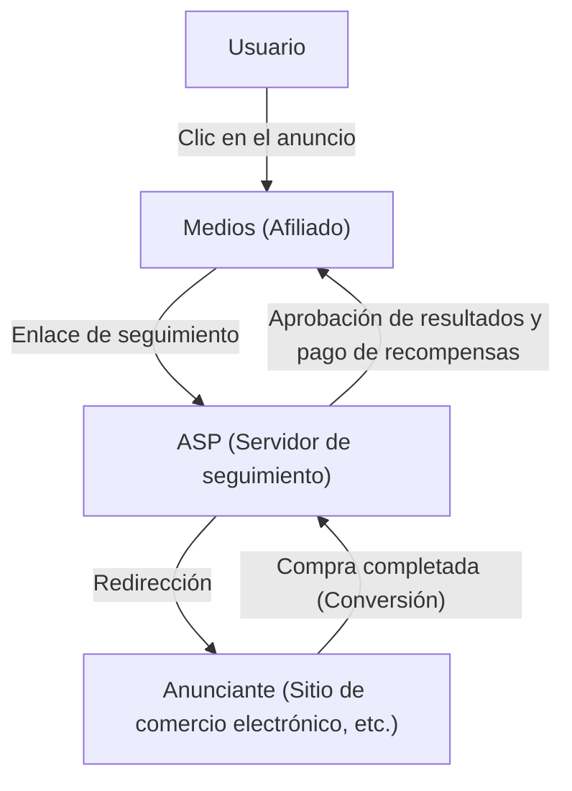
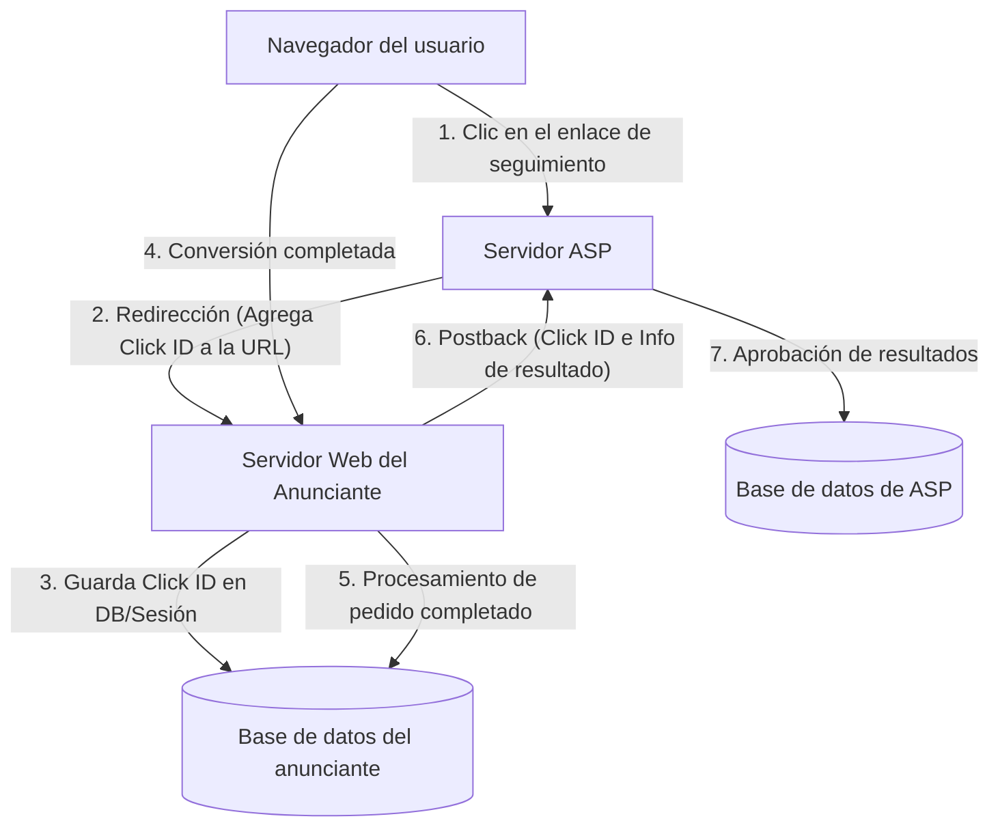

# Mecanismo del marketing de afiliación: El trasfondo técnico del seguimiento y la conversión

En el mercado de la publicidad en Internet, la publicidad basada en resultados (marketing de afiliación) desempeña un papel extremadamente importante. Dado que los anunciantes (comerciantes) solo pagan recompensas por "resultados" como ventas reales o la adquisición de clientes potenciales, es ampliamente reconocida como una estrategia de marketing muy rentable.

Sin embargo, detrás de esto, opera una tecnología de seguimiento (tracking) altamente sofisticada y compleja para rastrear con precisión el comportamiento del usuario y determinar qué introducción de medios (afiliados) generó el resultado.

Este artículo explica el trasfondo técnico del marketing de afiliación: el papel de los ASP (proveedores de servicios de afiliación), las URL de seguimiento con redireccionamientos, las tecnologías del lado del cliente como Cookies y LocalStorage, y el seguimiento entre servidores (S2S). S2S traslada parte de la medición a los servidores; no elude las restricciones del navegador ni los requisitos de consentimiento.

## 1. El panorama general del ecosistema de afiliación

El marketing de afiliación se compone principalmente de las siguientes cuatro partes interesadas:

1. **Usuarios (Consumidores)**: Navegan por los medios, hacen clic en los anuncios y compran o se registran en productos.
2. **Medios (Afiliados/Editores)**: Presentan productos en sus propios sitios web y redes sociales, generando tráfico.
3. **ASP (Proveedores de Servicios de Afiliación)**: Plataformas que intermedian entre los anunciantes y los medios, gestionando el seguimiento, la medición de resultados y el pago de recompensas.
4. **Anunciantes (Comerciantes)**: Proporcionan productos o servicios y pagan gastos de publicidad al ASP.

En este ecosistema, el ASP es el núcleo técnico más importante.

El ASP puede actuar como un centro de datos que registra y relaciona qué clic publicitario condujo a una conversión notificada. El nivel de detalle, la precisión temporal y las reglas de atribución dependen de la implementación y las condiciones contractuales de cada proveedor y anunciante.

## 2. Mecanismo básico de seguimiento (Lado del cliente)

El seguimiento de afiliados ha dependido históricamente en gran medida de la tecnología del lado del cliente (navegador). Aquí, desglosaremos y explicaremos el flujo de seguimiento estándar convencional.

### 2.1. URL de seguimiento y redirección

Muchos enlaces de afiliación usan una URL de seguimiento del ASP antes de enviar al visitante al anunciante. Otros sistemas miden las referencias directamente o desde el servidor del anunciante, por lo que no todas las implementaciones requieren una redirección por el ASP.

Ejemplo: `https://click.example-asp.com/track?aff_id=12345&campaign_id=67890`

Cuando un usuario hace clic en este enlace, ocurre el siguiente proceso:

1. **Registro del clic**: Según la implementación y las reglas aplicables, el ASP registra la hora y los identificadores publicitarios necesarios para la medición. Si trata direcciones IP o valores User-Agent, debe gestionar su finalidad, necesidad, periodo de conservación y controles de acceso.
2. **Generación del ID de clic**: Se genera un "ID de clic (Click ID)" para identificar de forma única este evento de clic.
3. **Transferencia del identificador**: Algunos sistemas tradicionales guardaban el Click ID en una Cookie del ASP. No puede suponerse que este método funcione cuando el navegador bloquea las Cookies de terceros. Otros sistemas transfieren el identificador al dominio del anunciante y, cuando está permitido, lo guardan en un contexto propio.
4. **Redirección**: Para una navegación temporal se suelen usar [HTTP 302](/es/p/history-of-http/) (Found) o 307 (Temporary Redirect). 301 (Moved Permanently) indica un traslado permanente y puede almacenarse en caché, por lo que normalmente no conviene para medir clics. Algunas implementaciones añaden el Click ID a la URL de destino.

### 2.2. El papel de las Cookies y LocalStorage

Los usuarios que llegan al sitio del anunciante navegan por él y, finalmente, llegan a una "conversión (CV)", como la compra de un producto o el registro como miembro.

Un ejemplo de seguimiento tradicional del lado del cliente inserta en la página de confirmación una etiqueta JavaScript o de imagen del ASP, llamada «etiqueta de conversión (CV)». Su capacidad para relacionar el clic y la conversión depende de que el navegador permita acceder al identificador y enviar la solicitud de la etiqueta.

Cuando se carga la etiqueta de conversión, se lleva a cabo el siguiente proceso:

- **Lectura del identificador**: Si la implementación lo permite, se lee un identificador guardado en el contexto propio del anunciante o un Click ID incluido en la URL de destino. No se puede dar por hecho que el navegador pueda leer directamente una Cookie de terceros del ASP.
- **Envío del resultado**: Se envían al ASP el Click ID disponible y los datos de conversión (por ejemplo, importe o número de pedido), de acuerdo con el contrato, el consentimiento y las reglas aplicables.

Cuando el consentimiento y las reglas aplicables lo permiten, el anunciante también puede guardar datos de medición en `LocalStorage` o `SessionStorage`. Estos almacenes pertenecen a un sitio y están sujetos a las funciones de privacidad del navegador y a los ajustes o borrados del usuario; no son copias de seguridad garantizadas de las Cookies ni identificadores permanentes.

## 3. La ola de protección de la privacidad: El impacto de ITP

El seguimiento en el lado del cliente, aunque fácil de implementar, tenía un problema importante: "el seguimiento excesivo del usuario mediante Cookies de terceros".

A medida que aumentaba la [preocupación por la privacidad](/es/p/privacy-vs-convenience-big-data/) debido a la recopilación del historial de comportamiento en múltiples sitios sin el conocimiento de los usuarios, cada proveedor de navegadores comenzó a introducir fuertes restricciones de seguimiento, empezando por la **ITP (Prevención de Seguimiento Inteligente)** instalada en el navegador Safari de Apple.

### El impacto de ITP en los afiliados

La ITP de WebKit restringe en Safari las Cookies y el almacenamiento que podrían utilizarse para el seguimiento entre sitios. Los efectos dependen de la versión del navegador, el uso, la navegación y la forma de guardar los datos. Algunos ejemplos:

1. **Cookies de terceros**: WebKit bloquea de forma predeterminada las Cookies de terceros con ITP. Por ello, con la configuración predeterminada de Safari no puede suponerse que funcione una medición tradicional que lea directamente una Cookie del ASP desde el navegador.
2. **Cookies y almacenamiento establecidos mediante JavaScript**: En ciertos casos de enlaces clasificados como rastreadores, ITP puede limitar a 24 horas la duración de las Cookies que establece JavaScript en la página de destino. Las Cookies y los datos como LocalStorage modificables por scripts también pueden quedar sujetos a eliminación tras un periodo sin interacción del usuario. No es una regla universal de 24 horas/7 días para todas las Cookies.
3. **Almacenamiento de terceros**: LocalStorage de terceros y almacenes similares pueden separarse por sitio o ser temporales. Para cada caso deben consultarse el comportamiento actual de WebKit y los ajustes del usuario.

Estas restricciones pueden dificultar que algunos sistemas tradicionales relacionen un clic con una conversión posterior. El efecto en la medición, las comisiones o el ROI varía según la implementación y no puede generalizarse.

## 4. Seguimiento en el lado del servidor (S2S) y el auge del Postback

Un enfoque es el **seguimiento entre servidores (Server-to-Server / S2S)**, también llamado método **Postback**, que envía los datos de conversión desde el servidor del anunciante al ASP. Traslada parte de la medición a un servidor; no elimina las restricciones del navegador ni los requisitos de consentimiento.

### Arquitectura de seguimiento S2S

En el seguimiento S2S, el servidor del anunciante y el servidor del ASP se comunican directamente (a través de una API), sin depender de las Cookies del navegador ni de las etiquetas de JavaScript.

1. **Clic y redirección**: Como antes, el usuario hace clic en el enlace del ASP. El ASP genera un `Click ID` único y lo pasa al sitio del anunciante como un parámetro de URL durante la redirección (Ejemplo: `https://shop.example.com/?click_id=abcde12345`).
2. **Almacenamiento en el servidor**: El servidor web del anunciante obtiene `click_id` de una solicitud permitida y, si es necesario, lo guarda en una sesión o base de datos. También puede establecer una Cookie para su propio dominio mediante una respuesta HTTP, pero debe respetar la prevención de rastreo del navegador, los atributos y la duración de la Cookie, los ajustes del usuario, el consentimiento y las reglas aplicables. El procesamiento en servidor no elimina las restricciones de ITP.
3. **Postback en el momento de la conversión**: Cuando el usuario completa la compra y se confirma el procesamiento del pedido en el servidor del anunciante, se envía directamente una solicitud HTTP (GET o POST) desde el servidor del anunciante al endpoint designado (Postback URL) del ASP.

### Ventajas del seguimiento S2S

- **Control del flujo de datos**: El anunciante puede validar, transformar o eliminar campos antes de compartirlos. Esto no elimina la necesidad de consentimiento adecuado ni de minimizar los datos.
- **Posible reducción del trabajo del navegador**: Algunas configuraciones pueden reducir las etiquetas de terceros y las solicitudes directas a proveedores desde una página.
- **Control de reintentos y duplicados**: El envío entre servidores también puede fallar, reintentarse o duplicarse. Se necesitan reintentos, deduplicación, identificadores de evento y supervisión.

### Desafíos del seguimiento S2S

Entre los desafíos están la implementación y el mantenimiento. El anunciante puede necesitar recibir y guardar parámetros, autenticar solicitudes, reintentar y deduplicar eventos y supervisar la entrega, lo que puede suponer un coste mayor para negocios pequeños. Algunos eventos deben originarse en el navegador o la aplicación del usuario, por lo que S2S no siempre cubre todo el proceso de medición.

Por lo tanto, en los últimos años, los ASP están trabajando para reducir el obstáculo para introducir el seguimiento S2S al proporcionar complementos para las principales plataformas como Shopify y WordPress.

## 5. Tecnología de seguimiento de próxima generación

Además del seguimiento S2S, todo el ecosistema continúa evolucionando aún más.

### 5.1. Huella digital (Identificación alternativa)
La huella digital combina características de un navegador o dispositivo para intentar identificarlo o rastrearlo. No garantiza identificar a una persona de forma única ni fiable, implica riesgos para la privacidad y puede estar sujeta a protecciones del navegador, leyes y políticas de plataformas. No debe adoptarse a la ligera como sustituto de las Cookies.

### 5.2. Data Clean Room y GTM en el lado del servidor
Las salas limpias de datos y los contenedores del lado del servidor de Google Tag Manager (GTM) son opciones para gestionar el tratamiento y el intercambio de datos. Usarlos no anonimiza los datos automáticamente ni garantiza el cumplimiento legal o la privacidad. Deben diseñarse y revisarse la finalidad, el consentimiento y los permisos, la minimización de datos, los controles de acceso y los límites de salida.

## Resumen

Detrás del marketing de afiliación, la evolución de la tecnología y la ola de protección de la privacidad están chocando ferozmente, y el mecanismo de seguimiento está experimentando cambios drásticos.

Los enfoques del lado del cliente y del servidor tienen funciones y limitaciones distintas. Anunciantes, afiliados y ASP deben definir la finalidad y los límites de la medición y elegir una implementación que tenga en cuenta las leyes y reglas de las plataformas, el consentimiento y las opciones del usuario, la minimización de datos y la seguridad. S2S no garantiza por sí solo ni la precisión ni la privacidad: requiere un diseño y una operación cuidadosos.

Comprender la arquitectura del sistema de publicidad basada en resultados será cada vez más importante para todos los ingenieros y especialistas en marketing involucrados en el marketing web en el futuro.

## Referencias

- [WebKit: Tracking Prevention in WebKit](https://webkit.org/tracking-prevention/)
- [WebKit: Intelligent Tracking Prevention 2.2](https://webkit.org/blog/8828/)
- [Google for Developers: Server-side tagging fundamentals](https://developers.google.com/tag-platform/learn/sst-fundamentals/2-what-is-sst)
- [IETF RFC 9110: HTTP Semantics, Redirection](https://www.rfc-editor.org/rfc/rfc9110.html)
- [WebKit: Tracking Prevention Policy](https://webkit.org/tracking-prevention-policy/)
