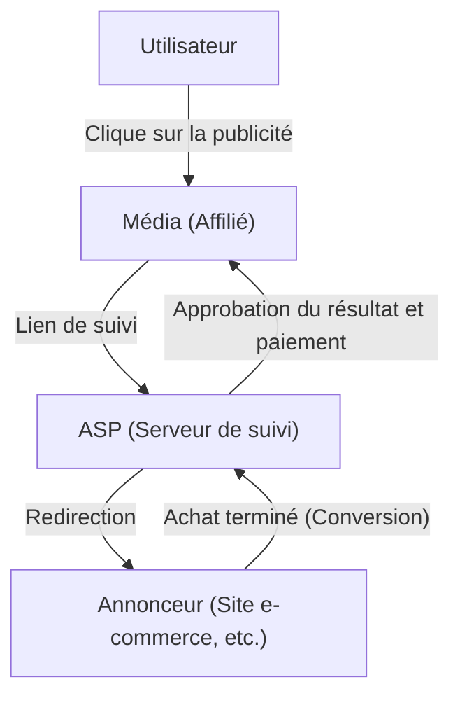
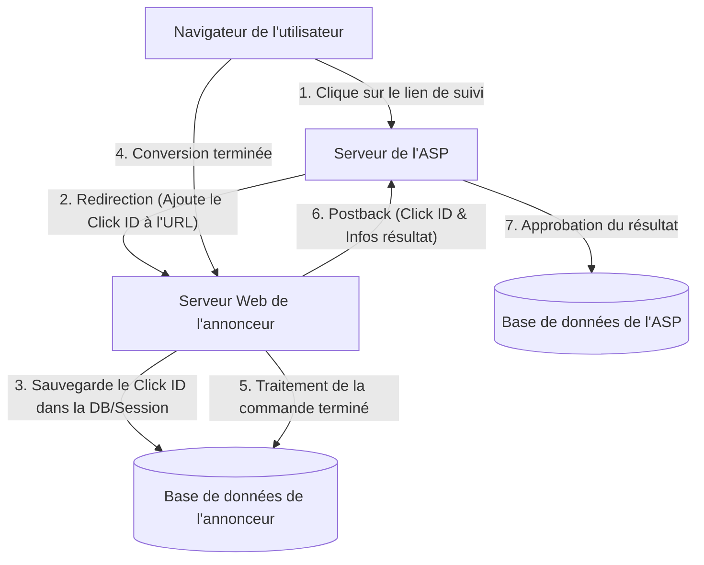

# Le mécanisme du marketing d'affiliation : les coulisses techniques du suivi et de la conversion

Sur le marché de la publicité sur Internet, la publicité au résultat (marketing d'affiliation) joue un rôle extrêmement important. Les annonceurs (marchands) ne paient des commissions que pour les "résultats" réels, tels que les ventes ou l'acquisition de leads, ce qui est largement reconnu comme une méthode de marketing très rentable.

Cependant, en coulisses, des technologies de suivi complexes et avancées sont à l'œuvre pour suivre avec précision le comportement des utilisateurs et déterminer quel média (affilié) est à l'origine du résultat.

Cet article explique les aspects techniques du marketing d'affiliation : le rôle de l'ASP (Affiliate Service Provider), les URL de suivi avec redirection, les technologies côté client comme les cookies et LocalStorage, et le suivi serveur à serveur (S2S). Le S2S déplace une partie de la mesure vers les serveurs ; il ne contourne ni les restrictions des navigateurs ni les exigences de consentement.

## 1. Vue d'ensemble de l'écosystème de l'affiliation

Le marketing d'affiliation est principalement composé des quatre parties prenantes suivantes :

1. **Utilisateur (consommateur)** : Consulte les médias, clique sur les publicités et achète/s'inscrit à des produits.
2. **Média (affilié/éditeur)** : Présente des produits sur son propre site Web ou sur les réseaux sociaux pour générer du trafic.
3. **ASP (Affiliate Service Provider)** : Plateforme qui fait le lien entre les annonceurs et les médias, et gère le suivi, la mesure des résultats et le paiement des commissions.
4. **Annonceur (marchand)** : Propose des produits ou services et paie des frais publicitaires à l'ASP.

Dans cet écosystème, l'ASP est le hub technique le plus important.

L'ASP peut servir de plateforme de données qui enregistre et rapproche le clic publicitaire ayant conduit à une conversion déclarée. Le niveau de détail, la précision temporelle et les règles d'attribution dépendent de la mise en œuvre et des conditions contractuelles de chaque prestataire et annonceur.

## 2. Le mécanisme de base du suivi (côté client)

Historiquement, le suivi de l'affiliation a fortement dépendu des technologies côté client (navigateur). Ici, nous allons décomposer et expliquer le flux de suivi standard traditionnel.

### 2.1. URL de suivi et redirection

De nombreux liens d'affiliation utilisent une URL de suivi de l'ASP avant d'envoyer le visiteur vers le site de l'annonceur. D'autres dispositifs mesurent les recommandations directement ou côté serveur chez l'annonceur ; une redirection par l'ASP n'est donc pas toujours nécessaire.

Exemple : `https://click.example-asp.com/track?aff_id=12345&campaign_id=67890`

Lorsqu'un utilisateur clique sur ce lien, le processus suivant se produit :

1. **Enregistrement du clic** : Selon la mise en œuvre et les règles applicables, l'ASP enregistre l'heure et les identifiants publicitaires nécessaires à la mesure. S'il traite des adresses IP ou des valeurs User-Agent, il convient de définir leur finalité, leur nécessité, leur durée de conservation et les contrôles d'accès.
2. **Génération du Click ID** : Un "Click ID" (identifiant de clic) est généré pour identifier de manière unique cet événement de clic.
3. **Transmission de l'identifiant** : Certains anciens dispositifs stockaient le Click ID dans un cookie de l'ASP. Cette méthode ne peut pas être présumée fonctionner lorsque les cookies tiers sont bloqués. D'autres dispositifs transmettent l'identifiant au domaine de l'annonceur et le stockent, si cela est autorisé, dans un contexte propriétaire.
4. **Redirection** : Une navigation temporaire utilise généralement [HTTP 302](/fr/p/history-of-http/) (Found) ou 307 (Temporary Redirect). 301 (Moved Permanently) indique un déplacement permanent et peut être mis en cache ; elle convient donc rarement à une redirection ordinaire de mesure des clics. Certains dispositifs ajoutent le Click ID à l'URL de destination.

### 2.2. Le rôle des Cookies et de LocalStorage

L'utilisateur qui atteint le site de l'annonceur navigue sur le site et finit par réaliser une "conversion" (CV), comme l'achat d'un produit ou l'inscription en tant que membre.

Un exemple de suivi traditionnel côté client consiste à intégrer sur la page de confirmation une balise JavaScript ou image de l'ASP, appelée « balise de conversion (CV) ». La mise en relation du clic et de la conversion dépend de l'accès du navigateur à l'identifiant et de l'autorisation de la requête réseau de la balise.

Lorsque la balise de conversion est chargée, le traitement suivant est effectué :

- **Lecture de l'identifiant** : Si la mise en œuvre le permet, la balise lit un identifiant enregistré dans le contexte propriétaire de l'annonceur ou un Click ID transmis dans l'URL de destination. On ne peut pas présumer que le navigateur peut lire directement un cookie tiers de l'ASP.
- **Envoi du résultat** : Le Click ID disponible et les données de conversion (montant ou numéro de commande, par exemple) sont transmis à l'ASP conformément au contrat, au consentement et aux règles applicables.

Lorsque le consentement et les règles applicables le permettent, l'annonceur peut aussi enregistrer des données de mesure dans `LocalStorage` ou `SessionStorage`. Ces espaces sont propres à un site et restent soumis aux fonctions de confidentialité du navigateur ainsi qu'aux réglages ou suppressions de l'utilisateur ; ils ne constituent ni une sauvegarde garantie des cookies ni des identifiants permanents.

## 3. La vague de protection de la vie privée : l'impact de l'ITP

Bien que le suivi côté client soit facile à mettre en œuvre, il présentait un problème majeur : le "suivi excessif des utilisateurs par des cookies tiers".

Face aux [préoccupations croissantes en matière de confidentialité](/fr/p/privacy-vs-convenience-big-data/) concernant la collecte de l'historique de navigation sur plusieurs sites à l'insu de l'utilisateur, les fournisseurs de navigateurs ont commencé à introduire de fortes restrictions de suivi, à commencer par l'**ITP (Intelligent Tracking Prevention)** intégrée au navigateur Safari d'Apple.

### L'impact de l'ITP sur l'affiliation

L'ITP de WebKit restreint dans Safari les cookies et espaces de stockage susceptibles d'être utilisés pour le suivi intersites. Les effets dépendent de la version du navigateur, de l'utilisation, du parcours de navigation et de la méthode de stockage. Exemples :

1. **Cookies tiers** : WebKit bloque par défaut les cookies tiers avec l'ITP. Avec les réglages par défaut de Safari, on ne peut donc pas présumer qu'une mesure traditionnelle puisse lire directement un cookie de l'ASP dans le navigateur.
2. **Cookies et stockage définis par JavaScript** : Dans certains cas de liens identifiés comme liés au suivi, l'ITP peut limiter à 24 heures la durée des cookies définis par JavaScript sur la page d'arrivée. Les cookies modifiables par script et les données comme LocalStorage peuvent aussi devenir susceptibles d'être supprimés après une période sans interaction de l'utilisateur. Il ne s'agit pas d'une règle universelle de 24 heures/7 jours pour tous les cookies.
3. **Stockage tiers** : Le LocalStorage tiers et les espaces similaires peuvent être cloisonnés par site ou éphémères. Il faut vérifier le comportement actuel de WebKit et les réglages de l'utilisateur pour chaque cas.

Ces restrictions peuvent compliquer, dans certains dispositifs traditionnels, le rapprochement d'un clic avec une conversion ultérieure. Les effets sur la mesure, les commissions ou le ROI varient selon la mise en œuvre et ne peuvent pas être généralisés.

## 4. L'essor du suivi côté serveur (S2S) et du Postback

Une approche consiste à utiliser le **suivi serveur à serveur (Server-to-Server / S2S)**, également appelé méthode **Postback**, qui transmet les données de conversion du serveur de l'annonceur à l'ASP. Elle déplace une partie de la mesure côté serveur ; elle ne supprime ni les restrictions des navigateurs ni les exigences de consentement.

### Architecture du suivi S2S

Dans le suivi S2S, le serveur de l'annonceur et le serveur de l'ASP communiquent directement (via API), sans dépendre des cookies du navigateur ni des balises JavaScript.

1. **Clic et redirection** : Comme auparavant, l'utilisateur clique sur le lien de l'ASP. L'ASP génère un `Click ID` unique et le transmet au site de l'annonceur en tant que paramètre d'URL lors de la redirection (ex : `https://shop.example.com/?click_id=abcde12345`).
2. **Stockage côté serveur** : Le serveur Web de l'annonceur récupère `click_id` dans une requête autorisée et l'enregistre si nécessaire dans une session ou une base de données. Il peut aussi définir un cookie pour son propre domaine dans une réponse HTTP, tout en respectant les protections contre le suivi du navigateur, les attributs et la durée du cookie, les réglages de l'utilisateur, le consentement et les règles applicables. Le traitement serveur ne supprime pas les restrictions de l'ITP.
3. **Postback lors de la conversion** : Au moment où l'utilisateur termine son achat et que le traitement de la commande est confirmé sur le serveur de l'annonceur, ce dernier envoie directement une requête HTTP (GET ou POST) au point de terminaison spécifié (Postback URL) de l'ASP.

### Avantages du suivi S2S

- **Maîtrise des flux de données** : L'annonceur peut valider, transformer ou supprimer des champs avant leur transmission. Cela ne dispense pas d'un consentement approprié ni de la minimisation des données.
- **Réduction possible du travail du navigateur** : Certaines configurations peuvent réduire le nombre de balises tierces et de requêtes directes aux fournisseurs sur une page.
- **Gestion des nouvelles tentatives et doublons** : Les transmissions serveur à serveur peuvent aussi échouer, être répétées ou dupliquées. Il faut prévoir des tentatives, la déduplication, des identifiants d'événement et une supervision.

### Défis du suivi S2S

Les défis comprennent la mise en œuvre et l'exploitation. L'annonceur peut devoir recevoir et stocker des paramètres, authentifier les requêtes, réessayer et dédupliquer les événements et surveiller leur livraison, ce qui peut coûter davantage aux petites entreprises. Certains événements doivent toujours provenir du navigateur ou de l'application ; le S2S seul ne couvre donc pas nécessairement toute la mesure.

Par conséquent, les ASP s'efforcent ces dernières années de réduire les obstacles à l'introduction du suivi S2S en proposant des plugins pour les principales plateformes telles que Shopify et WordPress.

## 5. Technologies de suivi de nouvelle génération

En plus du suivi S2S, l'écosystème dans son ensemble continue d'évoluer.

### 5.1. Fingerprinting (Identification alternative)
Le fingerprinting combine des caractéristiques d'un navigateur ou appareil pour tenter de l'identifier ou de le suivre. Il ne garantit pas l'identification unique et fiable d'une personne, présente des risques pour la vie privée et peut relever des protections des navigateurs, des lois et des règles des plateformes. Il ne faut pas l'adopter à la légère comme substitut aux cookies.

### 5.2. Data Clean Room et GTM côté serveur
Les salles blanches de données et les conteneurs côté serveur de Google Tag Manager (GTM) permettent de gérer le traitement et le partage des données. Leur utilisation n'anonymise pas automatiquement les données et ne garantit ni la conformité juridique ni la confidentialité. Il faut définir et vérifier la finalité, le consentement et les autorisations, la minimisation des données, les contrôles d'accès et les limites de sortie.

## Conclusion

Dans les coulisses du marketing d'affiliation, l'évolution technologique et la vague de protection de la vie privée s'entrechoquent violemment, et les mécanismes de suivi subissent des changements spectaculaires.

Les approches côté client et côté serveur ont des rôles et des limites différents. Annonceurs, affiliés et ASP doivent définir la finalité et les limites de la mesure, puis choisir une mise en œuvre qui tient compte des lois et règles des plateformes applicables, du consentement et des choix des utilisateurs, de la minimisation des données et de la sécurité. Le S2S ne garantit automatiquement ni précision ni confidentialité ; sa conception et son exploitation doivent être rigoureuses.

Comprendre l'architecture système de la publicité au résultat deviendra de plus en plus crucial à l'avenir pour tous les ingénieurs et spécialistes du marketing impliqués dans le marketing Web.

## Références

- [WebKit: Tracking Prevention in WebKit](https://webkit.org/tracking-prevention/)
- [WebKit: Intelligent Tracking Prevention 2.2](https://webkit.org/blog/8828/)
- [Google for Developers: Server-side tagging fundamentals](https://developers.google.com/tag-platform/learn/sst-fundamentals/2-what-is-sst)
- [IETF RFC 9110: HTTP Semantics, Redirection](https://www.rfc-editor.org/rfc/rfc9110.html)
- [WebKit: Tracking Prevention Policy](https://webkit.org/tracking-prevention-policy/)
