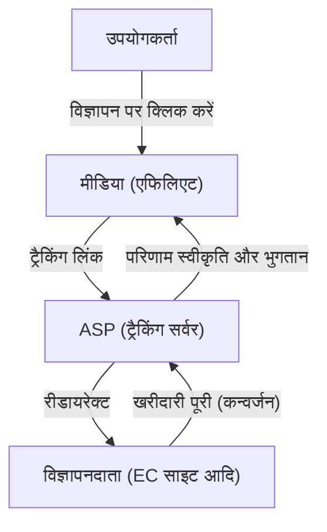
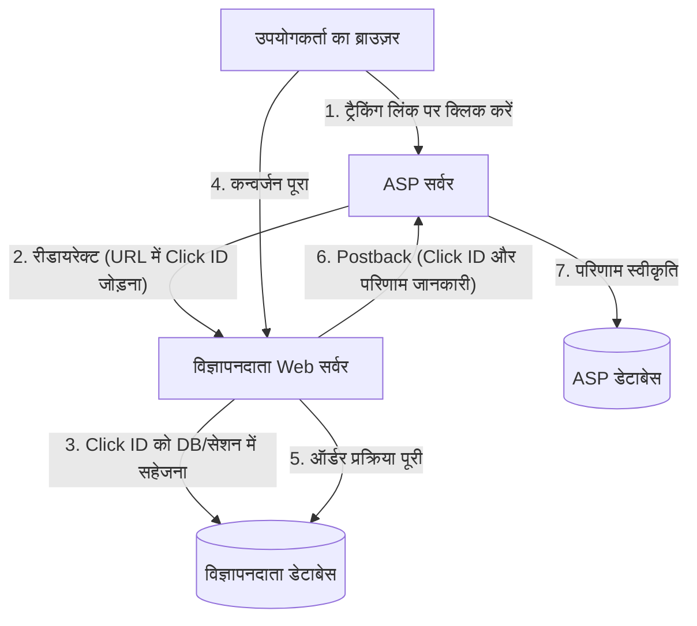

# एफिलिएट की कार्यप्रणाली: ट्रैकिंग और कन्वर्जन के तकनीकी पहलू

इंटरनेट विज्ञापन बाज़ार में, प्रदर्शन-आधारित विज्ञापन (एफिलिएट मार्केटिंग) एक अत्यंत महत्वपूर्ण भूमिका निभाते हैं। विज्ञापनदाता (मर्चेंट) केवल वास्तविक बिक्री या लीड जनरेशन जैसे 'परिणामों' के लिए ही भुगतान करते हैं, इसलिए इसे व्यापक रूप से एक लागत-प्रभावी मार्केटिंग रणनीति माना जाता है।

हालाँकि, इसके पीछे उपयोगकर्ता के व्यवहार को सटीक रूप से ट्रैक करने और यह निर्धारित करने के लिए कि किस मीडिया (एफिलिएट) के रेफरल से परिणाम प्राप्त हुआ है, उन्नत और जटिल ट्रैकिंग तकनीकें काम कर रही हैं।

यह लेख एफिलिएट मार्केटिंग की तकनीकी प्रक्रिया समझाता है: ASP की भूमिका, रीडायरेक्ट वाले ट्रैकिंग URL, कुकीज़ और LocalStorage जैसी क्लाइंट-साइड तकनीकें तथा सर्वर-टू-सर्वर (S2S) ट्रैकिंग। S2S मापन के एक हिस्से को सर्वर पर ले जाता है; यह ब्राउज़र प्रतिबंधों या सहमति की आवश्यकताओं को दरकिनार नहीं करता।

## 1. एफिलिएट इकोसिस्टम का समग्र दृश्य

एफिलिएट मार्केटिंग में मुख्य रूप से निम्नलिखित 4 हितधारक (स्टेकहोल्डर्स) शामिल होते हैं।

1. **उपयोगकर्ता (उपभोक्ता)**: मीडिया ब्राउज़ करते हैं, विज्ञापनों पर क्लिक करते हैं और उत्पादों की खरीदारी या आवेदन करते हैं।
2. **मीडिया (एफिलिएट / पब्लिशर)**: अपनी वेबसाइटों या SNS पर उत्पादों का प्रचार करते हैं और ट्रैफ़िक उत्पन्न करते हैं।
3. **ASP (एफिलिएट सर्विस प्रोवाइडर)**: एक प्लेटफ़ॉर्म जो विज्ञापनदाताओं और मीडिया के बीच मध्यस्थ के रूप में कार्य करता है, और ट्रैकिंग, परिणाम मापन और पारिश्रमिक भुगतान का प्रबंधन करता है।
4. **विज्ञापनदाता (मर्चेंट)**: उत्पाद या सेवाएँ प्रदान करते हैं और ASP को विज्ञापन शुल्क का भुगतान करते हैं।

इस इकोसिस्टम में, सबसे तकनीकी केंद्र ASP होता है।

ASP डेटा हब की तरह काम कर सकता है, जो दर्ज करता और मिलान करता है कि किस विज्ञापन क्लिक से रिपोर्ट किया गया कन्वर्ज़न जुड़ा। रिकॉर्ड का विवरण, समय की सटीकता और एट्रिब्यूशन नियम प्रदाता तथा विज्ञापनदाता के कार्यान्वयन और अनुबंध पर निर्भर करते हैं।

## 2. ट्रैकिंग का मूल तंत्र (क्लाइंट साइड)

ऐतिहासिक रूप से, एफिलिएट ट्रैकिंग क्लाइंट-साइड (ब्राउज़र) तकनीकों पर बहुत अधिक निर्भर रही है। यहाँ हम पारंपरिक मानक ट्रैकिंग फ्लो को विभाजित करके समझाते हैं।

### 2.1. ट्रैकिंग URL और रीडायरेक्ट

कई एफिलिएट लिंक आगंतुक को विज्ञापनदाता की साइट पर भेजने से पहले ASP ट्रैकिंग URL का उपयोग करते हैं। कुछ व्यवस्थाएँ रेफ़रल को सीधे या विज्ञापनदाता के सर्वर पर मापती हैं, इसलिए हर कार्यान्वयन में ASP रीडायरेक्ट अनिवार्य नहीं है।

उदाहरण: `https://click.example-asp.com/track?aff_id=12345&campaign_id=67890`

जब कोई उपयोगकर्ता इस लिंक पर क्लिक करता है, तो निम्नलिखित प्रक्रिया होती है:

1. **क्लिक रिकॉर्ड करना**: कार्यान्वयन और लागू नियमों के अनुसार ASP मापन के लिए आवश्यक समय और विज्ञापन पहचानकर्ता दर्ज करता है। IP पते या User-Agent को संभालने पर उद्देश्य, आवश्यकता, रखरखाव अवधि और पहुँच नियंत्रण तय होने चाहिए।
2. **क्लिक ID जनरेट करना**: इस क्लिक इवेंट की विशिष्ट रूप से पहचान करने के लिए एक 'क्लिक ID' (Click ID) उत्पन्न की जाती है।
3. **पहचानकर्ता भेजना**: कुछ पुराने सिस्टम Click ID को ASP कुकी में रखते थे। जहाँ ब्राउज़र थर्ड-पार्टी कुकीज़ रोकता है, वहाँ इस तरीके के काम करने की धारणा नहीं रखी जा सकती। अन्य सिस्टम पहचानकर्ता विज्ञापनदाता के डोमेन तक भेजते हैं और अनुमति होने पर उसे फ़र्स्ट-पार्टी संदर्भ में रखते हैं।
4. **रीडायरेक्ट**: अस्थायी नेविगेशन के लिए आमतौर पर [HTTP 302](/hi/p/history-of-http/) (Found) या 307 (Temporary Redirect) का उपयोग होता है। 301 (Moved Permanently) स्थायी स्थानांतरण बताता है और कैश हो सकता है, इसलिए सामान्य क्लिक-मापन रीडायरेक्ट के लिए आम तौर पर उपयुक्त नहीं है। कुछ कार्यान्वयन लक्ष्य URL में Click ID जोड़ते हैं।

### 2.2. कुकीज़ और लोकल स्टोरेज की भूमिका

विज्ञापनदाता की साइट पर पहुँचने वाला उपयोगकर्ता साइट को ब्राउज़ करता है, और अंततः उत्पाद खरीदने या सदस्य के रूप में पंजीकरण करने जैसे 'कन्वर्जन (CV)' तक पहुँचता है।

एक पारंपरिक क्लाइंट-साइड उदाहरण में कन्वर्ज़न पूरे होने वाले पेज (थैंक-यू पेज) पर ASP का JavaScript या इमेज 'कन्वर्ज़न टैग (CV टैग)' लगाया जाता है। क्लिक को कन्वर्ज़न से जोड़ पाना इस पर निर्भर है कि ब्राउज़र सहेजे गए पहचानकर्ता तक पहुँच और टैग के नेटवर्क अनुरोध की अनुमति देता है या नहीं।

जब कन्वर्जन टैग लोड होता है, तो निम्नलिखित प्रक्रियाएँ निष्पादित होती हैं:

- **पहचानकर्ता पढ़ना**: जहाँ कार्यान्वयन अनुमति देता है, टैग विज्ञापनदाता के फ़र्स्ट-पार्टी संदर्भ में सहेजे पहचानकर्ता या लक्ष्य URL में दिए Click ID को पढ़ता है। ब्राउज़र से ASP की थर्ड-पार्टी कुकी सीधे पढ़े जाने की धारणा नहीं रखी जा सकती।
- **परिणाम भेजना**: उपलब्ध Click ID और कन्वर्ज़न विवरण अनुबंध, सहमति और लागू नियमों के अनुसार ASP को भेजे जाते हैं।

जहाँ सहमति और लागू नियम अनुमति दें, विज्ञापनदाता मापन स्थिति को `LocalStorage` या `SessionStorage` में रख सकता है। ये स्टोरेज प्रति-साइट होते हैं और ब्राउज़र गोपनीयता सुविधाओं, उपयोगकर्ता सेटिंग या हटाने से प्रभावित हो सकते हैं; ये कुकी का सुनिश्चित बैकअप या स्थायी पहचानकर्ता नहीं हैं।

## 3. गोपनीयता संरक्षण की लहर: ITP का प्रभाव

क्लाइंट-साइड ट्रैकिंग को लागू करना आसान है, लेकिन इसमें एक बड़ी समस्या थी। वह है 'थर्ड-पार्टी कुकीज़ के माध्यम से अत्यधिक उपयोगकर्ता ट्रैकिंग'।

बिना उपयोगकर्ता की जानकारी के कई साइटों पर व्यवहार के इतिहास को एकत्र किए जाने के कारण [गोपनीयता संबंधी चिंताएँ](/hi/p/privacy-vs-convenience-big-data/) बढ़ गईं, और Apple के Safari ब्राउज़र में शामिल **ITP (Intelligent Tracking Prevention)** सहित विभिन्न ब्राउज़र वेंडरों ने सख्त ट्रैकिंग प्रतिबंध लागू करना शुरू कर दिया।

### ITP का एफिलिएट पर प्रभाव

WebKit का ITP Safari में उन कुकीज़ और स्टोरेज को सीमित करता है जिनका उपयोग क्रॉस-साइट ट्रैकिंग के लिए हो सकता है। प्रभाव ब्राउज़र संस्करण, उपयोग, नेविगेशन पथ और स्टोरेज सेट करने के तरीके पर निर्भर करता है। उदाहरण:

1. **थर्ड-पार्टी कुकीज़**: WebKit ITP में थर्ड-पार्टी कुकीज़ को डिफ़ॉल्ट रूप से ब्लॉक करता है। इसलिए Safari की डिफ़ॉल्ट सेटिंग में ब्राउज़र से ASP कुकी सीधे पढ़ने वाली पुरानी मापन पद्धति पर भरोसा नहीं किया जा सकता।
2. **JavaScript से सेट कुकी और स्टोरेज**: ट्रैकिंग के रूप में वर्गीकृत कुछ लिंक मामलों में ITP लैंडिंग पेज पर JavaScript द्वारा सेट कुकी की अवधि 24 घंटे तक सीमित कर सकता है। उपयोगकर्ता की गतिविधि न होने पर स्क्रिप्ट से लिखी जा सकने वाली कुकी और LocalStorage जैसे डेटा हटाने योग्य भी हो सकते हैं। यह सभी कुकीज़ पर लागू सार्वभौमिक 24 घंटे/7 दिन का नियम नहीं है।
3. **थर्ड-पार्टी स्टोरेज**: थर्ड-पार्टी LocalStorage आदि साइट के अनुसार अलग किए जा सकते हैं या अस्थायी हो सकते हैं। वास्तविक व्यवहार के लिए मौजूदा WebKit जानकारी और उपयोगकर्ता सेटिंग देखें।

इन प्रतिबंधों से कुछ पारंपरिक व्यवस्थाओं में क्लिक को बाद में हुए कन्वर्ज़न से जोड़ना कठिन हो सकता है। मापन, भुगतान या विज्ञापनदाता के ROI पर प्रभाव कार्यान्वयन के अनुसार बदलता है और इसे सामान्यीकृत नहीं किया जा सकता।

## 4. सर्वर-साइड ट्रैकिंग (S2S) और पोस्टबैक का उदय

एक तरीका **सर्वर-टू-सर्वर (S2S) ट्रैकिंग**, जिसे **पोस्टबैक विधि** भी कहते हैं, है। इसमें विज्ञापनदाता का सर्वर कन्वर्ज़न जानकारी ASP को भेजता है। यह मापन के एक हिस्से को सर्वर पर ले जाता है; ब्राउज़र प्रतिबंध या सहमति की आवश्यकताएँ समाप्त नहीं होतीं।

### S2S ट्रैकिंग का आर्किटेक्चर

S2S ट्रैकिंग में, ब्राउज़र की कुकीज़ या JavaScript टैग पर निर्भर किए बिना, विज्ञापनदाता का सर्वर और ASP का सर्वर सीधे (API के माध्यम से) संवाद करते हैं।

1. **क्लिक और रीडायरेक्ट**: हमेशा की तरह, उपयोगकर्ता ASP के लिंक पर क्लिक करता है। ASP एक विशिष्ट `Click ID` उत्पन्न करता है और इसे रीडायरेक्ट के समय URL पैरामीटर के रूप में विज्ञापनदाता की साइट पर भेजता है (उदाहरण: `https://shop.example.com/?click_id=abcde12345`)।
2. **सर्वर-साइड पर सहेजना**: विज्ञापनदाता का Web सर्वर अनुमत अनुरोध से `click_id` लेता है और आवश्यकता होने पर सेशन या डेटाबेस में रखता है। वह HTTP प्रतिक्रिया से अपने डोमेन के लिए कुकी भी सेट कर सकता है, लेकिन ब्राउज़र ट्रैकिंग सुरक्षा, कुकी विशेषताएँ और अवधि, उपयोगकर्ता सेटिंग, सहमति तथा लागू नियम फिर भी लागू होते हैं। सर्वर पर प्रसंस्करण से ITP प्रतिबंध समाप्त नहीं होते।
3. **कन्वर्जन के समय पोस्टबैक**: जब उपयोगकर्ता खरीदारी पूरी कर लेता है और विज्ञापनदाता के सर्वर पर ऑर्डर की पुष्टि हो जाती है, तो विज्ञापनदाता के सर्वर से सीधे ASP द्वारा निर्दिष्ट एंडपॉइंट (Postback URL) पर एक HTTP अनुरोध (GET या POST) भेजा जाता है।

### S2S ट्रैकिंग के लाभ

- **डेटा प्रवाह पर नियंत्रण**: विज्ञापनदाता भेजने से पहले फ़ील्ड की जाँच, रूपांतरण या हटाना कर सकता है। उचित सहमति और डेटा न्यूनतमकरण फिर भी आवश्यक हैं।
- **ब्राउज़र का काम कम हो सकता है**: कुछ व्यवस्थाएँ पेज पर थर्ड-पार्टी टैग और विक्रेता को सीधे भेजे जाने वाले अनुरोध घटा सकती हैं।
- **पुनः प्रयास और डुप्लिकेट नियंत्रण**: सर्वर-टू-सर्वर भेजना भी विफल, दोहराया या डुप्लिकेट हो सकता है। पुनः प्रयास, डिडुप्लिकेशन, इवेंट ID और निगरानी की योजना चाहिए।

### S2S ट्रैकिंग की चुनौतियाँ

चुनौतियों में कार्यान्वयन और निरंतर संचालन शामिल हैं। विज्ञापनदाता को पैरामीटर प्राप्त और सहेजने, अनुरोध प्रमाणित करने, इवेंट दोबारा भेजने और डुप्लिकेट हटाने, तथा डिलीवरी की निगरानी करने की आवश्यकता हो सकती है; छोटे व्यवसायों के लिए इसकी लागत अधिक हो सकती है। कुछ इवेंट उपयोगकर्ता के ब्राउज़र या ऐप से ही आने चाहिए, इसलिए केवल S2S पूरी मापन प्रक्रिया को कवर नहीं करता।

इसलिए, हाल के वर्षों में, ASPs Shopify और WordPress जैसे प्रमुख प्लेटफ़ॉर्म के लिए प्लगइन्स प्रदान करके S2S ट्रैकिंग के लिए कार्यान्वयन की बाधाओं को कम करने का प्रयास कर रहे हैं।

## 5. अगली पीढ़ी की ट्रैकिंग तकनीकें

S2S ट्रैकिंग के अलावा, पूरे इकोसिस्टम में और भी प्रगति हो रही है।

### 5.1. फ़िंगरप्रिंटिंग (वैकल्पिक पहचान)
फ़िंगरप्रिंटिंग ब्राउज़र या डिवाइस की विशेषताओं को जोड़कर उसकी पहचान या ट्रैकिंग करने का प्रयास है। यह किसी व्यक्ति की विशिष्ट और विश्वसनीय पहचान की गारंटी नहीं देता, गोपनीयता जोखिम रखता है और ब्राउज़र सुरक्षा, कानून तथा प्लेटफ़ॉर्म नीतियों के अधीन हो सकता है। इसे कुकी के विकल्प के रूप में लापरवाही से नहीं अपनाना चाहिए।

### 5.2. डेटा क्लीन रूम और सर्वर-साइड GTM
डेटा क्लीन रूम और Google Tag Manager (GTM) सर्वर-साइड कंटेनर डेटा प्रसंस्करण और साझा करने के प्रबंधन के विकल्प हैं। इनका उपयोग अपने आप डेटा को अनाम नहीं करता और न ही कानूनी अनुपालन या गोपनीयता की गारंटी देता है। उद्देश्य, सहमति और अनुमतियाँ, डेटा न्यूनतमकरण, पहुँच नियंत्रण तथा आउटपुट सीमाएँ तय और जाँची जानी चाहिए।

## निष्कर्ष

एफिलिएट मार्केटिंग के पीछे, तकनीकी प्रगति और गोपनीयता संरक्षण की लहरों के बीच तीव्र टकराव हो रहा है, और ट्रैकिंग तंत्र नाटकीय बदलावों के दौर से गुज़र रहे हैं।

क्लाइंट-साइड और सर्वर-साइड तरीकों की भूमिकाएँ और सीमाएँ अलग हैं। विज्ञापनदाताओं, एफिलिएट्स और ASP को मापन का उद्देश्य और सीमाएँ तय करके लागू कानूनों व प्लेटफ़ॉर्म नियमों, सहमति और उपयोगकर्ता की पसंद, डेटा न्यूनतमकरण तथा सुरक्षा को ध्यान में रखकर व्यवस्था चुननी चाहिए। S2S अपने आप सटीकता या गोपनीयता की गारंटी नहीं देता; सावधानीपूर्वक डिज़ाइन और संचालन आवश्यक हैं।

प्रदर्शन-आधारित विज्ञापनों के सिस्टम आर्किटेक्चर को समझना, वेब मार्केटिंग में शामिल सभी इंजीनियरों और मार्केटर्स के लिए भविष्य में और भी महत्वपूर्ण हो जाएगा।

## संदर्भ

- [WebKit: Tracking Prevention in WebKit](https://webkit.org/tracking-prevention/)
- [WebKit: Intelligent Tracking Prevention 2.2](https://webkit.org/blog/8828/)
- [Google for Developers: Server-side tagging fundamentals](https://developers.google.com/tag-platform/learn/sst-fundamentals/2-what-is-sst)
- [IETF RFC 9110: HTTP Semantics, Redirection](https://www.rfc-editor.org/rfc/rfc9110.html)
- [WebKit: Tracking Prevention Policy](https://webkit.org/tracking-prevention-policy/)
