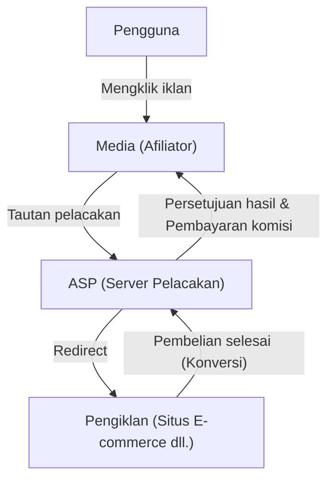
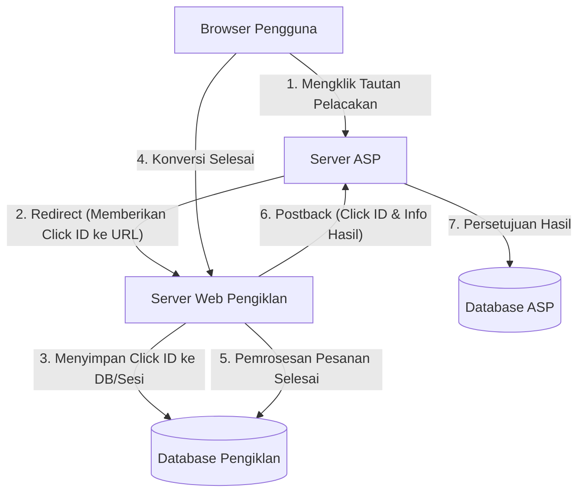

# Mekanisme Afiliasi: Di Balik Layar Teknologi Pelacakan dan Konversi

Di pasar periklanan internet, iklan berbasis kinerja (pemasaran afiliasi) memainkan peran yang sangat penting. Pengiklan (merchant) hanya membayar komisi untuk "hasil" yang nyata seperti penjualan atau perolehan prospek, sehingga dikenal luas sebagai metode pemasaran yang sangat hemat biaya.

Namun, di balik layar, terdapat teknologi pelacakan (tracking) yang canggih dan kompleks yang beroperasi untuk melacak perilaku pengguna secara akurat dan menentukan media (afiliator) mana yang menghasilkan rujukan tersebut.

Artikel ini menjelaskan aspek teknis pemasaran afiliasi: peran ASP, URL pelacakan dengan pengalihan, teknologi sisi klien seperti Cookie dan LocalStorage, serta pelacakan server-ke-server (S2S). S2S memindahkan sebagian proses pengukuran ke server; metode ini tidak mengakali pembatasan browser atau persyaratan persetujuan.

## 1. Gambaran Umum Ekosistem Afiliasi

Pemasaran afiliasi utamanya terdiri dari empat pemangku kepentingan berikut:

1. **Pengguna (Konsumen)**: Menelusuri media, mengklik iklan, serta membeli atau mendaftar untuk suatu produk.
2. **Media (Afiliator/Publisher)**: Memperkenalkan produk di situs web atau media sosial mereka sendiri untuk menghasilkan lalu lintas (traffic).
3. **ASP (Affiliate Service Provider)**: Platform yang menjembatani pengiklan dan media, serta mengelola pelacakan, pengukuran hasil, dan pembayaran komisi.
4. **Pengiklan (Merchant)**: Menyediakan produk atau layanan dan membayar biaya iklan kepada ASP.

Dalam ekosistem ini, pusat teknologi terpentingnya adalah ASP.

ASP dapat menjadi pusat data yang mencatat dan mencocokkan klik iklan dengan konversi yang dilaporkan. Tingkat perincian, ketepatan waktu, dan aturan atribusi bergantung pada implementasi serta ketentuan kontrak tiap penyedia dan pengiklan.

## 2. Mekanisme Dasar Pelacakan (Sisi Klien)

Secara historis, pelacakan afiliasi sangat bergantung pada teknologi sisi klien (browser). Di sini, kami akan membedah dan menjelaskan alur pelacakan standar konvensional.

### 2.1. URL Pelacakan dan Pengalihan (Redirect)

Banyak tautan afiliasi menggunakan URL pelacakan ASP sebelum mengarahkan pengunjung ke situs pengiklan. Ada pula sistem yang mengukur rujukan secara langsung atau di server pengiklan, sehingga pengalihan melalui ASP tidak wajib dalam setiap implementasi.

Contoh: `https://click.example-asp.com/track?aff_id=12345&campaign_id=67890`

Ketika pengguna mengklik tautan ini, proses berikut terjadi:

1. **Pencatatan Klik**: Bergantung pada implementasi dan aturan yang berlaku, ASP mencatat waktu dan pengenal iklan yang diperlukan untuk pengukuran. Jika memproses alamat IP atau User-Agent, tujuan, kebutuhan, masa penyimpanan, dan kontrol akses harus dikelola dengan jelas.
2. **Pembuatan ID Klik (Click ID)**: Sebuah "ID Klik (Click ID)" dihasilkan untuk mengidentifikasi peristiwa klik ini secara unik.
3. **Penerusan pengenal**: Sejumlah konfigurasi lama menyimpan Click ID di Cookie ASP. Cara ini tidak dapat diandalkan jika browser memblokir Cookie pihak ketiga. Konfigurasi lain meneruskan pengenal ke domain pengiklan dan, jika diizinkan, menyimpannya dalam konteks pihak pertama.
4. **Pengalihan**: Navigasi sementara biasanya menggunakan [HTTP 302](/id/p/history-of-http/) (Found) atau 307 (Temporary Redirect). 301 (Moved Permanently) menandakan perpindahan permanen dan dapat di-cache, sehingga umumnya tidak cocok untuk pengalihan pengukuran klik biasa. Beberapa implementasi menambahkan Click ID ke URL tujuan.

### 2.2. Peran Cookie dan LocalStorage

Pengguna yang mencapai situs pengiklan akan menjelajahi situs tersebut dan pada akhirnya melakukan "Konversi (CV)" seperti pembelian produk atau pendaftaran anggota.

Salah satu contoh metode sisi klien konvensional adalah memasang JavaScript atau tag gambar dari ASP, yang disebut "Tag Konversi (CV Tag)", pada halaman penyelesaian konversi (Thank You Page). Kemampuan untuk menghubungkan klik dengan konversi bergantung pada akses browser terhadap pengenal yang tersimpan dan izin untuk mengirim permintaan jaringan tag tersebut.

Ketika tag konversi dimuat, proses berikut berlangsung:

- **Membaca pengenal**: Jika diizinkan oleh implementasi, tag membaca pengenal yang disimpan dalam konteks pihak pertama pengiklan atau Click ID dari URL tujuan. Tidak dapat diasumsikan bahwa browser bisa membaca langsung Cookie pihak ketiga milik ASP.
- **Mengirim hasil**: Click ID yang tersedia dan detail konversi (misalnya nilai pembelian atau nomor pesanan) dikirim ke ASP sesuai kontrak, persetujuan, dan aturan yang berlaku.

Jika persetujuan dan aturan yang berlaku mengizinkan, pengiklan dapat menyimpan status pengukuran di `LocalStorage` atau `SessionStorage`. Penyimpanan ini dibatasi per situs dan tetap dipengaruhi fitur privasi browser serta pengaturan atau penghapusan oleh pengguna; ini bukan cadangan Cookie yang terjamin atau pengenal permanen.

## 3. Gelombang Perlindungan Privasi: Dampak ITP

Meskipun pelacakan sisi klien mudah diimplementasikan, hal itu menyimpan masalah besar. Masalah tersebut adalah "pelacakan pengguna yang berlebihan oleh Cookie pihak ketiga".

Seiring dengan meningkatnya [kekhawatiran terkait privasi](/id/p/privacy-vs-convenience-big-data/) atas pengumpulan riwayat perilaku di berbagai situs tanpa sepengetahuan pengguna, para vendor browser mulai memberlakukan pembatasan pelacakan yang ketat, dipelopori oleh **ITP (Intelligent Tracking Prevention)** yang disematkan pada browser Safari milik Apple.

### Dampak ITP terhadap Afiliasi

ITP WebKit membatasi Cookie dan penyimpanan di Safari yang mungkin digunakan untuk pelacakan lintas situs. Dampaknya bergantung pada versi browser, penggunaan, jalur navigasi, dan cara penyimpanan diatur. Contohnya:

1. **Cookie pihak ketiga**: WebKit memblokir Cookie pihak ketiga secara default dengan ITP. Karena itu, pengukuran tradisional yang membaca Cookie ASP langsung di browser tidak dapat diasumsikan berfungsi dengan pengaturan default Safari.
2. **Cookie dan penyimpanan yang disetel dengan JavaScript**: Dalam kondisi tertentu yang melibatkan tautan terklasifikasi sebagai pelacak, ITP dapat membatasi masa berlaku Cookie yang disetel JavaScript pada halaman tujuan menjadi 24 jam. Cookie yang dapat ditulis skrip dan data seperti LocalStorage juga dapat dihapus setelah pengguna tidak berinteraksi selama jangka waktu tertentu. Ini bukan aturan universal 24 jam/7 hari untuk semua Cookie.
3. **Penyimpanan pihak ketiga**: LocalStorage pihak ketiga dan penyimpanan serupa dapat dipartisi per situs atau bersifat sementara. Periksa dokumentasi WebKit terkini dan pengaturan pengguna untuk kasus sebenarnya.

Pembatasan ini dapat menyulitkan beberapa konfigurasi lama dalam menghubungkan klik dengan konversi yang terjadi kemudian. Dampaknya pada pengukuran, komisi, atau ROI berbeda menurut implementasi dan tidak dapat digeneralisasi.

## 4. Kebangkitan Pelacakan Sisi Server (S2S) dan Postback

Salah satu pendekatan adalah **pelacakan server-ke-server (Server-to-Server / S2S)**, yang juga disebut **metode Postback**, yaitu pengiriman informasi konversi dari server pengiklan ke ASP. Metode ini memindahkan sebagian proses pengukuran ke server, tetapi tidak menghapus pembatasan browser maupun persyaratan persetujuan.

### Arsitektur Pelacakan S2S

Dalam pelacakan S2S, server pengiklan dan server ASP berkomunikasi secara langsung (melalui API) tanpa bergantung pada Cookie browser maupun tag JavaScript.

1. **Klik dan Pengalihan**: Seperti sebelumnya, pengguna mengklik tautan ASP. ASP menghasilkan `Click ID` unik dan meneruskannya ke situs pengiklan sebagai parameter URL saat pengalihan (misalnya: `https://shop.example.com/?click_id=abcde12345`).
2. **Penyimpanan di sisi server**: Server Web pengiklan mengambil `click_id` dari permintaan yang diizinkan dan menyimpannya dalam sesi atau basis data jika diperlukan. Server juga dapat menyetel Cookie untuk domainnya sendiri melalui respons HTTP, tetapi tetap harus mematuhi pencegahan pelacakan browser, atribut dan masa berlaku Cookie, pengaturan pengguna, persetujuan, serta aturan yang berlaku. Pemrosesan server tidak menghilangkan pembatasan ITP.
3. **Postback saat Konversi**: Saat pengguna menyelesaikan pembelian dan pesanan dikonfirmasi oleh server pengiklan, server pengiklan mengirimkan permintaan HTTP (GET atau POST) secara langsung ke titik akhir (Endpoint/Postback URL) yang telah ditentukan oleh ASP.

### Keuntungan Pelacakan S2S

- **Kontrol alur data**: Pengiklan dapat memvalidasi, mengubah, atau menghapus kolom sebelum mengirimkannya. Persetujuan yang sesuai dan minimalisasi data tetap diperlukan.
- **Potensi pengurangan kerja browser**: Beberapa konfigurasi dapat mengurangi tag pihak ketiga dan permintaan langsung ke vendor dari halaman.
- **Penanganan percobaan ulang dan duplikasi**: Pengiriman ant server juga dapat gagal, dicoba ulang, atau terduplikasi. Rancang percobaan ulang, deduplikasi, ID peristiwa, dan pemantauan.

### Tantangan Pelacakan S2S

Tantangannya mencakup penerapan dan operasi berkelanjutan. Pengiklan mungkin perlu menerima dan menyimpan parameter, mengautentikasi permintaan, mencoba ulang dan menghapus duplikasi peristiwa, serta memantau pengiriman; hal ini dapat membebani usaha kecil. Sebagian peristiwa tetap harus berasal dari browser atau aplikasi pengguna, sehingga S2S saja belum tentu mencakup seluruh alur pengukuran.

Oleh karena itu, beberapa tahun terakhir ASP telah berupaya menurunkan rintangan implementasi pelacakan S2S dengan menyediakan plugin untuk platform-platform utama seperti Shopify dan WordPress.

## 5. Teknologi Pelacakan Generasi Berikutnya

Selain pelacakan S2S, ekosistem periklanan juga terus berevolusi.

### 5.1. Fingerprinting (Identifikasi Alternatif)
Fingerprinting menggabungkan karakteristik browser atau perangkat untuk mencoba mengidentifikasi atau melacaknya. Cara ini tidak menjamin identifikasi seseorang secara unik dan andal, memiliki risiko privasi, serta dapat terkena perlindungan browser, hukum, dan kebijakan platform. Jangan mengadopsinya begitu saja sebagai pengganti Cookie.

### 5.2. Data Clean Room dan Server-Side GTM
Data Clean Room dan kontainer sisi server Google Tag Manager (GTM) merupakan pilihan untuk mengelola pemrosesan dan pembagian data. Penggunaannya tidak otomatis menganonimkan data atau menjamin kepatuhan hukum maupun privasi. Tujuan, persetujuan dan izin, minimalisasi data, kontrol akses, serta batas keluaran perlu dirancang dan diperiksa.

## Kesimpulan

Di balik layar pemasaran afiliasi, kemajuan teknologi dan gelombang perlindungan privasi bertabrakan dengan hebat, membuat mekanisme pelacakan mengalami perubahan yang dramatis.

Metode sisi klien dan sisi server memiliki peran serta batasan yang berbeda. Pengiklan, afiliator, dan ASP perlu menetapkan tujuan dan batas pengukuran, lalu memilih implementasi dengan mempertimbangkan hukum dan aturan platform yang berlaku, persetujuan dan pilihan pengguna, minimalisasi data, serta keamanan. S2S tidak otomatis menjamin akurasi atau privasi; desain dan operasinya perlu dilakukan dengan cermat.

Memahami arsitektur sistem iklan berbasis kinerja akan menjadi semakin penting bagi setiap insinyur dan pemasar yang terlibat dalam pemasaran web di masa mendatang.

## Referensi

- [WebKit: Tracking Prevention in WebKit](https://webkit.org/tracking-prevention/)
- [WebKit: Intelligent Tracking Prevention 2.2](https://webkit.org/blog/8828/)
- [Google for Developers: Server-side tagging fundamentals](https://developers.google.com/tag-platform/learn/sst-fundamentals/2-what-is-sst)
- [IETF RFC 9110: HTTP Semantics, Redirection](https://www.rfc-editor.org/rfc/rfc9110.html)
- [WebKit: Tracking Prevention Policy](https://webkit.org/tracking-prevention-policy/)
