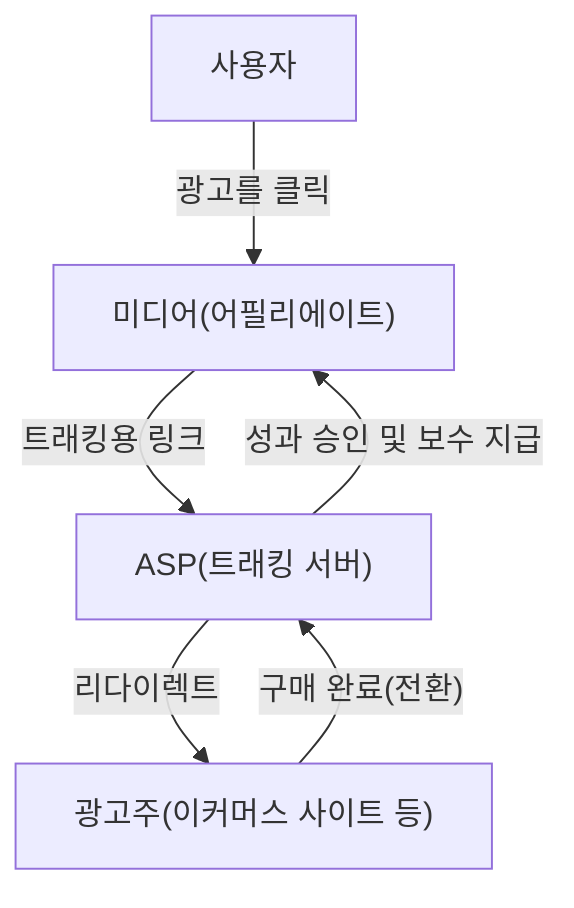
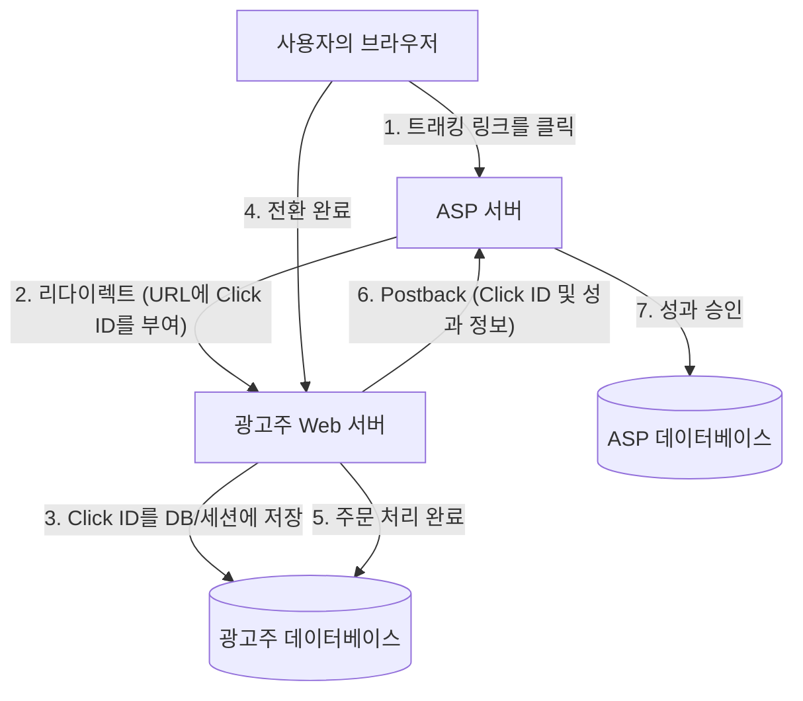

# 제휴 마케팅의 구조: 트래킹 및 전환의 기술적 이면

인터넷 광고 시장에서 성과 보상형 광고(제휴 마케팅)는 매우 중요한 역할을 수행하고 있습니다. 광고주(머천트)는 실제 매출이나 리드 획득과 같은 '성과'에 대해서만 보수를 지급하기 때문에 비용 대비 효과가 높은 마케팅 기법으로 널리 인식되고 있습니다.

하지만 그 이면에는 사용자의 행동을 정확하게 추적하고, 어떤 미디어(어필리에이트)의 소개를 통해 성과가 발생했는지를 판정하기 위한 고도화되고 복잡한 트래킹 기술이 작동하고 있습니다.

이 글에서는 ASP(어필리에이트 서비스 프로바이더)의 역할, 리다이렉트를 사용하는 트래킹 URL, 쿠키와 LocalStorage 같은 클라이언트 기술, 서버 간 트래킹(S2S)을 설명합니다. S2S는 측정 과정의 일부를 서버로 옮기는 방식이며, 브라우저 제한이나 동의 요건을 우회하지는 않습니다.

## 1. 제휴 마케팅 생태계의 전체적인 모습

제휴 마케팅은 주로 다음의 4가지 이해관계자로 구성되어 있습니다.

1. **사용자(소비자)**: 미디어를 열람하고 광고를 클릭하여 상품을 구매하거나 신청합니다.
2. **미디어(어필리에이트/퍼블리셔)**: 자신의 웹사이트나 SNS에 상품을 소개하고 트래픽을 창출합니다.
3. **ASP(어필리에이트 서비스 프로바이더)**: 광고주와 미디어를 중개하며, 트래킹, 성과 측정, 보수 지급 관리를 수행하는 플랫폼입니다.
4. **광고주(머천트)**: 상품이나 서비스를 제공하고 ASP에 광고비를 지불합니다.

이 생태계에서 기술적인 중심 허브 역할을 하는 것이 바로 ASP입니다.

ASP는 어떤 광고 클릭이 보고된 전환으로 이어졌는지 기록하고 대조하는 데이터 허브 역할을 할 수 있습니다. 기록의 세밀도, 시각의 정밀도, 어트리뷰션 규칙은 각 사업자와 광고주의 구현 및 계약 조건에 따라 달라집니다.

## 2. 트래킹의 기본 메커니즘(클라이언트 사이드)

제휴 트래킹은 역사적으로 클라이언트 사이드(브라우저) 기술에 크게 의존해 왔습니다. 여기서는 기존의 표준적인 트래킹 흐름을 분해하여 설명합니다.

### 2.1. 트래킹 URL과 리다이렉트

많은 제휴 링크는 방문자를 광고주 사이트로 보내기 전에 ASP 트래킹 URL을 사용합니다. 추천 유입을 직접 측정하거나 광고주 서버에서 측정하는 방식도 있으므로 모든 구현에서 ASP 리다이렉트가 필수인 것은 아닙니다.

예: `https://click.example-asp.com/track?aff_id=12345&campaign_id=67890`

사용자가 이 링크를 클릭하면 다음의 프로세스가 발생합니다.

1. **클릭 기록**: ASP는 구현 방식과 적용 규칙에 따라 측정에 필요한 시각과 광고 식별 정보를 기록합니다. IP 주소나 User-Agent를 처리한다면 목적, 필요성, 보존 기간, 접근 제어를 정해 관리해야 합니다.
2. **클릭 ID 생성**: 이 클릭 이벤트를 고유하게 식별하기 위한 '클릭 ID(Click ID)'가 생성됩니다.
3. **식별자 전달**: 일부 기존 구성은 ASP 쿠키에 Click ID를 저장했습니다. 브라우저가 서드파티 쿠키를 차단하는 환경에서는 이 방식을 사용할 수 있다고 가정할 수 없습니다. 다른 구성은 식별자를 광고주 도메인에 전달하고 허용되는 범위에서 퍼스트파티 영역에 저장합니다.
4. **리다이렉트**: 일시적인 이동에는 보통 [HTTP 302](/ko/p/history-of-http/)(Found) 또는 307(Temporary Redirect)을 사용합니다. 301(Moved Permanently)은 영구 이전을 뜻하고 캐시될 수 있어 일반적인 클릭 측정 리다이렉트에는 대체로 적절하지 않습니다. 일부 구현은 목적지 URL에 Click ID를 추가합니다.

### 2.2. 쿠키와 로컬 스토리지의 역할

광고주의 사이트에 도달한 사용자는 사이트 내부를 돌아다니다가, 최종적으로 상품 구매나 회원 가입 등의 '전환(CV)'에 이르게 됩니다.

기존 클라이언트 측 방식의 한 예로, 전환 완료 페이지(감사 페이지)에 ASP가 제공하는 JavaScript 또는 이미지 '전환 태그(CV 태그)'를 삽입합니다. 클릭과 전환을 연결할 수 있는지는 브라우저가 저장된 식별자에 접근할 수 있는지, 태그의 네트워크 요청을 허용하는지에 달려 있습니다.

전환 태그가 로드되면 다음의 처리가 수행됩니다.

- **식별자 읽기**: 구현이 허용하는 경우 광고주의 퍼스트파티 영역에 저장된 식별자나 목적지 URL의 Click ID를 읽습니다. 브라우저에서 ASP 서드파티 쿠키를 직접 읽을 수 있다고 가정할 수 없습니다.
- **성과 전송**: 계약, 동의, 적용 규칙에 따라 사용 가능한 Click ID와 전환 정보(구매 금액, 주문 번호 등)를 ASP에 전송합니다.

동의와 적용 규칙이 허용하는 경우 광고주는 측정 상태를 `LocalStorage`나 `SessionStorage`에 저장할 수도 있습니다. 이 저장소는 사이트별로 구분되며 브라우저 개인정보 보호 기능과 사용자 설정 또는 삭제의 영향을 받습니다. 쿠키의 확실한 백업이나 영구 식별자로 볼 수 없습니다.

## 3. 개인정보 보호의 물결: ITP의 충격

클라이언트 사이드 트래킹은 구현이 용이한 반면, 큰 문제를 안고 있었습니다. 바로 '서드 파티 쿠키에 의한 과도한 사용자 추적'입니다.

사용자가 모르는 사이에 여러 사이트를 횡단하며 행동 이력이 수집되는 것에 대한 [개인정보 보호 우려](/ko/p/privacy-vs-convenience-big-data/)가 높아지면서, Apple의 Safari 브라우저에 탑재된 **ITP(Intelligent Tracking Prevention)**를 시작으로 각 브라우저 공급업체들이 강력한 트래킹 제한을 도입하기 시작했습니다.

### ITP가 제휴 마케팅에 미친 영향

WebKit의 ITP는 Safari에서 사이트 간 추적에 사용될 수 있는 쿠키와 저장소를 제한합니다. 영향은 브라우저 버전, 이용 방식, 이동 경로, 저장 방법에 따라 다릅니다. 예를 들면 다음과 같습니다.

1. **서드파티 쿠키**: WebKit은 ITP에서 서드파티 쿠키를 기본 차단합니다. 따라서 Safari 기본 설정에서는 브라우저가 ASP 쿠키를 직접 읽는 기존 측정 방식을 전제로 할 수 없습니다.
2. **JavaScript로 설정한 쿠키와 저장소**: 추적 링크로 분류된 특정 경로에서는 ITP가 도착 페이지의 JavaScript 쿠키 수명을 24시간으로 제한할 수 있습니다. 사용자 상호작용이 장기간 없으면 스크립트로 쓸 수 있는 쿠키와 LocalStorage 등의 데이터도 삭제 대상이 될 수 있습니다. 모든 쿠키에 적용되는 일률적인 24시간/7일 규칙은 아닙니다.
3. **서드파티 저장소**: 서드파티 LocalStorage 등은 사이트별로 분리되거나 임시 저장으로 취급될 수 있습니다. 실제 동작은 최신 WebKit 설명과 사용자 설정을 확인해야 합니다.

이러한 제한으로 일부 기존 구성에서는 클릭과 나중에 발생한 전환을 연결하기 어려울 수 있습니다. 측정, 보수, 광고주 ROI에 미치는 영향은 구현에 따라 달라지므로 일률적으로 단정할 수 없습니다.

## 4. 서버 사이드 트래킹(S2S)과 포스트백의 부상

한 가지 접근 방식은 **서버 간(Server-to-Server / S2S) 트래킹**, 즉 **포스트백(Postback) 방식**으로 광고주 서버에서 ASP로 전환 정보를 보냅니다. 측정 과정 일부를 서버로 옮길 뿐, 브라우저 제한이나 동의 요건을 없애지는 않습니다.

### S2S 트래킹의 아키텍처

S2S 트래킹에서는 브라우저의 쿠키나 JavaScript 태그에 의존하지 않고, 광고주의 서버와 ASP의 서버가 직접(API를 통해) 통신을 수행합니다.

1. **클릭 및 리다이렉트**: 기존과 동일하게 사용자는 ASP의 링크를 클릭합니다. ASP는 고유한 `Click ID`를 생성하여, 리다이렉트 시의 URL 파라미터로서 광고주 사이트에 전달합니다(예: `https://shop.example.com/?click_id=abcde12345`).
2. **서버 측 저장**: 광고주의 웹 서버는 허용된 요청에서 `click_id`를 가져와 필요하면 세션이나 데이터베이스에 저장합니다. HTTP 응답으로 자사 도메인 쿠키를 설정할 수도 있지만, 브라우저 추적 방지, 쿠키 속성과 수명, 사용자 설정, 동의 및 적용 규칙을 따라야 합니다. 서버에서 처리한다고 ITP 제한이 사라지지는 않습니다.
3. **전환 시의 포스트백**: 사용자가 구매를 완료하고 광고주의 서버에서 주문 처리가 확정되는 시점에, 광고주의 서버에서 직접 ASP에 지정된 엔드포인트(Postback URL)로 HTTP 요청(GET 또는 POST)을 전송합니다.

### S2S 트래킹의 장점

- **데이터 흐름 제어**: 광고주는 파트너에게 전송하기 전에 필드를 검증·변환·삭제할 수 있습니다. 적절한 동의와 데이터 최소화가 불필요해지는 것은 아닙니다.
- **브라우저 작업을 줄일 가능성**: 일부 구성에서는 페이지의 서드파티 태그와 공급자에 직접 보내는 요청을 줄일 수 있습니다.
- **재시도와 중복 처리**: 서버 간 전송도 실패하거나 재시도·중복될 수 있으므로 재시도, 중복 제거, 이벤트 ID, 모니터링을 설계해야 합니다.

### S2S 트래킹의 과제

과제에는 도입과 지속적인 운영이 포함됩니다. 광고주는 파라미터 수신·저장, 요청 인증, 이벤트 재시도와 중복 제거, 전송 모니터링을 구현해야 할 수 있어 소규모 사업자에게 비용 부담이 될 수 있습니다. 일부 이벤트는 여전히 사용자의 브라우저나 앱에서 발생해야 하므로 S2S만으로 전체 측정 흐름을 처리하지 못할 수 있습니다.

그래서 ASP는 최근 Shopify나 WordPress 등의 주요 플랫폼을 위한 플러그인을 제공함으로써 S2S 트래킹의 도입 장벽을 낮추려는 노력을 하고 있습니다.

## 5. 차세대 트래킹 기술

S2S 트래킹에 더해, 생태계 전체에서 지속적인 진화가 이루어지고 있습니다.

### 5.1. 핑거프린팅(대체 식별)
핑거프린팅은 브라우저나 기기의 특성을 조합해 식별 또는 추적을 시도하는 방식입니다. 개인을 고유하고 안정적으로 식별한다고 보장할 수 없으며 개인정보 위험이 있고 브라우저 보호 조치, 법률, 플랫폼 정책의 적용을 받을 수 있습니다. 쿠키 대안으로 가볍게 도입해서는 안 됩니다.

### 5.2. 데이터 클린룸과 서버 사이드 GTM
데이터 클린룸과 Google Tag Manager(GTM) 서버 측 컨테이너는 데이터 처리와 공유를 관리하는 선택지입니다. 이를 사용한다고 데이터가 자동으로 익명화되거나 법 준수 및 개인정보 보호가 보장되지는 않습니다. 처리 목적, 동의와 권한, 데이터 최소화, 접근 제어, 출력 제한을 설계하고 점검해야 합니다.

## 결론

제휴 마케팅의 이면에서는 기술의 발전과 개인정보 보호의 흐름이 격렬하게 충돌하며, 트래킹 시스템은 극적인 변화를 겪고 있습니다.

클라이언트 방식과 서버 방식은 역할과 한계가 서로 다릅니다. 광고주, 어필리에이트, ASP는 측정 목적과 범위를 정하고 적용 법률과 플랫폼 규칙, 동의와 사용자 선택, 데이터 최소화, 보안을 고려해 구현 방식을 선택해야 합니다. S2S가 정확성이나 개인정보 보호를 자동으로 보장하지 않으므로 신중한 설계와 운영이 필요합니다.

성과 보상형 광고의 시스템 아키텍처를 이해하는 것은 웹 마케팅에 관련된 모든 엔지니어와 마케터에게 앞으로 더욱 중요해질 것입니다.

## 참고 자료

- [WebKit: Tracking Prevention in WebKit](https://webkit.org/tracking-prevention/)
- [WebKit: Intelligent Tracking Prevention 2.2](https://webkit.org/blog/8828/)
- [Google for Developers: Server-side tagging fundamentals](https://developers.google.com/tag-platform/learn/sst-fundamentals/2-what-is-sst)
- [IETF RFC 9110: HTTP Semantics, Redirection](https://www.rfc-editor.org/rfc/rfc9110.html)
- [WebKit: Tracking Prevention Policy](https://webkit.org/tracking-prevention-policy/)
