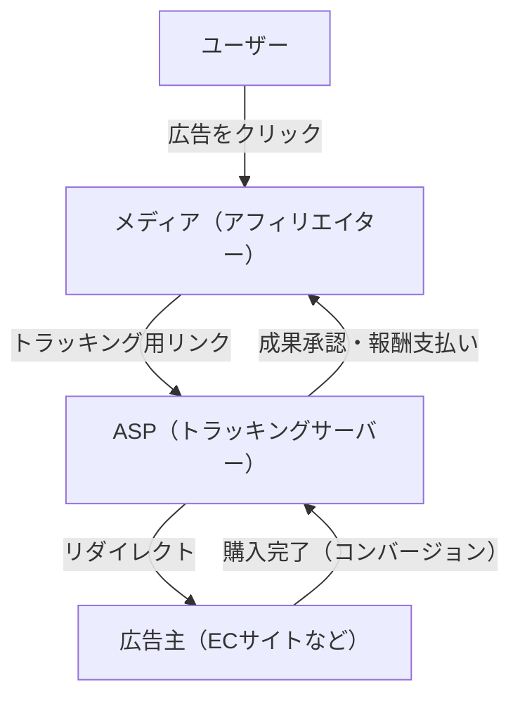
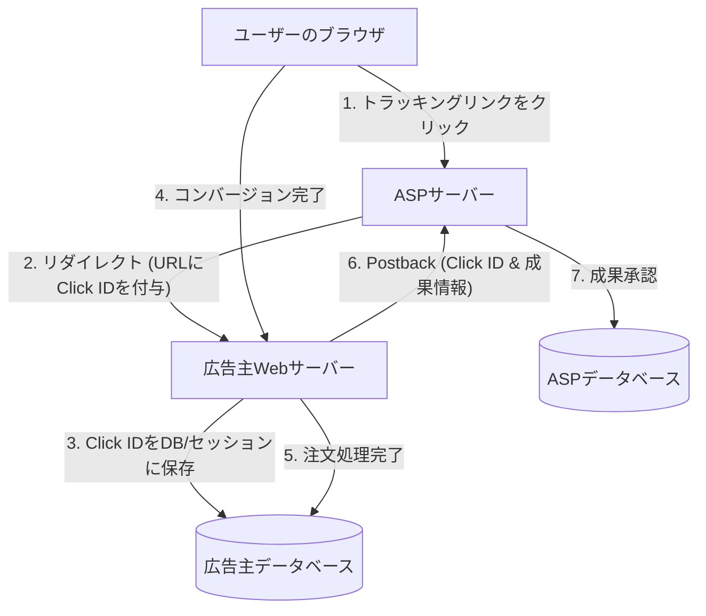

# アフィリエイトの仕組み：トラッキングとコンバージョンの技術的裏側

インターネット広告市場において、成果報酬型広告（アフィリエイト・マーケティング）は極めて重要な役割を果たしています。広告主（マーチャント）は、実際の売上やリード獲得といった「成果」に対してのみ報酬を支払うため、費用対効果の高いマーケティング手法として広く認知されています。

しかし、その裏側には、ユーザーの行動を正確に追跡し、どのメディア（アフィリエイター）の紹介によって成果が発生したのかを判定するための、高度で複雑なトラッキング技術が動いています。

本記事では、アフィリエイトシステムの中核を担うASP（アフィリエイト・サービス・プロバイダ）の役割から、リダイレクトを利用したトラッキングURLの仕組み、CookieやLocalStorageを用いたクライアントサイドの追跡技術、そして近年注目を集めるITP（Intelligent Tracking Prevention）対策としてのサーバーサイド・トラッキング（S2S）に至るまで、アフィリエイトの技術的裏側を徹底的に解説します。

## 1. アフィリエイト・エコシステムの全体像

アフィリエイト・マーケティングは、主に以下の4つのステークホルダーによって構成されています。

1. **ユーザー（消費者）**: メディアを閲覧し、広告をクリックして商品を購入・申し込む。
2. **メディア（アフィリエイター/パブリッシャー）**: 自身のウェブサイトやSNSで商品を紹介し、トラフィックを創出する。
3. **ASP（アフィリエイト・サービス・プロバイダ）**: 広告主とメディアを仲介し、トラッキング、成果計測、報酬の支払い管理を行うプラットフォーム。
4. **広告主（マーチャント）**: 商品やサービスを提供し、ASPに広告費を支払う。

このエコシステムにおいて、最も技術的なハブとなるのがASPです。

ASPは、クリックIDや成果情報を用いて、どの広告経由のクリックが成果に結びついたかを記録・照合するデータ基盤として機能します。記録の粒度や時刻の精度、アトリビューションの判断方法は、各ASPや広告主の実装・契約条件によって異なります。

## 2. トラッキングの基本メカニズム（クライアントサイド）

アフィリエイトのトラッキングは、歴史的にクライアントサイド（ブラウザ）の技術に大きく依存してきました。ここでは、従来の標準的なトラッキングフローを分解して解説します。

### 2.1. トラッキングURLとリダイレクト

アフィリエイターが掲載するリンクには、ASPのトラッキングURLを経由して広告主のサイトへ移動する方式が広く使われています。直接広告主に遷移してサーバー側で計測する方式などもあり、すべての実装がASPへのリダイレクトを必須とするわけではありません。

例：`https://click.example-asp.com/track?aff_id=12345&campaign_id=67890`

ユーザーがこのリンクをクリックすると、以下のプロセスが発生します。

1. **クリックの記録**: ASPは、実装と適用ルールに応じて、クリック時刻や広告IDなど計測に必要な情報を記録します。IPアドレスやUser-Agentを扱う場合は、利用目的、必要性、保存期間、アクセス制御を含めて適切に管理する必要があります。
2. **クリックIDの生成**: このクリックイベントを一意に識別するための「クリックID（Click ID）」が生成されます。
3. **識別子の受け渡し**: 従来型の一部の構成では、ASPが自身のドメインのCookieにクリックIDを保存しました。ただし、ブラウザがサードパーティCookieを許可しない環境ではこの方法を使えません。広告主ドメインへクリックIDを渡し、許可された範囲でファーストパーティ側に保存する方式などもあります。
4. **リダイレクト**: 一時的な遷移には通常 [HTTP 302](/p/history-of-http/)（Found）や 307（Temporary Redirect）などを使い、広告主のランディングページ（LP）へ移動させます。301（Moved Permanently）は恒久的な移転を示し、キャッシュされることもあるため、通常のクリック計測用リダイレクトには適しません。クリックIDを遷移先URLのパラメータに付ける実装もあります。

### 2.2. CookieとLocalStorageの役割

広告主のサイトに到達したユーザーは、サイト内を回遊し、最終的に商品の購入や会員登録などの「コンバージョン（CV）」に至ります。

従来のクライアントサイド方式の一例では、コンバージョン完了ページ（サンクスページ）にASPの「コンバージョンタグ（CVタグ）」と呼ばれるJavaScriptや画像タグを埋め込みます。この方式でクリックと成果を結び付けられるかは、保存した識別子をブラウザが利用できるか、タグの通信が許可されるかなどに左右されます。

コンバージョンタグが読み込まれると、以下の処理が行われます。

- **識別子の取得**: 許可される実装では、広告主のファーストパーティ領域に保存した識別子や遷移先URLのクリックIDなどを取得します。ASPのサードパーティCookieをブラウザから直接読めることを前提にはできません。
- **成果の送信**: 利用可能なクリックIDと、契約・同意・適用ルールに沿った成果情報（購入金額、注文番号など）をASPのサーバーへ送信します。

広告主のサイトで同意や適用されるルールに沿っている場合、`LocalStorage` や `SessionStorage` を計測状態の保存に使う実装もあります。ただし、これらはファーストパーティのサイト単位で管理され、ブラウザのプライバシー機能やユーザーによる削除・設定の影響を受けます。Cookieの確実なバックアップや無期限の識別子として扱うべきではありません。

## 3. プライバシー保護の波：ITPの衝撃

クライアントサイド・トラッキングは実装しやすい一方、サードパーティCookieなどを使ってサイトをまたいで利用者の行動を追跡できることから、プライバシー上の懸念を招いてきました。

ユーザーが知らない間に複数のサイトを横断して行動履歴が収集されることへの[プライバシー上の懸念](/p/privacy-vs-convenience-big-data/)が高まり、AppleのSafariブラウザに搭載された**ITP（Intelligent Tracking Prevention）**をはじめ、各ブラウザベンダーが強力なトラッキング制限を導入し始めました。

### ITPがアフィリエイトに与えた影響

WebKitのITPは、Safariにおいてクロスサイト追跡に使われる可能性のあるCookieやストレージを制限します。影響はブラウザのバージョン、利用状況、遷移方法、ストレージの設定方法などで異なります。主な例は次のとおりです。

1. **サードパーティCookie**: WebKitはITPでサードパーティCookieを既定でブロックします。したがって、ASPのCookieをブラウザから読み取る従来型の計測は、Safariの既定設定では前提にできません。
2. **JavaScriptで設定するCookieとストレージ**: ITPは、特定の追跡リンクから遷移した場合に、遷移先ページのJavaScriptが設定するCookieの有効期限を24時間に制限することがあります。また、ユーザー操作がない状態が続くと、JavaScriptで書き込めるCookieやLocalStorageなどのデータが削除対象になります。これはすべてのCookieに一律で適用される24時間／7日ルールではありません。
3. **第三者ストレージ**: サードパーティのLocalStorageなどは、サイトごとに分離されたり、一時的な保存となったりする場合があります。実際の動作はWebKitの現行仕様とユーザーの設定で確認する必要があります。

これらの制限により、クリック後に時間をおいて発生する成果を従来の方法で結び付けにくくなる場合があります。ただし、影響や計測可能性は実装ごとに異なり、報酬やROIへの効果を一律には断定できません。

## 4. サーバーサイド・トラッキング（S2S）とポストバックの台頭

ブラウザ上で動くタグや第三者への直接通信を減らし、広告主のサーバーからASPへ成果情報を送る方式の一つが**サーバー間（Server-to-Server / S2S）トラッキング**、いわゆる**ポストバック方式**です。これは計測処理の一部をサーバーへ移す方法で、ITPや同意要件を回避する仕組みではありません。

### S2Sトラッキングのアーキテクチャ

S2Sトラッキングでは、ブラウザのCookieやJavaScriptタグに依存せず、広告主のサーバーとASPのサーバーが直接（APIを介して）通信を行います。

1. **クリックとリダイレクト**: 従来通り、ユーザーはASPのリンクをクリックします。ASPは一意の `Click ID` を生成し、リダイレクト時のURLパラメータとして広告主サイトに渡します（例：`https://shop.example.com/?click_id=abcde12345`）。
2. **サーバーサイドでの保存**: 広告主のWebサーバーは、許可されたリクエストから `click_id` を取得し、必要に応じてセッションやデータベースに保存します。自社ドメインからHTTPレスポンスでCookieを設定する実装もありますが、ブラウザの追跡防止、Cookieの属性・寿命、ユーザーの設定、同意や適用されるルールに従う必要があります。サーバーで処理するだけでITPの制限がなくなるわけではありません。
3. **コンバージョン時のポストバック**: ユーザーが購入を完了し、広告主のサーバーで注文処理が確定したタイミングで、広告主のサーバーから直接ASPの指定されたエンドポイント（Postback URL）に対して、HTTPリクエスト（GETまたはPOST）を送信します。

### S2Sトラッキングのメリット

- **データ経路の制御**: サーバー側で送信項目を検証・加工・削除してからパートナーへ渡せます。ただし、適切な同意やデータ最小化が不要になるわけではありません。
- **ブラウザ上の処理を減らせる場合がある**: 広告主から多数のベンダーへ直接送るタグを減らし、ページ上の処理を軽くできる構成があります。
- **重複・欠落への対策が可能**: サーバー間送信でも通信障害や再送、重複は起こり得ます。再試行、重複排除、イベントIDや監査ログなどを設計する必要があります。

### S2Sトラッキングの課題

課題には導入・運用の技術的負担があります。広告主側でパラメータの受け取り、保存、署名・認証、再送と重複排除、監視などを実装する必要があり、小規模な事業者にはコストがかかる場合があります。また、ユーザーのブラウザやアプリからイベントを得る必要がある構成もあり、S2Sだけで全計測が完結するとは限りません。

そのため、ASPは近年、ShopifyやWordPressなどの主要なプラットフォーム向けのプラグインを提供することで、S2Sトラッキングの導入ハードルを下げる取り組みを行っています。

## 5. 次世代のトラッキング技術

S2Sトラッキングに加え、エコシステム全体でさらなる進化が続いています。

### 5.1. フィンガープリンティング（代替識別）
フィンガープリンティングは、ブラウザや端末から得られる複数の特徴を組み合わせ、識別や追跡に利用しようとする手法です。安定して個人を一意に識別できるとは限らず、プライバシー侵害のリスクがあり、ブラウザ側の対策や適用法令・ポリシーの対象にもなります。Cookieの代替として安易に使うべきではありません。

### 5.2. データクリーンルームとサーバーサイドGTM
データクリーンルームやGoogle Tag Manager（GTM）のサーバーサイドコンテナは、データの持ち寄り・処理・送信を管理する選択肢です。ただし、それらを使うだけでデータが匿名化されたり、法令順守やプライバシー保護が保証されたりするわけではありません。利用目的、同意・権限、データ最小化、アクセス制御、出力制限を設計・確認したうえで、許される範囲の分析に用います。

## まとめ

アフィリエイト・マーケティングの裏側では、技術の進化とプライバシー保護の波が激しく衝突し、トラッキングの仕組みは劇的な変化を遂げています。

クライアントサイドとサーバーサイドにはそれぞれ異なる役割と制約があります。広告主、アフィリエイター、ASPは、計測の目的と限界を明確にし、適用される法令・プラットフォーム規則、同意・選択の状態、データ最小化、セキュリティを踏まえて構成を選ぶ必要があります。S2Sは精度やプライバシーを自動的に保証するものではなく、適切な設計・運用が前提です。

成果報酬型広告のシステムアーキテクチャを理解することは、ウェブマーケティングに関わるすべてのエンジニアとマーケターにとって、今後ますます重要になるでしょう。

## 参考資料

- [WebKit: Tracking Prevention in WebKit](https://webkit.org/tracking-prevention/)
- [WebKit: Intelligent Tracking Prevention 2.2](https://webkit.org/blog/8828/)
- [Google for Developers: Server-side tagging fundamentals](https://developers.google.com/tag-platform/learn/sst-fundamentals/2-what-is-sst)
- [IETF RFC 9110: HTTP Semantics, Redirection](https://www.rfc-editor.org/rfc/rfc9110.html)
- [WebKit: Tracking Prevention Policy](https://webkit.org/tracking-prevention-policy/)
