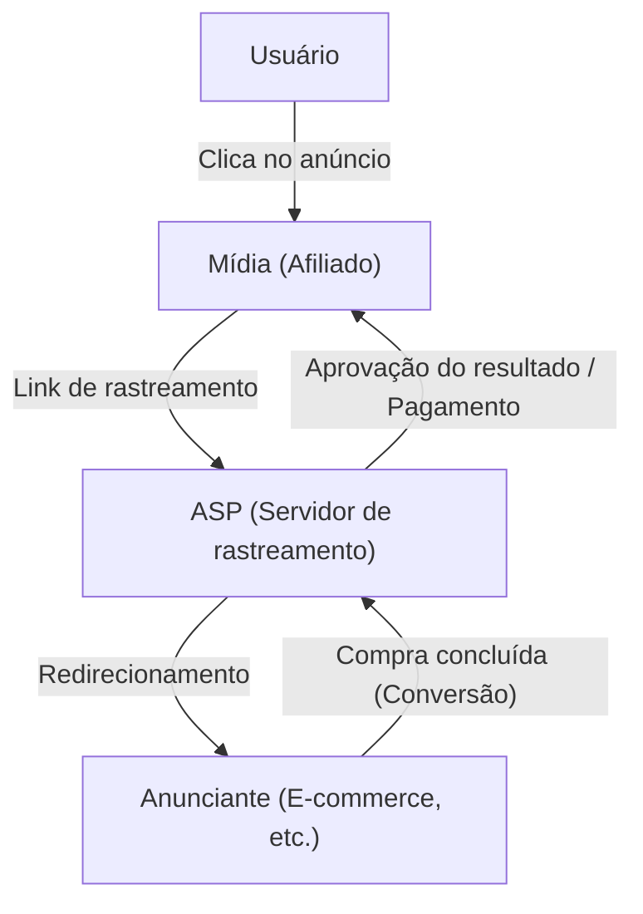
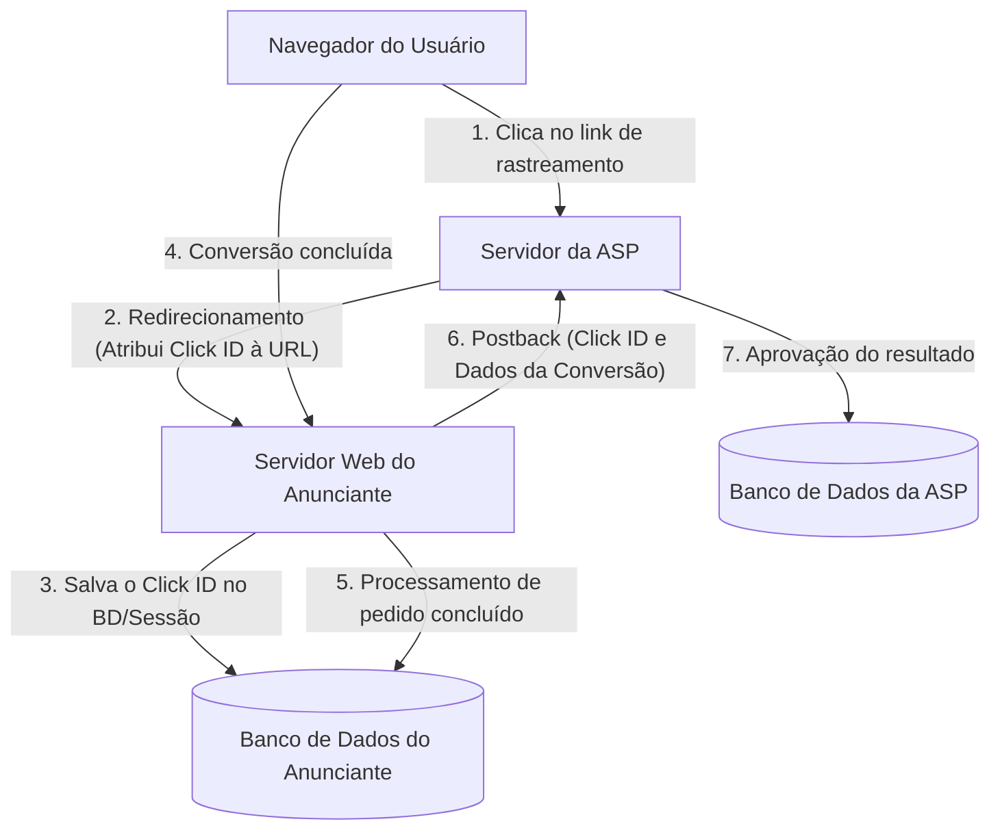

# O Mecanismo de Afiliados: Os Bastidores Técnicos do Rastreamento e Conversão

No mercado de publicidade na internet, a publicidade baseada em desempenho (marketing de afiliados) desempenha um papel fundamental. Como os anunciantes (comerciantes) pagam comissões apenas por "resultados" reais, como vendas ou geração de leads, ela é amplamente reconhecida como um método de marketing com excelente custo-benefício.

No entanto, nos bastidores, atuam tecnologias de rastreamento altamente avançadas e complexas para rastrear com precisão o comportamento do usuário e determinar a qual mídia (afiliado) o resultado gerado deve ser atribuído.

Este artigo explica os aspectos técnicos do marketing de afiliados: o papel das ASPs, URLs de rastreamento com redirecionamentos, tecnologias do lado do cliente como cookies e LocalStorage, e rastreamento entre servidores (S2S). O S2S transfere parte da medição para os servidores; não contorna as restrições dos navegadores nem os requisitos de consentimento.

## 1. Visão Geral do Ecossistema de Afiliados

O marketing de afiliados é composto principalmente por quatro stakeholders:

1. **Usuário (Consumidor)**: Acessa a mídia, clica nos anúncios e realiza compras ou inscrições.
2. **Mídia (Afiliado/Publisher)**: Apresenta produtos em seus sites ou redes sociais e gera tráfego.
3. **ASP (Provedor de Serviços de Afiliados)**: A plataforma que intermedia os anunciantes e a mídia, gerenciando o rastreamento, a medição de desempenho e o pagamento de comissões.
4. **Anunciante (Comerciante)**: Fornece os produtos ou serviços e paga as despesas de publicidade à ASP.

Neste ecossistema, o centro técnico mais importante é a ASP.

A ASP pode funcionar como um centro de dados que registra e relaciona qual clique em um anúncio levou a uma conversão informada. O nível de detalhe, a precisão temporal e as regras de atribuição dependem da implementação e das condições contratuais de cada fornecedor e anunciante.

## 2. O Mecanismo Básico de Rastreamento (Lado do Cliente)

Historicamente, o rastreamento de afiliados tem dependido fortemente das tecnologias do lado do cliente (navegador). Aqui, desmembramos o fluxo padrão tradicional de rastreamento.

### 2.1. URL de Rastreamento e Redirecionamento

Muitos links de afiliados usam uma URL de rastreamento da ASP antes de encaminhar o visitante ao site do anunciante. Outros sistemas medem a indicação diretamente ou no servidor do anunciante; portanto, nem toda implementação exige um redirecionamento pela ASP.

Exemplo: `https://click.example-asp.com/track?aff_id=12345&campaign_id=67890`

Quando o usuário clica neste link, ocorrem os seguintes processos:

1. **Registro do clique**: Conforme a implementação e as regras aplicáveis, a ASP registra o horário e os identificadores de anúncio necessários à medição. Se tratar endereços IP ou valores de User-Agent, deve definir finalidade, necessidade, período de retenção e controles de acesso.
2. **Geração do ID de clique**: É gerado um "ID de clique" (Click ID) único para identificar este evento.
3. **Transferência do identificador**: Algumas configurações antigas armazenavam o Click ID em um cookie da ASP. Não se pode presumir que isso funcione quando o navegador bloqueia cookies de terceiros. Outras configurações passam o identificador para o domínio do anunciante e, quando permitido, armazenam-no em um contexto primário.
4. **Redirecionamento**: Para navegação temporária, costuma-se usar [HTTP 302](/pt/p/history-of-http/) (Found) ou 307 (Temporary Redirect). 301 (Moved Permanently) indica uma mudança permanente e pode ser armazenado em cache, por isso geralmente não é adequado ao redirecionamento comum de medição de cliques. Algumas implementações acrescentam o Click ID à URL de destino.

### 2.2. O Papel do Cookie e do LocalStorage

O usuário que chega ao site do anunciante navega por ele e, eventualmente, atinge uma "conversão (CV)", como a compra de um produto ou o registro de membro.

Um exemplo tradicional do lado do cliente insere na página de conclusão da conversão (página de agradecimento) uma tag JavaScript ou de imagem da ASP, chamada "Tag de Conversão" (CV tag). A capacidade de relacionar o clique à conversão depende do acesso do navegador ao identificador armazenado e da permissão para a requisição de rede da tag.

Quando a tag de conversão é carregada, ocorrem os seguintes processamentos:

- **Leitura do identificador**: Quando a implementação permite, a tag lê um identificador guardado no contexto primário do anunciante ou um Click ID transmitido na URL de destino. Não se pode presumir que o navegador leia diretamente um cookie de terceiros da ASP.
- **Envio do resultado**: O Click ID disponível e os dados da conversão (como valor da compra ou número do pedido) são enviados à ASP de acordo com o contrato, o consentimento e as regras aplicáveis.

Quando o consentimento e as regras aplicáveis permitem, o anunciante também pode guardar o estado da medição em `LocalStorage` ou `SessionStorage`. Esses armazenamentos são específicos de cada site e continuam sujeitos aos recursos de privacidade do navegador e às configurações ou exclusões do usuário; não são backups garantidos de cookies nem identificadores permanentes.

## 3. A Onda de Proteção da Privacidade: O Impacto do ITP

O rastreamento do lado do cliente era fácil de implementar, mas apresentava um grande problema: o "rastreamento excessivo do usuário por meio de cookies de terceiros".

Com o aumento da [preocupação com a privacidade](/pt/p/privacy-vs-convenience-big-data/) em relação à coleta de históricos de navegação através de múltiplos sites sem o conhecimento do usuário, os desenvolvedores de navegadores começaram a introduzir fortes restrições de rastreamento, sendo o **ITP (Intelligent Tracking Prevention)** do navegador Safari da Apple o pioneiro.

### O Impacto do ITP nos Afiliados

O ITP do WebKit restringe no Safari cookies e armazenamento que podem ser usados para rastreamento entre sites. Os efeitos variam conforme a versão do navegador, o uso, o caminho de navegação e a forma de armazenamento. Exemplos:

1. **Cookies de terceiros**: O WebKit bloqueia cookies de terceiros por padrão com o ITP. Assim, não se pode presumir que a medição tradicional que lê diretamente um cookie da ASP no navegador funcione nas configurações padrão do Safari.
2. **Cookies e armazenamento definidos por JavaScript**: Em determinados casos de links classificados como rastreadores, o ITP pode limitar a 24 horas a duração dos cookies definidos por JavaScript na página de destino. Cookies graváveis por scripts e dados como LocalStorage também podem ficar sujeitos à exclusão após um período sem interação do usuário. Não é uma regra universal de 24 horas/7 dias para todos os cookies.
3. **Armazenamento de terceiros**: LocalStorage de terceiros e recursos semelhantes podem ser particionados por site ou temporários. Verifique a documentação atual do WebKit e as configurações do usuário para cada situação.

Essas restrições podem dificultar que algumas configurações tradicionais relacionem um clique a uma conversão posterior. O efeito sobre medição, comissões ou ROI varia conforme a implementação e não pode ser generalizado.

## 4. A Ascensão do Rastreamento do Lado do Servidor (S2S) e do Postback

Uma abordagem é o **rastreamento entre servidores (Server-to-Server / S2S)**, também chamado **método Postback**, que envia dados da conversão do servidor do anunciante à ASP. Ele transfere parte da medição para um servidor, mas não elimina restrições do navegador nem requisitos de consentimento.

### A Arquitetura do Rastreamento S2S

No rastreamento S2S, a comunicação não depende de cookies ou tags JavaScript no navegador; o servidor do anunciante e o servidor da ASP comunicam-se diretamente (via API).

1. **Clique e Redirecionamento**: Como antes, o usuário clica no link da ASP. A ASP gera um `Click ID` único e o passa como parâmetro de URL durante o redirecionamento para o site do anunciante (ex: `https://shop.example.com/?click_id=abcde12345`).
2. **Armazenamento no servidor**: O servidor Web do anunciante obtém `click_id` de uma requisição permitida e, se necessário, salva-o em uma sessão ou banco de dados. Também pode definir um cookie para seu próprio domínio por meio de uma resposta HTTP, mas ainda deve respeitar a prevenção de rastreamento do navegador, os atributos e a duração do cookie, as configurações do usuário, o consentimento e as regras aplicáveis. O processamento no servidor não elimina as restrições do ITP.
3. **Postback no Momento da Conversão**: Quando o usuário conclui a compra e o processamento do pedido é finalizado no servidor do anunciante, o próprio servidor envia uma requisição HTTP (GET ou POST) diretamente ao endpoint especificado pela ASP (Postback URL).

### Vantagens do Rastreamento S2S

- **Controle do fluxo de dados**: O anunciante pode validar, transformar ou remover campos antes do envio. Isso não elimina a necessidade de consentimento adequado e minimização de dados.
- **Possível redução do trabalho do navegador**: Algumas configurações podem reduzir tags de terceiros e requisições diretas a fornecedores feitas pela página.
- **Tratamento de novas tentativas e duplicatas**: O envio entre servidores também pode falhar, ser repetido ou duplicado. É preciso planejar novas tentativas, deduplicação, IDs de evento e monitoramento.

### Desafios do Rastreamento S2S

Os desafios incluem implementação e operação contínua. O anunciante talvez precise receber e armazenar parâmetros, autenticar requisições, tentar novamente e deduplicar eventos e monitorar a entrega, o que pode custar mais para pequenas empresas. Alguns eventos ainda precisam se originar no navegador ou aplicativo do usuário; portanto, o S2S sozinho pode não cobrir todo o fluxo de medição.

Por essa razão, nos últimos anos, as ASPs têm feito esforços para diminuir a dificuldade de implementação do S2S, oferecendo plugins para as principais plataformas, como Shopify e WordPress.

## 5. Tecnologias de Rastreamento de Próxima Geração

Além do rastreamento S2S, o ecossistema continua evoluindo de outras formas.

### 5.1. Fingerprinting (Identificação Alternativa)
Fingerprinting combina características de um navegador ou dispositivo para tentar identificá-lo ou rastreá-lo. Não garante a identificação única e confiável de uma pessoa, envolve riscos de privacidade e pode estar sujeito a proteções dos navegadores, leis e políticas das plataformas. Não deve ser adotado sem cautela como substituto dos cookies.

### 5.2. Data Clean Rooms e Server-Side GTM
Data Clean Rooms e contêineres server-side do Google Tag Manager (GTM) são opções para gerenciar o processamento e o compartilhamento de dados. Seu uso não anonimiza dados automaticamente nem garante conformidade legal ou privacidade. É preciso definir e verificar finalidade, consentimento e permissões, minimização de dados, controles de acesso e limites de saída.

## Conclusão

Nos bastidores do marketing de afiliados, os avanços tecnológicos e a onda de proteção à privacidade entram em conflito intenso, levando os mecanismos de rastreamento a passarem por mudanças drásticas.

As abordagens do lado do cliente e do servidor têm funções e limitações diferentes. Anunciantes, afiliados e ASPs devem definir a finalidade e os limites da medição e escolher uma implementação que considere as leis e regras de plataformas aplicáveis, o consentimento e as escolhas do usuário, a minimização de dados e a segurança. O S2S não garante precisão ou privacidade automaticamente; são necessários projeto e operação cuidadosos.

Entender a arquitetura de sistemas da publicidade de desempenho será cada vez mais essencial para todos os engenheiros e profissionais de marketing envolvidos no marketing digital.

## Referências

- [WebKit: Tracking Prevention in WebKit](https://webkit.org/tracking-prevention/)
- [WebKit: Intelligent Tracking Prevention 2.2](https://webkit.org/blog/8828/)
- [Google for Developers: Server-side tagging fundamentals](https://developers.google.com/tag-platform/learn/sst-fundamentals/2-what-is-sst)
- [IETF RFC 9110: HTTP Semantics, Redirection](https://www.rfc-editor.org/rfc/rfc9110.html)
- [WebKit: Tracking Prevention Policy](https://webkit.org/tracking-prevention-policy/)
