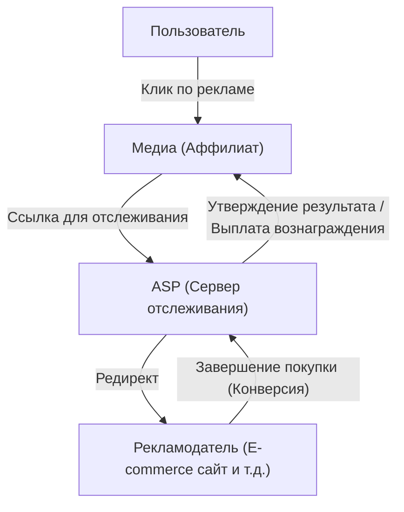
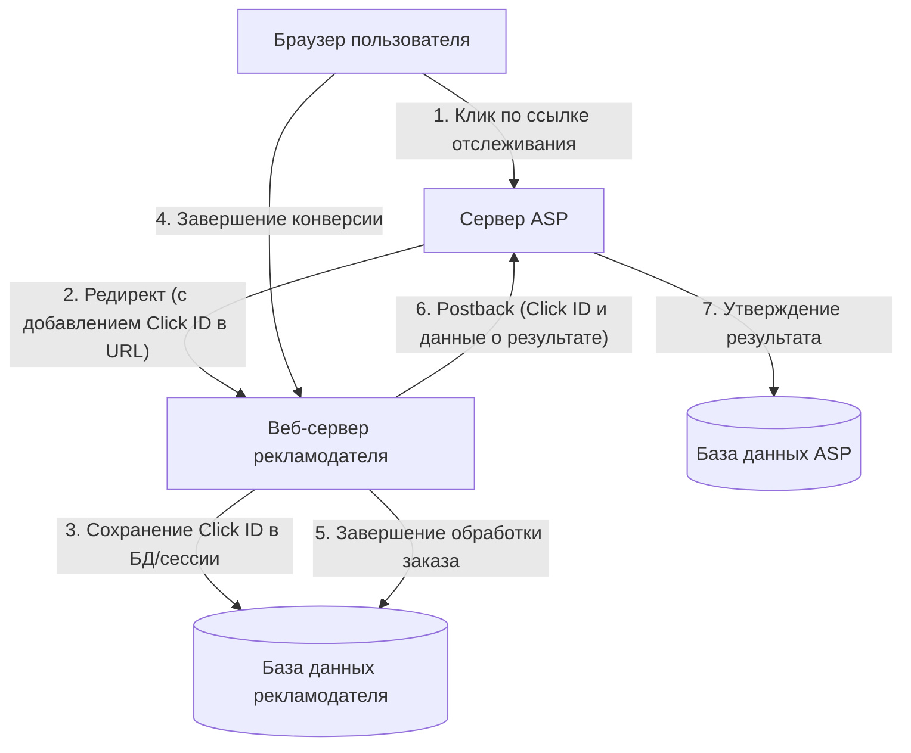

# Механизм партнерского маркетинга: Техническая сторона отслеживания и конверсии

На рынке интернет-рекламы реклама с оплатой за результат (партнерский маркетинг) играет исключительно важную роль. Рекламодатели (мерчанты) платят вознаграждение только за фактические "результаты", такие как реальные продажи или привлечение лидов, поэтому этот метод широко признан как экономически эффективный маркетинговый подход.

Однако за кулисами работают передовые и сложные технологии отслеживания, позволяющие точно отслеживать поведение пользователей и определять, благодаря какому медиа (аффилиату) был достигнут результат.

В статье рассматриваются технические аспекты партнерского маркетинга: роль ASP, URL отслеживания с перенаправлениями, клиентские технологии, такие как Cookie и LocalStorage, а также отслеживание между серверами (S2S). S2S переносит часть измерений на серверы, но не обходит ограничения браузеров или требования к согласию.

## 1. Общая картина экосистемы партнерского маркетинга

Партнерский маркетинг в основном состоит из следующих четырех заинтересованных сторон:

1. **Пользователь (Потребитель)**: Просматривает медиа, кликает по рекламе и покупает/заказывает товары.
2. **Медиа (Аффилиат/Паблишер)**: Представляет товары на своих веб-сайтах или в социальных сетях и генерирует трафик.
3. **ASP (Провайдер партнерских сервисов)**: Платформа, выступающая посредником между рекламодателями и медиа, управляющая отслеживанием, измерением результатов и выплатами вознаграждений.
4. **Рекламодатель (Мерчант)**: Предоставляет товары и услуги и платит рекламные сборы ASP.

В этой экосистеме основным техническим узлом является ASP.

ASP может служить центром данных, который регистрирует и сопоставляет рекламные клики с заявленными конверсиями. Детализация записей, точность времени и правила атрибуции зависят от реализации и договорных условий каждого поставщика и рекламодателя.

## 2. Базовые механизмы отслеживания (на стороне клиента)

Отслеживание в партнерском маркетинге исторически сильно зависело от технологий на стороне клиента (браузера). Здесь мы разберем и объясним традиционный стандартный процесс отслеживания.

### 2.1. URL-адреса отслеживания и перенаправления

Многие партнерские ссылки используют URL отслеживания ASP, прежде чем направить посетителя на сайт рекламодателя. В некоторых системах переходы измеряются напрямую или на сервере рекламодателя, поэтому перенаправление через ASP требуется не всегда.

Пример: `https://click.example-asp.com/track?aff_id=12345&campaign_id=67890`

Когда пользователь кликает по этой ссылке, происходит следующий процесс:

1. **Запись клика**: В зависимости от реализации и применимых правил ASP регистрирует время и рекламные идентификаторы, необходимые для измерения. При обработке IP-адресов или значений User-Agent следует определить цель, необходимость, срок хранения и контроль доступа.
2. **Генерация идентификатора клика**: Генерируется "Click ID" (идентификатор клика) для уникальной идентификации этого события клика.
3. **Передача идентификатора**: В некоторых старых конфигурациях Click ID сохранялся в Cookie ASP. Нельзя рассчитывать на этот способ, если браузер блокирует сторонние Cookie. Другие варианты передают идентификатор домену рекламодателя и, если это разрешено, сохраняют его в контексте первой стороны.
4. **Перенаправление**: Для временного перехода обычно применяют [HTTP 302](/ru/p/history-of-http/) (Found) или 307 (Temporary Redirect). 301 (Moved Permanently) означает постоянный перенос и может кэшироваться, поэтому обычно не подходит для обычного перенаправления при измерении кликов. Некоторые реализации добавляют Click ID в URL назначения.

### 2.2. Роль Cookie и LocalStorage

Пользователь, попавший на сайт рекламодателя, перемещается по сайту и в конечном итоге достигает "конверсии (CV)", например, покупает товар или регистрируется.

Один из традиционных клиентских вариантов — разместить на странице завершения конверсии (странице благодарности) JavaScript или тег изображения ASP, называемый тегом конверсии (CV-тегом). Связь клика с конверсией зависит от того, доступен ли браузеру сохраненный идентификатор и разрешен ли сетевой запрос тега.

Когда загружается тег конверсии, происходит следующая обработка:

- **Чтение идентификатора**: Если реализация это допускает, тег считывает идентификатор из контекста первой стороны рекламодателя или Click ID из URL назначения. Нельзя исходить из того, что браузер может напрямую читать стороннюю Cookie ASP.
- **Отправка результата**: Доступный Click ID и сведения о конверсии (например, сумма покупки или номер заказа) передаются ASP согласно договору, согласию и применимым правилам.

Если согласие и применимые правила это допускают, рекламодатель может хранить состояние измерения в `LocalStorage` или `SessionStorage`. Эти хранилища относятся к отдельному сайту и зависят от функций конфиденциальности браузера, настроек пользователя и удаления данных; они не являются гарантированной резервной копией Cookie или постоянным идентификатором.

## 3. Волна защиты конфиденциальности: Удар от ITP

Хотя отслеживание на стороне клиента было простым в реализации, оно имело серьезную проблему. Это "чрезмерное отслеживание пользователей с помощью сторонних Cookie".

Возросли [опасения по поводу конфиденциальности](/ru/p/privacy-vs-convenience-big-data/) в связи со сбором истории действий пользователей на нескольких сайтах без их ведома. В ответ на это браузеры начали вводить строгие ограничения на отслеживание, начиная с **ITP (Intelligent Tracking Prevention)**, встроенного в браузер Safari от Apple.

### Влияние ITP на партнерский маркетинг

ITP WebKit ограничивает в Safari Cookie и хранилища, которые могут использоваться для межсайтового отслеживания. Эффект зависит от версии браузера, сценария использования, пути перехода и способа хранения. Например:

1. **Сторонние Cookie**: WebKit по умолчанию блокирует сторонние Cookie с помощью ITP. Поэтому при настройках Safari по умолчанию нельзя рассчитывать на традиционное измерение, при котором браузер напрямую читает Cookie ASP.
2. **Cookie и хранилища, заданные JavaScript**: В некоторых случаях с классифицированными как трекеры ссылками ITP может ограничить срок Cookie, заданной JavaScript на целевой странице, 24 часами. Cookie и данные вроде LocalStorage, доступные для записи скриптам, также могут подлежать удалению после периода бездействия пользователя. Это не универсальное правило 24 часов/7 дней для всех Cookie.
3. **Сторонние хранилища**: Сторонний LocalStorage и подобные хранилища могут разделяться по сайтам или быть временными. Для конкретного случая следует проверить актуальную документацию WebKit и настройки пользователя.

Эти ограничения могут затруднить связывание клика с более поздней конверсией в некоторых традиционных конфигурациях. Влияние на измерения, вознаграждения или ROI зависит от реализации и не может быть обобщено.

## 4. Отслеживание на стороне сервера (S2S) и рост популярности постбэков

Один из подходов — **отслеживание сервер-сервер (Server-to-Server / S2S)**, также называемое **методом Postback**, при котором сервер рекламодателя передает сведения о конверсии ASP. Часть измерений переносится на сервер, но ограничения браузера и требования к согласию сохраняются.

### Архитектура S2S-отслеживания

При S2S-отслеживании сервер рекламодателя и сервер ASP общаются напрямую (через API), не полагаясь на файлы cookie браузера или теги JavaScript.

1. **Клик и редирект**: Как и прежде, пользователь кликает по ссылке ASP. ASP генерирует уникальный `Click ID` и передает его на сайт рекламодателя как параметр URL при редиректе (например, `https://shop.example.com/?click_id=abcde12345`).
2. **Сохранение на сервере**: Веб-сервер рекламодателя получает `click_id` из разрешенного запроса и при необходимости сохраняет его в сеансе или базе данных. Сервер также может задать Cookie для собственного домена в HTTP-ответе, однако на нее по-прежнему влияют защита браузера от отслеживания, атрибуты и срок действия Cookie, настройки пользователя, согласие и применимые правила. Серверная обработка не отменяет ограничения ITP.
3. **Постбэк при конверсии**: В тот момент, когда пользователь завершает покупку и обработка заказа подтверждается на сервере рекламодателя, HTTP-запрос (GET или POST) отправляется напрямую с сервера рекламодателя на указанную конечную точку (URL постбэка) ASP.

### Преимущества S2S-отслеживания

- **Контроль потоков данных**: Перед отправкой рекламодатель может проверить, преобразовать или удалить поля. Это не отменяет необходимость надлежащего согласия и минимизации данных.
- **Возможное сокращение нагрузки на браузер**: Некоторые конфигурации уменьшают число сторонних тегов и прямых запросов поставщикам со страницы.
- **Обработка повторов и дубликатов**: Серверная отправка также может завершиться ошибкой, повториться или продублироваться. Нужны повторы, дедупликация, идентификаторы событий и мониторинг.

### Проблемы S2S-отслеживания

Сложности связаны с внедрением и дальнейшей эксплуатацией. Рекламодателю может потребоваться принимать и хранить параметры, аутентифицировать запросы, повторять отправку и устранять дубликаты событий, а также контролировать доставку; для небольших компаний это может быть дорого. Некоторые события по-прежнему должны исходить из браузера или приложения пользователя, поэтому одного S2S может быть недостаточно для всего процесса измерения.

Поэтому в последние годы ASP стараются снизить барьер внедрения S2S-отслеживания, предоставляя плагины для основных платформ, таких как Shopify и WordPress.

## 5. Технологии отслеживания следующего поколения

Помимо S2S-отслеживания, дальнейшая эволюция продолжается во всей экосистеме.

### 5.1. Фигнерпринтинг (Альтернативная идентификация)
Фингерпринтинг объединяет характеристики браузера или устройства, пытаясь идентифицировать или отслеживать его. Он не гарантирует уникальную и надежную идентификацию человека, несет риски для конфиденциальности и может подпадать под защиту браузеров, законы и правила платформ. Не следует бездумно использовать его вместо Cookie.

### 5.2. Комнаты чистых данных (Data Clean Rooms) и серверный GTM
Чистые комнаты данных и серверные контейнеры Google Tag Manager (GTM) позволяют управлять обработкой и обменом данными. Их использование само по себе не обезличивает данные и не гарантирует соблюдение закона или конфиденциальность. Необходимо определить и проверить цель, согласие и права доступа, минимизацию данных, контроль доступа и ограничения результатов.

## Заключение

За кулисами партнерского маркетинга технологическая эволюция и волна защиты конфиденциальности жестко сталкиваются, а механизмы отслеживания претерпевают кардинальные изменения.

У клиентских и серверных методов разные задачи и ограничения. Рекламодателям, аффилиатам и ASP следует определить цель и границы измерения и выбрать реализацию с учетом применимых законов и правил платформ, согласия и выбора пользователя, минимизации данных и безопасности. S2S автоматически не гарантирует ни точность, ни конфиденциальность; необходимы продуманные проектирование и эксплуатация.

Понимание архитектуры систем рекламы с оплатой за результат будет становиться все более важным для всех инженеров и маркетологов, связанных с веб-маркетингом.

## Источники

- [WebKit: Tracking Prevention in WebKit](https://webkit.org/tracking-prevention/)
- [WebKit: Intelligent Tracking Prevention 2.2](https://webkit.org/blog/8828/)
- [Google for Developers: Server-side tagging fundamentals](https://developers.google.com/tag-platform/learn/sst-fundamentals/2-what-is-sst)
- [IETF RFC 9110: HTTP Semantics, Redirection](https://www.rfc-editor.org/rfc/rfc9110.html)
- [WebKit: Tracking Prevention Policy](https://webkit.org/tracking-prevention-policy/)
