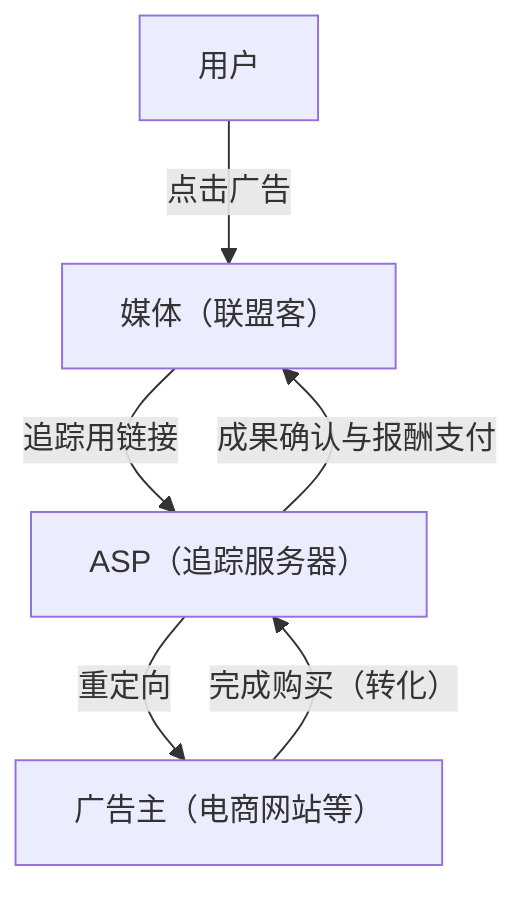
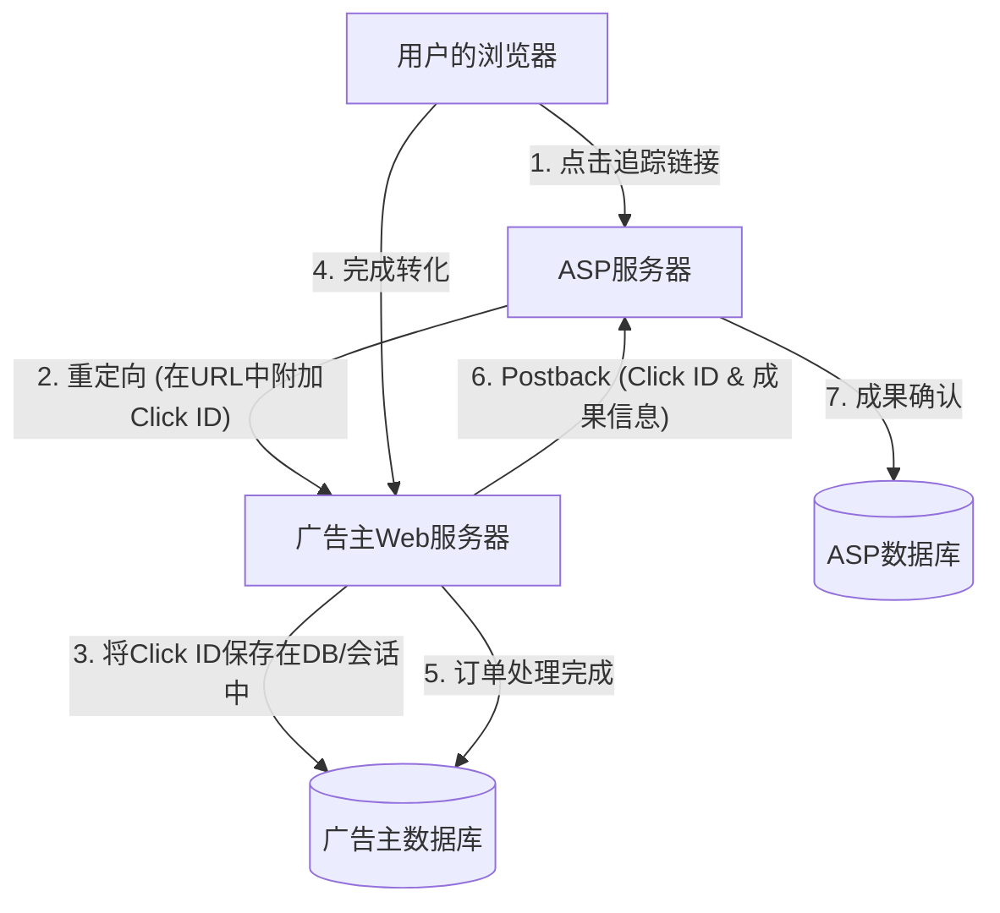

# 联盟营销机制：追踪与转化的技术内幕

在互联网广告市场中，按效果付费广告（联盟营销，Affiliate Marketing）发挥着极其重要的作用。由于广告主（Merchant）仅对实际销售额或获取潜在客户等“成果”支付报酬，它被广泛认为是高成本效益的营销手段。

然而，在其背后，运作着一套高度复杂的追踪技术，旨在准确追踪用户行为，并判定成果是由哪个媒体（联盟客，Affiliate）介绍产生的。

本文介绍联盟营销的技术机制：ASP（联盟服务提供商）的作用、使用重定向的追踪URL、Cookie和LocalStorage等客户端技术，以及服务端追踪（S2S）。S2S只是将部分测量处理转移到服务器，并不能绕过浏览器限制或同意要求。

## 1. 联盟营销生态系统全景

联盟营销主要由以下四个利益相关者构成：

1. **用户（消费者）**: 浏览媒体，点击广告并购买或申请商品。
2. **媒体（联盟客/发布商）**: 在自己的网站或社交媒体上介绍商品，创造流量。
3. **ASP（联盟服务提供商）**: 作为广告主和媒体的桥梁，负责追踪、成果衡量及报酬支付管理的平台。
4. **广告主（商家）**: 提供商品或服务，向ASP支付广告费。

在这个生态系统中，ASP是最具技术性的枢纽。

ASP可以作为数据枢纽，记录并核对哪个广告点击与报告的转化相关联。记录粒度、时间精度和归因规则取决于各服务商与广告主的实现方式及合同条件。

## 2. 追踪的基本机制（客户端）

从历史上看，联盟营销的追踪在很大程度上依赖于客户端（浏览器）技术。在此，我们将分解并解说传统的标准追踪流程。

### 2.1. 追踪URL与重定向

许多联盟链接会先通过ASP的追踪URL，再将访客带到广告主网站。也有直接衡量推荐来源或由广告主服务器进行衡量的方案，因此并非所有实现都必须经过ASP重定向。

例如：`https://click.example-asp.com/track?aff_id=12345&campaign_id=67890`

当用户点击该链接时，会发生以下流程：

1. **记录点击**：ASP根据实现方式和适用规则，记录测量所需的时间与广告标识符。如需处理IP地址或User-Agent，应明确用途、必要性、保存期限和访问控制。
2. **生成点击ID**: 生成一个唯一标识该点击事件的“点击ID（Click ID）”。
3. **传递标识符**：一些传统方案会将Click ID保存在ASP Cookie中。但如果浏览器阻止第三方Cookie，就不能假定这种方式可用。其他方案会将标识符传至广告主域名，并在允许的范围内保存在第一方环境中。
4. **重定向**：临时跳转通常使用[HTTP 302](/zh-cn/p/history-of-http/)（Found）或307（Temporary Redirect）。301（Moved Permanently）表示永久迁移，并可能被缓存，因此通常不适合普通的点击统计跳转。部分实现会在目标URL中附加Click ID。

### 2.2. Cookie与LocalStorage的作用

到达广告主网站的用户会在站内浏览，最终实现购买商品或注册会员等“转化（CV）”。

一种传统的客户端方案是在转化完成页（感谢页）嵌入ASP提供的JavaScript或图像“转化标签（CV标签）”。能否用它关联点击与转化，取决于浏览器是否允许访问已保存的标识符，以及是否允许标签发送网络请求。

当转化标签被加载时，将执行以下处理：

- **读取标识符**：在实现允许的情况下，读取广告主第一方环境中保存的标识符或目标URL中的Click ID。不能假定浏览器可直接读取ASP的第三方Cookie。
- **发送成果**：根据合同、用户同意及适用规则，将可用的Click ID和转化信息（如购买金额、订单号）发送给ASP。

在取得适当同意且符合适用规则时，广告主也可将测量状态保存在`LocalStorage`或`SessionStorage`中。这些存储按网站隔离，仍受浏览器隐私功能及用户设置或删除操作影响，不能视为可靠的Cookie备份或永久标识符。

## 3. 隐私保护浪潮：ITP的冲击

客户端追踪虽然易于实现，但也存在重大问题。那就是“利用第三方Cookie过度追踪用户”。

用户对在不知情的情况下跨多个网站收集行为记录的[隐私担忧](/zh-cn/p/privacy-vs-convenience-big-data/)日益加剧。以苹果Safari浏览器内置的**ITP（智能防追踪）**为首，各浏览器厂商开始引入强力的追踪限制。

### ITP对联盟营销的影响

WebKit的ITP会在Safari中限制可能用于跨站追踪的Cookie和存储。影响取决于浏览器版本、使用情况、跳转路径和存储设置。例子包括：

1. **第三方Cookie**：WebKit的ITP默认阻止第三方Cookie。因此，在Safari默认设置下，不能假定传统方案可以直接从浏览器读取ASP Cookie。
2. **JavaScript设置的Cookie和存储**：对于某些被识别为追踪的链接，ITP可能将落地页JavaScript设置的Cookie有效期限制为24小时。长期没有用户交互时，脚本可写入的Cookie和LocalStorage等数据也可能进入可删除范围。这不是适用于所有Cookie的统一24小时/7天规则。
3. **第三方存储**：第三方LocalStorage等存储可能按网站隔离，也可能只是临时存储。具体行为应以WebKit当前说明和用户设置为准。

这些限制可能使部分传统方案难以将点击与之后发生的转化关联起来。对测量、报酬或广告主ROI的影响因实现方式而异，不能一概而论。

## 4. 服务端追踪（S2S）与回调机制的崛起

一种方案是**服务端到服务端追踪（Server-to-Server / S2S）**，也称**Postback回调方式**，由广告主服务器向ASP发送转化信息。它将部分测量移至服务器，但不能消除浏览器限制或同意要求。

### S2S追踪的架构

在S2S追踪中，不再依赖浏览器的Cookie或JavaScript标签，而是由广告主的服务器与ASP的服务器直接（通过API）进行通信。

1. **点击与重定向**: 和传统一样，用户点击ASP的链接。ASP生成一个唯一的`Click ID`，并作为重定向时的URL参数传递给广告主网站（例：`https://shop.example.com/?click_id=abcde12345`）。
2. **服务端保存**：广告主Web服务器从获准的请求中取得`click_id`，并在需要时存入会话或数据库。也可通过HTTP响应为自有域名设置Cookie，但仍受浏览器追踪防护、Cookie属性和有效期、用户设置、同意及适用规则约束。服务器处理本身不会消除ITP限制。
3. **转化时的回调（Postback）**: 当用户完成购买，且订单在广告主的服务器中确定处理时，广告主的服务器直接向ASP指定的端点（Postback URL）发送HTTP请求（GET或POST）。

### S2S追踪的优势

- **控制数据流**：广告主可在发送前验证、转换或删除字段，但仍需取得适当同意并遵循数据最小化原则。
- **可能减少浏览器端处理**：部分架构可减少页面上的第三方标签和直接向供应商发送的请求。
- **处理重试和重复事件**：服务端请求也可能失败、重试或重复，因此需要设计重试、去重、事件ID和监控。

### S2S追踪的挑战

挑战包括实施和持续运维。广告主可能需要接收并保存参数、验证请求、重试和去重事件、监控传输，对小型企业而言成本可能较高。有些事件仍须从用户浏览器或应用产生，因此S2S不一定能独立覆盖整个测量流程。

为此，近年来ASP通过为Shopify、WordPress等主流平台提供插件，致力于降低S2S追踪的导入门槛。

## 5. 下一代追踪技术

除了S2S追踪，整个生态系统的进一步演进仍在继续。

### 5.1. 指纹识别（替代识别）
指纹识别会组合浏览器或设备特征，尝试识别或追踪设备。它不能保证唯一、可靠地识别个人，存在隐私风险，也可能受到浏览器防护、法律和平台政策约束。不应轻率地将其作为Cookie替代方案。

### 5.2. 数据无尘室与服务端GTM
数据洁净室和Google Tag Manager（GTM）服务端容器可用于管理数据处理和共享。使用这些工具本身不会自动使数据匿名化，也不能保证合规或隐私保护。需要设计并检查处理目的、同意与权限、数据最小化、访问控制和输出限制。

## 总结

在联盟营销的背后，技术的演进与隐私保护浪潮正发生着激烈碰撞，追踪机制正在发生急剧的变化。

客户端和服务端方案各有不同的作用与限制。广告主、联盟客和ASP应明确测量目的与边界，并考虑适用法律和平台规则、用户同意与选择、数据最小化及安全性。S2S不会自动保证准确性或隐私，仍需谨慎设计和运维。

理解基于效果付费广告的系统架构，对于所有从事网络营销的工程师和营销人员来说，在未来将变得越发重要。

## 参考资料

- [WebKit: Tracking Prevention in WebKit](https://webkit.org/tracking-prevention/)
- [WebKit: Intelligent Tracking Prevention 2.2](https://webkit.org/blog/8828/)
- [Google for Developers: Server-side tagging fundamentals](https://developers.google.com/tag-platform/learn/sst-fundamentals/2-what-is-sst)
- [IETF RFC 9110: HTTP Semantics, Redirection](https://www.rfc-editor.org/rfc/rfc9110.html)
- [WebKit: Tracking Prevention Policy](https://webkit.org/tracking-prevention-policy/)
