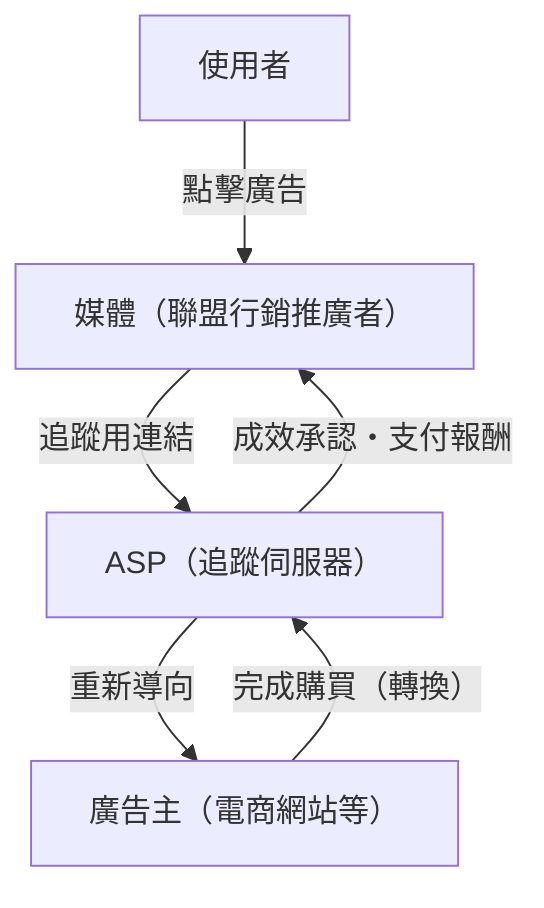
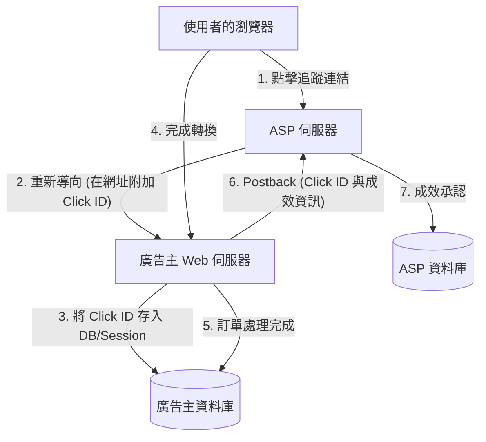

# 聯盟行銷的機制：追蹤與轉換的技術內幕

在網路廣告市場中，成效計費型廣告（聯盟行銷，Affiliate Marketing）扮演著極為重要的角色。因為廣告主 (Merchant) 僅針對實際的銷售或潛在客戶名單獲取等「成效」支付報酬，所以被廣泛認知為一種具備高成本效益的行銷手法。

然而，在其背後運作的，是為了準確追蹤使用者行為，並判定究竟是透過哪個媒體（聯盟行銷推廣者/Affiliate）的介紹才產生了成效，所仰賴的高度複雜追蹤技術。

本文介紹聯盟行銷的技術機制：ASP（聯盟行銷服務供應商）的作用、使用重新導向的追蹤網址、Cookie 與 LocalStorage 等客戶端技術，以及伺服器對伺服器追蹤（S2S）。S2S 只是將部分衡量作業移至伺服器，並不能繞過瀏覽器限制或同意要求。

## 1. 聯盟行銷生態系統的全貌

聯盟行銷主要由以下四個利害關係人（Stakeholders）構成：

1. **使用者（消費者）**：瀏覽媒體，點擊廣告並購買商品或提交申請。
2. **媒體（聯盟行銷推廣者 / 發布商）**：在自己的網站或社群媒體上介紹商品，創造流量。
3. **ASP（聯盟行銷服務供應商）**：仲介廣告主與媒體，負責追蹤、成效計算及報酬支付管理的平台。
4. **廣告主（商家）**：提供商品或服務，並向 ASP 支付廣告費。

在這個生態系統中，最具技術樞紐地位的就是 ASP。

ASP 可作為資料樞紐，記錄並核對哪個廣告點擊與回報的轉換相關。記錄粒度、時間精度及歸因規則，取決於各服務商與廣告主的實作方式及合約條件。

## 2. 追蹤的基本機制（客戶端）

在歷史上，聯盟行銷的追蹤曾高度依賴客戶端（瀏覽器）的技術。以下將拆解傳統標準的追蹤流程進行解說。

### 2.1. 追蹤網址與重新導向

許多聯盟連結會先使用 ASP 的追蹤網址，再將訪客導向廣告主網站。也有直接衡量推薦來源或由廣告主伺服器衡量的方式，因此並非每種實作都必須經過 ASP 重新導向。

範例：`https://click.example-asp.com/track?aff_id=12345&campaign_id=67890`

當使用者點擊這個連結時，會發生以下流程：

1. **點擊記錄**：ASP 會依實作方式及適用規則，記錄衡量所需的時間與廣告識別碼。若處理 IP 位址或 User-Agent，應妥善管理其用途、必要性、保存期限與存取控制。
2. **生成 Click ID**：系統會生成一個用來唯一識別此次點擊事件的「點擊 ID（Click ID）」。
3. **傳遞識別碼**：部分傳統架構會將 Click ID 儲存在 ASP Cookie 中。但若瀏覽器封鎖第三方 Cookie，就不能假設此方式可用。其他架構會將識別碼傳至廣告主網域，並在允許的範圍內存放於第一方環境。
4. **重新導向**：暫時性導覽通常使用 [HTTP 302](/zh-tw/p/history-of-http/)（Found）或 307（Temporary Redirect）。301（Moved Permanently）代表永久遷移，也可能被快取，因此一般不適合用於點擊衡量的普通重新導向。部分實作會在目的網址附加 Click ID。

### 2.2. Cookie 與 LocalStorage 的作用

抵達廣告主網站的使用者會在網站內瀏覽，並最終完成購買商品或註冊會員等「轉換（Conversion, CV）」。

一種傳統的客戶端作法，是在轉換完成頁（感謝頁）嵌入 ASP 提供的 JavaScript 或圖片「轉換標籤（CV 標籤）」。能否藉此連結點擊與轉換，取決於瀏覽器是否能存取已儲存的識別碼，以及是否允許標籤發出網路請求。

當轉換標籤被載入時，會執行以下處理：

- **讀取識別碼**：在實作允許的情況下，讀取存於廣告主第一方環境的識別碼，或目的網址中的 Click ID。不能假設瀏覽器可直接讀取 ASP 的第三方 Cookie。
- **傳送成效**：依合約、使用者同意及適用規則，將可用的 Click ID 與轉換資料（例如購買金額、訂單編號）傳送給 ASP。

在取得適當同意且符合適用規則時，廣告主也可將衡量狀態存放於 `LocalStorage` 或 `SessionStorage`。這些儲存空間依網站區隔，仍會受到瀏覽器隱私功能及使用者設定或刪除操作影響，不能視為可靠的 Cookie 備份或永久識別碼。

## 3. 隱私保護的浪潮：ITP 的衝擊

雖然客戶端追蹤的實作相對容易，但也存在一個重大問題，那就是「利用第三方 Cookie 過度追蹤使用者」。

因為在使用者不知情的情況下橫跨多個網站收集其行為記錄，引發了強烈的[隱私疑慮](/zh-tw/p/privacy-vs-convenience-big-data/)。以 Apple 的 Safari 瀏覽器所搭載的 **ITP（Intelligent Tracking Prevention，智慧防追蹤）**為首，各瀏覽器供應商開始導入強力的追蹤限制。

### ITP 對聯盟行銷造成的影響

WebKit 的 ITP 會在 Safari 限制可能用於跨網站追蹤的 Cookie 與儲存空間。影響取決於瀏覽器版本、使用情況、導覽路徑及儲存方式。例子如下：

1. **第三方 Cookie**：WebKit 的 ITP 預設會封鎖第三方 Cookie。因此在 Safari 預設設定下，不能假設傳統衡量方式可由瀏覽器直接讀取 ASP Cookie。
2. **JavaScript 設定的 Cookie 與儲存資料**：對於某些被判定為追蹤的連結，ITP 可能將到達頁面由 JavaScript 設定的 Cookie 有效期限限制為 24 小時。若一段時間沒有使用者互動，腳本可寫入的 Cookie 與 LocalStorage 等資料也可能列入刪除對象。這並非適用於所有 Cookie 的通用 24 小時／7 天規則。
3. **第三方儲存空間**：第三方 LocalStorage 等資料可能依網站分隔，或僅暫時保存。實際行為應依 WebKit 現行說明及使用者設定確認。

這些限制可能使部分傳統架構難以將點擊與之後發生的轉換連結。對衡量、報酬或廣告主 ROI 的影響因實作方式而異，不能一概而論。

## 4. 伺服器端追蹤（S2S）與 Postback 的崛起

一種作法是 **伺服器對伺服器追蹤（Server-to-Server / S2S）**，亦稱 **Postback 回傳方式**，由廣告主伺服器將轉換資料傳送給 ASP。它只是將部分衡量作業移至伺服器，並不會消除瀏覽器限制或同意要求。

### S2S 追蹤的架構

在 S2S 追蹤中，不再依賴瀏覽器的 Cookie 或 JavaScript 標籤，而是由廣告主的伺服器與 ASP 的伺服器直接（透過 API）進行通訊。

1. **點擊與重新導向**：如同以往，使用者點擊 ASP 的連結。ASP 生成唯一的 `Click ID`，並在重新導向時作為網址參數傳遞給廣告主網站（例：`https://shop.example.com/?click_id=abcde12345`）。
2. **伺服器端儲存**：廣告主 Web 伺服器從獲准的請求取得 `click_id`，並在需要時存入 Session 或資料庫。也可透過 HTTP 回應替自有網域設定 Cookie，但仍須遵循瀏覽器追蹤防護、Cookie 屬性與期限、使用者設定、同意及適用規則。伺服器處理本身不會消除 ITP 限制。
3. **轉換時的 Postback**：當使用者完成購買，並在廣告主伺服器上確定了訂單處理的時間點，廣告主的伺服器會直接向 ASP 所指定的端點（Postback URL）發送 HTTP 請求（GET 或 POST）。

### S2S 追蹤的優勢

- **資料流程控制**：廣告主可在傳送前驗證、轉換或移除欄位，但仍須取得適當同意並落實資料最小化。
- **可能減少瀏覽器端處理**：部分架構可減少頁面上的第三方標籤與直接傳送給供應商的請求。
- **處理重試與重複事件**：伺服器間傳送同樣可能失敗、重試或重複，因此必須設計重試、去重、事件 ID 與監控。

### S2S 追蹤的挑戰

挑戰包括導入與持續維運。廣告主可能需要接收並保存參數、驗證請求、重試及去重事件、監控傳送狀況，小型業者的成本可能較高。有些事件仍須由使用者的瀏覽器或 App 產生，因此 S2S 未必能單獨涵蓋整個衡量流程。

為此，近年來 ASP 致力於提供適用於 Shopify 或 WordPress 等主流平台的擴充套件（Plugin），以降低 S2S 追蹤的導入門檻。

## 5. 次世代的追蹤技術

除了 S2S 追蹤之外，整個生態系統仍在持續進化中。

### 5.1. 數位指紋（替代性識別 / Fingerprinting）
數位指紋會組合瀏覽器或裝置的特徵，嘗試識別或追蹤裝置。它不能保證唯一且可靠地識別個人，具有隱私風險，也可能受到瀏覽器防護、法律與平台政策規範。不應輕率地將它當作 Cookie 的替代品。

### 5.2. 資料無塵室與 Server-side GTM
資料潔淨室與 Google Tag Manager（GTM）伺服器端容器可用於管理資料處理與共享。使用這些工具不會自動將資料匿名化，也不保證符合法規或保護隱私。必須設計並檢查處理目的、同意與權限、資料最小化、存取控制及輸出限制。

## 總結

在聯盟行銷的背後，技術的演進與隱私保護的浪潮正激烈碰撞，追蹤機制的面貌也正經歷著戲劇性的轉變。

客戶端與伺服器端作法各有不同的角色與限制。廣告主、聯盟推廣者與 ASP 應明確定義衡量目的與界限，並考量適用法律與平台規則、使用者同意與選擇、資料最小化及安全性。S2S 不會自動保證精準度或隱私；仍須謹慎設計與維運。

對於所有參與網站行銷的工程師與行銷人員而言，理解成效計費型廣告的系統架構，在未來將會變得日益重要。

## 參考資料

- [WebKit: Tracking Prevention in WebKit](https://webkit.org/tracking-prevention/)
- [WebKit: Intelligent Tracking Prevention 2.2](https://webkit.org/blog/8828/)
- [Google for Developers: Server-side tagging fundamentals](https://developers.google.com/tag-platform/learn/sst-fundamentals/2-what-is-sst)
- [IETF RFC 9110: HTTP Semantics, Redirection](https://www.rfc-editor.org/rfc/rfc9110.html)
- [WebKit: Tracking Prevention Policy](https://webkit.org/tracking-prevention-policy/)
