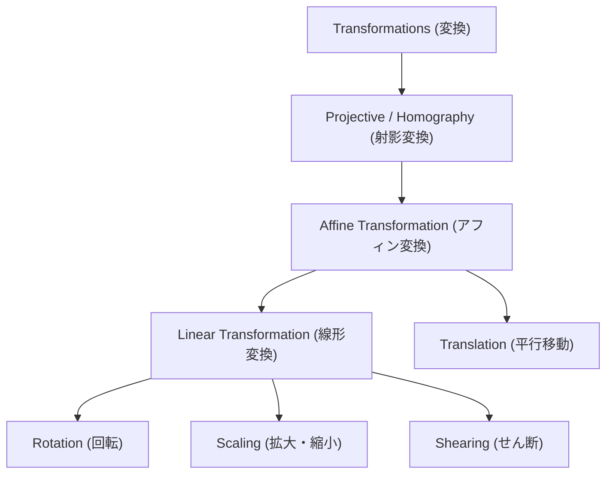
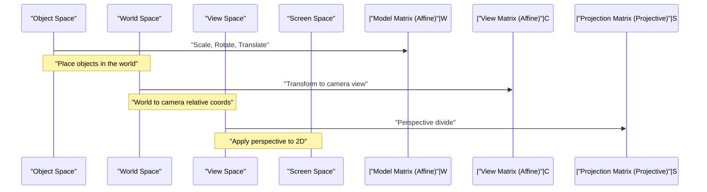

## 1. Introduction

In modern Computer Graphics (CG), image processing, and computer vision technologies, rotating 2D images or projecting 3D objects onto a 2D screen are indispensable operations. Behind these processes, powerful theories from linear algebra and geometry are actively at work. Among them, the most fundamental and crucial concepts are **Affine Transformation** and **Projective Transformation** (or Homography).

In this article, we will systematically and deeply explore the mathematical mechanisms of these two transformations, why a special coordinate system called **Homogeneous Coordinates** is required, and how they are applied in the practical realms of CG and computer vision.

## 2. Review and Limitations of Linear Transformations

Before diving into complex transformations, let us first look back at basic **Linear Transformations**. A linear transformation in a 2D space is expressed using a $2 \times 2$ matrix as follows:

$$
\begin{pmatrix} x' \\ y' \end{pmatrix} = \begin{pmatrix} a & b \\ c & d \end{pmatrix} \begin{pmatrix} x \\ y \end{pmatrix}
$$

Transformations that can be expressed in this matrix format include the following geometric operations:

- **Rotation**: An operation to rotate by an angle $\theta$.
- **Scaling**: An operation to change the scale along the $x$-axis and $y$-axis.
- **Shearing**: An operation that distorts a rectangle into a parallelogram.
- **Reflection**: An operation to flip across a specific axis.

However, these operations alone are insufficient for rendering practical CG. Here we face one major problem: **Translation**. A translation that moves the origin to another location is an operation of adding a specific vector $(t_x, t_y)$, which is represented as follows:

$$
\begin{pmatrix} x' \\ y' \end{pmatrix} = \begin{pmatrix} x \\ y \end{pmatrix} + \begin{pmatrix} t_x \\ t_y \end{pmatrix}
$$

This equation cannot be represented merely by matrix "multiplication". In the world of CG, it is necessary to sequentially apply rotations and translations to millions of vertices. If we had to switch between matrix multiplication and vector addition for every transformation, the mathematical handling would become cumbersome, and the implementation of computation pipelines and hardware would become exceedingly complex.

## 3. Affine Transformations and the Introduction of Homogeneous Coordinates

To solve this translation problem and uniformly handle all transformations using only matrix multiplication, mathematicians and engineers devised **Homogeneous Coordinates**.

### 3.1. What are Homogeneous Coordinates?

In homogeneous coordinates, one dummy dimension (usually $1$) is appended to the end of the 2D coordinates $(x, y)$ to represent it as a 3D vector $(x, y, 1)$. In general, the homogeneous coordinate $(x, y, w)$ corresponds to the Cartesian coordinate $(x/w, y/w)$ in real space (provided $w \neq 0$). Coordinates that differ by a nonzero scalar represent the same point.

### 3.2. Structure of the Affine Transformation Matrix

Using this homogeneous coordinate system, a 2D **Affine Transformation** can be beautifully represented as a $3 \times 3$ square matrix as follows:

$$
\begin{pmatrix} x' \\ y' \\ 1 \end{pmatrix} = \begin{pmatrix} a & b & t_x \\ c & d & t_y \\ 0 & 0 & 1 \end{pmatrix} \begin{pmatrix} x \\ y \\ 1 \end{pmatrix}
$$

Expanding this matrix multiplication yields the following:

$$
x' = ax + by + t_x \\
y' = cx + dy + t_y \\
1 = 0 \cdot x + 0 \cdot y + 1
$$

Brilliantly, the linear transformation part ($a, b, c, d$) and the translation part ($t_x, t_y$) have been integrated into a single matrix multiplication. The entire transformation combining a linear transformation with translation is referred to as an **Affine Transformation**.

### 3.3. Geometric Properties of Affine Transformations

The most important geometric property of an affine transformation is that **parallel lines remain parallel after transformation**. The ratios of points along a line segment (including the midpoint) are also preserved. Under an affine transformation with a nonsingular linear part, a square maps to a parallelogram, preserving the parallelism of each pair of opposite sides.

## 4. Projective Transformation: Mathematical Representation of Perspective

While affine transformations are extremely convenient and sufficient for rendering UI or simple 2D games, they cannot completely represent the mechanism by which human eyes or cameras capture the 3D world. In the real world, distant objects appear smaller, and parallel lines (like straight railway tracks or corridors) appear to intersect at a distant **Vanishing Point**. This is known as perspective.

The mathematical and rigorous modeling of this perspective is the **Projective Transformation**.

### 4.1. Structure of the Projective Transformation Matrix (Homography)

Projective transformations between 2D spaces are represented by a nonsingular $3 \times 3$ matrix in homogeneous coordinates; multiplying the entire matrix by any nonzero scalar represents the same transformation. In computer vision, this is also called a **homography matrix**. An affine transformation fixes the bottom row at $(0, 0, 1)$, while a projective transformation allows other values as long as the matrix remains nonsingular.

$$
\begin{pmatrix} X \\ Y \\ W \end{pmatrix} = \begin{pmatrix} h_{11} & h_{12} & h_{13} \\ h_{21} & h_{22} & h_{23} \\ h_{31} & h_{32} & h_{33} \end{pmatrix} \begin{pmatrix} x \\ y \\ 1 \end{pmatrix}
$$

After applying this transformation, to revert the result back to actual 2D coordinates $(x', y')$, it is necessary to divide (normalize) the entire vector by $W$.

$$
x' = \frac{X}{W} = \frac{h_{11}x + h_{12}y + h_{13}}{h_{31}x + h_{32}y + h_{33}} \\
y' = \frac{Y}{W} = \frac{h_{21}x + h_{22}y + h_{23}}{h_{31}x + h_{32}y + h_{33}}
$$

Because the denominator includes terms in $x$ and $y$, the transformed coordinates change nonlinearly. In perspective projection, this division (perspective divide) expresses depth-dependent scaling: nearby objects appear larger and distant objects appear smaller. A point with denominator $W=0$ cannot be normalized to finite 2D coordinates.

### 4.2. Class Hierarchy of Transformations

The inclusion relationships of these transformations can be organized as a hierarchical structure. Projective transformation has the highest degree of freedom, with affine transformations and linear transformations existing as its special cases.

## 5. Transformation Pipeline in CG

In the 3DCG rendering pipeline, matrix multiplication is performed sequentially in stages to transform 3D vertex data into final 2D screen coordinates. Because the space is 3-dimensional here, the homogeneous coordinate system becomes 4-dimensional $(x, y, z, 1)$, and matrices of size $4 \times 4$ are used.

1. **Model Transform**: Individual 3D models created around a reference point are placed at appropriate positions in a vast virtual world, adjusting their orientation and size. This is a pure affine transformation.
2. **View Transform**: A virtual camera is placed, and the coordinates of the entire world are transformed into "relative positions viewed from the camera". This is also a combination of affine transformations (mainly rotation and translation).
3. **Projection Transform**: The 3D scene is clipped against the view frustum and mapped to 2D screen coordinates using a $4 \times 4$ projection matrix. Dividing by the homogeneous coordinate $w$ produces the perspective-projected coordinates.

## 6. Applications in Computer Vision and Image Processing

Affine and projective transformations are extremely important not only for drawing pictures from scratch in 3DCG but also in the field of computer vision for processing and analyzing existing photos and videos.

### 6.1. Image Distortion Correction
When a planar building facade is photographed obliquely, perspective projection can make its edges appear to converge toward the top. A homography can rectify the perspective distortion of that plane: estimate the transform from corresponding corner points, then apply its inverse to produce a front-facing view. Radial lens distortion, such as barrel or pincushion distortion, is a separate effect; accurate rectification may require calibrating and correcting lens distortion first.

### 6.2. Panorama Image Stitching
Projective transformation is also deeply involved in the technology of stitching multiple photos together to create a vast panorama image. Images taken while rotating a camera with its projection center approximately fixed are geometrically related to each other such that they can be converted by a projective transformation. By extracting feature points (distinct points like corners and textures) between the images and estimating the homography matrix that overlays them with the least error, a seamless and natural panorama synthesis is realized.

## 7. Conclusion

Starting from the basic matrix operations of linear algebra, by introducing the elegant mathematical device of the homogeneous coordinate system—appending a dimension at the end—we can handle affine and projective transformations as a unified matrix multiplication.

- **Affine Transformation** expresses rigid transformations and deformations including translation, preserving parallelism.
- **Projective Transformation**, in addition to this, expresses perspective, enabling non-linear projections closer to real cameras.

Homogeneous coordinates are widely used in 3D graphics pipelines because they let transformations be composed and handled uniformly with matrix products. Projective transformations and homographies are also used for image alignment and geometric correction in computer vision. Understanding this mathematics makes the behavior of 3D software and image-processing APIs easier to follow.

