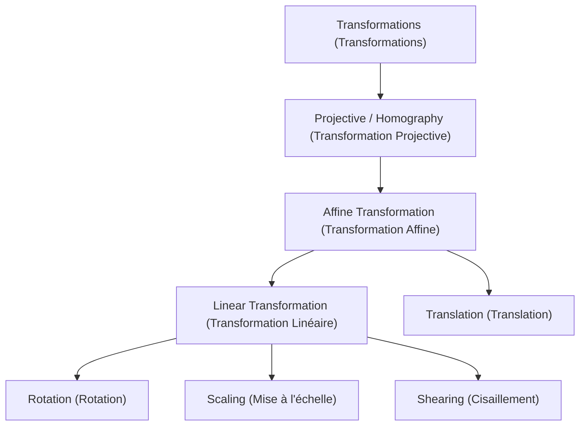
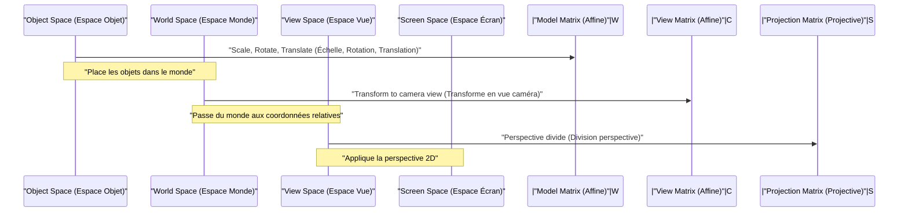

## 1. Introduction

Dans les technologies modernes de l'infographie (CG), du traitement d'images et de la vision par ordinateur, des processus tels que la rotation d'images 2D ou la projection d'objets tridimensionnels sur un écran 2D sont indispensables. Derrière ces processus opèrent les puissantes théories de l'algèbre linéaire et de la géométrie. Parmi elles, les concepts les plus fondamentaux et cruciaux sont la **Transformation Affine** (Affine Transformation) et la **Transformation Projective** (Projective Transformation / Homography).

Dans cet article, nous explorerons de manière systématique et approfondie les mécanismes mathématiques de ces deux transformations, pourquoi un système de coordonnées spécial appelé **Coordonnées Homogènes** (Homogeneous Coordinates) est nécessaire, et comment elles sont appliquées dans les mondes pratiques de l'infographie et de la vision par ordinateur.

## 2. Rappel et Limites des Transformations Linéaires

Avant de réfléchir aux transformations, passons d'abord en revue la **Transformation Linéaire** (Linear Transformation) de base. Une transformation linéaire dans un espace 2D est exprimée en utilisant une matrice $2 \times 2$ de la manière suivante :

$$
\begin{pmatrix} x' \\ y' \end{pmatrix} = \begin{pmatrix} a & b \\ c & d \end{pmatrix} \begin{pmatrix} x \\ y \end{pmatrix}
$$

Les transformations qui peuvent être exprimées sous cette forme matricielle incluent les opérations géométriques suivantes :

- **Rotation** (Rotation) : Opération de rotation d'un angle $\theta$.
- **Mise à l'échelle** (Scaling) : Opération de modification de l'échelle selon les axes $x$ et $y$.
- **Cisaillement** (Shearing) : Opération qui déforme un rectangle en un parallélogramme.
- **Réflexion** (Reflection) : Opération d'inversion par rapport à un axe spécifique.

Cependant, ces opérations seules sont insuffisantes pour rendre de la 3D (CG) pratique. Ici, nous faisons face à un problème majeur : la **Translation** (Translation). La translation, qui déplace l'origine vers un autre emplacement, est une opération d'addition d'un vecteur spécifique $(t_x, t_y)$, et est représentée ainsi :

$$
\begin{pmatrix} x' \\ y' \end{pmatrix} = \begin{pmatrix} x \\ y \end{pmatrix} + \begin{pmatrix} t_x \\ t_y \end{pmatrix}
$$

Cette équation ne peut pas être représentée par une simple « multiplication » matricielle. Dans le monde de la CG, il est nécessaire d'appliquer en continu des rotations et des translations à des millions de sommets. S'il fallait alterner entre la multiplication de matrices et l'addition de vecteurs à chaque transformation, le traitement mathématique deviendrait très fastidieux et l'implémentation des pipelines de calcul et du matériel deviendrait extrêmement complexe.

## 3. Transformations Affines et Introduction des Coordonnées Homogènes

Pour résoudre ce problème de translation et gérer de manière unifiée toutes les transformations uniquement avec des multiplications matricielles, les mathématiciens et les ingénieurs ont conçu les **Coordonnées Homogènes** (Homogeneous Coordinates).

### 3.1. Que sont les Coordonnées Homogènes ?

Dans les coordonnées homogènes, on ajoute une dimension factice (généralement $1$) à la fin des coordonnées 2D $(x, y)$, les représentant comme un vecteur 3D $(x, y, 1)$. En général, la coordonnée homogène $(x, y, w)$ correspond aux coordonnées cartésiennes $(x/w, y/w)$ dans l'espace réel (à condition que $w \neq 0$). Deux coordonnées homogènes qui diffèrent par un facteur scalaire non nul représentent le même point.

### 3.2. Structure de la Matrice de Transformation Affine

En utilisant ce système de coordonnées homogènes, une **Transformation Affine** 2D peut être magnifiquement représentée avec une matrice carrée $3 \times 3$ de la manière suivante :

$$
\begin{pmatrix} x' \\ y' \\ 1 \end{pmatrix} = \begin{pmatrix} a & b & t_x \\ c & d & t_y \\ 0 & 0 & 1 \end{pmatrix} \begin{pmatrix} x \\ y \\ 1 \end{pmatrix}
$$

En développant cette multiplication matricielle, nous obtenons ce qui suit :

$$
x' = ax + by + t_x \\
y' = cx + dy + t_y \\
1 = 0 \cdot x + 0 \cdot y + 1
$$

De manière brillante, la partie de transformation linéaire ($a, b, c, d$) et la partie de translation ($t_x, t_y$) ont été intégrées dans une seule multiplication matricielle. L'ensemble de cette transformation combinant transformation linéaire et translation est appelé **Transformation Affine**.

### 3.3. Propriétés Géométriques des Transformations Affines

La propriété géométrique la plus importante d’une transformation affine est que **les droites parallèles restent parallèles après la transformation**. Les rapports des points sur un segment, y compris le milieu, sont également conservés. Avec une transformation affine dont la partie linéaire est non singulière, un carré devient un parallélogramme et chaque paire de côtés opposés reste parallèle.

## 4. Transformation Projective : Représentation Mathématique de la Perspective

Bien que la transformation affine soit très pratique et suffisante pour dessiner des interfaces graphiques (UI) ou des jeux 2D simples, elle ne peut pas représenter complètement le mécanisme par lequel l'œil humain ou les caméras capturent le monde tridimensionnel. Dans le monde réel, les objets lointains apparaissent plus petits, et les lignes parallèles (comme des voies ferrées ou des couloirs) semblent se croiser en un **Point de Fuite** (Vanishing Point) au loin. C'est ce qu'on appelle la perspective.

La modélisation mathématique stricte de cette perspective est la **Transformation Projective** (Projective Transformation).

### 4.1. Structure de la Matrice de Transformation Projective (Homographie)

Les transformations projectives entre espaces 2D sont représentées, en coordonnées homogènes, par une matrice non singulière $3 \times 3$ ; multiplier toute la matrice par un scalaire non nul décrit la même transformation. En vision par ordinateur, on l’appelle aussi **matrice d’homographie**. Dans une transformation affine, la dernière ligne est fixée à $(0, 0, 1)$ ; une transformation projective peut prendre d’autres valeurs, à condition que la matrice reste non singulière.

$$
\begin{pmatrix} X \\ Y \\ W \end{pmatrix} = \begin{pmatrix} h_{11} & h_{12} & h_{13} \\ h_{21} & h_{22} & h_{23} \\ h_{31} & h_{32} & h_{33} \end{pmatrix} \begin{pmatrix} x \\ y \\ 1 \end{pmatrix}
$$

Après avoir appliqué cette transformation, pour ramener le résultat aux véritables coordonnées 2D $(x', y')$, il est nécessaire de diviser (normaliser) tout le vecteur par $W$.

$$
x' = \frac{X}{W} = \frac{h_{11}x + h_{12}y + h_{13}}{h_{31}x + h_{32}y + h_{33}} \\
y' = \frac{Y}{W} = \frac{h_{21}x + h_{22}y + h_{23}}{h_{31}x + h_{32}y + h_{33}}
$$

Comme le dénominateur contient des termes en $x$ et $y$, les coordonnées transformées varient de manière non linéaire. En projection perspective, cette division exprime une mise à l’échelle dépendant de la profondeur : les objets proches paraissent plus grands et les objets éloignés plus petits. Si le dénominateur $W$ vaut zéro, il est impossible de normaliser le point en coordonnées 2D finies.

### 4.2. Hiérarchie des Classes de Transformations

Les relations d'inclusion de ces transformations peuvent être organisées dans une structure hiérarchique. La transformation projective possède le plus haut degré de liberté, la transformation affine et la transformation linéaire existant en tant que cas particuliers de celle-ci.

## 5. Le Pipeline de Transformation en CG

Dans le pipeline de rendu 3DCG, afin de transformer les données des sommets 3D en coordonnées d'écran 2D finales, des multiplications matricielles sont effectuées de manière progressive et continue. L'espace étant ici tridimensionnel, le système de coordonnées homogènes devient en 4 dimensions $(x, y, z, 1)$ et des matrices de taille $4 \times 4$ sont utilisées.

1. **Transformation de Modèle** (Model Transform) : Positionne les modèles 3D individuels créés avec un point de référence à des positions appropriées dans un immense monde virtuel, ajustant leur orientation et leur taille. C'est une pure transformation affine.
2. **Transformation de Vue** (View Transform) : Place une caméra virtuelle et transforme les coordonnées du monde entier en « positions relatives vues depuis la caméra ». Il s'agit également d'une combinaison de transformations affines (principalement rotation et translation).
3. **Transformation de Projection** (Projection Transform) : La scène 3D est écrêtée par le volume de vision (frustum), puis projetée en coordonnées d’écran 2D au moyen d’une matrice de projection $4 \times 4$. La division par la coordonnée homogène $w$ donne les coordonnées en perspective.

## 6. Applications en Vision par Ordinateur et Traitement d'Images

Les transformations affines et projectives ne sont pas seulement vitales pour dessiner en 3DCG à partir de zéro, elles sont également très importantes dans le domaine de la vision par ordinateur pour le traitement et l'analyse de photographies et vidéos existantes.

### 6.1. Correction de Distorsion d'Images (Distortion Correction)
Lorsqu’une façade plane est photographiée obliquement, la projection perspective peut faire converger ses bords vers le haut. Une homographie permet de rectifier la perspective de ce plan : on estime la transformation à partir de points correspondants aux coins, puis on applique la transformation inverse pour obtenir une vue de face du plan. La distorsion radiale de l’objectif, en barillet ou en coussinet, est un phénomène distinct ; une rectification précise peut nécessiter de calibrer et corriger d’abord cette distorsion.

### 6.2. Assemblage d'Images Panoramiques (Image Stitching)
La transformation projective joue également un rôle important dans l’assemblage de photographies en panoramas. Lorsque l’appareil photo pivote autour d’un centre de projection approximativement fixe, les images obtenues sont liées géométriquement par une transformation projective. On extrait des points caractéristiques (coins ou textures saillantes) et on estime l’homographie qui les superpose au mieux afin de créer un panorama continu et naturel.

## 7. Conclusion

En partant des opérations matricielles basiques de l'algèbre linéaire, et en introduisant le mécanisme mathématique astucieux des coordonnées homogènes (l'ajout d'une dimension à la fin), nous pouvons traiter à la fois la transformation affine et la transformation projective comme des multiplications matricielles unifiées.

- La **Transformation Affine** exprime des déformations et des transformations de corps rigides, y compris la translation, tout en conservant le parallélisme.
- La **Transformation Projective** exprime en plus la perspective, permettant une projection non linéaire bien plus proche des véritables appareils photo.

Les coordonnées homogènes sont largement utilisées dans les pipelines graphiques 3D, car elles permettent de composer et de traiter les transformations uniformément par des produits matriciels. Les transformations projectives et les homographies servent aussi à aligner les images et à corriger leur géométrie en vision par ordinateur. Comprendre ces mathématiques aide à mieux saisir le fonctionnement des logiciels 3D et des API de traitement d’images.

