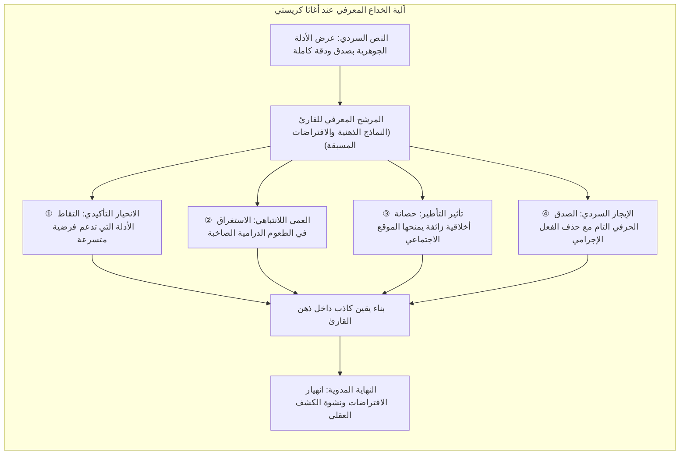
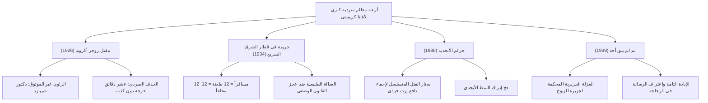
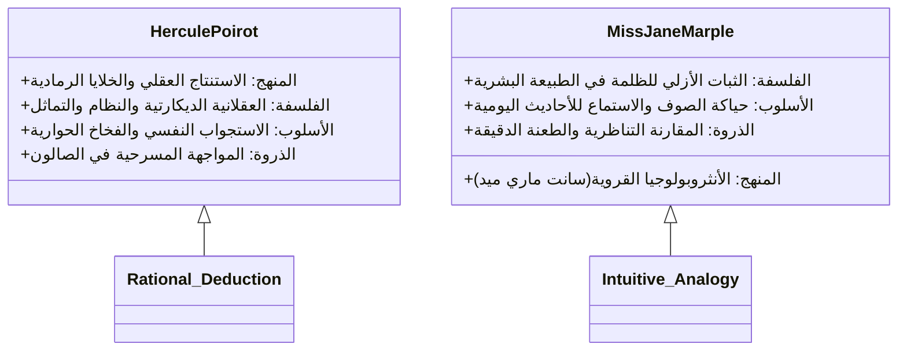

بتوزيع تجاوز ملياري نسخة وترجمات إلى أكثر من مئة لغة حول العالم، تتربع <strong>أغاثا كريستي (1890–1976)</strong>، الملقبة بـ «ملكة الجريمة»، على قمة الأدب البوليسي العالمي، ولم يتفوق عليها في تاريخ النشر البشري سوى الكتاب المقدس ومؤلفات ويليام شكسبير.

خلال العصر الذهبي لأدب الجريمة في عشرينيات وثلاثينيات القرن العشرين، حيث هيمنت تقاليد آرثر كونان دويل في فحص الأدلة المادية وقواعد «نادي التحري»، أحدثت كريستي ثورة معرفية كبرى: نقلت مركز الثقل من تتبع آثار الأقدام ورماد السجائر إلى <strong>مختبر سيكولوجي دقيق يختبر الانحيازات المعرفية والبقع العمياء في العقل البشري</strong>. تماماً مثل ساحر بارع تجذب يده اليمنى الأنظار بحركات مسرحية باهرة بينما تنفذ يده اليسرى الخدعة الخفية بهدوء، وضعت كريستي جميع الأدلة الجوهرية تحت ضوء النهار الساطع التزاماً بقواعد «اللعب النظيف» (Fair Play)، مستغلة في الوقت ذاته أحكام القارئ المسبقة وتوقعاته الأخلاقية ليقود نفسه بنفسه إلى الاستنتاج الخاطئ.

---

## 1. الأسس المعرفية للتضليل النفسي

إن التضليل عند كريستي ليس حيلة شكلية ساذجة، بل هندسة نفسية تستغل المسارات الذهنية المختصرة التي يعتمد عليها العقل البشري:

### 1.1 الانحياز التأكيدي وتأثير الأسبقية

بمجرد أن يتبنى القارئ فرضية أولية مقنعة (كالابن المتبنى المستهتر أو العشيقة الطامعة)، يبدأ <strong>الانحياز التأكيدي (Confirmation Bias)</strong> عمله الفوري. تُعاد صياغة وتفسير كل معلومة لاحقة لتخدم التصور المسبق. وحتى حينما ينقل القاتل الحقيقي قطعة أثاث أو يحرق رسالة أمام مرأى الجميع، يبرر القارئ ذلك تلقائياً بأنه تصرف بريء لحماية أحد الأقارب.

### 1.2 العمى اللانتباهي والرنجة الحمراء (*Red Herrings*)

أثبتت تجربة «الغوريلا غير المرئية» الشهيرة في علم النفس أن تركيز الانتباه الشديد على مهمة محددة يجعل العقل عاجزاً عن ملاحظة مفارقات صارخة تقع في مركز الرؤية. تستخدم كريستي <strong>الرنجة الحمراء (Red Herrings)</strong> ببراعة: زجاجات سموم غريبة، رسائل مشفرة، وخناجر دمشقية. وبينما يجهد القارئ فكره في حل هذه الرموز الدرامية، يتجاهل تحريك كرسي بذراعين مسافة نصف متر لإخفاء جهاز تسجيل وجثة.

### 1.3 الصدق اللغوي الصارم ومبدأ اللعب النظيف

تتجلى عبقرية كريستي في التزامها المطلق بعدم الكذب الصريح في المتن السردي. عند إعادة قراءة رواياتها بعد معرفة القاتل، يكتشف القارئ أن كل عبارة كُتبت كانت صادقة بالمعنى الحرفي للكلمة. فالذي خدع القارئ لم يكن قلم الكاتبة، بل غروره المعرفي واستنتاجاته السطحية.

---

## 2. التشريح البنيوي لأربع روائع خالدة

### 2.1 *مقتل روجر أكرويد* (1926): قمة الراوي غير الجدير بالثقة

حطمت هذه الرواية الميثاق غير المكتوب الذي يعتبر الراوي ومساعد المحقق ركيزة الأمانة الأخلاقية. يوثق الدكتور جيمس شيبارد التحقيق بوقار الطبيب الموثوق، بينما هو في الحقيقة المبتز والقاتل الفعلي لأكرويد.

تكمن العبقرية في <strong>الحذف السردي المتقن</strong>. كتب شيبارد واصفاً لحظة الجريمة: *«كان الباب مغلقاً. غادرت الغرفة في التاسعة والنصف تماماً. ولم يتبق لدي أي عمل لأقوم به»*. يتخيل القارئ زيارة طبية هادئة، بينما عبارة «لم يتبق أي عمل» كانت إقراراً مخيفاً بإتمام الطعن وتشغيل المسجل لضبط حجة الغياب. لم تكذب كريستي بحرف واحد، بل مارست الحذف السردي المحسوب.

### 2.2 *جريمة في قطار الشرق السريع* (1934): التواطؤ الجماعي

في قطار فاخر تحاصره الثلوج في البلقان، يُقتل المجرم الأمريكي راتشيت باثنتي عشرة طعنة متباينة القوة والزوايا، وتتشابك حجج غياب الركاب بإحكام هندسي مذهل.

يفجر بوارو فرضية الجاني المنفرد باكتشاف صادم: <strong>المسافرون الاثنا عشر هم جميعاً متواطئون ومنفذون للجريمة</strong>. متوحدين بذكرى مأساة اختطاف الطفلة ديزي أرمسترونغ، شكلوا محكمة شعبية سرية من اثني عشر محلفاً لإعدام مجرم أفلت من قبضة القضاء الرسمي.

### 2.3 *جرائم الأبجدية* (1936): التمويه بالقتل المتسلسل

تروع إنجلترا بسلسلة اغتيالات تتبع الترتيب الهجائي للمدن والضحايا: أليس آشر في أندوفر (A)، بيتي برنارد في بيكسهيل (B)، والسير كارمايكل كلارك في تشيرستون (C)، مع ترك دليل قطارات ABC بجوار كل جثة.

تعتمد الحيلة على <strong>إخفاء دافع طمع مالي فردي خلف هستيريا قاتل متسلسل وهمي</strong>. كان الجاني يستهدف فقط الضحية C للاستيلاء على ثروته؛ وما الضحايا الآخرون إلا طعوم للتغطية وتضليل الشرطة نحو فرضية مجنون عشوائي.

### 2.4 *ثم لم يبق أحد* (1939): كمال اللغز المغلق

يُستدرج عشرة أشخاص ذوي ماضٍ ملوث بجرائم غير معاقبة إلى جزيرة صخرية معزولة. وعلى إيقاع أنشودة أطفال مرعبة، يُقتلون تباعاً دون وجود أي كائن غريب على الجزيرة، حتى تنتحر الناجية الأخيرة هلعاً، لتبقى الجزيرة خاوية تماماً.

حُل هذا اللغز الرياضي المستحيل عبر مؤامرة القاضي وارغريف، الذي زيّف مقتله بمساعدة طبيب ساذج، وراقب فناء الناجين، ثم انتحر بآلية ميكانيكية مبتكرة، تاركاً اعترافه في زجاجة ألقاها في البحر.

---

## 3. ثنائية التحقيق: بوارو والآنسة ماربل

### 3.1 هيركيول بوارو: سيادة الخلايا الرمادية

يرفض المحقق البلجيكي الانحناء لفحص الوحل، معتمداً على التأمل الفكري الصافي:
- <strong>قناع الغريب غريب الأطوار:</strong> يبالغ في لهجته الفرنسية وحركاته المسرحية ليدفع المشتبه بهم للاستهانة به والبوح بأسرارهم.
- <strong>مشهد الصالون:</strong> جمع كل الأطراف في قاعة واحدة لتوليد ضغط سيكولوجي هائل يفضي إلى الاعتراف.

### 3.2 الآنسة جين ماربل: حكمة التناظر القروي

العجوز البسيطة من قرية سانت ماري ميد تقلب الصور النمطية للمجتمع الفيكتوري:
- <strong>التناظر القروي:</strong> ترى أن الجرائم المعقدة لا تختلف في جوهرها عن شرور وخيانات بسطاء قريتها.
- <strong>التخفي الاجتماعي:</strong> خلف إبر الحياكة وابتسامة العجوز الوديعة، تلتقط أسراراً لا يفصح بها أحد لضباط الشرطة.

---

## 4. الدقة السمية والواقعية العلمية

تستند مصداقية كريستي إلى معرفتها الصيدلانية الصارمة التي اكتسبتها أثناء عملها ممرضة ومساعدة صيدلي خلال الحربين العالميتين.

| السم | الرواية | التأثير الدوائي | الاستخدام السردي |
|---|---|---|---|
| <strong>الستركنين</strong> | *قضية ستايلز الغامضة* | حصر مستقبلات الغليسين، تشنجات كزازية، اختناق مع وعي كامل | تأخير الامتصاص عبر تفاعل ترسيب كيميائي لصنع حجة غياب |
| <strong>سيانيد البوتاسيوم</strong> | *السيانيد المتلألئ* | تثبيط أكسيداز السيتوكروم، نقص أكسجين خلوي فوري | التمويه داخل فوران ولون الشمبانيا |
| <strong>الثاليوم</strong> | *الحصان الأشهب* | تخريب الأيض الخلوي، تساقط الشعر، التهاب الأعصاب | محاكاة أمراض طبيعية أو التهاب الدماغ لتفادي الشبهة الجنائية |
| <strong>المورفين</strong> | *السرو الحزين* | تثبيط الجهاز العصبي المركزي، تضيق بؤبؤ العين، فشل تنفسي | خلطه في الشاي أو الأطعمة الخفيفة |

ويعد كتاب *الحصان الأشهب* (1961) شاهداً فريداً، حيث أدى وصفها الدقيق لأعراض التسمم بالثاليوم إلى تشخيص أطباء وممرضات لحالات مرضية غامضة في الواقع وإنقاذ حياة العديد من الضحايا.

---

## 5. الأثر الخالد في الأدب البوليسي

بتطويرها للبنى السردية للغز مع الحفاظ على روح اللعب النظيف، أسست أغاثا كريستي قواعد الرواية النفسية الحديثة، وألهمت تيار <strong>شين-هونكاكو (Shin-Honkaku)</strong> في اليابان (*جرائم القصر العشاري* ليوكيتو أياتسوجي). ويبقى فنها في التلاعب الإدراكي مرجعاً أبدياً في فنون السرد المعلق.
