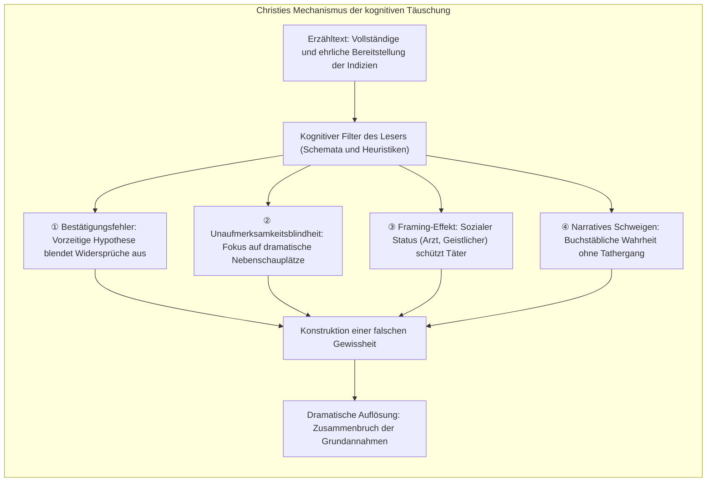
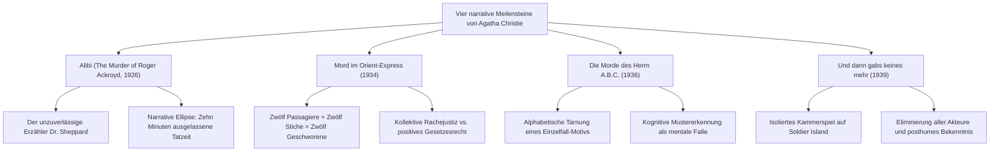
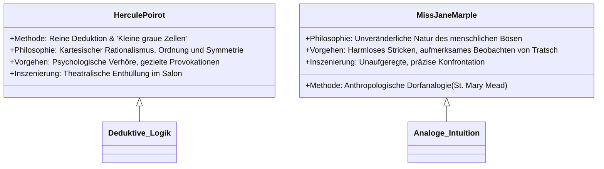

Mit über zwei Milliarden verkauften Exemplaren und Übersetzungen in mehr als einhundert Sprachen steht <strong>Agatha Christie (1890–1976)</strong> als unangefochtene „Königin des Kriminalromans“ (Queen of Crime) an der Spitze der weltweiten Literaturgeschichte, nur übertroffen von der Bibel und den Werken William Shakespeares.

Im Goldenen Zeitalter der Kriminalliteratur (Golden Age of Detective Fiction) der 1920er und 1930er Jahre, als das Erbe Arthur Conan Doyles die forensische Spurensuche und die strikten Kodizes des britischen *Detection Club* dominierte, vollzog Christie eine tiefgreifende Paradigmenverschiebung: weg von der bloßen Jagd nach Fußspuren und Ascheresten, hin zu einem <strong>präzise konstruierten Experiment mit menschlichen Denkfehlern und kognitiven blinden Flecken</strong>. Wie ein meisterhafter Zauberkünstler, der mit ausladenden Gesten der rechten Hand die Aufmerksamkeit des Publikums fesselt, während die linke Hand unsichtbar die eigentliche Manipulation vollzieht, präsentierte Christie alle entscheidenden Hinweise unter strikter Wahrung des Fair-Play-Prinzips völlig offen vor den Augen des Lesers – wohl wissend, dass dessen eigene Vorurteile, moralische Erwartungen und sprachliche Assoziationen ihn unweigerlich in eine gedankliche Sackgasse führen würden.

---

## 1. Erkenntnistheoretische Mechanismen der Irreführung

Die literarische Täuschung bei Agatha Christie beruht keineswegs auf billigen Taschenspielertricks, sondern auf einer tiefen Einsicht in die <strong>evolutionär bedingten Abkürzungen der menschlichen Informationsverarbeitung</strong>:

### 1.1 Bestätigungsfehler und Primäreffekt

Sobald ein Leser zu Beginn der Handlung eine plausible Deutung akzeptiert (beispielsweise den verschuldeten Neffen mit offensichtlichem Motiv), setzt der <strong>Bestätigungsfehler (Confirmation Bias)</strong> ein. Nachfolgende Ereignisse werden selektiv so interpretiert, dass sie das bestehende Vorurteil stützen. Selbst wenn der wahre Täter vor den Augen der Gesellschaft Möbel rückt oder Briefe verbrennt, deutet der Leser diese Handlungen als unbedeutende Marotte oder als Versuch, Angehörige zu decken.

### 1.2 Unaufmerksamkeitsblindheit und falsche Fährten (Red Herrings)

Das klassische Experiment des „unsichtbaren Gorillas“ belegt, dass intensive Konzentration auf ein bestimmtes Merkmal dazu führt, dass völlig offensichtliche Anomalien übersehen werden. Christie platzierte meisterhaft opulente <strong>rote Heringe (Red Herrings)</strong>: exotische Giftfläschchen, zerrissene Liebesbriefe und mysteriöse Einbrecherwerkzeuge. Während der Leser über diese dramatischen Requisiten rätselt, wird das entscheidende Detail – etwa ein um sechzig Zentimeter verrückter Lehnstuhl, der ein Diktiergerät verdeckt – als nebensächliches Rauminventar ausgefiltert.

### 1.3 Absolute sprachliche Redlichkeit im Fair Play

Die künstlerische Integrität Christies zeigt sich darin, dass sie den Leser niemals faktisch belügt. Bei einer erneuten Lektüre nach Kenntnis der Auflösung stellt man fest, dass jede Formulierung des Täters mit buchstäblicher Exaktheit wahr war. Die Täuschung entstand nicht durch falsche Aussagen der Autorin, sondern durch die unzulässigen Schlussfolgerungen des Lesers.

---

## 2. Strukturanalyse der vier epochalen Meisterwerke

### 2.1 Alibi (*The Murder of Roger Ackroyd*, 1926)

Mit diesem Roman revolutionierte Christie das Genre durch die radikale Demontage der ungeschriebenen Regel, dass der Ich-Erzähler und Chronist (der archetypische Dr. Watson) moralisch unantastbar sein müsse. Dr. James Sheppard, der angesehene Landarzt, dokumentiert die Ermittlungen akribisch, während er selbst der Erpresser und Mörder Ackroyds ist.

Christies Geniestreich liegt in der <strong>narrativen Ellipse (narrative omission)</strong>. Sheppard schreibt über den Zeitpunkt des Mordes: *„Die Tür war verschlossen. Ich verließ das Zimmer um halb zehn. Meine Arbeit war getan.“* Der Leser interpretiert dies als ärztliche Routine; in Wirklichkeit bezog sich „meine Arbeit“ auf den vollendeten Mord und die Platzierung des Diktiergeräts. Es liegt keine Lüge vor, sondern das Aussparen der kriminellen Handlung im Text.

### 2.2 Mord im Orient-Express (*Murder on the Orient Express*, 1934)

In einem im Schneechaos steckengebliebenen Luxuszug wird der zwielichtige Millionär Ratchett mit zwölf Messerstichen ermordet. Die Stiche weisen unterschiedliche Tiefen und Richtungen auf; die Alibis der Passagiere greifen lückenlos ineinander.

Poirot dekonstruiert die Grundannahme des klassischen Detektivromans, nach der ein einzelner Täter isoliert werden muss. Seine bahnbrechende Erkenntnis: <strong>Sämtliche zwölf Passagiere sind gemeinschaftliche Täter</strong>. Als improvisiertes Geschworenengericht vollstrecken sie kollektive Gerechtigkeit an einem Mörder, der sich der staatlichen Justiz entzogen hatte.

### 2.3 Die Morde des Herrn A.B.C. (*The A.B.C. Murders*, 1936)

Ein vermeintlicher Serienmörder terrorisiert Großbritannien nach alphabetischem Muster: Alice Ascher in Andover (A), Betty Barnard in Bexhill (B), Sir Carmichael Clarke in Churston (C). An jedem Tatort liegt ein ABC-Eisenbahnkursbuch.

Die geniale Täuschung beruht auf der <strong>Verschleierung eines Einzeltötungsdelikts durch künstliche Serialität</strong>. Der Mörder hatte es ausschließlich auf das wohlhabende Opfer C abgesehen, um an dessen Erbe zu gelangen. Die Morde an A, B und D dienten lediglich als Ablenkungsmantel, um die Ermittler auf die Fährte eines psychopathischen Triebtäters zu locken.

### 2.4 Und dann gabs keines mehr (*And Then There Were None*, 1939)

Zehn Menschen mit dunkler Vergangenheit werden auf eine abgelegene Insel gelockt und nach dem Rhythmus eines grausamen Kinderreims sukzessive ermordet. Es gibt keinen externen Zugang, keine Rettung und keinen Detektiv. Am Ende sind alle zehn Personen tot.

Die Lösung dieses scheinbar unlösbaren mathematischen Paradoxons liegt in der vorgetäuschten Ermordung des Täters selbst: Richter Wargrave inszeniert seinen eigenen Tod mit Hilfe eines Komplizen, beobachtet die verbleibenden Opfer bei ihrer gegenseitigen Zerstörung und richtet sich zuletzt selbst.

---

## 3. Die methodische Dichotomie: Poirot vs. Miss Marple

### 3.1 Hercule Poirot: Die kleinen grauen Zellen

Der belgische Meisterdetektiv verkörpert die pure Vernunft. Er lehnt die kriechende Spurensuche mit Lupe ab und stützt sich ganz auf Psychologie und Logik:
- <strong>Die Fassade des Exzentrikers:</strong> Poirot kokettiert bewusst mit seiner Rolle als eitler Ausländer, um Verdächtige in falscher Sicherheit zu wiegen.
- <strong>Der Salon-Showdown:</strong> Die dramatische Zusammenkunft aller Beteiligten im Salon dient der psychologischen Demaskierung des Täters vor versammelter Mannschaft.

### 3.2 Miss Jane Marple: Alltagsanthropologie

Die unscheinbare alte Dame aus dem Dorf St. Mary Mead nutzt das gesellschaftliche Vorurteil gegenüber ältlichen Jungfern:
- <strong>Dorfanalogie:</strong> Für Miss Marple unterscheidet sich der internationale Großverbrecher nicht von einem diebischen Dorfmetzger. Sie zieht intuitive Analogien aus jahrzehntelanger Beobachtung menschlicher Schwächen.
- <strong>Unsichtbarkeit:</strong> Während sie an einer Strickjacke arbeitet, plaudern Verdächtige ungeniert intimste Geheimnisse aus.

---

## 4. Toxikologie und naturwissenschaftliche Präzision

Ein zentraler Pfeiler von Christies Glaubwürdigkeit war ihre fundierte pharmazeutische Ausbildung während zweier Weltkriege. Ihre Gifte waren pharmakologisch stets fehlerfrei geschildert.

| Giftstoff | Exemplarisches Werk | Wirkungsweise & Symptomatik | Erzählerische Funktion |
|---|---|---|---|
| <strong>Strychnin</strong> | *Das fehlende Glied in der Kette* | Hemmung der Glycin-Rezeptoren, tonische Krämpfe, Erstickung bei vollem Bewusstsein | Verzögerte Aufnahme durch chemische Ausfällung für ein raffiniertes Alibi |
| <strong>Kaliumcyanid</strong> | *Blausäure* | Hemmung der Cytochrom-c-Oxidase, zelluläre Erstickung, Bittermandelgeruch | Verdeckung im schäumenden Champagnerglas während eines Toasts |
| <strong>Thallium</strong> | *Das fahle Pferd* | Zerstörung des Zellstoffwechsels, Haarausfall, Polyneuropathie | Vortäuschung natürlicher Infektionskrankheiten oder Enzephalitis |
| <strong>Morphin</strong> | *Morphium* | Dämpfung des ZNS, Miosis, Atemdepression | Heimliche Verabreichung in Schlaftee oder Gebäck zur Sedierung |

Besondere medizinhistorische Berühmtheit erlangte der Roman *Das fahle Pferd* (1961): Die darin exakt beschriebenen Vergiftungssymptome durch Thallium führten in mehreren realen Kriminal- und Krankheitsfällen dazu, dass aufmerksame Leser Leben retten und ungeklärte Mordfälle aufklären konnten.

---

## 5. Das Vermächtnis im modernen Kriminalroman

Agatha Christie hat die architektonischen Gesetze des Kriminalromans nicht bloß angewandt, sondern erweitert und transzendiert. Ihre Entwürfe bildeten das Fundament für moderne Psychothriller und inspirierten maßgeblich die japanische <strong>Shin-Honkaku-Bewegung</strong> (u.a. Yukito Ayatsuji mit *The Decagon House Murders*). Ihre Meisterschaft in der psychologischen Manipulation des Lesers bleibt der unerreichte Goldstandard narrativer Täuschungskunst.
