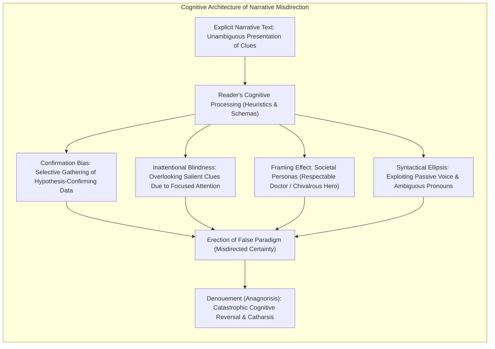
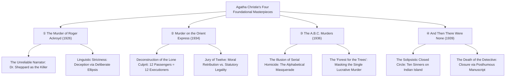
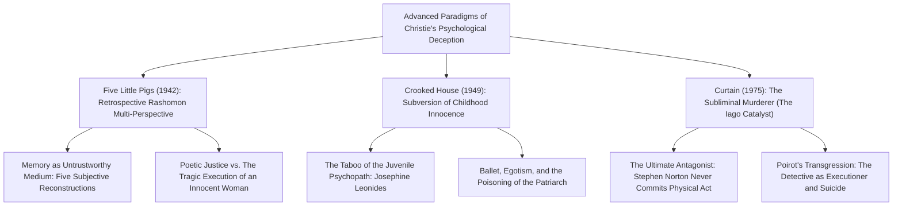

Surpassed in total publication volume only by the Holy Bible and the complete works of William Shakespeare, the literary corpus of Dame Agatha Christie (1890–1976) encompasses over two billion copies printed across more than one hundred languages. While commercial longevity on this planetary scale is frequently dismissed by high-modernist literary gatekeepers as the product of formulaic escapism, rigorous narratological and cognitive analysis reveals an entirely different reality: Christie was a supreme master of narrative architecture and applied epistemological deception.

During the "Golden Age of Detective Fiction" in the 1920s and 1930s—a period dominated by the forensic materialism of Arthur Conan Doyle's Sherlock Holmes and the rigid formalist canons of the Detection Club—Christie orchestrated a profound shift from the external mechanics of footprints, tobacco ash, and alibi timetables to the internal landscape of <strong>human cognitive bias, perceptual vulnerability, and linguistic ambiguity</strong>.

Like a master prestidigitator whose left hand palmates a coin while the right hand draws applause through flamboyant flourish, Christie pioneered the rigorous craft of <strong>psychological and narrative misdirection</strong>. Her genius resided not in concealing clues behind clandestine ciphers or esoteric arcana, but in displaying the decisive instruments of homicide in plain, unvarnished sight. By exploiting readers' deeply ingrained heuristics—our moral prejudices, class assumptions, gender expectations, and syntactical habits—she compelled readers to construct their own erroneous deductions, walking willingly into intellectual ambushes of their own making.

From the taboo-shattering revelation of the narrator-murderer in *The Murder of Roger Ackroyd* (1926), to the collective execution of *Murder on the Orient Express* (1934), the inversion of serial homicide in *The A.B.C. Murders* (1936), and the post-modern nihilism of *And Then There Were None* (1939), Christie systematically dismantled the axiomatic assumptions of the mystery genre.

This scholarly monograph presents an exhaustive inquiry into Christie's mechanics of deception: the cognitive science of perceptual blindspots, structural autopsies of her four foundational masterpieces, the epistemological divergence between Hercule Poirot's Cartesian rationalism and Miss Jane Marple's village anthropology, the forensic pharmacology acquired during her wartime dispensary service, and the enduring structural lineage connecting her work to contemporary narratology and Japanese *Shin-Honkaku* (New Orthodox) mystery fiction.

---

## 1. Epistemological Blindspots: The Cognitive Science of Misdirection

In stage magic, misdirection is rigorously defined not as merely distracting the observer's gaze, but as <strong>actively controlling the spectator's cognitive frame of reference</strong>. Christie operated upon the human psyche with identical precision, leveraging intrinsic evolutionary shortcuts in human information processing.

### 1.1 Confirmation Bias and the Primacy Effect

Human cognition relies on heuristic shortcuts (*schemas*) to rapidly interpret complex sensory reality. When an individual constructs an initial explanatory hypothesis, <strong>confirmation bias</strong> drives the subconscious mind to disproportionately register, weigh, and remember data that validates that hypothesis, while systematically ignoring, discounting, or reinterpreting conflicting evidence as irrelevant background noise.

Christie exploits this heuristic vulnerability through the strategic deployment of the <strong>Primacy Effect</strong>. Within the opening chapters of her novels, she constructs an effortless, socially recognizable melodrama: an imperious patriarch threatening to disinherit his family, a hot-tempered prodigal son laden with gambling debts, an impoverished niece, or a secretive foreign secretary. The reader immediately adopts the culturally primed narrative frame: *"The spendthrift heir is the obvious culprit."*

Once this cognitive frame is established, Christie can parade the true culprit's incriminating actions across the text with near-brazen transparency. If the actual murderer is observed burning a document, slipping a phial into an overcoat, or manipulating a mantlepiece clock, the reader's bias automatically rationalizes the anomaly: *"He is merely shielding his beloved cousin,"* or *"It is an innocent domestic quirk."* The deception is enacted not by the author's lies, but by the reader's self-generated rationalizations.

### 1.2 Inattentional Blindness and the "Forest for the Trees" Principle

Cognitive psychologists Christopher Chabris and Daniel Simons demonstrated through their landmark "Invisible Gorilla" experiment (1999) that intense visual and mental focus on a primary task blinds human observers to glaring anomalies occupying the center of their perceptual field (<strong>Inattentional Blindness</strong>).

In Christie's narrative mechanics, this operates via <strong>information flooding and decoy prominence</strong>:
- When a murder occurs, Christie saturates the crime scene with high-voltage, sensational curiosities: an antique dagger inscribed with exotic runes, a torn scrap of a love letter scented with attar of roses, a locked bedroom window, and an unconsumed cup of hot chocolate.
- Amidst this flurry of romantic forensic signifiers, she embeds the single mathematically fatal clue: an armchair shifted two feet from its original angle against the wall (to mask a dictaphone or obscure sightlines), or a calendar that has not been turned.

Because the reader's cognitive bandwidth is entirely consumed by analyzing the chemical potency of the poisoned chocolate or the mechanical locks of the windows, the displaced chair is unconsciously discarded as mundane interior decor. Christie masterfully applies G.K. Chesterton's paradox: *"Where does a wise man hide a pebble? On the beach. Where does a wise man hide a leaf? In the forest."*

### 1.3 The Paradox of Fair Play: Deception Through Absolute Candor

The Golden Age of detective fiction was governed by strict normative covenants, epitomized by Ronald Knox's "Ten Commandments" (1928) and S.S. Van Dine's "Twenty Rules for Writing Detective Stories" (1928). These manifestos demanded absolute "Fair Play": the author was ethically bound to place every evidentiary puzzle piece before the reader simultaneously with the fictional detective, prohibiting supernatural solutions, unannounced twins, and secret poisons unknown to science.

While mediocre writers resorted to cheating—withholding forensic findings or introducing eleventh-hour confessions—Christie achieved her masterpieces through <strong>hyper-conformity to the Fair Play doctrine</strong>. 

Upon reaching the final chapter of a Christie novel, the flabbergasted reader can re-read the entire volume with a critical scalpel and verify that every material fact, timeline coordinate, and psychological clue was laid bare on the page. The devastating aesthetic pleasure of the Christie denouement is rooted precisely in this humiliating epiphany: the author never lied; she told the absolute truth, and the reader's own unexamined assumptions forged the illusion.

---

## 2. Structural Autopsies of the Four Foundational Masterpieces

Christie's enduring stature in world literature rests upon four paradigm-shattering novels that dismantled the foundational axioms of the mystery genre.

### 2.1 *The Murder of Roger Ackroyd* (1926): The Apotheosis of the Unreliable Narrator

Published in 1926, *The Murder of Roger Ackroyd* ignited one of the fiercest controversies in 20th-century literary history. In traditional detective fiction, the first-person narrator—modeled on Dr. John H. Watson—represented a sacred moral contract: the objective, dependable proxy of the reader, intellectually slower than the Great Detective, but unimpeachably honest.

Christie shattered this covenant. The narrator of the novel, the genial village physician <strong>Dr. James Sheppard</strong>, is revealed in the final chapter to be the blackmailer and cold-blooded murderer of Roger Ackroyd.

The artistic brilliance of the novel lies in Sheppard's <strong>absolute linguistic strictness</strong>. A microscopic textual autopsy reveals that Sheppard never utters an untruth; he merely practices <strong>narrative ellipsis (deliberate omission)</strong>. Consider the fateful passage describing his departure from Ackroyd's study:

> *"The letter had been brought in at twenty minutes to nine. It was just on ten minutes to nine when I left him, the letter still unread. I hesitated with my hand on the door handle, looking back and wondering if there was anything I had left undone."*

The reader, primed by the archetype of the compassionate country doctor, automatically fills in the silence: *"Dr. Sheppard said goodnight to his friend, who was alive reading his mail, and walked home."* 

In reality, Sheppard had already driven the dagger into Ackroyd's neck. The *"anything I had left undone"* refers strictly to his mechanical concealment protocols: positioning the dictaphone with a timer to simulate Ackroyd's voice, locking the French windows from the outside, and shifting an armchair to mask the phonograph.

When critics accused Christie of an unethical breach of Fair Play, G.K. Chesterton famously defended her: *"The doctor did not tell lies; he told the literal truth, and it is not his fault if the reader was too stupid to understand what a murderer was thinking."* Christie proved that the first-person pronoun *"I"* is inherently subjective, volatile, and potentially monstrous, anticipating the postmodern unreliable narrators of Vladimir Nabokov (*Pale Fire*) and Kazuo Ishiguro (*The Remains of the Day*).

### 2.2 *Murder on the Orient Express* (1934): The Dissolution of the Lone Culprit

Stranded in a snowdrift in the mountains of Yugoslavia aboard the Simplon-Orient Express, an American tycoon named Samuel Edward Ratchett is found stabbed twelve times in his locked first-class compartment. 

As Hercule Poirot interrogates the passengers, he confronts an evidentiary labyrinth: every single suspect possesses an ironclad alibi corroborated by another passenger, while contradictory clues proliferate wildly—a pipe cleaner, a lady's cambric handkerchief with the initial "H", a conductor's passkey, and a charred fragment of paper referencing the kidnapping of baby Daisy Armstrong.

Christie dismantled the foundational dogma that <strong>a murder is the act of a single isolated individual (or a mastermind and an accomplice)</strong>. Poirot's ultimate revelation unmasks an astonishing truth: <strong>all twelve suspects in the coach conspired together, and all twelve took turns plunging the dagger into Ratchett's flesh</strong>.

The victim was, in reality, Cassetti—the fugitive child-murderer whose wealth had corrupted the American judicial system, escaping execution after brutally killing three-year-old Daisy Armstrong. The twelve passengers—ranging from an elderly Russian princess to an English governess, a Swedish missionary, an Italian chauffeur, and an American grandmother—were all surviving family members, retainers, and loved ones whose lives had been destroyed by Cassetti's crime. They assembled as a self-appointed <strong>Jury of Twelve</strong>, executing the death sentence that human law had failed to deliver.

The masterpiece transcends pure puzzle mechanics to interrogate jurisprudence: when the formal state fails to enforce justice, does natural law permit collective moral retribution? Poirot's ultimate decision to present an alternative, fabricated explanation to the Yugoslav authorities—attributing the crime to an unknown assassin who fled into the snow—remains one of the most morally complex endings in crime literature.

### 2.3 *The A.B.C. Murders* (1936): The Deconstruction of Serial Homicide

Decades before the FBI coined the term "serial killer" or Hollywood fixated on psychotic sociopaths, Christie authored the definitive deconstruction of the serial murder trope in *The A.B.C. Murders*.

A maniacal correspondent signing himself "A.B.C." taunts Poirot with letters announcing upcoming murders occurring in alphabetical order:
- <strong>A</strong>: Mrs. Ascher, a poor tobacconist in Andover.
- <strong>B</strong>: Betty Barnard, a flirtatious waitress in Bexhill-on-Sea.
- <strong>C</strong>: Sir Carmichael Clarke, an ultra-wealthy collector in Churston.

Beside each corpse lies an open copy of the *ABC Railway Guide*. Meanwhile, the narrative shifts between Hastings' first-person chronicle and chilling third-person perspectives following Alexander Bonaparte Cust, an epileptic travelling stocking salesman whose movements uncannily coincide with every crime.

The psychological misdirection here operates through the creation of a <strong>false serial paradigm</strong>:
The murderer's sole true objective was the elimination of <strong>Sir Carmichael Clarke</strong> to secure his brother Franklin Clarke's inheritance. Under normal investigative protocols, Franklin would be the immediate prime suspect. To insulate himself from scrutiny, Franklin invented the fictional persona of a deranged alphabetical mass murderer, executing two completely innocent strangers (Mrs. Ascher and Betty Barnard) simply to create a synthetic statistical pattern into which the single profitable murder could be seamlessly camouflaged.

By manufacturing a fictitious macro-narrative of madness, the killer concealed an intensely rational, micro-economic motive—a brilliant narratological execution of Chestertonian camouflage.

### 2.4 *And Then There Were None* (1939): The Solipsistic Closed Circle

Ten disparate individuals, each responsible for an unpunished death in their past, are lured under false pretenses to an austere modern mansion on isolated Soldier Island off the coast of Devon. Trapped by a violent Atlantic tempest, they discover a framed nursery rhyme on their bedroom walls—*"Ten Little Soldier Boys"*—and ten porcelain figurines on the dining table.

One by one, the guests are executed in strict accordance with the verses of the rhyme. With each death, a porcelain figurine vanishes. When the survivors search the island, they confirm that no other living soul exists upon the rock. Suspicion turns into paranoid terror, until every single person on the island is dead.

Christie accomplished here the <strong>ultimate structural deconstruction of the detective novel</strong>:
1. <strong>The Annihilation of the Detective Hero</strong>: There is no outside rational authority; the cast consists solely of suspects who are simultaneously victims.
2. <strong>The Extermination of All Suspects</strong>: The basic premise that the survivor is the killer is demolished, as all ten bodies are discovered by Scotland Yard.
3. <strong>Closure via Posthumous Manuscript</strong>: The solution cannot be derived from forensic reconstruction, but is revealed only through a confession sealed in a bottle recovered from the sea by fishermen—penned by the terminal cancer patient <strong>Justice Lawrence Wargrave</strong>.

Wargrave, seeking to unite his lifelong passion for justice with an artist's compulsion to commit a flawless masterpiece of homicide, orchestrated his own faked execution with the aid of the gullible Dr. Armstrong, before finishing off the final survivors and taking his own life. *And Then There Were None* remains the quintessential closed-circle mystery against which all subsequent psychological thrillers are measured.

---

## 8. Case Studies in Advanced Misdirection: *Five Little Pigs*, *Crooked House*, and *Curtain*

Beyond the four canonical monuments, Christie repeatedly expanded the boundaries of psychological deception in later works that pushed crime literature into acute psychological portraiture.

### 8.1 *Five Little Pigs* (1942): The Epistemology of Retrospective Memory

In *Five Little Pigs* (*Murder in Retrospect*), Christie dispensed entirely with contemporaneous physical investigation. Sixteen years after painter Amyas Crale was poisoned with coniine (hemlock extract) and his passionate wife Caroline was convicted and died in prison, their daughter Carla Lemarchant enlists Hercule Poirot to clear her mother's memory.

Poirot interviews the five surviving witnesses—the "Five Little Pigs":
1. Philip Blake (the stockbroker)
2. Meredith Blake (the herbalist)
3. Elsa Greer (the young muse/mistress)
4. Cecilia Williams (the devoted governess)
5. Angela Warren (the disfigured half-sister)

Each witness provides a subjective, written memoir of the fateful day. Christie anticipates Akira Kurosawa's *Rashomon* (1950) by eight years: the exact same events, conversations, and physical gestures are reconstructed through five distinct emotional prisms colored by jealousy, shame, unrequited love, and protective guilt.

The psychological misdirection hinges upon Caroline Crale's fatal silence during her trial. The reader, alongside the original jury, assumes Caroline's refusal to defend herself was an admission of guilt. Poirot uncovers the heartbreaking reality: Caroline remained silent because she mistakenly believed her beloved half-sister Angela had slipped the poison into Amyas's beer in a juvenile prank, choosing to hang rather than see her sister condemned. The true poisoner was the predatory mistress Elsa Greer, who murdered Amyas precisely when she realized he viewed her merely as a temporary canvas rather than a permanent love.

### 8.2 *Crooked House* (1949): Breaking the Taboo of Childhood Innocence

In *Crooked House*, which Christie considered one of her two finest personal achievements (alongside *Ordeal by Innocence*), she shattered the deepest cultural taboo of Victorian and Edwardian detective fiction: <strong>the sanctity and innocence of the child</strong>.

When the tyrannical octogenarian patriarch Aristide Leonides is poisoned with his own eserine eye drops, Scotland Yard focuses on his glamorous young widow Brenda and her illicit lover, the family tutor. The entire family dynamic is poisoned by mutual suspicion. The investigator Charles Hayward is guided and provoked by Aristide's twelve-year-old granddaughter, <strong>Josephine Leonides</strong>—an awkward, unlovely child with a passion for detective stories and a habit of recording family secrets in a black notebook.

The monstrous revelation, revealed through Josephine's hidden journal after she and her great-aunt Edith de Haviland perish, is that twelve-year-old Josephine herself was the calculating murderer:
- She poisoned her grandfather simply because he refused to pay for her ballet lessons.
- She subsequently murdered the family nanny who suspected her, and even staged a fake assault on herself to deflect suspicion.

Christie demonstrated that sociopathic egotism and lethal entitlement are not exclusive to cynical adults, unmasking childhood not as an idyllic sanctuary of innocence, but as a primitive cognitive state where unchecked narcissism can blossom into homicide.

### 8.3 *Curtain: Poirot's Last Case* (1975): The Subliminal Catalyst

Written during the London Blitz of the 1940s and locked in a bank vault for over thirty years to be published posthumously, *Curtain* presents the dark, tragic finale of Hercule Poirot.

Returning to Styles Court—the country estate where he and Hastings solved their first English case—an aged, crippled, and dying Poirot warns Hastings that a brilliant murderer, designated "X", is residing among the guests. "X" has been present at five separate homicides, yet in every case, another individual was tried and convicted or committed suicide.

Christie invents here the concept of the <strong>psychological catalyst</strong>:
The killer, <strong>Stephen Norton</strong>, never touches a weapon, administers a poison, or enters a crime scene. Instead, he possesses an uncanny, demonic genius for psychological manipulation—an avatar of Shakespeare's Iago. Operating on individuals experiencing marital strain or familial jealousy, Norton gently whispers toxic suggestions, amplifies paranoid insecurities, and orchestrates confrontations until his targets are provoked into committing murder on his behalf.

Because Norton's crimes reside entirely within the realm of interpersonal psychology, he is utterly immune to statutory law. To stop this monster, Poirot faces the ultimate ethical breakdown of the detective hero: he executes Norton himself, shooting him through the forehead, and deliberately withholds his own amyl nitrite heart medication, dying as a murderer who has sacrificed his soul for the preservation of others.