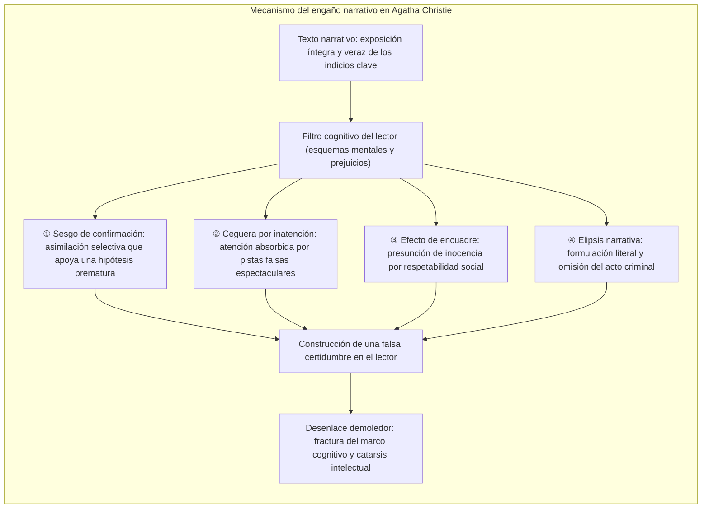
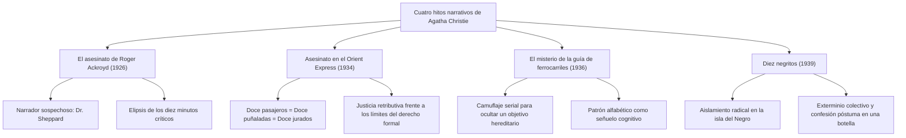
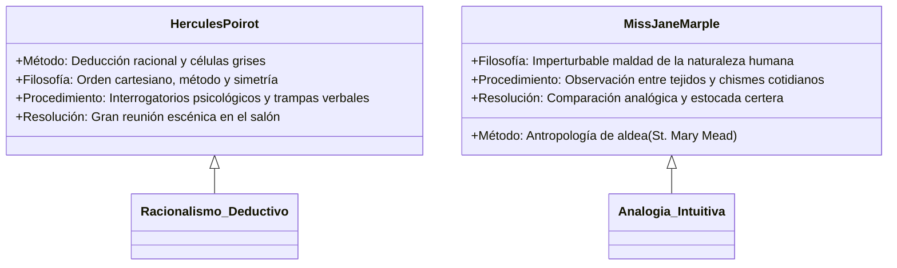

Con más de dos mil millones de ejemplares vendidos y traducciones a más de un centenar de idiomas, <strong>Agatha Christie (1890–1976)</strong> se erige como la cúspide indiscutible de la literatura de suspense y misterio, únicamente superada en difusión por la Biblia y la producción dramática de Shakespeare.

Durante la Edad de Oro de la novela policiaca (Golden Age of Detective Fiction) en las décadas de 1920 y 1930, en una época marcada por el paradigma forense de Arthur Conan Doyle y los códigos normativos del *Detection Club*, Christie impulsó una radical mutación estructural: transformó la persecución material de huellas y cenizas en un <strong>sofisticado laboratorio sobre los sesgos cognitivos y los puntos ciegos de la mente humana</strong>. De la misma forma en que un prestidigitador consumado atrae la mirada del público mediante ademanes grandilocuentes de su mano derecha mientras su mano izquierda ejecuta la verdadera manipulación oculta, Christie presentaba todas las pistas cardinales a plena luz del día bajo las estrictas reglas del juego limpio (*Fair Play*), confiando en que los prejuicios, las expectativas morales y las limitaciones perceptivas del lector lo conducirían inexorablemente al engaño.

---

## 1. Fundamentos cognitivos del engaño narrativo

La distracción (*misdirection*) en la obra de Christie no constituye un burdo truco efectista, sino una orquestación psicológica de las heurísticas del pensamiento humano:

### 1.1 Sesgo de confirmación y efecto de primacía

Cuando un lector acepta una premisa inicial atractiva (el pariente desheredado o la amante ambiciosa), su cerebro queda cautivo del <strong>sesgo de confirmación (Confirmation Bias)</strong>. A partir de ese instante, cualquier dato se reinterpreta para reforzar la teoría preestablecida. Si el auténtico culpable mueve un mueble o quema un documento ante los presentes, el lector interpreta el hecho como un gesto benevolente de protección familiar o una nimiedad excéntrica.

### 1.2 Ceguera por inatención y pistas falsas (*Red Herrings*)

El célebre experimento psicológico del «gorila invisible» demostró que focalizar intensamente la atención en un estímulo específico vuelve a las personas completamente ciegas ante anomalías flagrantes situadas en su propio campo visual. Christie domina el arte de los <strong>arenques rojos (Red Herrings)</strong>: viales de venenos exóticos, cartas anónimas o intrigas de espionaje. Mientras el lector vuelca su ingenio en resolver estos señuelos espectaculares, el detalle determinante —un sillón desplazado medio metro para ocultar un dictáfono— pasa inadvertido como mero mobiliario secundario.

### 1.3 Honradez textual y *Fair Play*

El mayor mérito artístico de Christie radica en su escrupulosa negativa a falsear los hechos en el texto. Al concluir la lectura y cotejar los párrafos iniciales, se constata que cada aserto era rigurosamente verídico. Quien engañó al lector no fue la pluma de la autora, sino la soberbia de sus propias inferencias deductivas.

---

## 2. Deconstrucción estructural de cuatro obras cumbres

### 2.1 *El asesinato de Roger Ackroyd* (1926): La cima del narrador no confiable

Esta obra conmocionó las convenciones del género al derribar el axioma de que el cronista fiel y ayudante del detective jamás podía ser el culpable. El doctor James Sheppard, figura respetada de la aldea, registra con templanza la pesquisa cuando en realidad es el extorsionador y verdugo de Ackroyd.

La clave maestra estriba en la <strong>precisión literal y la elipsis</strong>. Sheppard anota: *«La puerta estaba cerrada. Salí de la habitación a las nueve y media. Mi tarea había concluido»*. El lector supone que la consulta médica concluyó en armonía; sin embargo, la «tarea» aludía a la consumación del apuñalamiento y la colocación del dictáfono con temporizador. Christie no miente: silencia diez minutos cruciales mediante una omisión deliberada.

### 2.2 *Asesinato en el Orient Express* (1934): La conspiración solidaria

Inmovilizado por la nieve en territorio balcánico, el lujoso tren se convierte en el escenario del sangriento asesinato del criminal Ratchett. El cadáver presenta doce heridas asimétricas infligidas con diversa fuerza, y los coartadas de los viajeros encajan milimétricamente.

Hércules Poirot dinamita el dogma del homicida solitario al concluir que <strong>los doce pasajeros del coche cama son conspiradores y verdugos unánimes</strong>. Unidos por la tragedia del secuestro y asesinato de la niña Armstrong, conformaron un tribunal clandestino de doce jurados para ajusticiar al culpable que había burlado a los tribunales oficiales.

### 2.3 *El misterio de la guía de ferrocarriles* (1936): La cortina de humo serial

Un pretendido asesino psicópata siembra el pánico ejecutando víctimas según el orden alfabético: Alice Ascher en Andover (A), Betty Barnard en Bexhill (B), Sir Carmichael Clarke en Churston (C), dejando junto a cada cadáver la guía ferroviaria ABC.

La trampa descansa en <strong>ocultar un homicidio por codicia patrimonial tras la fachada de una pulsión psicopática en serie</strong>. El asesino solo buscaba erradicar a la víctima C para apoderarse de su herencia; las muertes de A, B y D fueron señuelos sacrificables para confundir a la policía.

### 2.4 *Diez negritos* (*And Then There Were None*, 1939): La perfección del recinto cerrado

Diez individuos culpables de crímenes impunes son atraídos a una isla incomunicada. Guiados por los versos de una tétrica canción infantil, van muriendo uno a uno sin que aparezca ningún agresor externo. Con el suicidio de la última superviviente, la isla queda desprovista de vida humana.

La resolución de este enigma matemáticamente perfecto radica en la farsa del juez Wargrave, quien fingió su propio asesinato con auxilio de un médico engañado, presenció el colapso final de los supervivientes y se suicidó con un artificio mecánico, confiando su confesión al océano.

---

## 3. Disyunción de métodos: Poirot versus Miss Marple

### 3.1 Hércules Poirot: La soberanía de las células grises

El detective belga desprecia el examen exhaustivo del fango y confía en el análisis mental:
- <strong>La pantomima del forastero:</strong> Exagera su acento extranjero y sus excentricidades para que los sospechosos lo subestimen y se confíen.
- <strong>La escena en el salón:</strong> La convocación de todos los implicados genera una insoportable tensión dramática que precipita el desmoronamiento del asesino.

### 3.2 Miss Jane Marple: Sabiduría antropológica doméstica

La dulce anciana de St. Mary Mead subvierte los prejuicios victorianos:
- <strong>La analogía rural:</strong> Para Miss Marple, los criminales metropolitanos actúan motivados por los mismos impulsos mezquinos que el tendero o la criada de su pueblo.
- <strong>Invisibilidad táctica:</strong> Al amparo de sus agujas de tejer, escucha indiscreciones que nadie confiaría a un investigador profesional.

---

## 4. Rigor toxicológico y solvencia científica

La perdurable fascinación por las tramas de Christie emana de su rigurosa formación farmacéutica durante la Primera y Segunda Guerra Mundial. Sus envenenamientos reflejan una fidelidad médica absoluta.

| Veneno | Novela representativa | Mecanismo fisiopatológico | Función en la trama |
|---|---|---|---|
| <strong>Estricnina</strong> | *El misterioso caso de Styles* | Bloqueo de receptores de glicina, convulsiones tetánicas, asfixia lúcida | Retardo en la absorción por precipitación para forjar una coartada |
| <strong>Cianuro potásico</strong> | *Cianuro espumoso* | Inhibición de citocromo c oxidasa, hipoxia celular fulminante | Disimulado en la efervescencia y tonalidad del champán |
| <strong>Talio</strong> | *El misterio de Pale Horse* | Bloqueo celular metabólico, caída del cabello, polineuropatía | Mimetiza enfermedades infecciosas o encefalitis sin sospecha de dolo |
| <strong>Morfina</strong> | *Café solo* | Depresión del SNC, miosis pupilar, parada respiratoria | Suministrado en infusiones o alimentos calientes |

El caso más elocuente ocurrió con *El misterio de Pale Horse* (1961): la minuciosa descripción clínica de la intoxicación por talio permitió que lectores médicos diagnosticaran a pacientes reales y desbarataran crímenes auténticos en el Reino Unido.

---

## 5. El legado imperecedero en la ficción universal

Al desafiar los límites del juego limpio sin vulnerar su espíritu, Agatha Christie redefinió las leyes de la intriga. Sus innovaciones sembraron las raíces del thriller psicológico contemporáneo e inspiraron el movimiento japonés <strong>Shin-Honkaku</strong> (*Los asesinatos de la mansión del decágono* de Yukito Ayatsuji). Su soberbio dominio del engaño perceptivo continúa siendo el canon ineludible del suspense literario.
