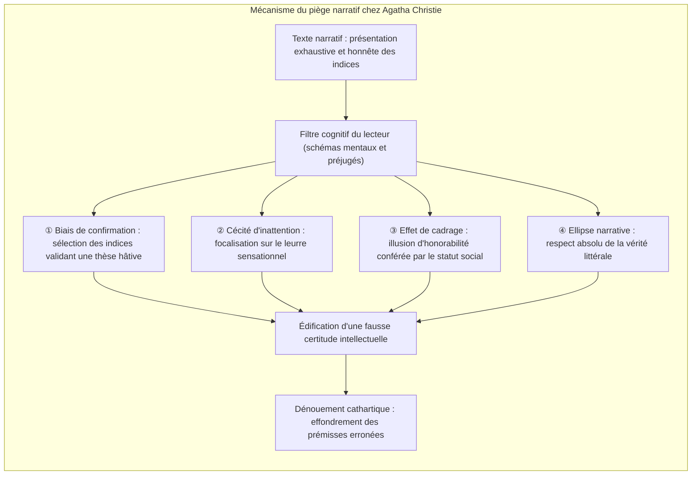
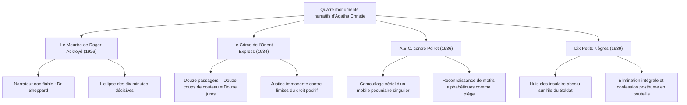
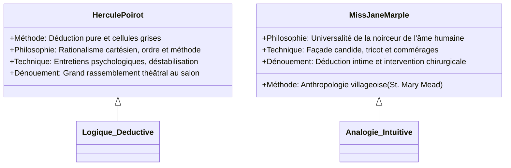

Avec plus de deux milliards d'exemplaires vendus à travers le monde et des traductions dans plus d'une centaine de langues, <strong>Agatha Christie (1890–1976)</strong> demeure la figure tutélaire absolue de la littérature policière, surpassée en diffusion uniquement par la Bible et les œuvres complètes de Shakespeare.

Au cœur de l'âge d'or du roman à énigme (Golden Age of Detective Fiction) dans les années 1920 et 1930, alors que l'influence d'Arthur Conan Doyle imposait la recherche d'indices matériels et les règles formelles du *Detection Club*, Christie opéra une véritable révolution épistémologique : déplacer le centre de gravité de l'enquête, quittant l'examen des mégots et des empreintes pour s'aventurer dans <strong>l'exploration des failles cognitives et des angles morts de l'esprit humain</strong>. À la façon d'un prestidigitateur accompli dont la main droite attire le regard par un geste éclatant tandis que la main gauche accomplit l'escamotage invisible, Christie exposait tous les indices capitaux au grand jour, dans le respect scrupuleux du *Fair Play*, tout en exploitant les préjugés, les heuristiques de jugement et les automatismes de lecture de son public.

---

## 1. Fondements cognitifs de la manipulation narrative

La manipulation (misdirection) christienne ne relève jamais de la duperie grossière, mais d'une ingénierie psychologique exploitant les raccourcis adaptatifs du cerveau humain :

### 1.1 Le biais de confirmation et l'effet de primauté

Dès que le lecteur adopte une première hypothèse séduisante (par exemple le fils prodigue endetté ou la maîtresse manipulatrice), son cerveau entre en phase de <strong>biais de confirmation (Confirmation Bias)</strong>. Tous les signaux ultérieurs sont réinterprétés pour conforter ce scénario préconçu. Si le véritable coupable déplace un meuble ou détruit un papier au vu et au su de tous, le lecteur rationnalise ce comportement en y voyant un geste protecteur anodin ou une simple bizarrerie.

### 1.2 La cécité d'inattention et les faux indices (*Red Herrings*)

L'expérience canonique du « gorille invisible » démontre que lorsqu'un sujet concentre son attention sur une tâche précise, un événement incongru intervenant au centre de son champ visuel devient paradoxalement indétectable. Christie applique rigoureusement cette loi : elle sème généreusement des <strong>poissons rouges (Red Herrings)</strong> – flacons de poison exotique, télégrammes codés, dagues orientales. Fasciné par ces artefacts romanesques, le lecteur omet d'analyser le fait qu'un fauteuil a été déplacé de cinquante centimètres pour dissimuler un dictaphone et l'angle de vision du cadavre.

### 1.3 La stricte honnêteté du *Fair Play*

La grandeur d'Agatha Christie réside dans son refus absolu du mensonge narratif direct. Lorsqu'on relit ses chefs-d'œuvre à rebours, on s'aperçoit que les faits étaient consignés noir sur blanc avec une rigueur clinique. Le lecteur n'a pas été trompé par la plume de l'écrivaine, mais par sa propre présomption et ses préjugés interprétatifs.

---

## 2. Anatomie structurelle de quatre chefs-d'œuvre

### 2.1 *Le Meurtre de Roger Ackroyd* (1926) : L'apogée du narrateur non fiable

Ce roman provoqua une onde de choc au sein du *Detection Club* en transgressant le postulat tacite selon lequel l'allié du détective et rédacteur du compte rendu ne saurait être le criminel. Le docteur James Sheppard, notable respecté du village de King's Abbot, tient la chronique des faits tout en dissimulant qu'il est l'auteur du chantage et du meurtre.

La maestria du dispositif repose sur <strong>l'ellipse linguistique</strong>. Sheppard relate : *« La porte était fermée. Je quittai la pièce à neuf heures et demie. Il ne me restait plus rien à faire. »* Le lecteur imagine un médecin prenant congé sereinement après sa visite ; or, « il ne me restait plus rien à faire » signifiait que le crime avait été perpétré et le subterfuge du phonographe mis en place. Christie n'écrit pas un seul mot faux, mais retranche dix minutes cruciales du récit par omission calculée.

### 2.2 *Le Crime de l'Orient-Express* (1934) : La conspiration collective

Bloqué par d'épaisses congères dans les Balkans, le prestigieux train devient le théâtre du meurtre sauvage du richissime et abject Ratchett. La victime a reçu douze coups de poignard de forces inégales, et les alibis des voyageurs s'imbriquent avec une perfection géométrique.

Hercule Poirot renverse le dogme du coupable unique en révélant que <strong>les douze passagers du wagon sont tous complices et coexécuteurs</strong>. Réunis par la tragédie commune du rapt de la petite Daisy Armstrong, ils ont constitué un tribunal populaire clandestin de douze jurés pour exécuter un criminel qui avait corrompu la justice institutionnelle.

### 2.3 *A.B.C. contre Poirot* (1936) : Le paravent de la folie sérielle

Un prétendu psychopathe sème la terreur à travers l'Angleterre en frappant selon l'ordre alphabétique : Alice Ascher à Andover (A), Betty Barnard à Bexhill (B), Sir Carmichael Clarke à Churston (C), laissant sur chaque corps l'indicateur des chemins de fer ABC.

L'illusion repose sur <strong>l'occultation d'un mobile crapuleux unique sous l'appareil d'un massacre sériel</strong>. Le tueur ne visait que l'héritage du notable C ; les meurtres de A, B et D n'étaient que de terrifiants leurres destinés à égarer Scotland Yard sur la piste d'un maniaque déséquilibré.

### 2.4 *Dix Petits Nègres* (*And Then There Were None*, 1939) : L'absolu du huis clos

Dix individus aux consciences chargées sont réunis sur une île rocheuse coupée de la terre ferme. Au son d'une comptine macabre, ils périssent les uns après les autres sans qu'aucun intrus ne puisse être découvert sur l'îlot. Lorsque la dernière survivante met fin à ses jours sous le coup de la terreur, il ne reste plus aucun être vivant.

Ce problème réputé insolvable trouve son dénouement dans la machination du juge Wargrave, qui simule sa propre mort avec le concours d'un médecin naïf, orchestre l'anéantissement mutuel des coupables et se suicide selon un dispositif balistique sophistiqué, laissant son aveu dans une bouteille jetée à la mer.

---

## 3. Dualité méthodologique : Poirot et Miss Marple

### 3.1 Hercule Poirot : La primauté des cellules grises

Le réfugié belge refuse la recherche besogneuse d'indices matériels pour privilégier la spéculation logique :
- <strong>L'illusion théâtrale :</strong> Poirot accentue volontairement son accent étranger et ses manies ridicules pour inciter les suspects à baisser leur garde.
- <strong>La scène finale :</strong> La confrontation générale dans un salon bourgeois n'est pas un simple artifice dramatique, mais une mise en scène catalysant l'aveu sous la pression psychologique.

### 3.2 Miss Jane Marple : L'analogie anthropologique

La vieille demoiselle campagnarde exploite le mépris d'âge et de genre de la société britannique :
- <strong>Le microcosme villageois :</strong> Pour Miss Marple, le crime le plus sophistiqué rappelle immanquablement la mesquinerie d'un sacristain ou le mensonge d'une lingère de son village.
- <strong>L'invisibilité sociale :</strong> Absorbée par son tricot, elle recueille les confidences les plus inavouables sans éveiller le moindre soupçon.

---

## 4. Rigueur toxicologique et réalisme scientifique

L'extraordinaire longévité de l'œuvre d'Agatha Christie s'explique également par son impeccable exactitude pharmacologique, acquise lors de son service bénévole d'infirmière et de préparatrice en pharmacie hospitalière durant les conflits mondiaux.

| Substance toxique | Œuvre représentative | Action pharmacologique | Exploitation narrative |
|---|---|---|---|
| <strong>Strychnine</strong> | *La Mystérieuse Affaire de Styles* | Blocage des récepteurs de glycine, convulsions tétaniques, asphyxie lucide | Retardement de l'effet par précipitation chimique pour bâtir un alibi temporel |
| <strong>Cyanure de potassium</strong> | *Meurtre au champagne* | Inhibition de la cytochrome c oxydase, hypoxie cellulaire foudroyante | Dissimulation de l'odeur et de la couleur dans l'effervescence du champagne |
| <strong>Thallium</strong> | *Le Cheval pâle* | Dégradation métabolique cellulaire, alopécie, polynévrites | Simulation parfaite de pathologies dégénératives ou infectieuses |
| <strong>Morphine</strong> | *Je ne suis pas coupable* | Dépression respiratoire, sédation centrale, myosis | Administration insidieuse dans des aliments ou boissons chaudes |

L'exemple le plus éclatant demeure *Le Cheval pâle* (1961) : la description des signes cliniques de l'empoisonnement au thallium permit à plusieurs médecins et infirmières ayant lu le roman d'identifier ce toxique rare et de sauver des patients condamnés dans la vie réelle.

---

## 5. Postérité et influence sur la narration contemporaine

En poussant à leurs limites logiques les contraintes du roman d'énigme sans jamais rompre le pacte du *Fair Play*, Agatha Christie a transcendé le simple jeu intellectuel. Ses structures narratives ont nourri le thriller psychologique moderne et suscité l'essor du mouvement japonais <strong>Shin-Honkaku</strong> (*Le Meurtre du manoir décagonal* de Yukito Ayatsuji). Son art du faux-semblant demeure l'étalon d'or de la dramaturgie du suspense.
