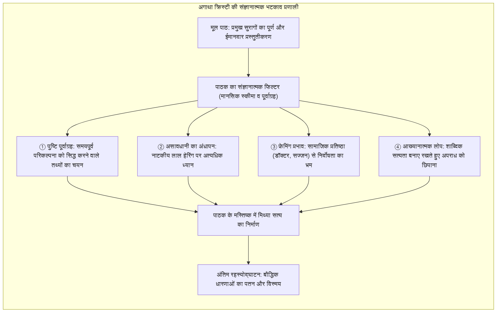
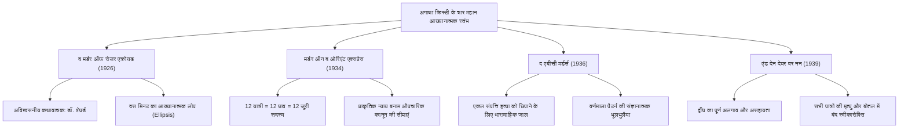
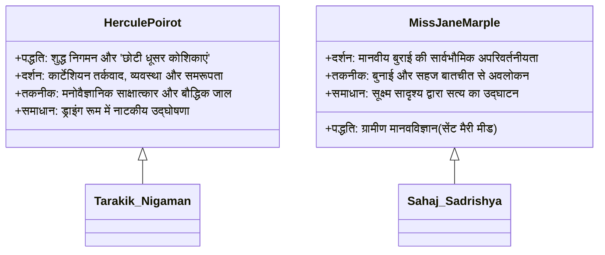

मानव प्रकाशन इतिहास में दो अरब से अधिक प्रतियों की बिक्री और सौ से अधिक भाषाओं में अनुवाद के साथ, <strong>अगाथा क्रिस्टी (1890–1976)</strong> जासूसी साहित्य की सर्वोच्च महारानी हैं, जिनका प्रसार केवल बाइबिल और विलियम शेक्सपियर के नाटकों के समकक्ष है।

1920 और 1930 के दशक में जासूसी कथा के स्वर्ण युग (Golden Age of Detective Fiction) के दौरान, जब आर्थर कॉनन डॉयल की भौतिक साक्ष्य और पदचिह्न परंपरा हावी थी, क्रिस्टी ने एक युगांतरकारी बौद्धिक क्रांति की: जांच का केंद्र सिगरेट की राख से हटाकर <strong>मानव मस्तिष्क के संज्ञानात्मक अंध बिंदुओं और मानसिक पूर्वाग्रहों की मनोवैज्ञानिक प्रयोगशाला</strong> में बदल दिया। जिस प्रकार एक कुशल जादूगर अपने दाहिने हाथ के भव्य हावभाव से दर्शकों का ध्यान आकर्षित करता है और बाएं हाथ से गुप्त चाल चलता है, क्रिस्टी ने 'फेयर प्ले' (Fair Play) के नियमों का पालन करते हुए सभी महत्वपूर्ण सुराग पाठक की आंखों के सामने रखे, यह जानते हुए कि पाठक अपने ही नैतिक पूर्वाग्रहों और भाषाई धारणाओं के कारण गलत निष्कर्ष पर पहुंचेगा।

---

## 1. संज्ञानात्मक भटकाव के दार्शनिक आधार

क्रिस्टी का भटकाव (misdirection) कोई सतही धोखा नहीं था, बल्कि मानव सूचना प्रसंस्करण की कमजोरियों का सटीक मनोवैज्ञानिक उपयोग था:

### 1.1 पुष्टि पूर्वाग्रह और प्रथम प्रभाव

एक बार जब पाठक किसी प्रारंभिक परिकल्पना को स्वीकार कर लेता है (जैसे कि फिजूलखर्च सौतेला बेटा या संदिग्ध प्रेमिका), तो उसका मस्तिष्क <strong>पुष्टि पूर्वाग्रह (Confirmation Bias)</strong> का शिकार हो जाता है। बाद की हर घटना को उस परिकल्पना के अनुकूल ढाला जाता है। यदि वास्तविक हत्यारा सबके सामने कुर्सी हटाता है या पत्र जलाता है, तो पाठक उसे किसी रिश्तेदार को बचाने का निर्दोष प्रयास मान लेता है।

### 1.2 असावधानी का अंधापन और भटकाने वाले सुराग (Red Herrings)

मनोविज्ञान का प्रसिद्ध 'अदृश्य गोरिल्ला' प्रयोग सिद्ध करता है कि किसी एक कार्य पर गहरा ध्यान केंद्रित करने से सामने मौजूद स्पष्ट विसंगति भी अनदेखी रह जाती है। क्रिस्टी प्रचुर मात्रा में <strong>रेड हेरिंग (Red Herrings)</strong> बिखेरती हैं—विदेशी जहर की शीशियां, गुप्त कोड वाले पत्र और रहस्यमयी खंजर। जब पाठक इन नाटकीय सुरागों को सुलझाने में व्यस्त होता है, तो कमरे में डिक्टाफोन छिपाने के लिए दो फीट खिसकाई गई कुर्सी एक सामान्य फर्नीचर मानकर अनदेखी कर दी जाती है।

### 1.3 फेयर प्ले और शाब्दिक सत्यनिष्ठा

क्रिस्टी की सबसे बड़ी साहित्यिक शक्ति यह है कि वे कभी तथ्यात्मक झूठ नहीं लिखतीं। रहस्योद्घाटन के बाद जब पाठक पहले पन्नों को दोबारा पढ़ता है, तो पाता है कि हर वाक्य शाब्दिक रूप से सच था। पाठक को लेखिका की कलम ने नहीं, बल्कि उसके अपने बौद्धिक अहंकार और जल्दबाजी ने छला था।

---

## 2. चार युगांतरकारी कृतियों का संरचनात्मक विश्लेषण

### 2.1 *द मर्डर ऑफ रोजर एक्रोयड* (1926): अविश्वसनीय कथावाचक का शिखर

इस उपन्यास ने जासूसी परंपरा के उस नियम को तोड़ दिया कि कथावाचक और जासूस का सहयोगी कभी हत्यारा नहीं हो सकता। गांव के सम्मानित चिकित्सक डॉ. जेम्स शेपर्ड जांच का विवरण लिखते हैं, जबकि वे स्वयं एक्रोयड के ब्लैकमेलर और हत्यारे हैं।

इसकी कलात्मक प्रतिभा <strong>आख्यानात्मक लोप (Ellipsis)</strong> में निहित है। शेपर्ड लिखते हैं: *«दरवाजा बंद था। मैं साढ़े नौ बजे कमरे से बाहर निकला। मेरे लिए करने को कुछ भी शेष नहीं बचा था»*। पाठक सोचता है कि डॉक्टर सामान्य परामर्श के बाद विदा हुए, जबकि 'कुछ शेष नहीं बचा' का अर्थ था कि हत्या और डिक्टाफोन की व्यवस्था पूरी हो चुकी थी। क्रिस्टी ने कोई झूठ नहीं बोला, केवल महत्वपूर्ण दस मिनट के कार्य का लोप कर दिया।

### 2.2 *मर्डर ऑन द ओरिएंट एक्सप्रेस* (1934): सामूहिक षड्यंत्र और न्याय

बर्फ में फंसी आलीशान ट्रेन में कुख्यात अपराधी रैचेट की बारह खंजरों के वार से हत्या हो जाती है। हर घाव अलग कोण और बल से लगा था, और सभी यात्रियों के पास अकाट्य बहाने (alibis) थे।

पोयरोट ने पारंपरिक एकल हत्यारे के सिद्धांत को ध्वस्त करते हुए निष्कर्ष निकाला कि <strong>ट्रेन के सभी बारह यात्री षड्यंत्रकारी और संयुक्त हत्यारे थे</strong>। अपहृत बच्ची डेज़ी आर्मस्ट्रांग की त्रासदी से जुड़े इन लोगों ने एक अनौपचारिक 12-सदस्यीय जूरी बनाई ताकि उस अपराधी को दंडित किया जा सके जो औपचारिक कानून से बच निकला था।

### 2.3 *द एबीसी मर्डर्स* (1936): धारावाहिक हत्या का पर्दा

इंग्लैंड में वर्णमाला के क्रम में हत्याओं की श्रृंखला शुरू होती है: एंडोवर में एलिस आशर (A), बेक्सहिल में बेट्टी बर्नार्ड (B), चर्सटन में सर कारमाइकल क्लार्क (C)। प्रत्येक शव के पास एक एबीसी रेलवे गाइड मिलती है।

इस चाल का सार था <strong>एकल संपत्ति हत्या को धारावाहिक पागलपन के पीछे छिपाना</strong>। हत्यारे का एकमात्र उद्देश्य संपत्ति हड़पने के लिए अमीर भाई C को मारना था; A, B और D केवल पुलिस को भटकाने के लिए की गई छलावरण हत्याएं थीं।

### 2.4 *एंड देन देयर वर नन* (1939): पूर्ण बंद कमरे का चरम

अतीत में कानून की पकड़ से बचे अपराधों के दोषी दस व्यक्तियों को एक निर्जन द्वीप पर बुलाया जाता है। एक क्रूर बाल-गीत की पंक्तियों के अनुसार वे एक-एक करके मारे जाते हैं। अंत में अंतिम जीवित पात्र आत्महत्या कर लेता है और द्वीप पर कोई जीवित नहीं बचता।

इस असंभव पहेली का समाधान न्यायाधीश वारग्रेव की चाल में था, जिन्होंने एक डॉक्टर की मदद से अपनी मृत्यु का नाटक रचा, बचे हुए लोगों के आत्म-विनाश को देखा और अंत में एक यांत्रिक उपकरण द्वारा स्वयं को गोली मारकर अपनी स्वीकारोक्ति की बोतल समुद्र में बहा दी।

---

## 3. दोहरी जांच पद्धतियां: पोयरोट बनाम मिस मार्पल

### 3.1 हर्क्यूल पोयरोट: धूसर कोशिकाओं का वैभव

बेल्जियम के जासूस भौतिक सुराग ढूंढने के बजाय विशुद्ध बौद्धिक चिंतन पर भरोसा करते हैं:
- <strong>विदेशी का आवरण:</strong> वे जानबूझकर अपनी अंग्रेजी और हरकतों को हास्यास्पद बनाते हैं ताकि संदिग्ध उन्हें कमतर आंकें और असावधानी में सच उगल दें।
- <strong>ड्राइंग रूम का नाटक:</strong> सभी संदिग्धों को एक कमरे में एकत्रित कर मनोवैज्ञानिक दबाव बनाना और सच उजागर करना उनकी पहचान है।

### 3.2 मिस जेन मार्पल: ग्रामीण सादृश्य की शक्ति

सेंट मैरी मीड की बुजुर्ग अविवाहित महिला सामाजिक रूढ़ियों को अपनी ताकत बनाती हैं:
- <strong>ग्रामीण सादृश्य:</strong> उनके लिए किसी अंतरराष्ट्रीय षड्यंत्र का मनोविज्ञान उनके गांव के कसाई या नौकरानी की बुराई से अलग नहीं है।
- <strong>सामाजिक अदृश्यता:</strong> ऊन बुनते हुए वे ऐसी गोपनीय बातें सुन लेती हैं जो कोई स्कॉटलैंड यार्ड को कभी नहीं बताता।

---

## 4. विष विज्ञान (Toxicology) की वैज्ञानिक यथार्थता

क्रिस्टी के उपन्यासों का वैज्ञानिक आधार उनके उस व्यावहारिक ज्ञान से आया जो उन्होंने विश्व युद्धों के दौरान अस्पताल में फार्मासिस्ट और नर्स के रूप में प्राप्त किया था।

| विष | प्रमुख उपन्यास | औषधीय क्रिया | कथात्मक उपयोग |
|---|---|---|---|
| <strong>स्ट्राइकिनिन</strong> | *द मिस्टीरियस अफेयर एट स्टाइल्स* | ग्लाइसिन रिसेप्टर अवरोध, टिटनेस जैसे दौरे, पूर्ण होश में दम घुटना | समय का बहाना बनाने के लिए रासायनिक अवक्षेपण द्वारा अवशोषण में देरी |
| <strong>पोटेशियम साइनाइड</strong> | *स्पार्कलिंग साइनाइड* | कोशिकीय श्वसन का अवरोध, तत्काल ऊतक हाइपोक्सिया | शैंपेन के झाग और रंग में गंध और स्वाद को छिपाना |
| <strong>थैलियम</strong> | *द पेल हॉर्स* | कोशिकीय चयापचय का विनाश, बाल झड़ना, नसों का पक्षाघात | स्वाभाविक बीमारी या एन्सेफलाइटिस का भ्रम पैदा करना |
| <strong>मॉर्फिन</strong> | *सैड साइप्रस* | केंद्रीय तंत्रिका तंत्र का अवसाद, श्वसन अवरोध | भोजन या चाय में मिलाकर शांत मृत्यु देना |

*द पेल हॉर्स* (1961) इसका अद्भुत प्रमाण है: थैलियम विषाक्तता के लक्षणों के सटीक विवरण ने वास्तविक जीवन में कई डॉक्टरों और नर्सों को दुर्लभ विषाक्तता पहचानने और वास्तविक रोगियों की जान बचाने में सक्षम बनाया।

---

## 5. जासूसी साहित्य में ऐतिहासिक विरासत

फेयर प्ले के नियमों का उल्लंघन किए बिना उनकी सीमाओं को पुनर्परिभाषित करके, अगाथा क्रिस्टी ने रहस्य कथा को अमर बना दिया। उनके आख्यानात्मक मॉडलों ने आधुनिक मनोवैज्ञानिक थ्रिलर को गढ़ा और जापान में <strong>शिन-होनकाकू</strong> आंदोलन (जैसे युकीतो अयात्सुजी का *द डिकागॉन हाउस मर्डर्स*) को प्रेरित किया। मानवीय धारणाओं को भ्रमित करने की उनकी कला जासूसी साहित्य का सर्वोत्कृष्ट मानदंड बनी रहेगी।
