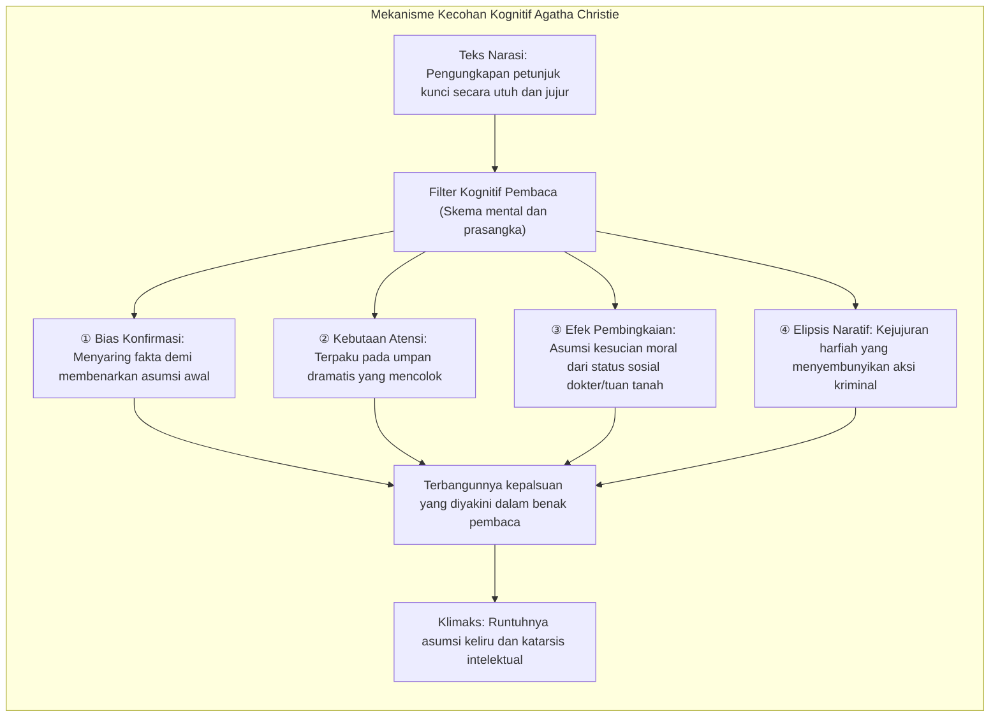
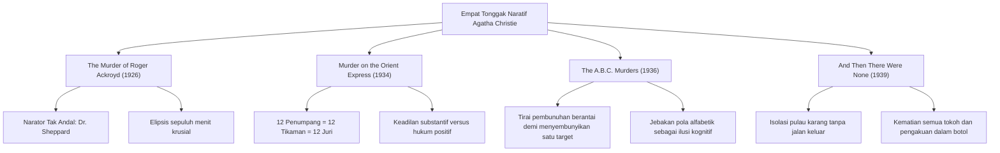
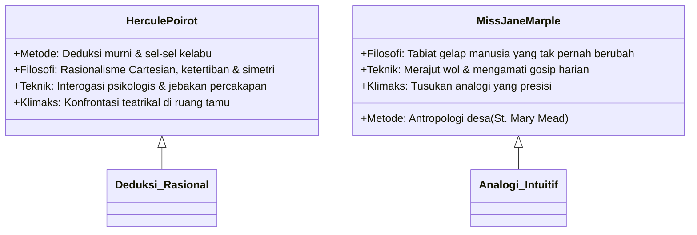

Dengan sirkulasi melampaui dua miliar eksemplar dalam lebih dari seratus bahasa di seluruh dunia, <strong>Agatha Christie (1890–1976)</strong> berdiri kokoh sebagai figur legendaris fiksi misteri yang pengaruhnya dalam sejarah percetakan manusia hanya disaingi oleh Alkitab dan karya lengkap William Shakespeare.

Pada Zaman Keemasan Fiksi Detektif (Golden Age of Detective Fiction) era 1920-an dan 1930-an, ketika pengaruh Arthur Conan Doyle mengutamakan pencarian bukti fisik dan aturan Detection Club mengatur konvensi penulisan, Christie melakukan revolusi epistemologis yang radikal: mengalihkan pusat penyelidikan dari jejak lumpur dan abu rokok menuju <strong>eksperimen laboratorium psikologis terhadap bias kognitif dan titik buta pikiran manusia</strong>. Bak seorang pesulap andal yang memikat mata penonton lewat gestur dramatis tangan kanan sementara tangan kirinya mengeksekusi muslihat rahasia, Christie menyajikan semua petunjuk vital secara terang-benderang di bawah aturan 'Fair Play' yang ketat. Namun, prasangka, asumsi moral, dan keterbatasan persepsi pembaca sendirilah yang menjebak mereka ke dalam kepalsuan.

---

## 1. Landasan Kognitif Manipulasi Naratif

Kecohan (*misdirection*) dalam karya Christie bukanlah sekadar trik murahan, melainkan manipulasi sistematis terhadap jalan pintas pemrosesan informasi dalam otak manusia:

### 1.1 Bias Konfirmasi dan Efek Keutamaan

Begitu pembaca menerima hipotesis awal yang tampak meyakinkan (misalnya anak angkat yang terlilit utang atau perempuan simpanan yang manipulatif), <strong>bias konfirmasi (Confirmation Bias)</strong> segera mengambil alih. Setiap informasi baru ditafsirkan secara selektif demi memperkuat dugaan tersebut. Bahkan ketika pelaku sejati memindahkan perabot atau membakar surat penting di hadapan saksi, pembaca membenarkannya sebagai tindakan sepele untuk melindungi kerabat.

### 1.2 Kebutaan Atensi dan Umpan Palsu (*Red Herrings*)

Eksperimen 'gorila tak kasat mata' membuktikan bahwa fokus intensif pada suatu objek membuat otak mengabaikan anomali mencolok di sekitarnya. Christie menaburkan banyak <strong>umpan palsu (Red Herrings)</strong>: botol racun eksotis, surat rahasia berbelit, atau daggers berukir. Sementara pembaca memeras otak memecahkan teka-teki teatrikal ini, kursi berlengan yang digeser setengah meter untuk menyembunyikan diktafon justru diabaikan sebagai perabot biasa.

### 1.3 Kejujuran Tekstual dalam Kaidah Fair Play

Kekuatan tertinggi Christie terletak pada penolakannya untuk berbohong secara faktual dalam narasi. Ketika pembaca menengok kembali bab-bab awal usai mengetahui dalang kejahatan, mereka mendapati bahwa kalimat yang dituliskan 100% akurat secara harfiah. Yang mengecoh pembaca bukanlah pena sang novelis, melainkan arogansi deduktif mereka sendiri.

---

## 2. Bedah Anatomi Empat Mahakarya Monumental

### 2.1 *The Murder of Roger Ackroyd* (1926): Puncak Narator Tak Andal

Novel ini mengguncang dunia sastra dengan meruntuhkan doktrin suci bahwa pendamping detektif dan pencatat cerita tidak mungkin seorang pelaku. Dokter James Sheppard yang dihormati di desanya menjadi narator sekaligus pemeras dan pembunuh Ackroyd.

Kegeniusan novel ini bersandar pada <strong>elipsis naratif</strong>. Sheppard mencatat: *«Pintu tertutup rapat. Saya meninggalkan ruangan itu pada pukul sembilan lewat tiga puluh. Tak ada lagi pekerjaan yang tersisa untuk saya selesaikan»*. Pembaca membayangkan sang dokter pulang dengan tenang; padahal kalimat tersebut merupakan pengakuan dingin bahwa penikaman dan perakitan diktafon telah tuntas. Christie tidak berdusta, ia hanya melompati rentang waktu sepuluh menit secara kalkulatif.

### 2.2 *Murder on the Orient Express* (1934): Konspirasi Kolektif

Terjebak di tengah badai salju Yugoslavia, kereta mewah Orient Express menjadi saksi pembunuhan miliarder keji Ratchett dengan dua belas luka tusukan asimetris.

Hercule Poirot menghancurkan dogma pelaku tunggal dengan kesimpulan mencengangkan: <strong>keduabelas penumpang gerbong adalah komplotan dan eksekutor bersama</strong>. Dipersatukan oleh kepedihan atas penculikan tragis anak kecil Daisy Armstrong, mereka membentuk dewan juri rahasia beranggotakan dua belas orang untuk mengeksekusi penjahat yang lolos dari hukuman negara.

### 2.3 *The A.B.C. Murders* (1936): Tabir Asap Pembunuh Berantai

Inggris dicekam ketakutan akibat serangkaian pembunuhan berantai berurutan abjad: Alice Ascher di Andover (A), Betty Barnard di Bexhill (B), Sir Carmichael Clarke di Churston (C), dengan panduan kereta ABC tertinggal di setiap lokasi.

Muslihat cemerlang ini bertumpu pada <strong>penyamaran motif warisan tunggal di balik histeria pembunuhan berantai</strong>. Sang dalang sesungguhnya hanya berniat menghabisi korban C demi menguasai harta warisan, sedangkan korban A, B, dan D hanyalah korban pelindung untuk mengelabui kepolisian agar memburu psikopat fiktif.

### 2.4 *And Then There Were None* (1939): Kemustahilan Ruang Tertutup

Sepuluh orang dengan rekam jejak kriminal tak terjamah hukum diundang ke sebuah pulau terpencil. Mengikuti syair lagu anak-anak yang mengerikan, mereka terbunuh satu per satu hingga orang terakhir gantung diri karena putus asa.

Misteri matematis ini dipecahkan melalui sandiwara Hakim Wargrave, yang memalsukan kematiannya sendiri dengan bantuan dokter yang diperalat, mengawasi kehancuran moral para penyintas, dan akhirnya mengakhiri hidupnya dengan mekanisme balistik yang rumit sembari meninggalkan surat pengakuan dalam botol.

---

## 3. Dikotomi Investigasi: Poirot vs Miss Marple

### 3.1 Hercule Poirot: Kejayaan Sel-Sel Kelabu

Detektif Belgia yang rapi ini menolak metode konvensional mencari jejak kaki di lumpur, mengandalkan kekuatan pemikiran analitis:
- <strong>Kamuflase Orang Asing:</strong> Sengaja bersikap eksentrik agar para tersangka memandangnya remeh dan membuka rahasia tanpa sengaja.
- <strong>Panggung Ruang Tamu:</strong> Mengumpulkan semua orang dalam satu ruangan untuk menyulut tekanan psikologis hingga pelaku menyerah.

### 3.2 Miss Jane Marple: Kekuatan Analogi Desa

Wanita tua bersahaja dari St. Mary Mead membalikkan prasangka sosial terhadap kaum lansia:
- <strong>Analogi Pedesaan:</strong> Bagi Miss Marple, kejahatan internasional yang rumit berakar pada kebusukan watak yang sama persis dengan kenakalan tukang daging atau pembantu di desanya.
- <strong>Ketidakkelihatan Sosial:</strong> Berlindung di balik jarum rajutnya, ia menyerap fakta krusial yang luput dari perhatian polisi resmi.

---

## 4. Keakuratan Toksikologi Medis

Keunggulan karya Christie didukung oleh kepakarannya dalam bidang farmasi dan toksikologi yang diperolehnya saat bertugas sebagai sukarelawan apoteker rumah sakit pada masa perang.

| Nama Racun | Karya Terkait | Mekanisme Farmakologis | Penggunaan dalam Plot |
|---|---|---|---|
| <strong>Strychnine</strong> | *The Mysterious Affair at Styles* | Blokade reseptor glisin, kejang tetanus, asfiksia sadar | Penundaan penyerapan melalui presipitasi kimia demi alibi waktu |
| <strong>Potassium Cyanide</strong> | *Sparkling Cyanide* | Inhibisi sitokrom c oksidase, anoksia seluler kilat | Disamarkan oleh buih dan warna sampanye saat bersulang |
| <strong>Thallium</strong> | *The Pale Horse* | Kerusakan metabolisme sel, kerontokan rambut, polineuropati | Menyerupai gejala ensefalitis atau penyakit menular alami |
| <strong>Morphine</strong> | *Sad Cypress* | Depresi sistem saraf pusat, miosis pupil, henti napas | Dicampurkan dalam teh atau makanan untuk penenang fatal |

Contoh paling fenomenal adalah novel *The Pale Horse* (1961), di mana deskripsi klinis keracunan talium yang teramat rinci berhasil menuntun pembaca kalangan medis untuk menyelamatkan pasien keracunan di dunia nyata.

---

## 5. Warisan bagi Fiksi Misteri Kontemporer

Dengan merawat kaidah intelektual fiksi detektif sembari meruntuhkan batasan konvensionalnya, Agatha Christie meletakkan fondasi bagi thriller psikologis modern. Karyanya mengilhami gerakan <strong>Shin-Honkaku</strong> di Jepang (*The Decagon House Murders* oleh Yukito Ayatsuji). Seni mengecoh pembaca yang ia bangun tetap menjadi mahkota abadi dalam arsitektur sastra misteri dunia.
