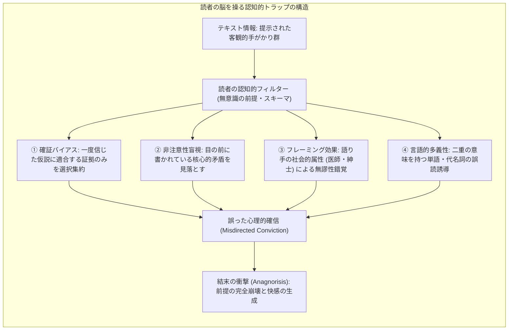
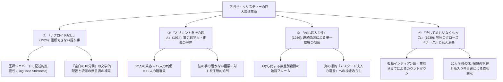
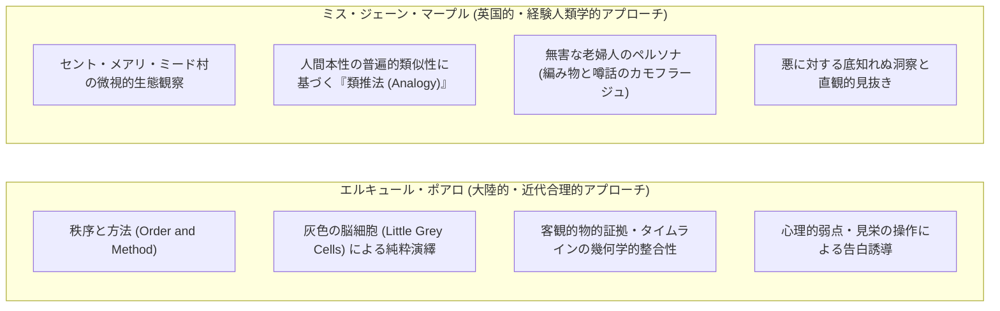
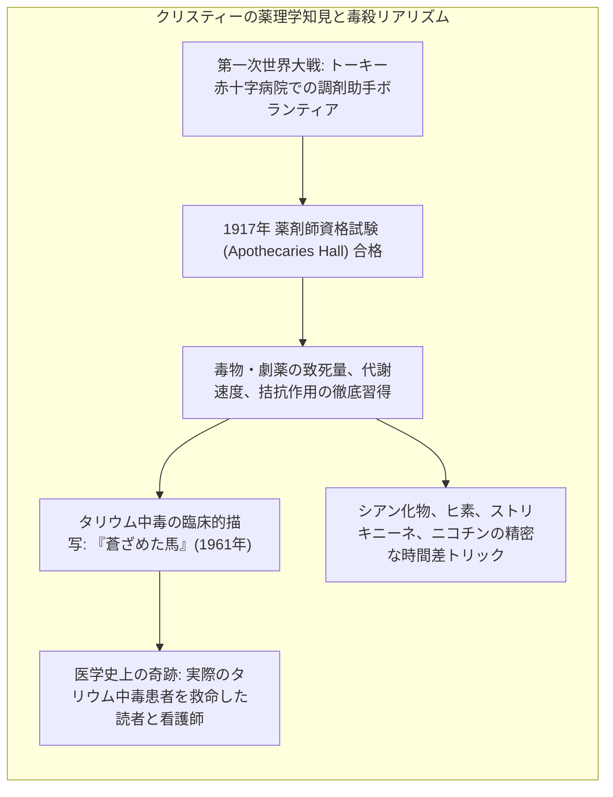
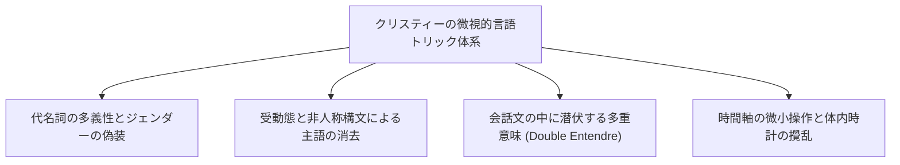
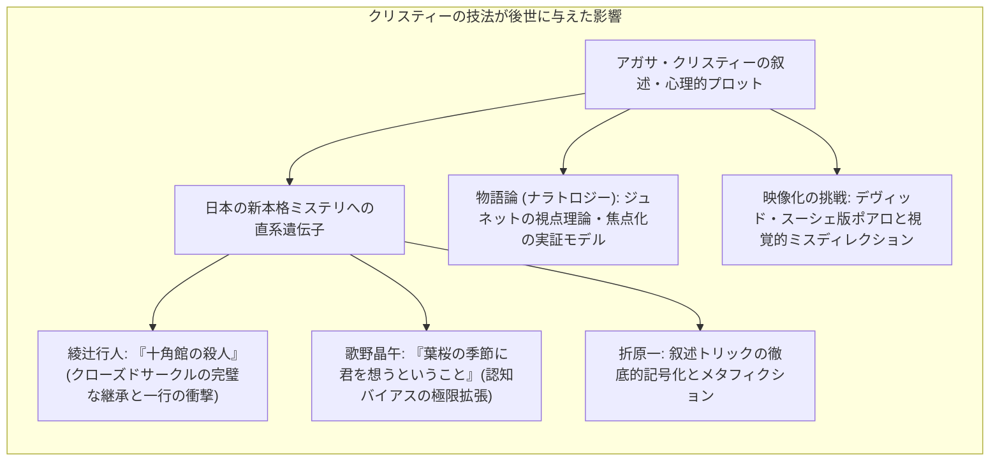

聖書、そしてウィリアム・シェイクスピアの戯曲全集に次いで、人類史上最も多くの言語に翻訳され、20億部を超える途方もない部数が印刷・読まれてきた作家——それが「ミステリの女王（Queen of Crime）」と称される英国の作家、<strong>アガサ・クリスティー（Agatha Christie, 1890–1976）</strong>です。

1920年代から1930年代にかけて訪れた「探偵小説の黄金時代（Golden Age of Detective Fiction）」において、アーサー・コナン・ドイルが確立したシャーロック・ホームズ流の法医学的・物的証拠重視の捜査劇を、クリスティーは「人間心理と認知の劇」へと鮮やかに脱皮させました。クリスティーが構築した迷宮の精緻さは、単なるパズルの面白さを超え、<strong>人間の知性が外界の情報をいかに主観的に歪曲・補完し、自己の思い込み（バイアス）によって欺かれていくかという「認知の病理」</strong>を冷徹なまでに暴き出す文学的実験室でもありました。

マジシャンが右手の派手なジェスチャーで観客の注意を誘導している間に左手で密かにタネを仕込むように、クリスティーはすべての手がかりを白日の下に、極めてフェアに提示しながら、読者の先入観、常識、道徳的予断、そして言語の多義性を巧みに操ることで、読者自らに誤った結論を組み立てさせました。これが、クリスティーの代名詞である<strong>「心理的・叙述的ミスディレクション（Psychological and Narrative Misdirection）」</strong>の神髄です。

『アクロイド殺し』における「語り手＝犯人」という禁じ手、『オリエント急行の殺人』における「容疑者全員＝実行犯」という集合的断罪、『ABC殺人事件』における「連続殺人による個別の動機の隠蔽」、そして『そして誰もいなくなった』における「被害者全員の死と犯人の消失」——。これらの記念碑的傑作で提示されたプロットの原型（アーキタイプ）は、現代の推理小説、映画、サイコスリラー、さらには日本の「新本格ミステリ」運動に至るまで、すべてのミステリ作家が乗り越えるべき巨大な金字塔として君臨し続けています。

本稿では、クリスティー作品に埋め込まれた認知的盲点と心理バイアスの作用機序、四大名作の構造的解剖、ポアロの「灰色の脳細胞」とミス・マープルの「類推的村落観察」の比較文学的対比、第一次世界大戦の調剤助手経験に裏打ちされた毒物薬理学のリアリズム、そして物語論（ナラトロジー）の視点からみた言語的叙述トリックの微視的メカニズムを学術的・体系的に解明します。

---

## 1. 認識論的死角と認知バイアス：なぜ読者は欺かれるのか

マジック（奇術）の世界において、「ミスディレクション」とは単に注意をそらすことではなく、「観客の注意を<strong>特定の無害な一点へと能動的に引きつけ、自発的に納得させること</strong>」と定義されます。クリスティーが読者に対して仕掛けた罠も、まったく同一の認知心理学的構造を持っています。

### 1.1 確証バイアス（Confirmation Bias）とフレーミング効果

人間は、一度ある仮説や先入観（「この人物は被害者を深く愛していた」「この人物は怪しすぎるから真犯人、あるいは逆に無実の道化だ」）を抱くと、その仮説を支持する情報ばかりを選択的に知覚し、仮説に反する明白な反証をノイズとして無意識に無視・矮小化する傾向があります。これを心理学で<strong>「確証バイアス」</strong>と呼びます。

クリスティーはこの心理的惰性を悪魔的な精度で利用します。彼女は物語の冒頭で、読者が飛びつきやすい「分かりやすい構図」（例えば、傲慢な被害者、財産を巡って対立する不肖の息子、怪しげな執事、愛人の存在など）を惜しげもなく提示します。読者が「犯人は遺産目当ての息子に違いない」という仮説の枠組み（フレーム）に囚われた瞬間、クリスティーの勝利は確定します。以後、真犯人が犯行現場にアリバイ工作を施す瞬間や、決定的な凶器の隠滅行為が文章としてありのままに描写されていても、読者の脳内フィルターはそれを「無害な日常的所作」あるいは「別の容疑者を庇う行動」として無意識に無害化して解釈してしまうのです。

### 1.2 非注意性盲視（Inattentional Blindness）と「隠すなら森の中」

認知科学における有名な「見えないゴリラ実験」（シモンズとチャブリス、1999年）が示すように、人間は特定の課題（例えば白いシャツのチームのパス回数を数えること）に高度に注意を集中させていると、視界の中央をゴリラの着ぐるみを着た人物が横切っても、その存在に全く気づくことができません。この現象を<strong>「非注意性盲視（Inattentional Blindness）」</strong>と呼びます。

ミステリにおけるクリスティーの卓越性は、<strong>「最も重要な手がかりを、過剰な無関係情報（情報過多）の奔流の中に平然と埋没させる」</strong>技術にありました：
- 犯行時刻の部屋の描写において、暖炉の灰、脱ぎ捨てられた手袋、インクの染み、開け放たれた窓、そして「動かされた椅子の位置」。
- 読者は「毒薬の種類」や「鍵のかかった窓」という派手な謎に全神経を集中させられているため、文章の真ん中に平然と置かれた「動かされた椅子」という物理的矛盾（死体の隠蔽や蓄音機の設置のための移動）を、単なる情景描写の装飾として脳内から自動消去してしまうのです。

G・K・チェスタトンがブラウン神父シリーズで喝破した「木の葉を隠すなら森の中、死体を隠すなら戦場の中」という逆説を、クリスティーはテキストの微視的レベルで完璧に実践しました。

### 1.3 フェア・プレイのパラドックス：すべてを明示しながら欺く美学

探偵小説の黄金時代には、ロナルド・ノックスの「十戒」（1928年）やS・S・ヴァン・ダインの「二十則」（1928年）に代表されるように、「読者に対してすべての手がかりを公平に提示しなければならない」という厳格な<strong>フェア・プレイ原則</strong>が共有されていました。

多くの作家が読者を騙すために情報を隠蔽したり、探偵だけが知る秘密の科学知識を持ち出したりして読者の反感を買ったのに対し、クリスティーの驚異的な点は、<strong>「真相を暴くために必要なパズルのピースを、すべて最初から読者の目前に並べて見せている」</strong>という点です。読者は読了後、ページを逆戻りして検証した瞬間、驚愕とともに敗北を認めざるを得なくなります。「著者は嘘を一行も書いていない。私が勝手に思い込み、私の目が節穴だったのだ」——このフェア・プレイに裏打ちされた知的な自責の念こそが、クリスティーの読書体験をカタルシスへと昇華させる核心なのです。

---

## 2. クリスティーの四大叙述革命：代表作の構造的解剖

クリスティーが世界のミステリ史に刻んだ最大の功績は、探偵小説のジャンル的「約束事（コンベンション）」そのものを脱構築した四大名作の構造設計にあります。

### 2.1 『アクロイド殺し』（1926年）：信頼できない語り手の極北

1926年に発表された『アクロイド殺し（*The Murder of Roger Ackroyd*）』は、探偵小説界に未曾有の賛否両論の嵐を巻き起こしました。当時の読者や評論家にとって、「ホームズに対するワトソン役」すなわち読者の代理人として事件を中立・客観的に記録する語り手（ナレーター）は、道徳的・構造的に絶対に疑ってはならない聖域でした。

クリスティーはその聖域に爆弾を投げ込みました。語り手である村落の医師ジェイムズ・シェパードこそが、アクロイドを脅迫し、刺殺した冷酷な真犯人だったのです。

この作品の文学的驚異は、シェパード医師の語りが<strong>「一言の虚偽も述べていない（文字通りの真実である）」</strong>という言語的厳密性（Linguistic Strictness）にあります。
例えば、シェパードがアクロイドの書斎を去る運命の瞬間、テキストにはこう記されています：

> *「アクロイドの書斎のドアは閉ざされていた。私が部屋を出たのは9時30分だった。私がやり残した仕事は何もなかった。」*

読者の脳は、語り手が「誠実な紳士医師」であるというフレーミング効果のせいで、「アクロイドは9時30分に生きており、シェパードは親切な診察を終えて退出した」と勝手に解釈（文脈補完）してしまいます。しかし実際には、シェパードは9時30分までにアクロイドを刺殺し、死体を隠蔽するための機械的トリック（蓄音機による声の偽装、窓の鍵の細工、椅子の移動）という「やり残した仕事」をすべて完璧に完了させていたのです。

シェパードは虚偽を語ったのではなく、<strong>ただ「自分が何をしたか」を意図的に省略（エリプシス）した</strong>に過ぎません。この「空白の10分間」を巡るフェアプレイ論争において、クリスティーは「語り手が真実を語る義務はあるが、自らの罪業をわざわざ告白する義務はない」という現代ナラトロジー（物語論）における「信頼できない語り手（Unreliable Narrator）」の金字塔を打ち立てたのです。

### 2.2 『オリエント急行の殺人』（1934年）：犯人単一性の解体と集合的正義

雪に閉ざされたユーゴスラビアの山中で立ち往生した超豪華列車「オリエント急行」。密室と化した一等寝台車で、アメリカの悪名高い富豪ラチェット（本名カセッティ）が12箇所を刺されて惨殺されます。

探偵エルキュール・ポアロが直面したのは、容疑者全員に互いに矛盾する完璧なアリバイが存在し、同時に全員が現場に残された謎の証拠品（燃えかすの手紙、車掌の制服、ドラゴンの刺繍が入った着物）と奇妙に結びついているというカオスでした。

クリスティーがここで粉砕したミステリの掟は、<strong>「犯人は単一（あるいは首謀者と共犯者のペア）である」という暗黙の前提</strong>でした。ポアロが導き出した驚愕の真相——それは<strong>「車内の容疑者12人全員が共謀し、一人一刀ずつラチェットを刺した」</strong>というものでした。

被害者ラチェットは、かつて幼いデイジー・アームストロングを誘拐・殺害し、巨万の富で法網を逃れた凶悪犯でした。車内に居合わせた公爵夫人、大佐、執事、家庭教師、伯爵夫妻らは、すべてデイジーの遺族や関係者であり、法の裁きが及ばない巨悪に対して自らが<strong>「12人の陪審員」</strong>となって死刑執行判決を下したのです。

クリスティーは単にパズルを解いたのではありません。「実定法が機能不全に陥ったとき、道徳的・自然法的な正義はいかに執行されるべきか」という法哲学の根源的ディレンマを提示しました。ポアロが最後に警察に対して提示した「見知らぬ暗殺者が雪の中に逃走した」という偽の推理を採用し、12人の犯人たちを見逃す結末は、本格ミステリにおける倫理と情理の最高峰のドラマを形作っています。

### 2.3 『ABC殺人事件』（1936年）：連続殺人の法則性による逆転

『ABC殺人事件（*The A.B.C. Murders*）』は、現代のプロファイリングやシリアルキラー（連続殺人犯）ものの始祖にして、その構造的転覆をすでに成し遂げていた記念碑的作品です。

ポアロのもとに届く「ABC」と名乗る狂人からの挑戦状。予告通り、アルファベット順に地名と被害者の頭文字が一致する殺人が発生します：
- <strong>A</strong>: アンドーヴァー（Andover）のアッシャー夫人（Mrs. Ascher）
- <strong>B</strong>: ベクスヒル（Bexhill）のベティ・バーナード（Betty Barnard）
- <strong>C</strong>: チャーストン（Churston）のカーマイケル・クラーク卿（Sir Carmichael Clarke）

死体の傍らには常に鉄道時刻表「ABC案内」が開いたまま残され、全英は正体不明のサイコパスの恐怖に震撼します。物語は三人称の客観描写と、ヘイスティングズ大尉の一人称回想、そしててんかんを患うストッキング行商人アレグザンダー・ボナパルト・カスト（A.B.C.の頭文字を持つ男）の苦悩する視点が並行して語られ、読者はカストが真犯人であると完全に思い込まされます。

しかし、これこそがクリスティーの最も華麗な<strong>「連続殺人のカモフラージュ」</strong>でした。
真犯人の目的は、最初から「第三の被害者」である大富豪カーマイケル・クラーク卿を暗殺し、その莫大な遺産を相続すること<strong>ただ一点</strong>にありました。単独でクラーク卿を毒殺すれば、遺産相続人である弟フランクリンに真っ先に警察の疑いの目が向けられます。そこでフランクリンは、無関係なAとBの殺人をあらかじめ実行し、あたかも「アルファベット順に無差別殺戮を繰り返す異常者の犯行」という巨大な錯覚のフレームを社会全体に構築した上で、本命のCをそのノイズの中に紛れ込ませたのです。

「木を隠すなら森の中」の格言を、一連の連続殺人という虚構の森を自ら創出することで達成したこのトリックは、後の映画や現代ミステリで無数に模倣される不朽のプロットモデルとなりました。

### 2.4 『そして誰もいなくなった』（1939年）：究極のクローズド・サークル

デヴォン沖に浮かぶ絶海の孤島「インディアン島（兵隊島）」。過去に法で裁けぬ罪を犯した10人の男女が、謎の主「U・N・オーエン（Unhonoured / Unknown＝名もなき者）」から招待を受けます。

館の客室に掲げられた童謡「10人のインディアン（兵隊）」の不気味なマザーグースの歌詞に沿って、10個のインディアン人形が一つずつ消えるとともに、孤島の滞在者たちが一人、また一人と不可解な死を遂げていきます。外部との連絡手段は絶たれ、ボートは来ず、島のどこを捜索しても10人以外の人間は存在しない。そしてついに、10人全員が死体となって発見されます。

クリスティーはここで、<strong>本格ミステリが内包する構造の限界を脱構築</strong>しました：
1. <strong>探偵の完全なる不在</strong>: 謎を解くべき論理的英雄（探偵）が存在せず、全員が容疑者であり、全員が恐怖に怯える被害者へと転落していく。
2. <strong>容疑者全員の死亡</strong>: 生存者が一人も残らないため、「生き残った最後の1人が真犯人」というパズルの基本公理が消滅する。
3. <strong>告白書による真相開示</strong>: 真相は、後日海上で漁師に拾い上げられたガラス瓶の中の告白書——犯人自身であった判事ロレンス・ウォーグレイヴによる手記——によってのみ事後的に明らかにされる。

ウォーグレイヴ判事は、自らの末期癌の病苦と、法の手を逃れた罪人たちに神に代わって鉄槌を下したいという狂気的な正義感を合体させ、医師アームストロングを巧みに騙して「偽の射殺死体」を演じることで自らの存在を容疑者リストから消去し、残りの者を全滅させた後に自裁したのです。これほど完璧に閉じた円環構造を持つミステリは、世界文学史上ほかに類を見ません。

---

## 3. 探偵の二項対立：ポアロの「演繹論理」とミス・マープルの「村落人間学」

クリスティーが生み出した二大名探偵、エルキュール・ポアロとミス・ジェーン・マープルは、対照的な認識論的アプローチを体現する文学的二項対立を形成しています。

### 3.1 エルキュール・ポアロ：秩序と方法、そして「灰色の脳細胞」

元ベルギー警察の警察部長であったポアロは、<strong>近代ヨーロッパの合理主義とデカルト的演繹精神</strong>の権化です。

ホームズが虫眼鏡と巻尺を持って絨毯を這い回り、タバコの灰や足跡を採取するのに対し、ポアロはそうした泥臭い肉体労働を「愚かな猟犬のやり方」と蔑みます。ポアロの武器は、暖炉の前の肘掛け椅子に深く座り、卵形の頭を傾げて静かに稼働させる<strong>「灰色の脳細胞（Little Grey Cells）」</strong>です。

ポアロの方法論の核心は<strong>「秩序と方法（Order and Method）」</strong>です：
- 事件関係者の証言、タイムラインの歪み、部屋の家具の配置といった客観的事実を、数学的な整合性を持つ幾何学的秩序へと再配列する。
- 人間が嘘をつくとき、必ず自らの虚栄心、プライド、恐怖、愛憎が言動の端々に漏れ出る。ポアロはわざと滑稽な外国人（英語のおぼつかない風変わりな小男）を演じることで相手の警戒心を解除し、相手が自発的に口を滑らせるのを待つのです。

### 3.2 ミス・マープル：田園村落の経験人類学と類推思考

対照的に、セント・メアリ・ミード村に暮らす老淑女ミス・マープルは、警察組織の権力も法医学の知識も持たない、一見どこにでもいる無害な老婦人です。

彼女の推理の武器は、徹底した<strong>「類推（アナロジー / Analogy）」</strong>です。マープルにとって、ロンドンの高級ホテルで起きた陰惨な毒殺事件も、国際的な詐欺事件も、すべて彼女が数十年にわたって観察し尽くしてきた「セント・メアリ・ミード村の住人たちの日常的悪徳」と完全に同一のパターンに還元されます：
- 「あの冷淡な銀行家は、村の小間物屋を騙して自殺に追い込んだ昔の郵便局長と瓜二つです」
- 「あの魅力的な青年が見せる無邪気な笑顔は、教会のお布施を盗んでいた日曜学校の少年の手口と同じです」

マープルの思想の根底には、<strong>「人間本性はどこへ行っても同じであり、最も穏やかで美しい田園の中にこそ、最も黒々とした悪が潜んでいる」</strong>という冷徹な人間観があります。編み物を編み、庭の雑草を抜き、鳥を観察しながら近所の噂話に耳を傾ける彼女の日常は、実は世界で最も精緻な人間観察のフィールドワークだったのです。

---

## 4. 毒殺の化学と法医学的リアリズム

アガサ・クリスティー作品の際立った技術的特徴の一つが、<strong>「毒殺（Poisoning）」の圧倒的な多さ</strong>と、その医学的・薬理学的描写の戦慄するほどの正確さです。クリスティーの全作品で描かれた殺人のうち半分以上が毒殺であり、これは銃殺や刺殺を好んだ他のミステリ作家と一線を画しています。

### 4.1 第一次世界大戦の調剤経験と薬剤師資格

クリスティーの毒物に関する驚異的な該博知識は、机上の空論ではありませんでした。第一次世界大戦が勃発した際、彼女はデヴォン州トーキーの赤十字病院でボランティア看護師として負傷兵の手当てに従事し、その後、病院の薬局（調剤室）へと配属されました。

1917年、彼女は厳しい国家試験に合格して正式な調剤助手（Apothecary's Assistant）の資格を取得しました。当時、抗生物質が存在しなかった時代において、薬局ではストリキニーネ、ヒ素、アトロピン、モルヒネ、抱水クロラールといった猛毒・劇薬をミリグラム単位で正確に調合して軟膏や内服液を製造していました。クリスティーは、毒薬と治療薬の境界がいかに紙一重であるか、そしてわずか数滴の計量ミスがいかに人間の生命を容易に絶ち切るかを、自らの指先と秤を通じて骨の髄まで叩き込まれたのです。

### 4.2 『蒼ざめた馬』とタリウム中毒：現実の命を救った文学

クリスティーの毒物描写の正確さを証明する最も劇的なエピソードが、1961年に発表された『蒼ざめた馬（*The Pale Horse*）』です。

この作品で犯人が用いた凶器は、当時一般にはほとんど知られていなかった重金属<strong>タリウム（Thallium）</strong>でした。タリウムは無味無臭で水に溶けやすく、摂取しても初期症状はインフルエンザや胃腸炎、神経痛に酷似し、数週間かけて徐々に衰弱死に至るため、医師でさえ自然死や病死と誤診しやすい恐るべき毒物です。そして末期に現れる特異な徴候が<strong>「毛髪の脱落（脱毛症）」</strong>でした。

この小説が刊行された後、現実の世界で奇跡が起きました：
1. 1975年、英国で原因不明の奇病で次々と同僚が倒れた工場において、ミステリ愛好家であった女性作業員が『蒼ざめた馬』の記述を思い出し、「これはタリウム中毒ではないか」と進言。調査の結果、同僚のグラハム・ヤングがタリウムを混入していたことが発覚し、毒殺魔が逮捕されました。
2. 1977年、ロンドンの病院にカタールから運ばれてきた生後19カ月の女児が、原因不明の昏睡と痙攣で危篤状態に陥っていました。当直の看護師マージョリー・ターナーが『蒼ざめた馬』を読んだばかりで、女児の脱毛症状からタリウム中毒の可能性を医師に進言。直ちに尿検査が行われて高濃度のタリウムが検出され、解毒剤（プルシアンブルー）の投与によって女児の一命を取り留めたのです。

一編のエンターテインメント小説が、医学書以上に正確な臨床毒性学の知識を一般に提示し、現実の人命を救ったというこの事例は、クリスティーの徹底したリアリズム精神の金字塔となっています。

---

## 5. 言語的ミスディレクションの微視的修辞学

クリスティーが仕掛ける罠は、大掛かりなプロットのレベルだけでなく、<strong>一文一文の構文（シンタックス）や語彙の選択</strong>という微視的な言語レベルにおいて周到に張り巡らされています。

### 5.1 代名詞とジェンダーの不可視化

英語という言語の文法構造を利用し、クリスティーは登場人物の性別や正体を巧みに隠蔽します：
- 「人影（the figure）」「誰か（someone）」「患者（the patient）」といった中性的な名詞を用いることで、読者に勝手に「男性」あるいは「女性」の像を結ばせる。
- 『死との約束』や『バグダッドの秘密』などで見られるように、特徴的な衣服（レインコート、ベール、つばの広い帽子）を身につけた人物を描写し、読者がその衣服の社会的ジェンダーに基づいて人物を特定した瞬間、実はその下に着ていたのが全く別の性別の人物であったという逆転を生み出します。

### 5.2 受動態による「行為主体（エージェント）」の隠蔽

クリスティーの文章では、犯行の瞬間や証拠の移動が<strong>受動態（Passive Voice）</strong>によって叙述されることが多々あります：
- *“The door was locked.”*（ドアには鍵がかけられていた / かけられた）
- *“A glass of wine was placed on the mantelpiece.”*（ワイングラスが暖炉の棚に置かれていた）

受動態を使うことで、「誰が鍵をかけたのか」「誰がグラスを置いたのか」という能動的な行為主体を文法的に完全に抹消することができます。読者はそれを「部屋の静的な状態」として読み過ごしてしまいますが、後から振り返ると、その行為こそが真犯人がアリバイ工作を行っていた決定的な瞬間であったことが明かされるのです。

### 5.3 会話の中の「二重の意味（Double Entendre）」

クリスティー作品の登場人物たちは、紅茶を飲みながら極めて自然で他愛のない世間話を交わします。しかし、その無駄話の中に、驚くべき真実が<strong>完全に二重の意味を持つ言葉</strong>として埋め込まれています。

例えば、ある登場人物が「私は昨夜、本当にひどい夢を見ました。すべてを赤く染め上げてしまうような……」と呟いたとき、読者はそれを「神経質な人物の心理的不安」として受け流します。しかし解決編において、それは比喩ではなく、真犯人が血塗られた絨毯を裏返して隠した物理的行為の生々しい告白であったことが判明します。日常会話の平穏なテクスチャーそのものが、読者の知覚を麻痺させる最強の目くらまし（スモークスクリーン）として機能しているのです。

---

## 6. 現代本格ミステリと物語論（ナラトロジー）への遺産

クリスティーが開発した叙述トリックとミスディレクションの文法は、その後の世界文学、とりわけ日本における<strong>「新本格ミステリ」ムーブメント</strong>へと直接的に継承され、劇的な進化を遂げました。

### 6.1 日本の新本格ミステリ運動への決定的影響

1987年、綾辻行人の『十角館の殺人』によって幕を開けた日本の「新本格ミステリ」は、クリスティーの『そして誰もいなくなった』に対する熱烈なオマージュであり、同時にその現代的再創造でした。

孤島、十角形の奇妙な館、過去の罪業、童謡に代わる連続殺人、そして読者を奈落に突き落とす「たった一行の衝撃」——。綾辻行人は、クリスティーが確立した「小説という文字メディアだからこそ成立する認知の盲点」を極限まで先鋭化させました。

さらに、歌野晶午の『葉桜の季節に君を想うということ』（2003年）は、読者が無意識に抱く「主人公＝若々しい探偵青年」という年齢・身体的ステレオタイプを逆手に取り、クリスティーの『アクロイド殺し』を凌駕する大胆な認知的ミスディレクションを達成しました。折原一の「倒錯」シリーズや貫井徳郎、米澤穂信らに至るまで、現代日本の本格ミステリの豊穣な土壌は、クリスティーが耕した叙述トリックの鉱脈の上に咲き誇っていると言っても過言ではありません。

### 6.2 物語論（ナラトロジー）と視覚的映像化の壁

文芸批評家ジェラール・ジュネットの物語論において、クリスティーの作品は<strong>「焦点化（Focalization）」</strong>と<strong>「物語言説（Narrative Discourse）」</strong>の極限的実験として研究されています。語り手が「何を知っており、何を語り、何を沈黙しているのか」という視点の操作こそが、クリスティー文学の骨格です。

それゆえに、クリスティー作品の映像化は、映画監督にとって最大の挑戦となってきました：
- 文字媒体であれば「シェパード医師の足取り」を文章の行間に隠すことができますが、カメラのレンズは「誰がそこにいたのか」を物理的に記録せざるを得ません。
- 名優デヴィッド・スーシェが主演を務めた決定版ドラマシリーズ『名探偵ポワロ』や、ケネス・ブラナー監督の映画『オリエント急行殺人事件』『ナイル殺人事件』では、主観ショット、巧みなカメラアングル、鏡の反射、編集のモンタージュを駆使して、いかに文字のミスディレクションを「視覚的ミスディレクション」へと翻訳するかの熾烈な映像実験が繰り返されてきました。

---

## 7. 結論：欺かれる快楽と人間の心の深淵

なぜ私たちは、アガサ・クリスティーの物語に自ら進んで欺かれ、そして騙された瞬間にこれほどまでに深い快感を覚えるのでしょうか。

心理学的に見れば、本格ミステリを読むという体験は、<strong>「自らの知性の限界を知る知的遊戯」</strong>です。私たちは日常生活において、自分が論理的で、客観的で、騙されにくい賢明な人間であると信じています。しかしクリスティーの作品を開いた瞬間、私たちは自らの先入観、ステレオタイプ、そして認知バイアスの虜となり、見事に罠へと誘導されます。解決編において探偵がすべての糸を解きほぐしたとき、崩壊するのは事件の謎だけでなく、「自分はすべてを見通していた」という読者の傲慢な自己像そのものです。この知的な敗北の爽快感こそが、読書がもたらす最高の快楽なのです。

しかし、クリスティーの不滅の魅力は、単なる巧妙なパズルメーカーとしての手腕にとどまりません。彼女がミスディレクションのベールの奥底に描き続けたのは、<strong>「日常のすぐ隣に口を開けている人間の暗黒の深淵」</strong>でした：
- 平穏なイギリスの村で花を愛でる親切な隣人が、金銭のために隣人を毒殺する。
- 誰からも愛される美しい少女が、嫉妬と執着のために冷酷な罠を仕掛ける。
- 完璧な正義を信じる老判事が、法を超越した大量殺戮者へと変貌する。

クリスティーは、人間を単一の「善人」や「悪人」として記号化することを徹底して拒みました。最も卑小な見栄、些細な恐怖、歪んだ愛情、そして抑圧された欲望が、ある日ふとしたきっかけで殺意へと転化する——。クリスティーが仕掛けた心理的ミスディレクションとは、読者の注意を逸らすための単なる技術ではなく、<strong>「人間とは、自分自身の心の深淵についてさえ盲目である」という人間存在そのものの悲劇を映し出す鏡</strong>だったのです。

隊商の鈴の音が消え去った砂漠のように、あるいは雪に閉ざされたオリエント急行の夜のように、クリスティーが紡ぎ出した物語の数々は、1世紀の時を経た今もなお、私たちを心地よい迷宮へと誘い、人間という不可解な生き物の真実を語り続けています。

---

## 参考文献・推薦図書

1. クリスティー, A. 『アクロイド殺し』 (羽田詩津子訳, ハヤカワ・ミステリ文庫)
2. クリスティー, A. 『オリエント急行の殺人』 (田口俊樹訳, ハヤカワ・ミステリ文庫)
3. クリスティー, A. 『そして誰もいなくなった』 (青木久恵訳, ハヤカワ・ミステリ文庫)
4. クリスティー, A. 『ABC殺人事件』 (田口俊樹訳, ハヤカワ・ミステリ文庫)
5. クリスティー, A. 『アガサ・クリスティー自伝』 (矢沢聖子訳, 早川書房)
6. ハークレス, J. 『アガサ・クリスティーの毒薬』 (The Chemistry of Murder, 2015)
7. 笠井潔 『本格ミステリの現在』 (双葉社)
8. シモンズ, D. & チャブリス, C. 『見えないゴリラ：錯覚色の科学』 (文藝春秋)
9. ジュネット, G. 『物語のディスクール：方法の試論』 (水声社)
10. ノックス, R. 『探偵小説十戒』 (1928)