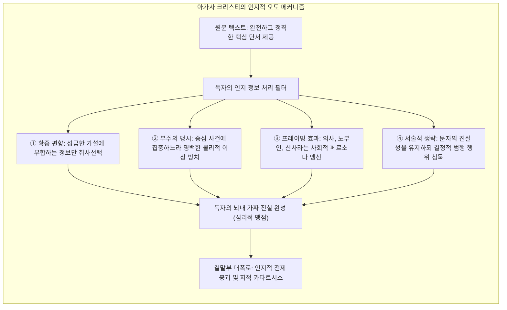
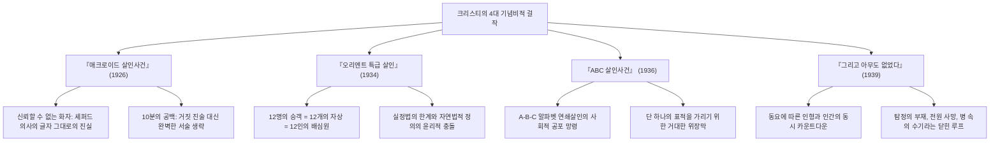
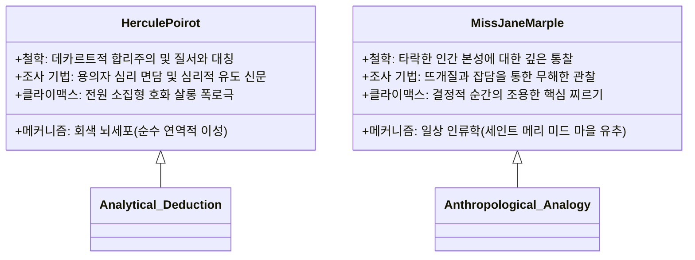

인류 출판 역사상 성경과 셰익스피어 희곡 전집에 필적하며 20억 부 이상의 발행 부수와 전 세계 최다 언어 번역 기록을 보유한 문학적 거인은 단연 <strong>아가사 크리스티(Agatha Christie, 1890–1976)</strong>입니다.

1920~30년대 추리소설의 황금기(Golden Age of Detective Fiction)에 아서 코난 도일식의 물리적 법의학 및 증거 추적 전통과 탐정 클럽의 엄격한 규칙주의 속에서, 크리스티는 범죄 소설의 패러다임을 '발자국과 담뱃재의 물리적 추적'에서 <strong>'인간 인지 편향과 심리적 맹점을 파고드는 정밀한 심리 실험'</strong>으로 혁신했습니다. 마술사가 화려한 오른손 제스처로 관객의 시선을 빼앗는 사이 왼손으로 트릭을 완성하듯, 크리스티는 완벽한 '페어플레이(Fair Play)' 원칙 아래 모든 핵심 단서를 독자의 눈앞에 정직하게 펼쳐 놓으면서도, 독자 스스로 자신의 선입견과 도덕적 편향에 갇혀 진실을 보지 못하게 만드는 고도의 서술 미학을 완성했습니다.

이것이 바로 크리스티 문학의 핵심 엔진인 <strong>'서술 및 심리적 미스디렉션(Narrative and Psychological Misdirection)'</strong>입니다. 『애크로이드 살인사건』에서 '기록자는 무결한 관찰자'라는 고정관념을 파괴하고, 『오리엔트 특급 살인』에서 '범인은 단 한 명'이라는 대전제를 해체하며, 『ABC 살인사건』에서 무작위 연쇄살인으로 단일 표적을 은폐하고, 『그리고 아무도 없었다』에서 탐정과 생존자가 전멸하는 극한의 폐쇄 공간을 설계한 그녀의 서사 모델은 오늘날 전 세계 추리 서사와 서술 트릭의 불멸의 원형으로 군림하고 있습니다.

---

## 1. 인식론적 맹점: 독자는 왜 필연적으로 속는가

마술에서의 오도(Misdirection)가 단순히 시선을 가리는 물리적 속임수가 아니듯, 크리스티의 미스디렉션은 <strong>독자의 주의력과 인지적 프레임을 능동적으로 통제</strong>하는 심리학적 공학입니다. 크리스티는 진화가 인간에게 부여한 인지적 효율성 추구 경향을 완벽하게 역이용했습니다.

### 1.1 확증 편향과 초두 효과

인간의 뇌는 초기에 제시된 인상(예: 탐욕스러운 양자, 매혹적이지만 위험한 내연녀)에 기초하여 첫인상(Primacy Effect)을 형성하면, 이후 들어오는 모든 정보를 그 틀에 끼워 맞추려는 <strong>확증 편향(Confirmation Bias)</strong>에 빠집니다. 진범이 독자의 시선이 닿는 공공연한 장소에서 가구를 옮기거나 서류를 태우더라도, 독자는 '결백한 친족을 보호하기 위한 행동'이나 '사소한 신경증'으로 자의적으로 해석하며 스스로 범인을 인지적 사각지대에 숨겨줍니다.

### 1.2 부주의 맹시와 붉은 청어(Red Herring)의 조화

심리학의 '보이지 않는 고릴라' 실험이 증명하듯, 주의가 한곳에 집중되면 눈앞의 명백한 이질성을 전혀 지각하지 못하는 <strong>부주의 맹시(Inattentional Blindness)</strong>가 발생합니다. 크리스티는 현장에 이국적인 독약병, 암호화된 밀서, 잠긴 방의 수수께끼 등 자극적인 미끼(Red Herring)를 대량 살포합니다. 독자가 이 화려한 미끼의 의미를 파헤치려 뇌를 풀가동하는 동안, 정작 범행의 핵심인 '방 한가운데 2피트 옮겨진 안락의자'(녹음기와 시신의 사각지대를 만들기 위한 물리적 배치)는 단순한 가구 배치로 치부되어 망각의 영역으로 사라집니다.

### 1.3 페어플레이 규칙 속의 절대적 언어적 정직성

크리스티 문학이 단순한 싸구려 트릭 소설과 확연히 구분되는 정점은, 그녀가 <strong>객관적 사실 진술에서 독자에게 거짓말을 하지 않는다</strong>는 철칙에 있습니다. 진상이 밝혀진 후 책의 첫 페이지로 돌아가 문장을 대조해 보면, 모든 핵심 사실이 한 자의 왜곡도 없이 그대로 적혀 있음을 깨닫게 됩니다. 독자를 기만한 것은 작가의 거짓말이 아니라, 독자 자신의 편견과 어설픈 유추였음을 깨닫는 순간, 독자는 가장 순도 높은 지적 전율을 경험합니다.

---

## 2. 4대 혁신 걸작의 구조적 해부

### 2.1 『애크로이드 살인사건』 (1926): 신뢰할 수 없는 화자의 극치

추리문학 역사상 가장 격렬한 논쟁을 불러일으킨 『애크로이드 살인사건』은 '기록자 왓슨은 결코 범인이 될 수 없다'는 불문율을 완벽히 해체했습니다. 마을의 존경받는 의사이자 화자인 제임스 셰퍼드는 살인 사건을 냉철하게 기록하지만, 바로 그 자신이 공갈범이자 살인자였습니다.

이 작품의 백미는 <strong>언어적 엄밀성(Linguistic Precision)</strong>입니다. 셰퍼드는 살인을 저지른 직후의 행동을 다음과 같이 묘사합니다: *"서재 문은 닫혀 있었다. 내가 그 방을 떠난 것은 아홉 시 삼십 분이었다. 내가 남겨둔 일은 아무것도 없었다."* 독자는 그가 환자를 진료하고 평온하게 퇴청했다고 믿어버리지만, '남겨둔 일이 없다'는 문장은 범행과 녹음기 알리바이 조작을 완벽하게 마쳤다는 섬뜩한 고백이었습니다. 크리스티는 단 한 줄의 거짓말도 쓰지 않은 채, 결정적인 10분간의 행동을 '서술적 생략(Ellipsis)'함으로써 서양 문학사 최고의 반전을 일구어냈습니다.

### 2.2 『오리엔트 특급 살인』 (1934): 집단 공모와 정의의 아포리아

폭설로 고립된 호화 열차 안에서 발생한 미국인 거부 래챗의 암살 사건은 '용의자 중 단 한 명의 진범을 가려낸다'는 고전 추리물의 공리를 전복합니다. 피해자의 몸에 남겨진 12개의 상처는 제각기 깊이와 각도가 달랐으며, 승객들의 완벽한 알리바이는 서로를 교차 보증하고 있었습니다.

포와로가 도달한 결론은 경악스럽게도 <strong>"열차에 탑승한 12명의 승객 전원이 공모자이자 공동 집행자"</strong>라는 진실이었습니다. 과거 유괴 살해된 어린 소녀 암스트롱 사건의 상처를 공유한 이들은 법망을 빠져나간 흉악범을 심판하기 위해 자발적인 '12인의 배심원단'을 결성했습니다. 이 작품은 단순한 트릭을 넘어, 실정법이 구제하지 못한 부정의를 대면했을 때 인간이 택할 수 있는 정의의 윤리적 한계를 탐구하는 장엄한 도덕적 드라마로 승화합니다.

### 2.3 『ABC 살인사건』 (1936): 연쇄 살인의 인지적 위장 논리

영국 전역을 공포로 몰아넣은 알파벳 순 연쇄살인—앤도버의 앨리스 애셔(A), 벡스힐의 엘리자베스 버나드(B), 처스턴의 카마이클 클라크(C). 현장에는 어김없이 ABC 철도 안내서가 남겨져 있었고, 세상은 사이코패스 무차별 살인마의 출현에 전율했습니다.

그러나 이 거대한 연쇄살인의 실체는 <strong>"단 하나의 표적인 C(막대한 유산을 가진 백만장자 형)를 살해하기 위해, 앞뒤로 무관한 희생자 A, B, D를 희생시켜 연쇄살인으로 위장한 교묘한 연막작전"</strong>이었습니다. 현대 인지과학에서 말하는 '패턴 인식의 함정'을 꿰뚫어 본 트릭으로, 인간은 무질서 속에서 일정한 규칙(알파벳 순서)을 발견하면 그 규칙 자체에 매몰되어 개별 사건의 실제 동기를 망각한다는 심리 법칙을 완벽히 형상화했습니다.

### 2.4 『그리고 아무도 없었다』 (1939): 폐쇄계의 극한과 전원 사망

바다 한가운데의 고립된 인디언 섬에 초대된 열 명의 남녀. 저택에는 열 개의 꼬마 인디언 인형과 잔혹한 동요가 걸려 있고, 사람들은 동요의 가사에 맞춰 하나씩 처형당합니다. 외부와의 통신은 두절되었고, 섬을 수색해도 외부 침입자의 흔적은 전무합니다. 그리고 마침내 마지막 생존자마저 절망 속에서 목을 매달며 <strong>"섬에는 아무도 남지 않게 됩니다."</strong>

탐정이 존재하지 않고 전원이 사망하는 이 불가능 범죄의 해답은, '판사 워그레이브'가 스스로 희생자 중 한 명으로 위장하여 죽음을 연출(안경과 이마의 총상을 가장)한 뒤, 살아남은 자들이 공포 속에서 자멸하도록 유도하고 마지막 순간 자살하는 완전범죄였습니다. 퍼즐 미스터리의 수학적 극한을 달성한 기념비적 걸작입니다.

---

## 3. 탐정 방법론의 이원성: 포와로와 미스 마플

크리스티는 세계관을 양분하는 두 명의 불멸의 명탐정을 통해 인간 심리를 탐구하는 상반된 방법론을 구축했습니다.

### 3.1 에르퀼 포와로: 회색 뇌세포와 질서의 연역학

벨기에 망명 경찰 출신의 포와로는 돋보기와 지문 채취 도구를 경멸합니다. 그에게 가장 중요한 것은 안락의자에 깊숙이 앉아 눈을 감고 가동하는 <strong>'회색 뇌세포(little grey cells)'</strong>입니다.
- <strong>심리적 유도:</strong> 외국인 특유의 서툰 영어와 과장된 몸짓을 연출하여 용의자들의 경계심을 해제하고, 스스로 방심하여 말실수를 하도록 유도합니다.
- <strong>연극적 결말:</strong> 모든 용의자를 한자리에 모아놓고 한 명씩 의심의 칼날을 들이대다 마지막 순간 진범을 지목하는 살롱 폭로극의 원형을 정립했습니다.

### 3.2 미스 제인 마플: 일상 인류학과 유추의 힘

영국의 조용한 시골 마을 세인트 메리 미드에 거주하는 평범한 노부인 미스 마플은 빅토리아 시대의 편견을 역이용합니다.
- <strong>마을 유추법:</strong> 마플에게 대도시의 복잡한 범죄는 시골 마을 푸줏간 집 아들이나 교회 집사의 사소한 악행과 본질적으로 다르지 않습니다. 인간 본성의 어두운 심연을 꿰뚫어 보고, "그 사건은 예전에 우리 마을 조카가 저지른 거짓말과 똑같군요"라며 유사성을 직관적으로 포착합니다.
- <strong>투명 인간 효과:</strong> 털실 뜨개질을 하며 무해한 잡담을 건네는 늙은 부인에게 사람들은 가장 내밀한 비밀을 부지불식간에 털어놓게 됩니다.

---

## 4. 독물학(Toxicology)의 과학적 사실주의

크리스티 작품의 트릭이 100년이 지난 오늘날에도 학술적으로 높이 평가받는 결정적 배경에는 <strong>정밀한 약학 및 독물학 지식</strong>이 있습니다. 제1차 세계대전 당시 버밍엄 병원 자원봉사 약제사로 복무하며 취득한 전문 약학 지식은 그녀의 작품에 독보적인 과학적 리얼리즘을 부여했습니다.

| 독물 명칭 | 대표 수록 작품 | 약리 작용 및 증상 | 크리스티의 서사적 활용법 |
|---|---|---|---|
| <strong>스트리키닌</strong> *(Strychnine)* | 『스타일스 저택의 괴사건』 | 척수 반사 억제 신경 차단, 극심한 파상풍성 경련, 의식 명료 상태 질식사 | 약물의 지연 흡수(브롬화물 침전 반응)를 이용한 알리바이 트릭 |
| <strong>청산칼륨</strong> *(Cyanide)* | 『스파클링 시안화물』 | 세포 호흡 시토크롬 산화효소 억제, 초고속 조직 질식, 아몬드 냄새 | 샴페인의 탄산 기포와 색채를 이용해 투약 순간을 완벽 은폐 |
| <strong>탈륨</strong> *(Thallium)* | 『창백한 말』 | 세포 대사 파괴, 탈모, 다발성 신경염, 무기력증 (소뇌 및 위장 장애) | 뇌염이나 자연 질병으로 오인케 하여 범죄 혐의 자체를 은폐 |
| <strong>모르핀</strong> *(Morphine)* | 『슬픈 사이프러스』 | 중추신경계 아편 수용체 결합, 동공 축소, 호흡 억제 | 차와 샌드위치에 섞어 투여, 수면과 혼수를 자연스럽게 유도 |

특히 1961년 발표된 『창백한 말』에서 묘사된 탈륨 중독의 특이 증상(탈모와 신경 마비)은, 1970년대 영국과 해외에서 실제 원인 불명의 희귀 질환으로 죽어가던 환자들을 크리스티 독자였던 간호사와 의사가 알아채고 살려낸 놀라운 의학적 일화로 전 세계 의학계에 기록되어 있습니다.

---

## 5. 추리문학사적 유산과 현대 서사로의 계승

크리스티는 로널드 녹스의 십계(Knox's Decalogue)나 반 다인의 이십칙(Van Dine's Rules)과 같은 고전적 규범의 문자 그대로의 조항을 위반하지 않으면서도, 그 규칙의 본질적 전제를 전복하는 천재적인 파격을 선보였습니다.

그녀가 확립한 <strong>'신뢰할 수 없는 화자', '집단 공모', '연쇄살인을 통한 표적 은폐', '안락의자 탐정의 심리 분석'</strong>은 영미권의 스릴러 문학을 넘어, 일본의 아야츠지 유키토(『십각관의 살인』), 시마다 소지 등이 이끈 <strong>'신본격(新本格) 미스터리 운동'</strong>의 절대적 영감의 원천이 되었습니다. 또한 크리스토퍼 놀란의 영화 문법, 데이비드 핀처의 서스펜스 설계, 현대 비디오 게임의 인터랙티브 스토리텔링에 이르기까지, 인간의 인지적 맹점을 예술로 승화시킨 크리스티의 서사학은 영원히 살아 숨 쉬고 있습니다.
