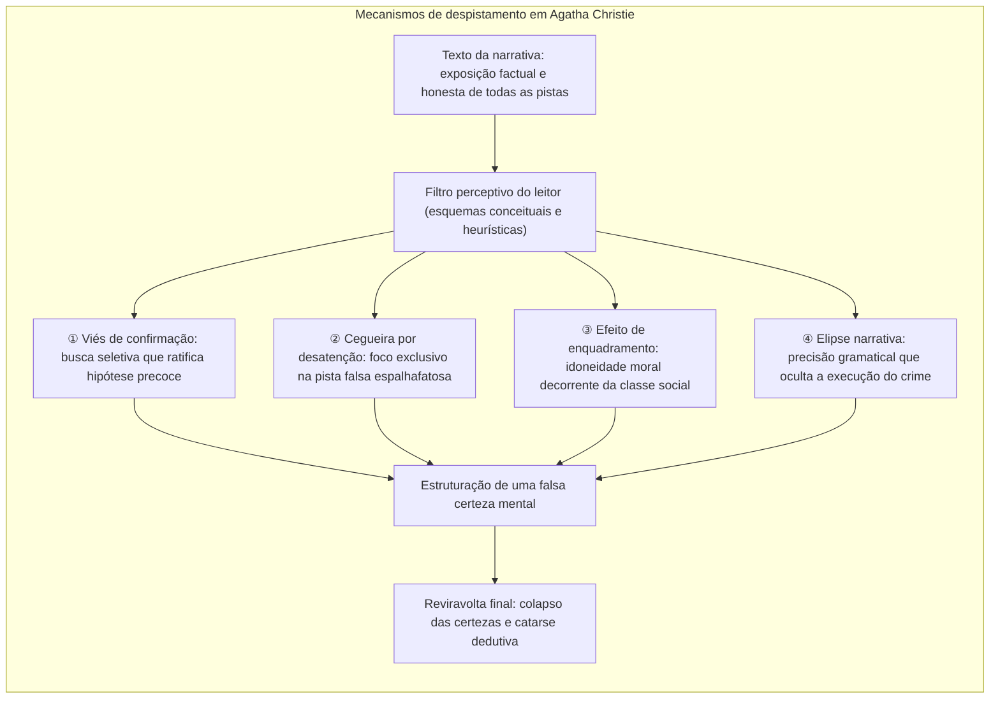
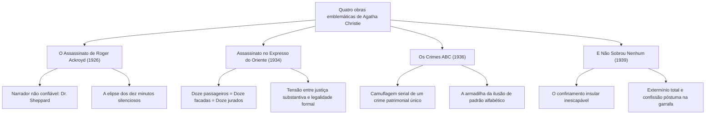
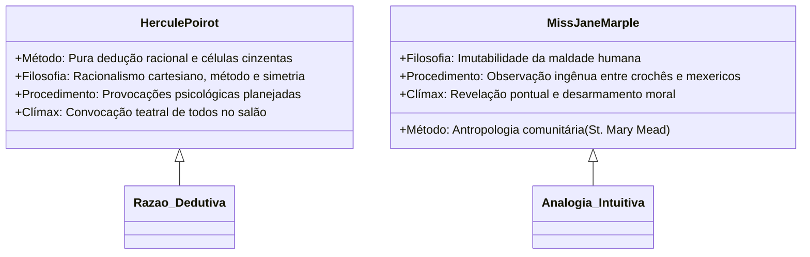

Com mais de dois bilhões de livros vendidos e traduções em dezenas de línguas, <strong>Agatha Christie (1890–1976)</strong> permanece no ápice inatingível da ficção policial em nível global, superada historicamente apenas pela Bíblia e pela dramaturgia de William Shakespeare.

Durante a Era de Ouro da ficção policial (Golden Age of Detective Fiction) nas décadas de 1920 e 1930, quando a tradição de Arthur Conan Doyle privilegiava a perícia forense e os cânones do *Detection Club* ditavam regras rígidas, Christie realizou uma revolução epistemológica: converteu a clássica caçada a bitucas de cigarro e pegadas em <strong>um laboratório sistemático sobre os vieses cognitivos e os pontos cegos da mente humana</strong>. Como um ilusionista virtuoso cuja mão direita atrai todos os olhares por meio de movimentos dramáticos enquanto a mão esquerda opera o artifício oculto, Christie disponibilizava todos os elementos cruciais à vista do leitor sob as regras do jogo limpo (*Fair Play*), certa de que a mente humana, refém de seus próprios preconceitos morais e esquemas conceituais, construiria conclusões equivocadas.

---

## 1. Fundamentos cognitivos da distração narrativa

O despistamento (*misdirection*) na obra de Christie não decorre de trapaça arbitrária, mas da exploração cirúrgica dos mecanismos mentais que regem o processamento humano de informações:

### 1.1 Viés de confirmação e o efeito de primazia

Quando o leitor é seduzido por uma primeira impressão plausível (o herdeiro endividado ou a viúva suspeita), o <strong>viés de confirmação (Confirmation Bias)</strong> passa a atuar imediatamente. A partir desse instante, todo indício subsequente é filtrado para corroborar a hipótese inicial. Caso o verdadeiro assassino reorganize a mobília ou queime correspondências à vista de todos, o leitor atribui o ato a um mero impulso afetivo ou excentricidade familiar.

### 1.2 Cegueira por desatenção e pistas falsas (*Red Herrings*)

Experimentos contemporâneos, como o célebre teste do «gorila invisível», revelam que o foco concentrado numa atividade suprime a percepção de elementos gritantes no centro da cena. Christie manejava com mestria as <strong>pistas falsas (Red Herrings)</strong>: frascos de venenos orientais, cartas ameaçadoras e pegadas na lama. Envolvido pela sofisticação dramática dessas pistas, o leitor deixa escapar que uma poltrona foi deslocada para criar um ponto cego acústico e visual.

### 1.3 Fidelidade escrupulosa ao princípio do *Fair Play*

O triunfo da narrativa de Christie consiste no fato de jamais recorrer à mentira explícita em seu discurso narrativo. Ao reler suas obras após o desfecho, constata-se que todas as pistas fundamentais constavam integralmente do texto. A ilusão não resultou de falácia da escritora, mas da precipitação interpretativa do próprio leitor.

---

## 2. Anatomia de quatro marcos narrativos fundamentais

### 2.1 *O Assassinato de Roger Ackroyd* (1926): A obra-prima do narrador não confiável

Ao subverter a premissa de que o narrador e companheiro do detetive encarna a integridade moral do leitor, Christie redefiniu o gênero. O médico da aldeia, Dr. James Sheppard, conduz o relato com aparente serenidade, sendo ele próprio o chantagista e assassino de Ackroyd.

O primor da obra reside na <strong>elipse deliberada</strong>. Sheppard registra: *«A porta estava fechada. Deixei o aposento às nove e meia. Não havia mais nada que eu pudesse fazer»*. O leitor presume uma despedida convencional de rotina médica; contudo, a ausência de afazeres significava que o assassinato e a montagem do álibi mecânico já haviam sido concluídos com sucesso. Não houve engano vocabular, apenas a omissão deliberada do ato criminoso.

### 2.2 *Assassinato no Expresso do Oriente* (1934): A conspiração solidária

Isolado por uma nevasca devastadora na Iugoslávia, o luxuoso trem torna-se o cenário da execução do magnata Ratchett. O corpo exibe doze ferimentos assimétricos, e os álibis dos viajantes entrelaçam-se com exatidão implacável.

Hercule Poirot desconstrói o axioma clássico do criminoso individual ao demonstrar que <strong>todos os doze passageiros conspiraram e executaram a vítima em conjunto</strong>. Unidos pela memória do assassinato da menina Daisy Armstrong, eles ergueram um tribunal secreto de doze jurados para aplicar a pena capital a um criminoso que havia escapado da justiça institucional.

### 2.3 *Os Crimes ABC* (1936): O biombo do assassino em série

Uma vaga de pânico assola a Inglaterra diante de mortes ordenadas pelo alfabeto: Alice Ascher em Andover (A), Betty Barnard em Bexhill (B), Sir Carmichael Clarke em Churston (C), com um guia ferroviário ABC depositado junto a cada corpo.

A mecânica do logro fundamenta-se em <strong>ocultar um assassinato premeditado por herança sob o disfarce de psicopatia em série</strong>. O executor ambicionava apenas eliminar o irmão milionário C; as mortes colaterais serviram tão somente para desviar o foco investigativo em direção a um maníaco fictício.

### 2.4 *E Não Sobrou Nenhum* (*And Then There Were None*, 1939): A clausura absoluta

Dez indivíduos com homicídios impunes no passado são atraídos a uma ilha inóspita. Inspirado por uma cantiga infantil funesta, o executor os elimina sucessivamente. Com o suicídio da última sobrevivente, nenhum ser vivo resta na ilha.

O mistério encontra elucidação na farsa do juiz Wargrave, que fingiu a própria morte com o apoio de um cúmplice ludibriado, testemunhou a autodestruição dos sobreviventes e tirou a própria vida por meio de um mecanismo balístico engenhoso, deixando sua confissão numa garrafa lançada ao oceano.

---

## 3. A dicotomia metodológica: Poirot versus Miss Marple

### 3.1 Hercule Poirot: A supremacia das células cinzentas

O detetive belga desdenha a busca rasteira por pistas físicas em favor da ginástica mental:
- <strong>A estratégia do excêntrico:</strong> Ele exagera trejeitos estrangeiros para induzir os suspeitos ao relaxamento da vigilância e ao descuido discursivo.
- <strong>O clímax no salão:</strong> A reunião de todos os envolvidos em ambiente fechado exerce pressão extrema até a confissão irrevogável do culpado.

### 3.2 Miss Jane Marple: A sabedoria analógica vicinal

A idosa solteirona de St. Mary Mead converte preconceitos etários em vantagens táticas:
- <strong>A analogia rural:</strong> Para Miss Marple, grandes crimes espelham os desvios de conduta triviais observados em sua pacata paróquia rural.
- <strong>Camuflagem social:</strong> Enquanto manuseia seus novelos de lã, escuta segredos inconfessáveis sem jamais despertar apreensão.

---

## 4. Rigor toxicológico e precisão científica

A sustentabilidade das tramas de Agatha Christie decorre amplamente de sua familiaridade farmacológica, consolidada durante o trabalho voluntário em dispensários hospitalares em tempos de guerra.

| Veneno | Obra ilustrativa | Mecanismo de ação | Emprego narrativo |
|---|---|---|---|
| <strong>Estricnina</strong> | *O Misterioso Caso de Styles* | Bloqueio de receptores de glicina, convulsões violentas, asfixia | Retardo proposital da absorção para consolidação de álibi |
| <strong>Cianeto de potássio</strong> | *Um Brinde com Cianeto* | Inibição da citocromo c oxidase, anóxia histotóxica instantânea | Dissimulação perfeita no gás e cor do champanhe |
| <strong>Tálio</strong> | *O Cavalo Amarelo* | Comprometimento celular, perda capilar, polineurite | Mimetização de patologias degenerativas naturais |
| <strong>Morfina</strong> | *Cipreste Triste* | Depressão do SNC, miose e parada respiratória | Misturada a lanches e infusões para sedação fatal |

O caso mais emblemático é *O Cavalo Amarelo* (1961): a descrição cristalina da intoxicação por tálio capacitou profissionais de saúde na vida real a identificar o veneno e resgatar pacientes à beira da morte em casos verídicos no Reino Unido.

---

## 5. O legado eterno na arquitetura da ficção

Ao estender os horizontes da narrativa policial sem transgredir as normas da lealdade intelectual, Agatha Christie transcendeu o formato do quebra-cabeça tradicional. Suas estruturas influenciaram os mestres do suspense contemporâneo e impulsionaram o movimento japonês <strong>Shin-Honkaku</strong> (*Os Assassinatos da Casa Decagonal* de Yukito Ayatsuji). Seu domínio da psicologia do engano permanece como a bússola dourada da ficção de mistério.
