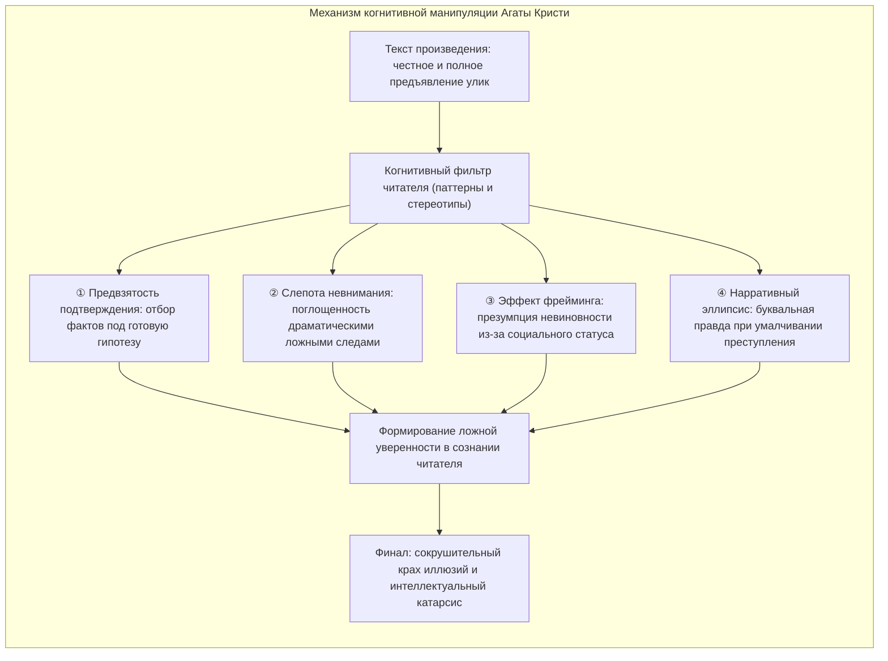
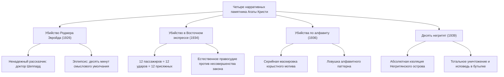
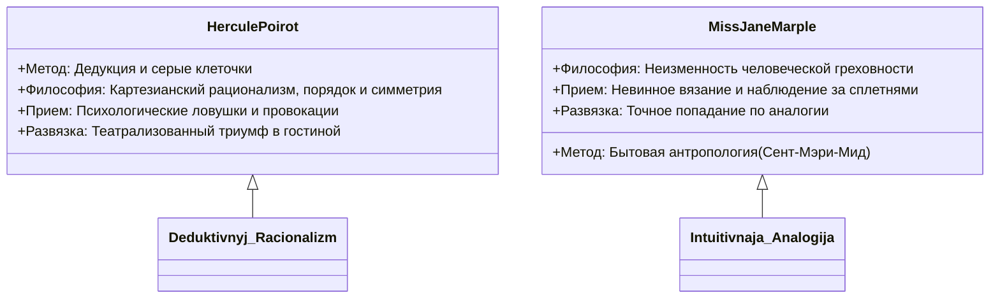

Суммарный тираж произведений <strong>Агаты Кристи (1890–1976)</strong> превышает два миллиарда экземпляров на более чем сотне языков мира, уступая в истории человечества лишь Библии и сочинениям Уильяма Шекспира.

В Золотой век детективного жанра (Golden Age of Detective Fiction) 1920–1930-х годов, когда традиции Артура Конан Дойла абсолютизировали сбор материальных улик (отпечатков пальцев, пепла и грязи), а Британский детективный клуб насаждал формальные каноны, Кристи совершила фундаментальную когнитивную революцию: она превратила детектив из физического расследования в <strong>высокоточный психологический эксперимент над ментальными слепыми зонами и эвристиками восприятия читателя</strong>. Подобно иллюзионисту, чья правая рука отвлекает взгляд публики эффектным взмахом, пока левая рука совершает скрытую манипуляцию, Кристи выкладывала ключевые улики прямо перед читателем в строгом соответствии с правилом «Честной игры» (Fair Play). Но читатель сам оказывался в плену собственных шаблонов, моральных стереотипов и поспешных умозаключений.

---

## 1. Когнитивные основания детективного обмана

Мастерство отвлечения внимания (misdirection) у Кристи основывается на филигранном знании уязвимостей человеческой психики:

### 1.1 Предвзятость подтверждения и эффект первичности

Как только читатель принимает первичную версию (например, образ расточительного приемного сына или роковой любовницы), включается <strong>предвзятость подтверждения (Confirmation Bias)</strong>. Любая последующая деталь интерпретируется исключительно в пользу сформированной гипотезы. Если истинный убийца передвигает стул или сжигает письмо на глазах у свидетелей, читатель списывает это на чудачество или благородную защиту родственников.

### 1.2 Слепота невнимания и «красные сельди» (Red Herrings)

Знаменитый психологический эксперимент с «невидимой гориллой» доказал: интенсивная фиксация внимания на одном стимуле делает сознание невосприимчивым к очевидным аномалиям в поле зрения. Кристи виртуозно разбрасывает <strong>ложные следы (Red Herrings)</strong> — флаконы с экзотическими ядами, таинственные записки и разбитые часы. Читатель бросает все интеллектуальные ресурсы на расшифровку этих драматических декораций, упуская из виду стул, сдвинутый на полметра, чтобы скрыть диктофон.

### 1.3 Безупречная текстуальная честность в рамках Fair Play

Художественная непогрешимость Кристи заключается в том, что она никогда не лжет читателю фактологически. Перечитывая роман после разоблачения, читатель с изумлением обнаруживает, что каждая фраза убийцы была абсолютно правдива. Обман возник не из-за лжи писательницы, а из-за интеллектуальной самоуверенности самого читателя.

---

## 2. Структурный разбор четырех шедевров

### 2.1 «Убийство Роджера Экройда» (1926): Вершина ненадежного рассказчика

Этот роман взорвал конвенции жанра, разрушив негласное правило о непогрешимости повествователя-хроникера (архетипа доктора Ватсона). Сельский врач Джеймс Шеппард ведет хронику расследования, будучи шантажистом и хладнокровным убийцей Экройда.

Триумф приема кроется в <strong>нарративном эллипсисе (фигуре умолчания)</strong>. Шеппард пишет о моменте преступления: *«Дверь была заперта. Я покинул комнату в половине десятого. Мне больше нечего было делать»*. Читатель представляет спокойное завершение визита; однако фраза «мне больше нечего было делать» означала, что убийство совершено, а алиби с диктофоном подготовлено. В тексте нет ни слова лжи — лишь сознательное изъятие десяти минут действия.

### 2.2 «Убийство в Восточном экспрессе» (1934): Коллективный заговор

Застрявший в снегах Югославии экспресс становится местом жестокой расправы над негодяем Рэтчеттом. На теле обнаружено двенадцать ножевых ран разной глубины, а алиби всех пассажиров взаимно подтверждаются.

Эркюль Пуаро сокрушает аксиому об одиночном преступнике: <strong>все двенадцать пассажиров вагона являются сообщниками и соисполнителями</strong>. Связанные трагедией похищения маленькой Дейзи Армстронг, они образовали тайный суд присяжных из двенадцати человек, чтобы покарать преступника, избежавшего официального правосудия.

### 2.3 «Убийства по алфавиту» (1936): Серийная дымовая завеса

Англию сотрясает серия преступлений, совершаемых в алфавитном порядке: Алиса Ашер в Андовере (A), Бетти Барнард в Бэксхилле (B), сэр Кармайкл Кларк в Черстоне (C). Рядом с каждой жертвой лежит железнодорожный справочник ABC.

Суть трюка — <strong>маскировка единичного корыстного убийства за ширмой маниакальной серии</strong>. Убийца стремился ликвидировать лишь миллионера C ради наследства; жертвы A, B и D были циничной декорацией для направления полиции по ложному следу серийного психопата.

### 2.4 «Десять негритят» (1939): Абсолютный герметичный триллер

Десять человек с несмываемыми грехами прошлого собраны на отрезанном от мира скалистом острове. Под строки зловещей считалочки они гибнут один за другим, пока последняя выжившая не совершает самоубийство в приступе ужаса. На острове не остается ни одной живой души.

Парадокс неразрешимого преступления раскрывается через хитроумный замысел судьи Уоргрейва: он инсценировал собственную смерть с помощью обманутого доктора, хладнокровно дождался гибели остальных и покончил с собой, доверив исповедь брошенной в океан бутылке.

---

## 3. Методологическая дихотомия: Пуаро и мисс Марпл

### 3.1 Эркюль Пуаро: Власть серых клеточек

Бельгийский сыщик презирает ползание с лупой по коврам, уповая исключительно на работу ума:
- <strong>Маска чудака:</strong> Пуаро намеренно подчеркивает свою эксцентричность и иноземный акцент, усыпляя бдительность подозреваемых.
- <strong>Драматический финал:</strong> Сбор всех фигурантов в замкнутом пространстве служит психологическим катализатором разоблачения.

### 3.2 Мисс Джейн Марпл: Сила житейской аналогии

Пожилая дама из деревни Сент-Мэри-Мид виртуозно использует стереотипы о «старых девах»:
- <strong>Деревенская аналогия:</strong> Для нее сложнейшее столичное преступление тождественно проступкам деревенского лавочника или викария.
- <strong>Социальная невидимость:</strong> За спицами и чаем она слышит признания, которые никогда не доверили бы Скотленд-Ярду.

---

## 4. Токсикологическая достоверность

Долговечность сюжетов Кристи опирается на безупречное знание фармакологии, полученное ею во время работы сестрой милосердия и аптекарем в военные годы.

| Яд | Произведение | Фармакологический механизм | Нарративная функция |
|---|---|---|---|
| <strong>Стрихнин</strong> | *Загадочное происшествие в Стайлзе* | Блокада глициновых рецепторов, судороги, асфиксия в полном сознании | Замедленное всасывание благодаря химическому осаждению для создания алиби |
| <strong>Цианистый калий</strong> | *Сверкающий цианид* | Блокирование тканевого дыхания, мгновенная гипоксия | Маскировка цвета и запаха в пузырьках шампанского |
| <strong>Таллий</strong> | *Вилла «Белый конь»* | Разрушение метаболизма, выпадение волос, полиневриты | Маскировка под энцефалит или инфекционное заболевание |
| <strong>Морфин</strong> | *Печальный кипарис* | Угнетение ЦНС, миоз, паралич дыхательного центра | Введение в чай или выпечку для скрытой седации |

Хрестоматийный пример — роман *«Вилла „Белый конь“»* (1961): скрупулезное описание клинической картины отравления таллием неоднократно помогало читателям-медикам ставить верные диагнозы в реальной жизни и спасать людей.

---

## 5. Влияние на мировую детективную традицию

Не нарушая духа честной интеллектуальной дуэли, Агата Кристи раздвинула границы жанра. Ее открытия легли в основу современного психологического триллера и породили в Японии движение <strong>Син-хонкаку</strong> (*«Убийства в десятиугольном доме»* Юкито Аяцудзи). Ее методы управления зрительским вниманием навсегда вошли в золотой фонд мировой драматургии.
