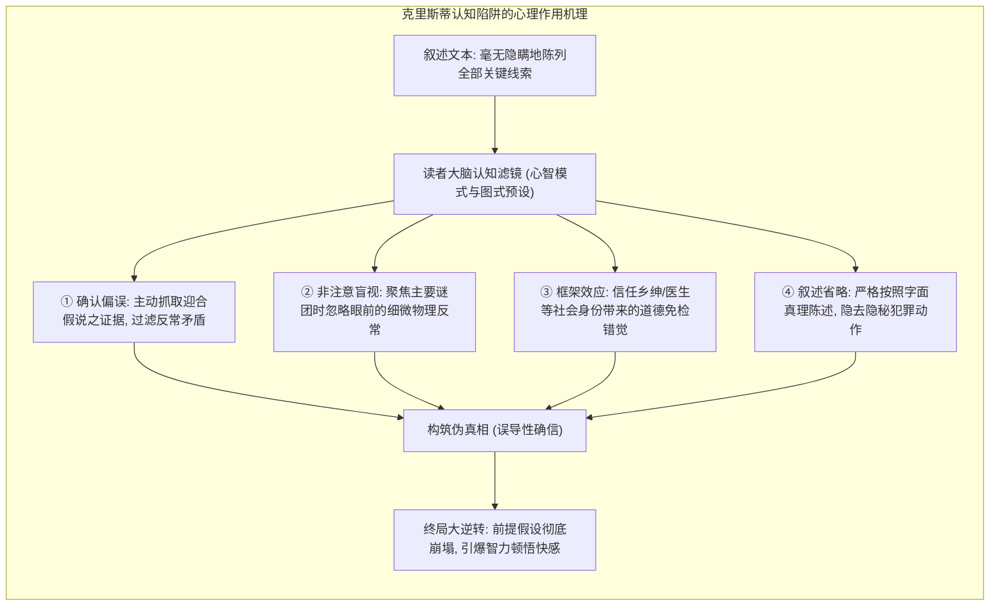
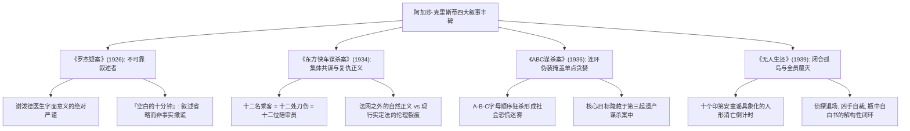

除《圣经》和莎士比亚全集外，人类出版史上翻译语种最多、发行逾20亿册的文学丰碑，唯有“侦探小说女王”<strong>阿加莎·克里斯蒂（Agatha Christie, 1890–1976）</strong>。

在20世纪20至30年代“侦探小说黄金时代”的群星璀璨中，当柯南·道尔式的福尔摩斯物证法医学派与侦探俱乐部规则派占据主流之际，克里斯蒂完成了从“足迹烟灰的外部追凶”向<strong>“人类认知偏差与心理盲区实验”</strong>的深刻质变。魔术师借右手华丽手势转移焦点时左手暗度陈仓；克里斯蒂则是在光天化日之下，以绝对“公平竞争（Fair Play）”的诚实笔触将全部线索陈列于读者眼前，却利用读者的思维定势、道德偏见与语言歧义，让读者自发拼凑出错误的假说而跌入心智陷阱。

这便是克里斯蒂登峰造极的<strong>“叙述与心理误导（Psychological & Narrative Misdirection）”</strong>。无论是《罗杰疑案》打破“记录者即正义”的叙述者凶手禁忌，《东方快车谋杀案》解构“凶手唯一”的十二人陪审团审判，还是《ABC谋杀案》以连环狂热掩盖单点谋利，《无人生还》孤岛全员覆灭的极限定理，她建立的原型至今深刻统治着全球推理文学、悬疑电影乃至日本“新本格”思潮。

---

## 1. 认识论盲区：读者为何必然被骗

魔术界的“误导”绝非单纯蒙蔽双眼，而是<strong>主动控制受众的注意力和思维框架</strong>。克里斯蒂精准操纵了进化赋予人类的信息处理捷径：

### 1.1 确认偏误与首因效应

人类一旦在开篇接受了某种直观设定（例如“败家养子图谋遗产”或“冷血情妇涉嫌谋杀”），<strong>确认偏误（Confirmation Bias）</strong>会驱使大脑自动将后续所有线索向既定框架靠拢。当真凶在众目睽睽之下移动一把椅子或烧毁信件时，读者会自动脑补为“掩护亲人”或“无害怪癖”，让真凶在盲区中从容作案。

### 1.2 非注意盲视与“藏叶于林”法则

心理学著名的“看不见的大猩猩”实验证明：高度专注某一任务时，人们会对正中央的突兀异象视而不见。克里斯蒂深谙<strong>信息过载与红鲱鱼（Red Herring）</strong>之道：命案现场充斥着神秘毒药瓶、异国情书碎屑与反锁窗户，读者为这些浪漫线索绞尽脑汁时，房间正中那把被挪动两英尺的扶手椅（用来遮挡定时录音机与尸体视角）便被视作寻常家具而被大脑自动过滤。

### 1.3 恪守公平竞争下的绝对诚实

克里斯蒂的崇高艺术魅力，在于她从未在客观事实上向读者说谎。当谜底揭晓、翻回前文逐字重读时，读者会震撼地发现：<strong>所有的线索都白纸黑字写在眼前，欺骗读者的不是作者的笔，而是读者自己的傲慢与偏见</strong>。这种心悦诚服的智力顿挫，构成了本格推理最极致的审美愉悦。

---

## 2. 四大颠覆性杰作的结构解剖

### 2.1 《罗杰疑案》：不可靠叙述者的巅峰

1926年的《罗杰疑案》打破了“华生式记录者绝非凶手”的铁律。老好人乡村医生谢泼德正是勒索并刺杀罗杰的真凶。

其惊世绝伦之处在于<strong>叙事文本的字面严谨性（Linguistic Strictness）</strong>。谢泼德在掩饰行凶时刻写道：“罗杰书斋的门紧闭着。我离开房间时是九点半。我遗留未完成的工作已经没有了。”读者脑补以为他看诊完毕从容告辞，实际上他已完成刺杀，并布置好了定时留声机与移动椅子的伪证工作。克里斯蒂未撒谎，只进行了“叙事省略（Ellipsis）”，创造了现代叙事学不可靠叙述者的最高典范。

### 2.2 《东方快车谋杀案》：集体裁决与悲悯妥协

暴风雪瘫痪的东方快车上，恶贯满盈的绑架杀童犯被刺十二刀毙命。波洛面对的是破绽百出却又互相支撑的全员不在场证明。

克里斯蒂颠覆了“真凶唯一”的公理：<strong>车厢内十二名乘客全部是凶手，每人刺下一刀</strong>。这十二人是受害女童阿姆斯特朗的至亲故旧，化身“十二人陪审团”替天行道。波洛最终选择向南斯拉夫警方提供第二种假想方案放走众人，探讨了情理与法理在极端非正义面前的深刻裂变。

### 2.3 《ABC谋杀案》：连环命案的伪装反转

疯子按英文字母表顺序连环虐杀平民，并在尸体旁留下火车时刻表。卡斯特的嫌疑被推至顶峰。然而这一切不过是凶手为除掉堂兄卡迈克尔爵士（C）继承遗产所精心铺设的“人造森林”。杀死无辜的A与B，只为了将具有直接动机的C淹没在疯子无差别杀戮的庞大假象中。

### 2.4 《无人生还》：暴风雪山庄模式的极限解构

士兵岛上的十个罪人按童谣依次遇害，无一幸免。没有外来者，全员遇害，连解开谜底的侦探都彻底退场。沃格雷夫法官以假死脱身清理门户、最终服毒自尽，唯留漂流瓶自白书。这是本格推理史上最孤绝、最严丝合缝的闭合宇宙。

---

## 3. 探侦二元对立：波洛的纯粹理性与马普尔的人类学

- <strong>赫尔克里·波洛</strong>：大陆理性主义与笛卡尔演绎法的化身。他蔑视趴地搜集烟灰的行径，端坐扶手椅凭借“灰色脑细胞”重组因果网络，利用滑稽外侨的假象瓦解嫌疑人的心理防线。
- <strong>简·马普尔小姐</strong>：英国经验主义与微观人类学的化身。圣玛丽米德村的老处女将世界缩小为乡邻琐事，运用<strong>类比推理（Analogy）</strong>，在织毛衣与修剪花草间洞穿人性深处最阴暗的残忍。

---

## 4. 毒理学现实主义与药剂师功底

克里斯蒂作品中超过半数死于毒杀，其精确度源于一战时期在托基红十字医院药房考取的正式药剂师助理资格。在《白马酒店》中，她对<strong>铊（Thallium）</strong>中毒初期似感冒、晚期全秃的病理刻画极其精准，在现实中两度直接帮助英国内外科医护人员识破隐秘投毒、挽救了垂危病患的生命，成就了文学反哺医学的千古奇迹。

---

## 5. 结语：被骗的狂喜与人性的深渊

本格推理是智力谦逊的演练。读者自愿受骗，在真相大白那一刻体验傲慢破灭后的纯粹顿悟。而克里斯蒂在错综诡计背后凝视的，始终是藏匿在英式红茶与田园繁花背后的平庸之恶。那些因贪婪、执念、恐惧与被扭曲的爱而滑向深渊的普通灵魂，正是她跨越百年依然震撼人心的永恒密码。