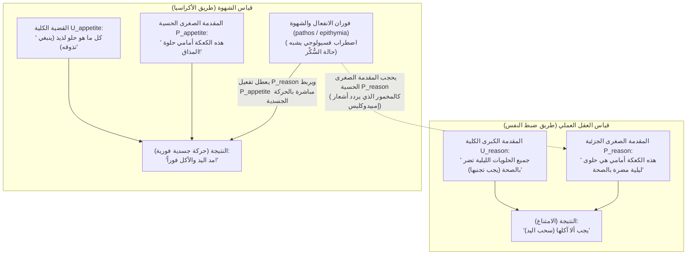
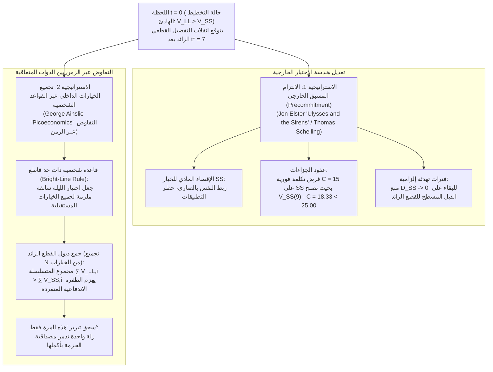

## 1. مقدمة: الهاتف الذكي في الثالثة فجراً وتراجيديا «ميديا» ليوريبيديس — تعريف الأكراسيا (ἀκρασία)

تخيّل أن لديك عرضاً تقديمياً حاسماً أو امتحاناً مصيرياً غداً في تمام الساعة الثامنة صباحاً. أنت تعلم يقيناً أنه ما لم تخلد إلى النوم فوراً، فإن أداءك الإدراكي غداً سيتضرر بشدة. ومع ذلك، في الساعة الثالثة فجراً، لا يزال إبهامك يتصفح شاشة الهاتف الذكي بلا توقف. أو تأمل مريضاً يقرّ بصدق بتحذير طبيبه من أن صحة القلب هي أولويته القصوى، لكنه يمد يده عمداً لتناول حلوى منتصف الليل.

أطلق فلاسفة اليونان القدماء على هذه الظاهرة الإنسانية الشاملة اسم <strong>«الأكراسيا» (ἀκρασία / Akrasia)</strong>، وهي مشتقة من بادئة النفي $\alpha$- («بدون») وكلمة $\kappa\rho\acute{\alpha}\tau\omicron\varsigma$ (*kratos*، «سلطة أو سيطرة أو حكم»)، وتعني حرفياً <strong>«انعدام ضبط النفس»</strong> أو <strong>«عدم العفة الإرادية»</strong> (باللاتينية *incontinentia*، وفي الفلسفة الحديثة <strong>«ضعف الإرادة / Weakness of Will»</strong>). وفي تراجيديا «ميديا» ليوريبيديس (431 ق.م، الأبيات 1078–1080) و«التحولات» للشاعر الروماني أوفيد (7.20–21)، تبلور هذا الصراع الداخلي في العبارة اللاتينية الخالدة:

> <strong>"Video meliora proboque, deteriora sequor."</strong>
> («أرى الأفضل وأصادق عليه، لكنني أتبع الأسوأ.»)

في فلسفة الفعل التحليلية المعاصرة، يُعدّ الفعل $y$ الذي يقوم به الفاعل $S$ في اللحظة $t$ فعلاً <strong>أكراسياً بالمعنى الدقيق (تزامنياً)</strong> إذا وفقط إذا تحققت ثلاثة شروط في آن واحد عند اللحظة $t$:

1. <strong>القصدية والحرية (Intentionality and Freedom):</strong> ينفذ $S$ الفعل $y$ عن قصد وبحرية دون إكراه مادي أو انعكاس لاإرادي، معتقداً أن الفعل البديل $x$ متاح وفي مقدوره عند اللحظة $t$.
2. <strong>الحكم الواعي بالأفضلية «بعد أخذ كل شيء في الاعتبار» (All-Things-Considered Judgment):</strong> استناداً إلى جميع الأسباب ذات الصلة المتاحة له، يحكم $S$ بوعي عند اللحظة $t$ بأن القيام بالفعل $x$ أفضل من القيام بالفعل $y$ ($x \succ y$).
3. <strong>المخالفة التزامنية للحكم:</strong> على الرغم من تمسكه بالحكم الواعي $x \succ y$ في اللحظة $t$، يختار $S$ الفعل $y$ وينفذه عمداً في نفس اللحظة $t$.

لماذا تمثل الأكراسيا الصارمة فضيحة فلسفية؟ لأن كلاً من علم النفس الشعبي ونظرية الاختيار العقلاني (*التفضيل المكشوف*) يفترضان أن اختيار $y$ عمداً بدلاً من $x$ يبرهن على أن الفاعل قدّر $y$ بقيمة أعلى في لحظة الاختيار.

---

## 2. العقلانية السقراطية («بروتاغوراس») والقياس العملي عند أرسطو

### 2.1 «فن القياس» عند سقراط ووهم المنظور الزمني

في محاورة «بروتاغوراس» لأفلاطون (352a–358d)، يفنّد سقراط رأي العامة (οἱ πολλοί) القائل بأن المعرفة (ἐπιστήμη) تُجرّ بواسطة الأهواء والملذات «كما يُجرّ العبد (ἀνδράποδον)». ووفقاً لـ <strong>العقلانية السقراطية (Socratic Intellectualism)</strong>، فإن المعرفة الحقيقية حاكمة بطبعها، و<strong>«لا أحد يخطئ أو يفعل الشر طوعاً» (οὐδεὶς ἑκὼν ἁμαρτάνει)</strong>.

إذن، لماذا يضحي البشر باستمرار بـ <strong>الخير الأكبر الآجل (LL: Larger-Later)</strong> من أجل <strong>اللذة الأصغر العاجلة (SS: Smaller-Sooner)</strong>؟ يشخّص سقراط ذلك بوصفه <strong>خداعاً بصرياً ناتجاً عن المنظور الزمني</strong>: فكما أن القرب المكاني يجعل الأشياء تبدو أكبر من حجمها الحقيقي، فإن القرب الزمني للذة الفورية يضخمها في عين الذات مقارنةً بالألم أو المكافأة البعيدة في المستقبل. وفي لحظة الفعل $t$، ينقلب الحكم التقييمي ذاته ($y \succ x$). ومن ثمّ، فإن خلاص حياتنا لا يكمن في الشد العصبي، بل في علم دقيق هو <strong>«فن القياس» (μετρητικὴ τέχνη)</strong>.

### 2.2 النفس الثلاثية عند أفلاطون والكتاب السابع من «الأخلاق النيقوماخية» لأرسطو

في «الجمهورية» (الكتاب الرابع، 436a–441c)، يتجاوز أفلاطون الأحادية السقراطية عبر <strong>مبدأ الأضداد</strong> ويقسم النفس إلى ثلاث قوى: <strong>الجزء العاقل (λογιστικόν)</strong>، و<strong>الجزء الغضبي (θυμοειδές)</strong>، و<strong>الجزء الشهواني (ἐπιθυμητικόν)</strong> — مستشهداً بقصة <strong>ليونتيوس (Leontius)</strong> الذي لعن عينيه وهو يفتحهما عنوةً لينظر إلى جثث المعدومين.

وفي «الأخلاق النيقوماخية» (الكتاب السابع، 1145a–1152a)، يصنف أرسطو أربعة أنماط للأخلاق:

| النمط الخلقي (يوناني) | المصطلح العربي / الإنجليزي | الحكم العقلي (Logos) | اتجاه الشهوة | الصراع الداخلي | الفعل النهائي والشعور اللاحق |
| :--- | :--- | :--- | :--- | :--- | :--- |
| <strong>ἀρετή / σωφροσύνη</strong> | <strong>الفضيلة / العفة</strong> (Temperance) | صائب (يدرك الخير) | متناغم تماماً مع العقل | <strong>لا يوجد</strong> | يفعل الخير ببهجة وسلاسة |
| <strong>ἐγκράτεια</strong> | <strong>ضبط النفس / الإمساك</strong> (Continence) | صائب (يدرك الخير) | ينزع نحو اللذة المفرطة | <strong>شديد</strong> | العقل يقهر الشهوة؛ يتصرف بصواب |
| <strong>ἀκρασία</strong> | <strong>عدم ضبط النفس / الأكراسيا</strong> | صائب (يدرك الخير) | ينزع نحو اللذة المفرطة | <strong>شديد</strong> | يرضخ للشهوة؛ يشعر بـ <strong>ندم حاد (μεταμέλεια)</strong> |
| <strong>κακία / ἀκολασία</strong> | <strong>الرذيلة / الفجور</strong> (Intemperance) | فاسد (يتخذ اللذة مبدأً) | ينزع نحو اللذة المفرطة | <strong>لا يوجد</strong> | يختار الشر باختيار مبيت (προαίρεσις)؛ <strong>بلا ندم</strong> |

يميز أرسطو بين <strong>الامتلاك بالقوة/الملكة (ἔχειν)</strong> للمعرفة و<strong>التفعيل الواعي بالفعل (ἐνεργεῖν)</strong> داخل بنية <strong>القياس العملي (Practical Syllogism)</strong>:

يحتفظ الشخص الأكراسي بالمقدمة الكبرى الكلية $U_{\text{reason}}$، لكن فوران الشهوة (πάθος) يحجب المقدمة الصغرى الحسية الجزئية $P_{\text{reason}}$ ويفعّل $P_{\text{appetite}}$ («إنها حلوة!»). وحتى لو نطق بعبارات أخلاقية أثناء الأكل، فإنه يكون <strong>«كالمخمورين الذين ينشدون أشعار إمبيدوكليس»</strong> (1147a18–24).

---

## 3. الأحكام المشروطة عند ديفيدسون ونظرية العزم عند هولتون

### 3.1 دونالد ديفيدسون (1970): الثلاثية غير المتسقة

في مقالته الشهيرة *«كيف يكون ضعف الإرادة ممكناً؟»* (1970)، يصوغ <strong>دونالد ديفيدسون (Donald Davidson)</strong> ثلاثة مبادئ تبدو متناقضة ظاهرياً (<strong>P1</strong>: الرغبة الأقوى في $x$ تستلزم فعل $x$ عمداً؛ <strong>P2</strong>: الحكم بأن $x$ أفضل من $y$ يستلزم الرغبة في $x$ أكثر؛ <strong>P3</strong>: توجد أفعال غير منضبطة).

وبالاستناد إلى منطق التأكيد الاحتمالي عند كارل همبل، يميز ديفيدسون بين <strong>الأحكام المشروطة (*prima facie*)</strong> و<strong>الأحكام غير المشروطة (*all-out*)</strong>:
1. إن <strong>الحكم «بعد أخذ كل شيء في الاعتبار» (ATC)</strong> في P3 يظل منطقياً حكماً مشروطاً بمجموع الأسباب المتاحة $\mathcal{E} = \{r_1, r_2, \dots, r_n\}$:
   $$\text{pf}(x \succ y,\; \mathcal{E})$$
2. في المقابل، فإن النية النهائية التي تحكم P1 وP2 هي <strong>حكم غير مشروط (*sans phrase*)</strong>:
   $$y \succ x$$

إن الجمع بين $\text{pf}(x \succ y,\; \mathcal{E})$ و$y \succ x$ لا ينطوي على أي تناقض منطقي صوري. غير أن الفاعل الأكراسي ينتهك <strong>مبدأ ضبط النفس (Principle of Continence)</strong> لأن الرغبة الجزئية $r_2$ تعمل عبر <strong>التجزئة الذهنية (Mental Partitioning)</strong> بوصفها *«سبباً ذهنياً ليس مسوغاً عقلانياً»*.

### 3.2 غاري واتسون (1977) وريتشارد هولتون (1999)

بينما يرفض <strong>غاري واتسون</strong> المبدأ P2 عبر الفصل بين <strong>نظام التقييم ($\text{Val}(x) > \text{Val}(y)$)</strong> و<strong>نظام الدافعية ($\text{Mot}(y) > \text{Mot}(x)$)</strong>، يثبت <strong>ريتشارد هولتون</strong> (1999) أن <strong>ضعف الإرادة</strong> بالمعنى المألوف هو إخفاق عبر-زمني: أي <strong>التراجع المتسرع وإعادة النظر (reconsideration) في «عزم» (Resolution) سابق</strong> كان قد صيغ خصيصاً مع نية من الدرجة الثانية *بعدم إعادة فتح المداولة* عند هبوب الإغراء.

---

## 4. الخصم القطعي الزائد في الاقتصاد السلوكي واستراتيجيات ضبط النفس

### 4.1 الخصم الأسي (صامويلسون) مقابل الخصم القطعي الزائد (أينسلي)

بينما يضمن نموذج <strong>الخصم الأسي (Exponential Discounting)</strong> لبول صامويلسون (1937)، $U_{\text{exp}}(A, D) = A \cdot e^{-rD}$، <strong>اتساقاً زمنياً</strong> صارماً، أثبت <strong>جورج أينسلي (George Ainslie)</strong> (1975، *Picoeconomics*، 1992) أن البشر والكائنات الحية يخصمون المكافآت المستقبلية وفق <strong>دالة خصم قطعي زائد (Hyperbolic Discounting)</strong> تتناسب عكسياً مع التأخير $D = T - t$:

$$V(D) = \frac{A}{1 + k D} = \frac{A}{1 + k(T - t)}, \qquad \rho(D) = -\frac{V'(D)}{V(D)} = \frac{k}{1 + k D}$$

مع معامل الاندفاعية $k = 0.5$، وإغراء عاجل $A_{\text{SS}} = 50$ عند $t_{\text{SS}} = 10$، ومكافأة آجلة أكبر $A_{\text{LL}} = 100$ عند $t_{\text{LL}} = 15$، فإن <strong>نقطة انقلاب التفضيلات $t^*$</strong> حيث $V_{\text{SS}}(t^*) = V_{\text{LL}}(t^*)$ هي:

$$\frac{50}{1 + 0.5(10 - t^*)} = \frac{100}{1 + 0.5(15 - t^*)} \implies 8.5 - 0.5 t^* = 12 - t^* \implies \mathbf{t^* = 7.0}$$

| اللحظة $t$ | تأخير $D_{\text{SS}}$ | تأخير $D_{\text{LL}}$ | القيمة القطعية $V_{\text{SS}}(t)$ | القيمة القطعية $V_{\text{LL}}(t)$ | الخيار المهيمن والحالة النفسية |
| :---: | :---: | :---: | :---: | :---: | :--- |
| $t = 0$ | $10$ | $15$ | $8.33$ | <strong>$11.76$</strong> | <strong>هيمنة LL:</strong> تخطيط هادئ وعقد العزم ($\text{LL} \succ \text{SS}$) |
| <strong>$t^* = 7$</strong> | <strong>$3$</strong> | <strong>$8$</strong> | <strong>$20.00$</strong> | <strong>$20.00$</strong> | <strong>نقطة التقاطع:</strong> ذروة الصراع الداخلي |
| $t = 9$ | $1$ | $6$ | <strong>$33.33$</strong> | $25.00$ | <strong>هيمنة SS (انقلاب التفضيل):</strong> طفرة قطعية وأكراسيا |
| $t = 10$ | $0$ | $5$ | <strong>$50.00$</strong> | $28.57$ | <strong>ذروة SS:</strong> استسلام فوري يتبعه ندم |

وقد أثبت الاقتصاد العصبي (McClure et al., *Science*, 2004) عبر الرنين المغناطيسي الوظيفي أن هذا الصراع يعكس التنافس بين <strong>نظام الدوبامين الحوفي المتوسط $\beta$</strong> (الجسم المخطط البطني، الذي ينشط عند $D \to 0$) و<strong>النظام التنفيذي الجبهي الجداري $\delta$</strong> (dlPFC).

### 4.2 الالتزام المسبق («أوليس وعرائس البحر») وتجميع الخيارات (Bundling)

1. <strong>الالتزام المسبق عند جون إلستر (*Ulysses and the Sirens*، 1979):</strong> مثل <strong>أوليس (أوديسيوس)</strong> الذي أمر بربطه إلى صاري السفينة وسدّ آذان بحارته بالشمع قبل الاقتراب من السيرينات، تقوم الذات العاقلة $S_{t_0}$ بتقييد الذات المندفعة المستقبلية $S_{t_1}$ مسبقاً عبر الإقصاء المادي للخيار SS أو فرض غرامة فورية $C = 15$ ($33.33 - 15 = 18.33 < 25.00$).
2. <strong>تجميع الخيارات (Bundling) عند جورج أينسلي:</strong> نظراً لأن منحنيات القطع الزائد تمتلك ذيولاً طويلة المدى أكثر سماكة بكثير من المنحنيات الأسية، فإن تبني <strong>قاعدة شخصية ذات حد قاطع (Bright-Line Rule)</strong> تجمع $N+1 = 5$ خيارات متعاقبة بفاصل $\tau = 10$ يقلب المتباينة في اللحظة $t = 9$:
   $$V_{\text{bundle}}^{\text{LL}}(9) = \sum_{i=0}^{4} \frac{100}{1 + 0.5(6 + 10i)} \approx \mathbf{52.68} > V_{\text{bundle}}^{\text{SS}}(9) = \sum_{i=0}^{4} \frac{50}{1 + 0.5(1 + 10i)} \approx \mathbf{50.73}$$
   وهذا يفسر رياضياً لماذا يكون تبرير <strong>«هذه المرة فقط كاستثناء»</strong> قاتلاً: فهو يفصل اختيار الليلة عن السلسلة المستقبلية ويدمر مصداقية القاعدة. إن الحكمة العملية الحقيقية (φρόνησις) تكمن في التصميم المسبق لبيئتنا وقواعدنا الشخصية أثناء ساعات الصفاء الذهني.
