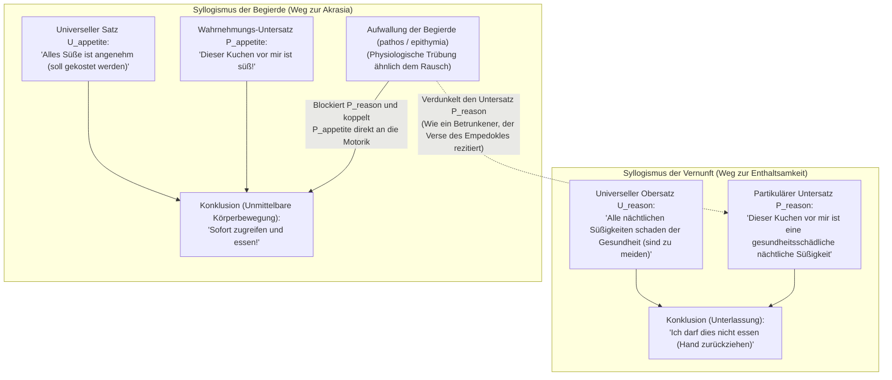
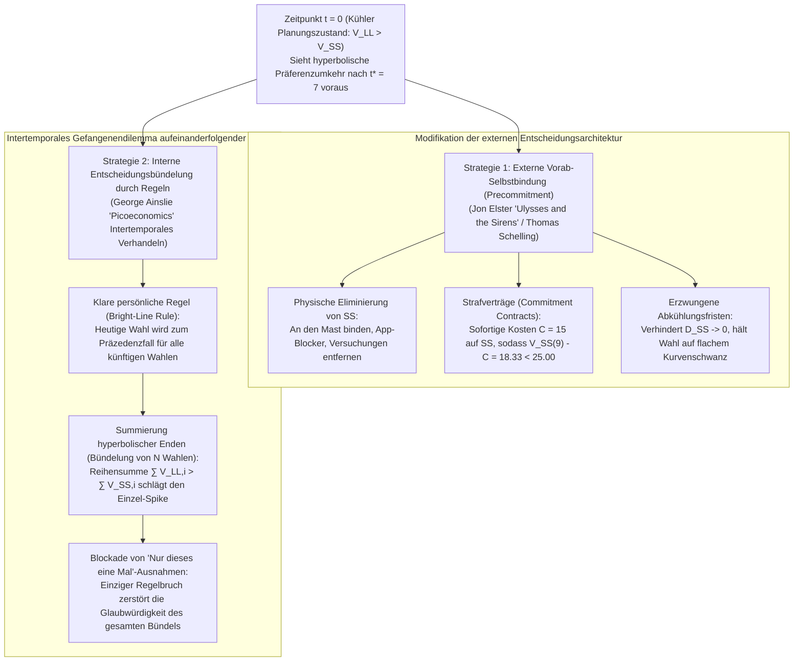

## 1. Einleitung: Das Smartphone um 3 Uhr morgens und Euripides' *Medea* — Definition der Akrasia (ἀκρασία)

Morgen früh um 8:00 Uhr steht ein entscheidender Vortrag oder eine Prüfung an. Sie wissen genau, dass Ihre kognitive Leistungsfähigkeit morgen massiv leiden wird, wenn Sie nicht sofort schlafen. Dennoch scrollen Sie um 3:00 Uhr nachts weiter durch Ihr Smartphone. Oder ein Patient, der die Warnung seines Arztes voll akzeptiert hat, greift absichtlich zu einem ungesunden Mitternachtsdessert.

Antike griechische Philosophen nannten dieses universelle Phänomen <strong>Akrasia (ἀκρασία)</strong> – abgeleitet von $\alpha$- („ohne“) und $\kappa\rho\acute{\alpha}\tau\omicron\varsigma$ (*kratos*, „Herrschaft, Macht“), was wörtlich <strong>„Mangel an Selbstbeherrschung“</strong> oder <strong>„Unenthaltsamkeit“</strong> (lateinisch *incontinentia*, modern <strong>„Willensschwäche“</strong>) bedeutet. In Euripides' Tragödie *Medea* (431 v. Chr., V. 1078–1080) und Ovids *Metamorphosen* (7.20–21) fand dieser innere Riss seine berühmteste Formulierung:

> <strong>„Video meliora proboque, deteriora sequor.“</strong>
> („Ich sehe das Bessere und heiße es gut, doch dem Schlechteren folge ich.“)

In der analytischen Handlungstheorie gilt eine Handlung $y$ eines Akteurs $S$ zum Zeitpunkt $t$ genau dann als <strong>strikt (synchron) akratisch</strong>, wenn drei Bedingungen zugleich erfüllt sind:

1. <strong>Intentionalität und Freiheit:</strong> $S$ führt $y$ absichtlich und ohne äußeren Zwang aus und glaubt, dass die alternative Handlung $x$ zum Zeitpunkt $t$ offensteht.
2. <strong>Bewusstes Alles-in-allem-Urteil (All-Things-Considered Judgment):</strong> Unter Berücksichtigung aller relevanten Gründe urteilt $S$ zum Zeitpunkt $t$ bewusst, dass es besser wäre, $x$ statt $y$ zu tun ($x \succ y$).
3. <strong>Synchroner Widerspruch zum eigenen Urteil:</strong> Trotz des bewussten Urteils $x \succ y$ entscheidet sich $S$ zum Zeitpunkt $t$ absichtlich für $y$.

Warum ist strikte Akrasia ein philosophischer Skandal? Weil sowohl unsere Alltagspsychologie als auch die formale Entscheidungstheorie (*Revealed Preference*) voraussetzen, dass eine absichtliche Wahl von $y$ gegenüber $x$ zeigt, dass der Akteur $y$ im Moment der Wahl höher bewertete als $x$.

---

## 2. Sokratischer Intellektualismus (*Protagoras*) und Aristoteles' praktischer Syllogismus

### 2.1 Sokrates' Messkunst und die optische Täuschung der zeitlichen Perspektive

In Platons Dialog *Protagoras* (352a–358d) weist Sokrates die Meinung der Vielen (οἱ πολλοί) zurück, das Wissen (ἐπιστήμη) werde von Leidenschaften und Begierden „wie ein Sklave (ἀνδράποδον)“ herumgezerrt. Sein <strong>sokratischer Intellektualismus</strong> besagt: Wahres Wissen ist unüberwindlich, und <strong>„niemand fehlt freiwillig“ (οὐδεὶς ἑκὼν ἁμαρτάνει)</strong>.

Warum opfern Menschen dennoch ein <strong>größeres späteres Gut (LL: Larger-Later)</strong> für eine <strong>kleinere sofortige Lust (SS: Smaller-Sooner)</strong>? Sokrates erklärt dies als <strong>perspektivische Täuschung durch zeitliche Nähe</strong>: Wie im Raum nahe Dinge größer erscheinen als gleich große entfernte Dinge, so bläht sich eine unmittelbar bevorstehende Lust im subjektiven Blickfeld riesig auf. Im Moment des Handelns kippt daher das Werturteil selbst ($y \succ x$). Das Heilmittel des Lebens ist nicht bloße Willenskraft, sondern eine wissenschaftliche <strong>„Messkunst“ (μετρητικὴ τέχνη)</strong>.

### 2.2 Platons Dreiteilung der Seele und Aristoteles' *Nikomachische Ethik* Buch VII

In der *Politeia* (Buch IV, 436a–441c) überwindet Platon den motivationalen Monismus durch die <strong>Dreiteilung der Seele</strong> in den <strong>vernünftigen Teil (λογιστικόν)</strong>, den <strong>muthaften Teil (θυμοειδές)</strong> und den vernunftunabhängigen <strong>begehrenden Teil (ἐπιθυμητικόν)</strong> – illustriert am Fall des <strong>Leontios</strong>, der seine eigenen Augen verflucht, während ihn seine Begierde zwingt, hingerichtete Leichen anzustarren.

Aristoteles systematisiert das Problem in der *Nikomachischen Ethik* (Buch VII, 1145a–1152a) durch vier Charaktertypen:

| Charaktertyp (Griechisch) | Deutscher / Englischer Begriff | Vernunfturteil (Logos) | Richtung der Begierde | Innerer Konflikt | Handlung & Affekt danach |
| :--- | :--- | :--- | :--- | :--- | :--- |
| <strong>ἀρετή / σωφροσύνη</strong> | <strong>Tugend / Besonnenheit</strong> (Temperance) | Richtig (erfasst das Gute) | In Harmonie mit der Vernunft | <strong>Keiner</strong> | Handelt freudig und mühelos gut |
| <strong>ἐγκράτεια</strong> | <strong>Enthaltsamkeit / Selbstbeherrschung</strong> | Richtig (erfasst das Gute) | Drängt zu maßloser Lust | <strong>Stark</strong> | Vernunft siegt über Begierde; handelt richtig |
| <strong>ἀκρασία</strong> | <strong>Unenthaltsamkeit / Willensschwäche</strong> | Richtig (erfasst das Gute) | Drängt zu maßloser Lust | <strong>Stark</strong> | Unterliegt der Begierde; empfindet <strong>tiefe Reue (μεταμέλεια)</strong> |
| <strong>κακία / ἀκολασία</strong> | <strong>Laster / Zügellosigkeit</strong> (Vice) | Verderbt (Lust als Prinzip) | Drängt zu maßloser Lust | <strong>Keiner</strong> | Wählt das Schlechte vorsätzlich (προαίρεσις); <strong>keine Reue</strong> |

Aristoteles unterscheidet zwischen dem bloß <strong>dispositionellen Besitzen (ἔχειν)</strong> von Wissen und dessen <strong>aktiver Ausübung (ἐνεργεῖν)</strong> im <strong>praktischen Syllogismus</strong>:

Der Akratiker besitzt weiterhin den allgemeinen Obersatz $U_{\text{reason}}$, doch der Affekt (πάθος) blockiert die aktive Wahrnehmung des partikulären Untersatzes $P_{\text{reason}}$. Selbst wenn er beim Essen moralische Sätze murmelt, gleicht er <strong>„Betrunkenen, die Verse des Empedokles rezitieren“</strong> (1147a18–24).

---

## 3. Donald Davidsons bedingte Urteile und Richard Holtons Theorie der Vorsätze

### 3.1 Donald Davidson (1970): Die inkonsistente Triade

In *„How is Weakness of the Will Possible?“* (1970) formuliert <strong>Donald Davidson</strong> drei scheinbar unvereinbare Prinzipien:
* <strong>P1:</strong> Wenn ein Akteur $x$ mehr tun will als $y$ und sich frei glaubt, tut er absichtlich $x$, sofern er entweder $x$ oder $y$ absichtlich tut.
* <strong>P2:</strong> Wenn ein Akteur urteilt, dass $x$ besser ist als $y$, dann will er $x$ mehr tun als $y$.
* <strong>P3:</strong> Es gibt unenthaltsame Handlungen, bei denen ein Akteur alles in allem urteilt, $x$ sei besser als $y$, und dennoch absichtlich $y$ tut.

Analog zu Carl Hempels Logik induktiver Wahrscheinlichkeit trennt Davidson <strong>bedingte (*prima facie*) Urteile</strong> von <strong>unbedingten (*all-out*) Urteilen</strong>:
1. Das <strong>Alles-in-allem-Urteil (ATC-Urteil)</strong> in P3 ist logisch gesehen ein auf die Gesamtmenge aller verfügbaren Gründe $\mathcal{E} = \{r_1, r_2, \dots, r_n\}$ bedingtes Urteil:
   $$\text{pf}(x \succ y,\; \mathcal{E})$$
2. Die finale Intention in P1 und P2 ist hingegen ein <strong>unbedingtes Urteil</strong>:
   $$y \succ x \quad (\text{unbedingt / sans phrase})$$

Zwischen $\text{pf}(x \succ y,\; \mathcal{E})$ und $y \succ x$ besteht kein formaler logischer Widerspruch. Der Akratiker verletzt jedoch das <strong>Prinzip der Enthaltsamkeit (Principle of Continence)</strong>, weil durch <strong>mentale Partitionierung</strong> der partielle Wunsch $r_2$ als *„mentale Ursache, die kein Grund ist“*, das unbedingte Urteil $y \succ x$ auslöst.

### 3.2 Gary Watson (1977) und Richard Holton (1999)

Während <strong>Gary Watson</strong> P2 verwirft und zwischen <strong>Bewertungssystem ($\text{Val}(x) > \text{Val}(y)$)</strong> und <strong>Motivationssystem ($\text{Mot}(y) > \text{Mot}(x)$)</strong> unterscheidet, zeigt <strong>Richard Holton</strong> (1999), dass alltägliche <strong>Willensschwäche</strong> ein diachrones Phänomen ist: das <strong>vorschnelle Wiederaufrollen (Reconsideration) eines zuvor gefassten Vorsatzes (Resolution)</strong>, der genau als zweistufige Intention (mit einem Meta-Verbot der Neuberatung in der Versuchung) gebildet wurde.

---

## 4. Hyperbolische Diskontierung in der Verhaltensökonomik und Strategien der Selbstkontrolle

### 4.1 Samuelsons exponentielle vs. Ainslies hyperbolische Diskontierung

Während Paul Samuelsons (1937) <strong>exponentielles Diskontierungsmodell</strong> $U_{\text{exp}}(A, D) = A \cdot e^{-rD}$ eine konstante Diskontrate $r$ und strikte <strong>Zeitkonsistenz</strong> aufweist, bewies <strong>George Ainslie</strong> (1975, *Picoeconomics*, 1992), dass Menschen zukünftige Belohnungen mit der Verzögerung $D = T - t$ nach einer <strong>hyperbolischen Diskontierungsfunktion</strong> entwerten:

$$V(D) = \frac{A}{1 + k D} = \frac{A}{1 + k(T - t)}, \qquad \rho(D) = -\frac{V'(D)}{V(D)} = \frac{k}{1 + k D}$$

Mit dem Impulsivitätsparameter $k = 0.5$, einer kleineren früheren Versuchung $A_{\text{SS}} = 50$ bei $t_{\text{SS}} = 10$ und einer größeren späteren Belohnung $A_{\text{LL}} = 100$ bei $t_{\text{LL}} = 15$ ergibt sich der exakte <strong>Präferenzumkehrpunkt $t^*$</strong> aus $V_{\text{SS}}(t^*) = V_{\text{LL}}(t^*)$:

$$\frac{50}{1 + 0.5(10 - t^*)} = \frac{100}{1 + 0.5(15 - t^*)} \implies 8.5 - 0.5 t^* = 12 - t^* \implies \mathbf{t^* = 7.0}$$

| Zeitpunkt $t$ | Verzögerung $D_{\text{SS}}$ | Verzögerung $D_{\text{LL}}$ | Hyperbolischer Wert $V_{\text{SS}}(t)$ | Hyperbolischer Wert $V_{\text{LL}}(t)$ | Dominante Wahl & Psychischer Zustand |
| :---: | :---: | :---: | :---: | :---: | :--- |
| $t = 0$ | $10$ | $15$ | $8.33$ | <strong>$11.76$</strong> | <strong>LL dominant:</strong> Kühle Planung & Vorsatzbildung ($\text{LL} \succ \text{SS}$) |
| <strong>$t^* = 7$</strong> | <strong>$3$</strong> | <strong>$8$</strong> | <strong>$20.00$</strong> | <strong>$20.00$</strong> | <strong>Indifferenz-/Kreuzungspunkt:</strong> Maximaler innerer Konflikt |
| $t = 9$ | $1$ | $6$ | <strong>$33.33$</strong> | $25.00$ | <strong>SS dominant (Präferenzumkehr):</strong> Hyperbolischer Anstieg & Akrasia |
| $t = 10$ | $0$ | $5$ | <strong>$50.00$</strong> | $28.57$ | <strong>SS-Maximum:</strong> Nachgeben gegenüber der Versuchung, danach Reue |

Neuroökonomische fMRI-Studien (McClure et al., *Science*, 2004) belegen die Konkurrenz zwischen dem dopaminergen <strong>$\beta$-System</strong> (ventrales Striatum, aktiv bei $D \to 0$) und dem exekutiven <strong>$\delta$-System</strong> (dorsolateraler präfrontaler Kortex dlPFC).

### 4.2 Selbstbindung (*Ulysses and the Sirens*) und Entscheidungsbündelung (Bundling)

1. <strong>Jon Elsters (*Ulysses and the Sirens*, 1979) Selbstbindung (Precommitment):</strong> Wie Homers <strong>Odysseus (Ulysses)</strong> sich an den Mast binden ließ, bevor er die Sirenen hörte, entzieht das rationale Selbst $S_{t_0}$ dem zukünftigen impulsiven Selbst $S_{t_1}$ die Option SS oder belegt sie mit einer sofortigen Strafe $C = 15$ ($33.33 - 15 = 18.33 < 25.00$).
2. <strong>George Ainslies Entscheidungsbündelung (Bundling via Bright-Line Rules):</strong> Da Hyperbeln bei großen Verzögerungen viel flacher abfallen als Exponentialkurven, kehrt die Bündelung von nur $N+1 = 5$ Entscheidungen im Abstand $\tau = 10$ unter einer klaren persönlichen Regel das Verhältnis bei $t = 9$ um:
   $$V_{\text{bundle}}^{\text{LL}}(9) = \sum_{i=0}^{4} \frac{100}{1 + 0.5(6 + 10i)} \approx \mathbf{52.68} > V_{\text{bundle}}^{\text{SS}}(9) = \sum_{i=0}^{4} \frac{50}{1 + 0.5(1 + 10i)} \approx \mathbf{50.73}$$
   Dies beweist mathematisch, warum die Ausrede <strong>„Nur dieses eine Mal“</strong> tödlich für die Selbstkontrolle ist: Sie entbündelt die heutige Wahl von der Serie und zerstört die Glaubwürdigkeit der Regel. Wahre praktische Weisheit (φρόνησις) besteht im vorausschauenden Entwurf unserer Umwelt- und Regelarchitektur.
