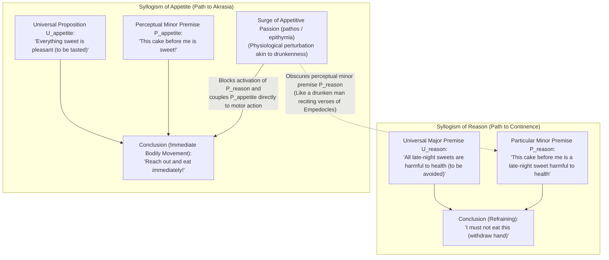
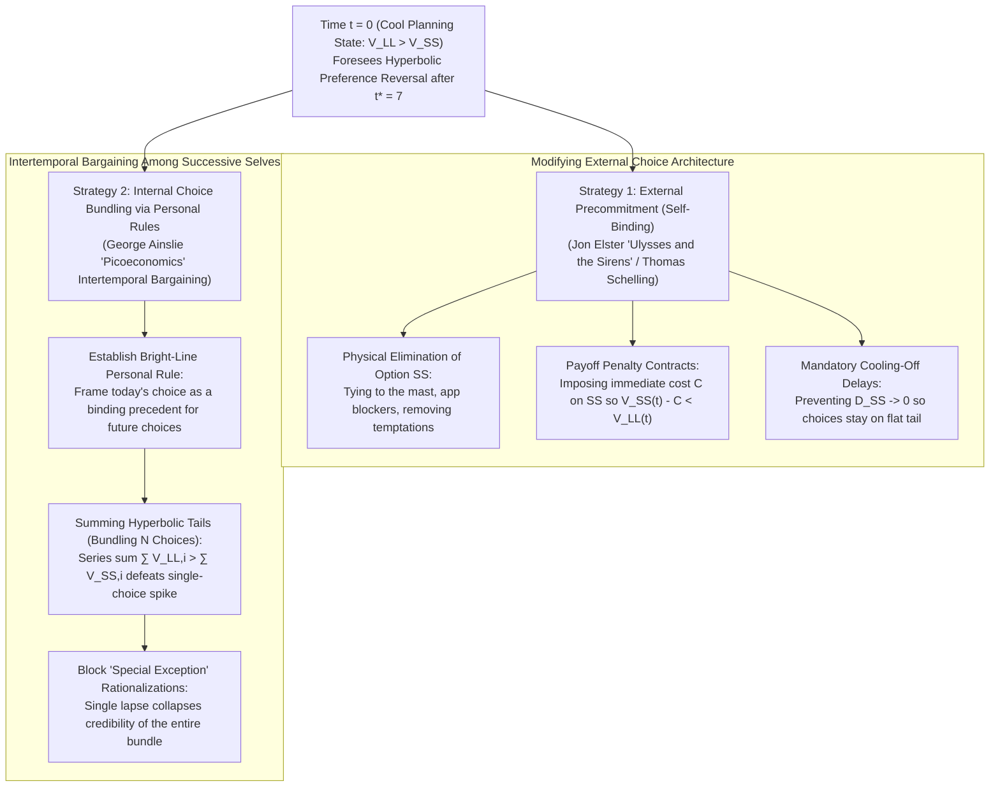

## 1. Introduction: The 3:00 AM Smartphone and Euripides' *Medea* — Defining Akrasia (ἀκρασία)

Imagine that you have a decisive presentation or examination tomorrow at 8:00 AM. You know that unless you sleep immediately, your performance tomorrow will suffer. Yet at 3:00 AM, you keep scrolling through a smartphone feed. Or consider a patient who endorses a physician's warning that cardiovascular health is paramount, yet reaches for a midnight dessert, or a researcher who procrastinates on a crucial manuscript while feeling acute self-reproach.

When examined through the lens of analytic philosophy of action, decision theory, and moral psychology, this universal phenomenon poses a theoretical scandal that challenges our foundational assumptions about rational agency, intention, and free will.

Ancient Greek philosophers named this phenomenon <strong>akrasia (ἀκρασία)</strong>, from *a-* ("without") and *kratos* (κράτος, "power, rule, or mastery"), signifying <strong>"lack of self-mastery"</strong> or <strong>"incontinence"</strong> (Latin *incontinentia*, modern <strong>"weakness of will"</strong>). Its iconic literary expression appears in Euripides' tragedy *Medea* (431 BCE, lines 1078–1080):

> "I understand full well the dreadful evil I am about to perpetrate, but my passion (θυμός) is stronger than my deliberative counsels (βουλευμάτων)."

Four centuries later, Ovid distilled Medea's conflict into seven Latin words in *Metamorphoses* (7.20–21):

> <strong>"Video meliora proboque, deteriora sequor."</strong> ("I see the better and approve it, yet I follow the worse.")

In contemporary action theory, an action $y$ performed by an agent $S$ at time $t$ is <strong>strictly (synchronically) akratic</strong> if and only if three conditions hold simultaneously at $t$:

1. <strong>Intentionality and Freedom:</strong> $S$ performs $y$ intentionally and uncompelled, believing an alternative action $x$ is open and within their power at $t$.
2. <strong>Conscious All-Things-Considered Better Judgment:</strong> Taking into account all available relevant considerations, $S$ consciously judges at $t$ that performing $x$ is better than performing $y$ ($x \succ y$).
3. <strong>Synchronic Contrariness to Judgment:</strong> Despite holding the conscious judgment $x \succ y$ at $t$, $S$ intentionally chooses and executes $y$ at $t$.

Why is strict akrasia a philosophical scandal? Because both <strong>folk psychology</strong> and <strong>rational choice theory</strong> explain intentional choice via *revealed preference*: choosing $y$ over $x$ ordinarily shows that $y$ appeared more valuable to the agent at the moment of choice. If an agent genuinely judges $x \succ y$ in the exact instant they freely choose $y$, where does the link between judgment, desire, intention, and action break?

---

## 2. Socratic Intellectualism (*Protagoras* 352a–358d) — Why "No One Errs Willingly" and the Art of Measurement

In Plato's *Protagoras* (352a–358d), Socrates confronts the belief of "the many" (οἱ πολλοί) that knowledge (ἐπιστήμη) is dragged around by passion, pleasure, pain, love, or fear <strong>"just like a slave (ὥσπερ ἀνδράποδον)"</strong> (352b–c). Against this, Socrates defends <strong>Socratic Intellectualism</strong>: knowledge is commanding, and no one who knows what is best acts contrary to it; hence <strong>"no one errs willingly" (οὐδεὶς ἑκὼν ἁμαρτάνει)</strong> (358c).

To deconstruct the claim that people do what they know is bad because they are "overcome by pleasure," Socrates maps "good/bad" and "net long-run pleasure/pain" onto a single commensurable scale. Substituting these terms directly into the popular phrasing reveals its logical absurdity:

* <strong>Substitution 1:</strong> "A man does what he knows to be overall *bad*, because he is overcome by the *good*."
* <strong>Substitution 2:</strong> "A man does what he knows will bring greater overall *pain*, because he is overcome by immediate *pleasure*."

Why do humans sacrifice a <strong>Larger-Later good (LL)</strong> for a <strong>Smaller-Sooner pleasure (SS)</strong>? Socrates diagnoses an <strong>optical illusion of temporal perspective</strong>:

> "Do things of the same size appear larger to your sight when near at hand, and smaller when seen at a distance? ... Whereas the power of appearance makes us wander and repent in our choices between great and small, the <strong>art of measurement (μετρητικὴ τέχνη)</strong> would invalidate this illusion and, by showing the truth, bring our soul to rest and save our life." (*Protagoras* 356c–e)

Temporal proximity distorts value just as spatial proximity distorts visual size. An immediate pleasure at $t=0$ looms huge in the agent's subjective view, while a larger future pain or reward at $t + \Delta t$ shrinks. At the moment of action $t$, the agent does *not* hold the judgment $x \succ y$; under the illusion of proximity, their evaluative belief flips to $y \succ x$. What people call "weakness of will" is <strong>synchronic cognitive ignorance (ἀμαθία ἡ μεγίστη)</strong>—the lack of a scientific <strong>art of measurement</strong>.

---

## 3. Plato's Tripartite Soul (*Republic* Book IV) and Aristotle's Practical Syllogism (*Nicomachean Ethics* Book VII)

### 3.1 Plato's Tripartite Soul and the Case of Leontius

In *Republic* Book IV (436a–441c), Plato moves beyond Socratic motivational monism and introduces the <strong>Tripartite Theory of the Soul</strong>, grounded on the <strong>Principle of Opposites</strong>: the same entity cannot act or be acted upon in opposite ways in the same part of itself toward the same object at the same time (436b). Because a tempted agent experiences a simultaneous pull toward and repulsion from the same object, the soul must comprise three distinct subsystems:

1. <strong>The Rational Part (λογιστικόν / *Logistikon*):</strong> Calculates what is genuinely beneficial for the whole soul across time.
2. <strong>The Spirited Part (θυμοειδές / *Thymoeides*):</strong> The seat of anger, honor, and self-disgust, naturally allied with reason.
3. <strong>The Appetitive Part (ἐπιθυμητικόν / *Epithymetikon*):</strong> Good-independent biological drives (hunger, thirst, sensory craving) seeking immediate gratification regardless of overall welfare.

Plato illustrates this conflict with <strong>Leontius, son of Aglaion</strong> (*Republic* 439e–440a). Passing the public execution grounds outside the north wall of Athens, Leontius felt both a morbid appetite (ἐπιθυμία) to gaze at the corpses and intense revulsion. Overpowered after a struggle, he pried his eyes open and shouted: *"Look then, you wretches! Fill yourselves with the lovely spectacle!"* His simultaneous self-curse proves that his rational judgment against the act remained active during the act itself.

### 3.2 Aristotle's *Nicomachean Ethics* Book VII: Moral Typology and the Practical Syllogism

In *Nicomachean Ethics* Book VII (1145a–1152a), Aristotle "saves the appearances" (τὰ φαινόμενα σῴζειν) by first distinguishing four moral states:

| Character Type (Greek) | English Term | Rational Judgment (λόγος) | Direction of Appetite | Internal Conflict | Resulting Action & Post-Action Affect |
| :--- | :--- | :--- | :--- | :--- | :--- |
| <strong>ἀρετή / σωφροσύνη</strong> | <strong>Virtue / Temperance</strong> | Correct (grasps the good) | Harmonized with reason | <strong>None</strong> | Performs noble actions gladly |
| <strong>ἐγκράτεια</strong> | <strong>Continence / Self-Control</strong> | Correct (grasps the good) | Pulls toward excess pleasure | <strong>Severe</strong> | Reason overrides appetite; acts rightly |
| <strong>ἀκρασία</strong> | <strong>Incontinence / Akrasia</strong> | Correct (grasps the good) | Pulls toward excess pleasure | <strong>Severe</strong> | Succumbs to appetite; feels <strong>acute remorse (μεταμέλεια)</strong> |
| <strong>κακία / ἀκολασία</strong> | <strong>Vice / Intemperance</strong> | Corrupted (endorses excess) | Pulls toward excess pleasure | <strong>None</strong> | Chooses bad actions deliberately (προαίρεσις); <strong>no remorse</strong> |

Unlike the intemperate person (ἀκόλαστος), who deliberately adopts the false principle that present pleasure should always be pursued, the akratic person preserves the noble universal principle intact and feels remorse afterward. Aristotle subdivides akrasia into <strong>weakness (ἀσθένεια)</strong>—deliberating rightly but failing to stand by the conclusion under passion—and <strong>impetuosity (προπέτεια)</strong>—acting from passion before deliberating (1150b19–28).

To explain *how* one acts against knowledge (VII.3, 1146b–1147b), Aristotle distinguishes <strong>dispositional possession (ἔχειν)</strong> (including the impaired state of those asleep, mad, or <strong>drunk</strong>) from <strong>active perceptual exercise (θεωρεῖν / ἐνεργεῖν)</strong> within the <strong>Practical Syllogism</strong>:

The akratic agent retains the universal major premise $U_{\text{reason}}$, but the surge of appetite (πάθος) obscures the active perceptual minor premise $P_{\text{reason}}$ while activating $P_{\text{appetite}}$ ("This is sweet!"), driving bodily action directly. Even if the agent recites moral maxims while indulging, they are <strong>"like drunken men reciting the verses of Empedocles"</strong> (1147a18–24).

---

## 4. Donald Davidson's "How is Weakness of the Will Possible?" (1970) — The Inconsistent Triad and Conditional Judgments

In 1970, <strong>Donald Davidson</strong> inaugurated the modern analytic debate in *"How is Weakness of the Will Possible?"* by formulating an <strong>Inconsistent Triad (P1, P2, P3)</strong>:

* <strong>Principle P1 (Intentionality–Desire):</strong> If an agent wants to do $x$ more than $y$ and believes themselves free to do either, they will intentionally do $x$ if they do either $x$ or $y$ intentionally.
* <strong>Principle P2 (Judgment–Desire):</strong> If an agent judges that it would be better to do $x$ than $y$, they want to do $x$ more than $y$.
* <strong>Principle P3 (Existence of Incontinent Action):</strong> There exist incontinent actions in which an agent judges that, all things considered, it would be better to do $x$ than $y$, and yet intentionally does $y$.

Rather than rejecting P1, P2, or P3, Davidson reconciles all three via Carl Hempel's logic of probabilistic confirmation, where $\text{pr}(H, e_1)$ and $\text{pr}(\neg H, e_1 \land e_2)$ do not formally contradict each other because probability is conditioned on evidence. Davidson distinguishes <strong>*prima facie* (conditional) practical judgments</strong> from <strong>unconditional (all-out) practical judgments</strong>:

1. Relative to reason $r_1$ (tomorrow's performance), sleeping ($x$) is better than scrolling ($y$): $\text{pf}(x \succ y,\; r_1)$.
2. Relative to reason $r_2$ (immediate amusement), scrolling ($y$) is better than sleeping ($x$): $\text{pf}(y \succ x,\; r_2)$.
3. Relative to the totality of available relevant reasons $\mathcal{E} = \{r_1, r_2, \dots, r_n\}$, the <strong>All-Things-Considered (ATC) judgment</strong> remains a conditional judgment:
   $$\text{pf}(x \succ y,\; \mathcal{E})$$
4. By contrast, the final judgment governing P1 and P2 (which Davidson identifies with <strong>intention</strong>) is an <strong>unconditional ("all-out" / *sans phrase*) judgment</strong>:
   $$y \succ x$$

Because $\text{pf}(x \succ y,\; \mathcal{E})$ in P3 is conditional while $y \succ x$ in P1–P2 is unconditional, holding both simultaneously entails <strong>no formal logical contradiction</strong>. Instead, the akratic agent violates the foundational norm of practical rationality—Davidson's <strong>Principle of Continence</strong> (*"Perform the action judged best on the basis of all available relevant reasons $\mathcal{E}$"*). In *"Paradoxes of Irrationality"* (1982), Davidson explains that this occurs through <strong>Mental Partitioning</strong>, where desire $r_2$ acts across a subsystem boundary as *"a mental cause that is not a reason"* to produce $y \succ x$.

---

## 5. Contemporary Action Theory — Gary Watson, Richard Holton, Amélie Rorty, and Alfred Mele

### 5.1 Gary Watson (1977): Evaluation vs. Motivation and the Compulsion Dilemma

In *"Scepticism about Weakness of Will"* (1977), <strong>Gary Watson</strong> rejects Davidson's P2 by separating the <strong>Valuation System</strong> ($\text{Val}(x) > \text{Val}(y)$) from the <strong>Motivational System</strong> ($\text{Mot}(y) > \text{Mot}(x)$). An akratic agent retains the unconditional evaluative judgment that $x$ is best, yet their desire for $y$ is causally stronger. To distinguish <strong>akrasia</strong> from <strong>irresistible compulsion</strong>, Watson argues that in weakness of will the desire is resistible by normal capacities for self-control, which the agent culpably fails to develop or exercise.

### 5.2 Richard Holton (1999): Synchronic Akrasia vs. Diachronic Weakness of Will (Resolutions)

In *"Intention and Weakness of Will"* (1999) and *Willing, Wanting, Waiting* (2009), <strong>Richard Holton</strong> argues that ordinary <strong>weakness of will</strong> is not synchronic akrasia, but the <strong>diachronic failure to stand by one's prior resolutions</strong>. Drawing on Michael Bratman's planning theory, Holton defines a <strong>Resolution</strong> as a two-tiered intention formed at a cool moment $t_0$ to defeat contrary inclinations foreseen at $t_1$, combining (1) a first-order intention to do $x$, and (2) a meta-intention <strong>not to reconsider</strong> that intention under temptation. Weakness of will is the <strong>over-ready reconsideration of a resolution</strong>, doubly dissociable from akrasia:

| Phenomenon Category | Synchronic Conflict with Judgment (Akrasia) | Diachronic Abandonment of Resolution (Weakness of Will) | Concrete Philosophical Example |
| :--- | :---: | :---: | :--- |
| <strong>Standard Overlap</strong> | <strong>Yes</strong> ($x \succ y$ at $t_1$ while doing $y$) | <strong>Yes</strong> (Breaks prior resolution) | Resolving at noon to sleep early, and at 2:00 AM scrolling while judging it worse. |
| <strong>Weakness of Will *without* Akrasia</strong> | <strong>No</strong> (Judgment at $t_1$ flips to $y \succ x$) | <strong>Yes</strong> (Reconsiders resolution) | Resolving at $t_0$ to quit smoking, but rationalizing at a party at $t_1$ that smoking is best. |
| <strong>Akrasia *without* Weakness of Will</strong> | <strong>Yes</strong> (Acts against moral judgment) | <strong>No</strong> (Violates no resolution) | <strong>Huckleberry Finn</strong> (Bennett, 1974): judges turning in Jim obligatory, yet refuses out of empathy. |

Complementing this, <strong>Amélie Rorty</strong> (1980) analyzed executive akrasia, while <strong>Alfred Mele</strong> (*Irrationality*, 1987; *Backsliding*, 2012) integrated Walter Mischel's Hot/Cool system theory to show how attentional focus governs self-control.

---

## 6. Mathematical Formulation in Behavioral Economics — Hyperbolic Discounting

Behavioral economics and neuroeconomics have translated Socrates' "illusion of temporal perspective" into exact discount equations.

### 6.1 Exponential Discounting vs. Ainslie's Hyperbolic Discounting

In 1937, <strong>Paul Samuelson</strong> formulated the neoclassical <strong>Exponential Discounting Model</strong>, where a reward $A$ delayed by $D = T - t \ge 0$ is discounted at a constant rate $r > 0$:

$$U_{\text{exp}}(A, D) = A \cdot e^{-r D} = A \cdot e^{-r(T - t)}$$

For a <strong>Smaller-Sooner reward (SS)</strong> ($A_{\text{SS}}$ at $t_{\text{SS}}$) and a <strong>Larger-Later reward (LL)</strong> ($A_{\text{LL}}$ at $t_{\text{LL}}$), their exponential value ratio at any $t \le t_{\text{SS}}$ is:

$$\frac{U_{\text{exp}}(\text{LL}, t)}{U_{\text{exp}}(\text{SS}, t)} = \frac{A_{\text{LL}}}{A_{\text{SS}}} \cdot e^{-r(t_{\text{LL}} - t_{\text{SS}})}$$

Because $t$ cancels out, exponential discounting exhibits strict <strong>Time Consistency</strong>: the curves never cross.

By contrast, empirical research by <strong>Richard Herrnstein</strong>, <strong>Richard Thaler</strong> (1981), <strong>James Mazur</strong> (1987), and <strong>George Ainslie</strong> (*Specious Reward*, 1975; *Picoeconomics*, 1992) established that biological organisms follow <strong>Hyperbolic Discounting</strong>:

$$V(D) = \frac{A}{1 + k D} = \frac{A}{1 + k(T - t)}$$

where $k > 0$ is the <strong>impulsivity parameter</strong> (approximated in discrete time by David Laibson's 1997 quasi-hyperbolic $\beta\text{–}\delta$ model $U_t = u_t + \beta \sum_{\tau=1}^{\infty} \delta^\tau u_{t+\tau}$). Its <strong>instantaneous discount rate</strong> is:

$$\rho(D) = -\frac{V'(D)}{V(D)} = \frac{k}{1 + k D}$$

When $D$ is large, $\rho(D)$ is small; as $D \to 0$, $\rho(D)$ surges toward $k$, causing SS to spike above LL.

### 6.2 Exact Numerical Derivation of Preference Reversal and Neural Correlates

Let $A_{\text{SS}} = 50$ at $t_{\text{SS}} = 10$, $A_{\text{LL}} = 100$ at $t_{\text{LL}} = 15$, and $k = 0.5$:

$$V_{\text{SS}}(t) = \frac{50}{1 + 0.5(10 - t)}, \qquad V_{\text{LL}}(t) = \frac{100}{1 + 0.5(15 - t)}$$

Setting $V_{\text{SS}}(t^*) = V_{\text{LL}}(t^*)$ gives $1 + 7.5 - 0.5 t^* = 2(1 + 5 - 0.5 t^*) \implies 0.5 t^* = 3.5 \implies \mathbf{t^* = 7.0}$.

| Time $t$ | $D_{\text{SS}}$ | $D_{\text{LL}}$ | $V_{\text{SS}}(t)$ | $V_{\text{LL}}(t)$ | Dominant Choice & Psychological State |
| :---: | :---: | :---: | :---: | :---: | :--- |
| $t = 0$ | $10$ | $15$ | $8.33$ | <strong>$11.76$</strong> | <strong>LL Dominant:</strong> Cool planning & resolution ($\text{LL} \succ \text{SS}$) |
| $t = 4$ | $6$ | $11$ | $12.50$ | <strong>$15.38$</strong> | <strong>LL Dominant:</strong> Resolution holds at moderate distance |
| <strong>$t^* = 7$</strong> | <strong>$3$</strong> | <strong>$8$</strong> | <strong>$20.00$</strong> | <strong>$20.00$</strong> | <strong>Crossing Point:</strong> Maximum internal conflict |
| $t = 9$ | $1$ | $6$ | <strong>$33.33$</strong> | $25.00$ | <strong>SS Dominant (Preference Reversal):</strong> Hyperbolic surge & akrasia |
| $t = 10$ | $0$ | $5$ | <strong>$50.00$</strong> | $28.57$ | <strong>SS Peak:</strong> Immediate indulgence followed by regret |

In neuroeconomics, <strong>Samuel McClure et al.</strong> (*Science*, 2004) showed via fMRI that this reflects competition between the <strong>$\beta$-system</strong> (mesolimbic dopamine circuit: ventral striatum, mPFC) firing for immediate rewards ($D \to 0$) and the <strong>$\delta$-system</strong> (dorsolateral prefrontal cortex dlPFC) evaluating long-run value.

---

## 7. Strategies of Self-Control — Precommitment and Personal Rules (Bundling)

### 7.1 Jon Elster's *Ulysses and the Sirens* (1979) and Thomas Schelling: Precommitment

<strong>Thomas Schelling</strong> (*Choice and Consequence*, 1984) and <strong>Jon Elster</strong> (*Ulysses and the Sirens*, 1979) modeled self-control as strategic self-binding by a cool self $S_{t_0}$ against a future myopic self $S_{t_1}$, exemplified by Homer's <strong>Ulysses</strong> plugging his crew's ears with wax and having himself bound to the mast. Precommitment operates via (1) <strong>Option Elimination</strong>, (2) <strong>Payoff Modification</strong> (an immediate penalty $C = 15$ on SS at $t=9$ reduces its value to $33.33 - 15 = 18.33 < 25.00$), or (3) <strong>Mandatory Delays</strong> (preventing $D_{\text{SS}} \to 0$).

### 7.2 George Ainslie's *Picoeconomics*: Bright-Line Personal Rules and Choice Bundling

When external binding is unavailable, <strong>George Ainslie</strong> (*Picoeconomics*, 1992) showed that willpower operates as an <strong>Intertemporal Repeated Prisoner's Dilemma</strong> among successive selves. Because hyperbolic curves $V(D) = \frac{A}{1+kD}$ have thick tails at long delays, adopting a <strong>Bright-Line Personal Rule</strong> makes tonight's choice a precedent for a bundle of $N+1$ choices spaced by $\tau = 10$:

$$V_{\text{bundle}}^{\text{LL}}(t) = \sum_{i=0}^{N} \frac{A_{\text{LL}}}{1 + k(D_{\text{LL}} + i \cdot \tau)}, \qquad V_{\text{bundle}}^{\text{SS}}(t) = \sum_{i=0}^{N} \frac{A_{\text{SS}}}{1 + k(D_{\text{SS}} + i \cdot \tau)}$$

At $t = 9$, where an isolated choice loses ($33.33 > 25.00$), bundling $N+1 = 5$ choices yields:
* $V_{\text{bundle}}^{\text{SS}}(9) = \frac{50}{1.5} + \frac{50}{6.5} + \frac{50}{11.5} + \frac{50}{16.5} + \frac{50}{21.5} \approx \mathbf{50.73}$
* $V_{\text{bundle}}^{\text{LL}}(9) = \frac{100}{4.0} + \frac{100}{9.0} + \frac{100}{14.0} + \frac{100}{19.0} + \frac{100}{24.0} \approx \mathbf{52.68}$

Thus $V_{\text{bundle}}^{\text{LL}}(9) > V_{\text{bundle}}^{\text{SS}}(9)$ ($52.68 > 50.73$), defeating temptation! Claiming <strong>"Just this once"</strong> is fatal because it unbundles tonight's choice from the series and destroys rule credibility across future selves.

---

## 8. Conclusion: Practical Wisdom (*Phronesis*) as Self-Knowledge and Architecture

Our 2,400-year inquiry shows that Socrates' temporal illusion is mathematically realized in hyperbolic discounting $V(D) = \frac{A}{1+kD}$; Plato's and Aristotle's conflict between reason and appetite is instantiated in frontoparietal ($\delta$) versus mesolimbic ($\beta$) neural competition; and Davidson's and Holton's analyses clarify the gap between conditional all-things-considered judgments, unconditional intentions, and resolutions. True practical wisdom (φρόνησις) lies in designing precommitments and bright-line personal rules during our hours of calm deliberation.

---

## References

* Plato. *Protagoras* (352a–358d) & *Republic* (Book IV, 436a–441c).
* Aristotle. *Nicomachean Ethics* (Book VII, 1145a–1152a).
* Davidson, Donald (1970). "How is Weakness of the Will Possible?" In *Essays on Actions and Events* (1980).
* Watson, Gary (1977). "Scepticism about Weakness of Will." *The Philosophical Review*, 86(3), 316–339.
* Holton, Richard (1999). "Intention and Weakness of Will." *The Journal of Philosophy*, 96(5), 241–262.
* Ainslie, George (1992). *Picoeconomics*. Cambridge University Press.
* Elster, Jon (1979). *Ulysses and the Sirens*. Cambridge University Press.
* Laibson, David (1997). "Golden Eggs and Hyperbolic Discounting." *QJE*, 112(2), 443–478.
* McClure, Samuel M., et al. (2004). "Separate Neural Systems Value Immediate and Delayed Monetary Rewards." *Science*, 306(5695), 503–507.
