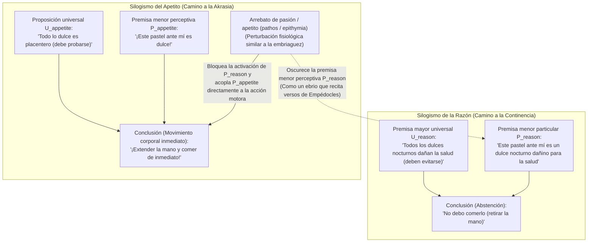
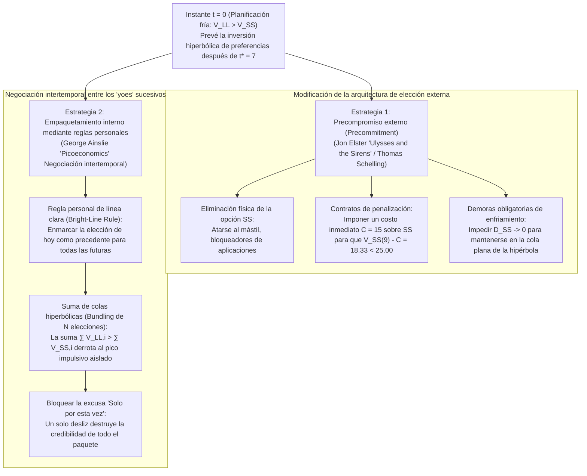

## 1. Introducción: El teléfono móvil a las 3:00 a. m. y la *Medea* de Eurípides — Definiendo la akrasia (ἀκρασία)

Mañana a las 8:00 a. m. tienes una presentación o un examen decisivo. Sabes mejor que nadie que, si no duermes de inmediato, tu rendimiento cognitivo de mañana se verá gravemente perjudicado. Sin embargo, a las 3:00 a. m., tu pulgar sigue desplazándose sin fin por la pantalla del teléfono móvil. O pensemos en un paciente que acepta sinceramente la advertencia médica de priorizar su salud cardiovascular, pero alarga la mano intencionalmente hacia un postre nocturno.

Los filósofos de la antigua Grecia llamaron a este fenómeno universal <strong>akrasia (ἀκρασία)</strong> —del prefijo privativo $\alpha$- («sin») y $\kappa\rho\acute{\alpha}\tau\omicron\varsigma$ (*kratos*, «poder, dominio o gobierno»)—, que significa literalmente <strong>«falta de autodominio»</strong> o <strong>«incontinencia»</strong> (en latín *incontinentia*, y en la filosofía moderna <strong>«debilidad de la voluntad»</strong>). En la tragedia *Medea* de Eurípides (431 a. C., vv. 1078–1080) y en las *Metamorfosis* de Ovidio (7.20–21) recibió su formulación más célebre:

> <strong>«Video meliora proboque, deteriora sequor.»</strong>
> («Veo lo mejor y lo apruebo, pero sigo lo peor.»)

En la filosofía analítica de la acción contemporánea, una acción $y$ realizada por un agente $S$ en el instante $t$ es <strong>estrictamente (sincrónicamente) akrática</strong> si y solo si se cumplen simultáneamente tres condiciones en $t$:

1. <strong>Intencionalidad y libertad:</strong> $S$ realiza $y$ intencionalmente, sin coacción física ni reflejo subpersonal, creyendo que una acción alternativa $x$ está abierta y a su alcance en $t$.
2. <strong>Juicio consciente «considerando todas las cosas» (All-Things-Considered Judgment):</strong> Tomando en cuenta todas las razones relevantes disponibles, $S$ juzga conscientemente en $t$ que es mejor realizar $x$ que realizar $y$ ($x \succ y$).
3. <strong>Contrariedad sincrónica al juicio:</strong> A pesar de mantener el juicio consciente $x \succ y$ en $t$, $S$ elige y ejecuta intencionalmente $y$ en $t$.

¿Por qué la akrasia estricta supone un escándalo filosófico? Porque tanto la psicología popular como la teoría de la elección racional (*preferencia revelada*) asumen que elegir intencionalmente $y$ sobre $x$ demuestra que el agente valoraba más $y$ en el momento de la elección.

---

## 2. El intelectualismo socrático (*Protágoras*) y el silogismo práctico de Aristóteles

### 2.1 El arte de la medida en Sócrates y la ilusión de la perspectiva temporal

En el *Protágoras* de Platón (352a–358d), Sócrates refuta la opinión de la mayoría (οἱ πολλοί) según la cual el conocimiento (ἐπιστήμη) es arrastrado por las pasiones y los placeres «como un esclavo (ἀνδράποδον)». Según el <strong>intelectualismo socrático</strong>, el verdadero conocimiento es soberano y <strong>«nadie yerra ni hace el mal voluntariamente» (οὐδεὶς ἑκὼν ἁμαρτάνει)</strong>.

¿Por qué, entonces, los seres humanos sacrifican continuamente un <strong>bien mayor futuro (LL: Larger-Later)</strong> por un <strong>placer menor inmediato (SS: Smaller-Sooner)</strong>? Sócrates diagnostica una <strong>ilusión óptica de la perspectiva temporal</strong>: así como la cercanía espacial hace que los objetos parezcan más grandes de lo que son, la inminencia temporal agiganta subjetivamente el placer inmediato frente al dolor o la recompensa lejana. En el instante $t$, el propio juicio de valor se invierte ($y \succ x$). La salvación de nuestra vida reside, pues, en una ciencia exacta: el <strong>«arte de la medida» (μετρητικὴ τέχνη)</strong>.

### 2.2 El alma tripartita de Platón y el Libro VII de la *Ética nicomáquea* de Aristóteles

En la *República* (Libro IV, 436a–441c), Platón supera el monismo socrático mediante el <strong>principio de los opuestos</strong> y divide el alma en tres subsistemas: la <strong>parte racional (λογιστικόν)</strong>, la <strong>parte irascible (θυμοειδές)</strong> y la <strong>parte apetitiva (ἐπιθυμητικόν)</strong> —ilustrados con el caso de <strong>Leoncio</strong>, quien maldice sus propios ojos mientras los abre por la fuerza para mirar los cadáveres de unos ejecutados—.

En la *Ética nicomáquea* (Libro VII, 1145a–1152a), Aristóteles sistematiza cuatro tipos de carácter moral:

| Tipo de carácter (Griego) | Término español / inglés | Juicio racional (Logos) | Dirección del apetito | Conflicto interno | Acción final y afecto posterior |
| :--- | :--- | :--- | :--- | :--- | :--- |
| <strong>ἀρετή / σωφροσύνη</strong> | <strong>Virtud / Templanza</strong> (Temperance) | Correcto (capta el bien) | En armonía con la razón | <strong>Ninguno</strong> | Realiza acciones nobles con deleite |
| <strong>ἐγκράτεια</strong> | <strong>Continencia / Autocontrol</strong> | Correcto (capta el bien) | Empuja al placer excesivo | <strong>Severo</strong> | La razón vence al apetito; actúa bien |
| <strong>ἀκρασία</strong> | <strong>Incontinencia / Akrasia</strong> | Correcto (capta el bien) | Empuja al placer excesivo | <strong>Severo</strong> | Cede al apetito; siente <strong>agudo remordimiento (μεταμέλεια)</strong> |
| <strong>κακία / ἀκολασία</strong> | <strong>Vicio / Intemperancia</strong> (Vice) | Corrompido (adopta el placer como principio) | Empuja al placer excesivo | <strong>Ninguno</strong> | Elige el mal por elección deliberada (προαίρεσις); <strong>sin remordimiento</strong> |

Aristóteles distingue entre la <strong>posesión disposicional (ἔχειν)</strong> del saber y su <strong>ejercicio activo (ἐνεργεῖν)</strong> dentro del <strong>silogismo práctico</strong>:

El agente akrático conserva la premisa mayor universal $U_{\text{reason}}$, pero el arrebato pasional (πάθος) nubla la premisa menor perceptiva $P_{\text{reason}}$ mientras activa $P_{\text{appetite}}$ («¡Es dulce!»). Aunque pronuncie máximas morales mientras come, es <strong>«como los hombres ebrios que recitan los versos de Empédocles»</strong> (1147a18–24).

---

## 3. Los juicios condicionales de Davidson y la teoría de las resoluciones de Holton

### 3.1 Donald Davidson (1970): La tríada inconsistente

En *«How is Weakness of the Will Possible?»* (1970), <strong>Donald Davidson</strong> plantea tres principios aparentemente incompatibles (<strong>P1</strong>: querer hacer $x$ más que $y$ implica hacer $x$ intencionalmente; <strong>P2</strong>: juzgar $x$ mejor que $y$ implica querer $x$ más que $y$; <strong>P3</strong>: existen acciones incontinentes).

Apoyándose en la lógica de la confirmación probabilística de Carl Hempel, Davidson distingue los <strong>juicios condicionales (*prima facie*)</strong> de los <strong>juicios incondicionales (*all-out*)</strong>:
1. El <strong>juicio «considerando todas las cosas» (ATC)</strong> en P3 es lógicamente un juicio condicional relativo al conjunto total de razones disponibles $\mathcal{E} = \{r_1, r_2, \dots, r_n\}$:
   $$\text{pf}(x \succ y,\; \mathcal{E})$$
2. En cambio, la intención final que rige P1 y P2 es un <strong>juicio incondicional (*sans phrase*)</strong>:
   $$y \succ x$$

Mantener simultáneamente $\text{pf}(x \succ y,\; \mathcal{E})$ y $y \succ x$ no implica contradicción lógica formal. El agente akrático viola el <strong>principio de continencia (Principle of Continence)</strong> porque, mediante una <strong>partición mental (Mental Partitioning)</strong>, el deseo parcial $r_2$ opera como *«una causa mental que no es una razón»*.

### 3.2 Gary Watson (1977) y Richard Holton (1999)

Mientras <strong>Gary Watson</strong> rechaza P2 separando el <strong>sistema de valoración ($\text{Val}(x) > \text{Val}(y)$)</strong> del <strong>sistema motivacional ($\text{Mot}(y) > \text{Mot}(x)$)</strong>, <strong>Richard Holton</strong> (1999) demuestra que la <strong>debilidad de la voluntad</strong> ordinaria es un fallo diacrónico: la <strong>reconsideración demasiado precipitada de una resolución previa</strong>, la cual combinaba una intención de primer orden con una metaintención de *no reabrir la deliberación* bajo la tentación.

---

## 4. Descuento hiperbólico en economía conductual y estrategias de autocontrol

### 4.1 Descuento exponencial (Samuelson) vs. hiperbólico (Ainslie)

Mientras que el modelo de <strong>descuento exponencial</strong> de Paul Samuelson (1937), $U_{\text{exp}}(A, D) = A \cdot e^{-rD}$, garantiza una estricta <strong>consistencia temporal</strong>, <strong>George Ainslie</strong> (1975, *Picoeconomics*, 1992) demostró que los humanos y animales descuentan las recompensas futuras según una <strong>función de descuento hiperbólico</strong> inversamente proporcional a la demora $D = T - t$:

$$V(D) = \frac{A}{1 + k D} = \frac{A}{1 + k(T - t)}, \qquad \rho(D) = -\frac{V'(D)}{V(D)} = \frac{k}{1 + k D}$$

Con el parámetro de impulsividad $k = 0.5$, una tentación inmediata $A_{\text{SS}} = 50$ en $t_{\text{SS}} = 10$ y una recompensa mayor $A_{\text{LL}} = 100$ en $t_{\text{LL}} = 15$, el <strong>punto de inversión de preferencias $t^*$</strong> donde $V_{\text{SS}}(t^*) = V_{\text{LL}}(t^*)$ es:

$$\frac{50}{1 + 0.5(10 - t^*)} = \frac{100}{1 + 0.5(15 - t^*)} \implies 8.5 - 0.5 t^* = 12 - t^* \implies \mathbf{t^* = 7.0}$$

| Instante $t$ | Demora $D_{\text{SS}}$ | Demora $D_{\text{LL}}$ | Valor hiperbólico $V_{\text{SS}}(t)$ | Valor hiperbólico $V_{\text{LL}}(t)$ | Elección dominante y estado psicológico |
| :---: | :---: | :---: | :---: | :---: | :--- |
| $t = 0$ | $10$ | $15$ | $8.33$ | <strong>$11.76$</strong> | <strong>LL dominante:</strong> Planificación fría y resolución ($\text{LL} \succ \text{SS}$) |
| <strong>$t^* = 7$</strong> | <strong>$3$</strong> | <strong>$8$</strong> | <strong>$20.00$</strong> | <strong>$20.00$</strong> | <strong>Punto de cruce:</strong> Máximo conflicto interno |
| $t = 9$ | $1$ | $6$ | <strong>$33.33$</strong> | $25.00$ | <strong>SS dominante (Inversión):</strong> Pico hiperbólico y akrasia |
| $t = 10$ | $0$ | $5$ | <strong>$50.00$</strong> | $28.57$ | <strong>Pico de SS:</strong> Indulgencia inmediata seguida de arrepentimiento |

La neuroeconomía (McClure et al., *Science*, 2004) confirmó mediante fMRI que esta pugna enfrenta al <strong>sistema dopaminérgico mesolímbico $\beta$</strong> (estriado ventral, activo cuando $D \to 0$) contra el <strong>sistema ejecutivo frontoparietal $\delta$</strong> (dlPFC).

### 4.2 Precompromiso (*Ulises y las Sirenas*) y empaquetamiento de elecciones (Bundling)

1. <strong>El precompromiso de Jon Elster (*Ulysses and the Sirens*, 1979):</strong> Como <strong>Ulises</strong> haciéndose atar al mástil antes de escuchar a las Sirenas, el yo racional $S_{t_0}$ restringe de antemano al yo impulsivo $S_{t_1}$ eliminando físicamente SS o imponiéndole una penalización inmediata $C = 15$ ($33.33 - 15 = 18.33 < 25.00$).
2. <strong>El empaquetamiento de elecciones (Bundling) de George Ainslie:</strong> Dado que las curvas hiperbólicas poseen colas mucho más gruesas a largo plazo que las exponenciales, adoptar una <strong>regla personal de línea clara (Bright-Line Rule)</strong> que agrupe $N+1 = 5$ elecciones sucesivas espaciadas por $\tau = 10$ invierte la desigualdad en $t = 9$:
   $$V_{\text{bundle}}^{\text{LL}}(9) = \sum_{i=0}^{4} \frac{100}{1 + 0.5(6 + 10i)} \approx \mathbf{52.68} > V_{\text{bundle}}^{\text{SS}}(9) = \sum_{i=0}^{4} \frac{50}{1 + 0.5(1 + 10i)} \approx \mathbf{50.73}$$
   Esto explica matemáticamente por qué la racionalización <strong>«Solo por esta vez»</strong> es letal: separa la elección de esta noche de la serie futura y destruye la credibilidad de la regla. La verdadera sabiduría práctica (φρόνησις) consiste en diseñar preventivamente nuestra arquitectura de precompromisos y reglas personales.
