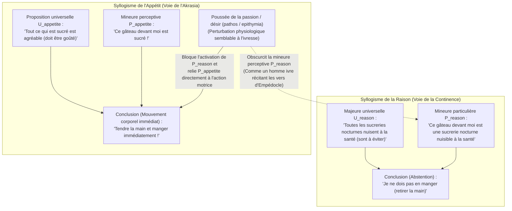
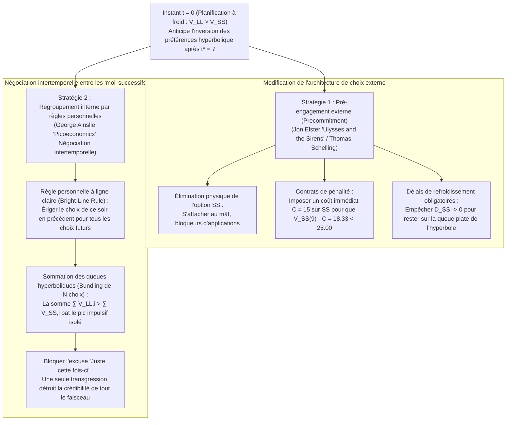

## 1. Introduction : Le smartphone à 3 heures du matin et la *Médée* d'Euripide — Définir l'akrasia (ἀκρασία)

Demain matin à 8h00, vous avez une présentation ou un examen décisif. Vous savez mieux que quiconque que si vous ne dormez pas immédiatement, vos capacités cognitives seront gravement altérées demain. Pourtant, à 3h00 du matin, votre pouce continue de faire défiler l'écran de votre smartphone. Ou encore, un patient qui adhère sincèrement aux avertissements de son médecin concernant sa santé cardiovasculaire tend délibérément la main vers un dessert nocturne.

Les philosophes grecs de l'Antiquité ont nommé ce phénomène universel <strong>akrasia (ἀκρασία)</strong> — formé du préfixe privatif $\alpha$- (« sans ») et de $\kappa\rho\acute{\alpha}\tau\omicron\varsigma$ (*kratos*, « pouvoir, maîtrise »), signifiant littéralement <strong>« absence de maîtrise de soi »</strong> ou <strong>« incontinence »</strong> (en latin *incontinentia*, et en philosophie moderne <strong>« faiblesse de la volonté »</strong>). Dans la tragédie *Médée* d'Euripide (431 av. J.-C., v. 1078–1080) et les *Métamorphoses* d'Ovide (7.20–21), ce déchirement a reçu sa formulation immortelle :

> <strong>« Video meliora proboque, deteriora sequor. »</strong>
> (« Je vois le meilleur et je l'approuve, mais je suis le pire. »)

Dans la philosophie analytique de l'action contemporaine, une action $y$ accomplie par un agent $S$ à l'instant $t$ est <strong>strictement (synchroniquement) akratique</strong> si et seulement si trois conditions sont réunies simultanément en $t$ :

1. <strong>Intentionnalité et liberté :</strong> $S$ accomplit $y$ intentionnellement, sans contrainte physique ni réflexe sub-personnel, en croyant qu'une action alternative $x$ est ouverte et en son pouvoir en $t$.
2. <strong>Jugement conscient « tout bien considéré » (All-Things-Considered Judgment) :</strong> Tenant compte de toutes les raisons pertinentes disponibles, $S$ juge consciemment en $t$ qu'il est meilleur d'accomplir $x$ plutôt que $y$ ($x \succ y$).
3. <strong>Contrariété synchronique au jugement :</strong> Tout en maintenant le jugement conscient $x \succ y$ en $t$, $S$ choisit et exécute intentionnellement $y$ en $t$.

Pourquoi l'akrasia stricte constitue-t-elle un scandale philosophique ? Parce que tant la psychologie ordinaire que la théorie du choix rationnel (*préférence révélée*) supposent que choisir intentionnellement $y$ plutôt que $x$ prouve que l'agent attribuait une valeur supérieure à $y$ au moment du choix.

---

## 2. L'intellectualisme socratique (*Protagoras*) et le syllogisme pratique d'Aristote

### 2.1 L'art de la mesure chez Socrate et l'illusion de perspective temporelle

Dans le *Protagoras* de Platon (352a–358d), Socrate rejette l'opinion de la multitude (οἱ πολλοί) selon laquelle la science (ἐπιστήμη) serait traînée par les passions et les plaisirs « comme un esclave (ἀνδράποδον) ». Selon l'<strong>intellectualisme socratique</strong>, la connaissance véritable est souveraine et <strong>« nul ne fait le mal volontairement » (οὐδεὶς ἑκὼν ἁμαρτάνει)</strong>.

Pourquoi les humains sacrifient-ils alors un <strong>bien supérieur futur (LL : Larger-Later)</strong> au profit d'un <strong>plaisir moindre immédiat (SS : Smaller-Sooner)</strong> ? Socrate diagnostique une <strong>illusion d'optique liée à la distance temporelle</strong> : de même que la proximité spatiale fait paraître les objets plus grands qu'ils ne le sont, la proximité temporelle d'un plaisir immédiat le fait paraître gigantesque par rapport à une douleur ou une récompense éloignée dans le futur. À l'instant $t$, le jugement évaluatif lui-même bascule ($y \succ x$). Le salut de notre vie réside donc dans une science exacte : l'<strong>« art de la mesure » (μετρητικὴ τέχνη)</strong>.

### 2.2 L'âme tripartite chez Platon et le Livre VII de l'*Éthique à Nicomaque* d'Aristote

Dans la *République* (Livre IV, 436a–441c), Platon dépasse le monisme socratique grâce au <strong>principe des contraires</strong> et divise l'âme en trois instances : la <strong>partie rationnelle (λογιστικόν)</strong>, la <strong>partie irascible ou ardente (θυμοειδές)</strong> et la <strong>partie appétitive (ἐπιθυμητικόν)</strong> — illustrées par le cas de <strong>Léontios</strong>, qui maudit ses propres yeux tout en les écarquillant pour contempler des cadavres de suppliciés.

Dans l'*Éthique à Nicomaque* (Livre VII, 1145a–1152a), Aristote distingue quatre dispositions morales :

| Disposition (Grec) | Terme français / anglais | Jugement rationnel (Logos) | Direction du désir | Conflit interne | Action finale et affect post-action |
| :--- | :--- | :--- | :--- | :--- | :--- |
| <strong>ἀρετή / σωφροσύνη</strong> | <strong>Vertu / Tempérance</strong> (Temperance) | Correct (saisit le bien) | En harmonie avec la raison | <strong>Aucun</strong> | Accomplit le bien avec plaisir |
| <strong>ἐγκράτεια</strong> | <strong>Continence / Maîtrise de soi</strong> | Correct (saisit le bien) | Pousse au plaisir excessif | <strong>Sévère</strong> | La raison triomphe du désir ; agit bien |
| <strong>ἀκρασία</strong> | <strong>Incontinence / Akrasia</strong> | Correct (saisit le bien) | Pousse au plaisir excessif | <strong>Sévère</strong> | Cède au désir ; éprouve un <strong>vif remords (μεταμέλεια)</strong> |
| <strong>κακία / ἀκολασία</strong> | <strong>Vice / Intempérance</strong> (Intemperance) | Corrompu (érige le plaisir en principe) | Pousse au plaisir excessif | <strong>Aucun</strong> | Choisit le mal par choix délibéré (προαίρεσις) ; <strong>sans remords</strong> |

Aristote résout l'énigme en distinguant la <strong>possession habituelle (ἔχειν)</strong> du savoir et son <strong>exercice actuel (ἐνεργεῖν)</strong> au sein du <strong>syllogisme pratique</strong> :

L'agent akratique conserve la majeure universelle $U_{\text{reason}}$, mais la poussée passionnelle (πάθος) voile la mineure perceptive particulière $P_{\text{reason}}$ tout en activant $P_{\text{appetite}}$ (« C'est sucré ! »). S'il prononce des paroles morales en mangeant, il est <strong>« comme les hommes ivres qui récitent les vers d'Empédocle »</strong> (1147a18–24).

---

## 3. Les jugements conditionnels de Davidson et la théorie des résolutions de Holton

### 3.1 Donald Davidson (1970) : La triade incohérente

Dans *« How is Weakness of the Will Possible? »* (1970), <strong>Donald Davidson</strong> énonce trois principes apparemment incompatibles (<strong>P1</strong> : vouloir davantage $x$ implique faire $x$ intentionnellement ; <strong>P2</strong> : juger $x$ meilleur que $y$ implique vouloir davantage $x$ ; <strong>P3</strong> : il existe des actions incontinentes).

S'inspirant de la logique de la confirmation inductive de Carl Hempel, Davidson distingue les <strong>jugements conditionnels (*prima facie*)</strong> des <strong>jugements inconditionnels (*all-out*)</strong> :
1. Le <strong>jugement « tout bien considéré » (ATC)</strong> dans P3 reste logiquement conditionné par l'ensemble total des raisons disponibles $\mathcal{E} = \{r_1, r_2, \dots, r_n\}$ :
   $$\text{pf}(x \succ y,\; \mathcal{E})$$
2. En revanche, l'intention finale régissant P1 et P2 est un <strong>jugement inconditionnel (*sans phrase*)</strong> :
   $$y \succ x$$

Tenir simultanément $\text{pf}(x \succ y,\; \mathcal{E})$ et $y \succ x$ ne contient aucune contradiction logique formelle. Mais l'agent akratique viole le <strong>principe de continence (Principle of Continence)</strong> parce qu'à travers un <strong>cloisonnement mental (Mental Partitioning)</strong>, le désir partiel $r_2$ agit comme *« une cause mentale qui n'est pas une raison »*.

### 3.2 Gary Watson (1977) et Richard Holton (1999)

Tandis que <strong>Gary Watson</strong> rejette P2 en séparant le <strong>système d'évaluation ($\text{Val}(x) > \text{Val}(y)$)</strong> du <strong>système motivationnel ($\text{Mot}(y) > \text{Mot}(x)$)</strong>, <strong>Richard Holton</strong> (1999) montre que la <strong>faiblesse de la volonté</strong> au sens ordinaire est une défaillance diachronique : la <strong>révision trop hâtive (reconsideration) d'une résolution préalable</strong>, laquelle combinait une intention de premier ordre et une méta-intention de *ne pas rouvrir la délibération* face à la tentation.

---

## 4. Actualisation hyperbolique en économie comportementale et stratégies de maîtrise de soi

### 4.1 Actualisation exponentielle (Samuelson) vs. hyperbolique (Ainslie)

Alors que le modèle d'<strong>actualisation exponentielle</strong> de Paul Samuelson (1937), $U_{\text{exp}}(A, D) = A \cdot e^{-rD}$, garantit une stricte <strong>cohérence temporelle</strong>, <strong>George Ainslie</strong> (1975, *Picoeconomics*, 1992) a démontré empiriquement que les humains déprécient les récompenses futures selon une <strong>fonction d'actualisation hyperbolique</strong> inversement proportionnelle au délai $D = T - t$ :

$$V(D) = \frac{A}{1 + k D} = \frac{A}{1 + k(T - t)}, \qquad \rho(D) = -\frac{V'(D)}{V(D)} = \frac{k}{1 + k D}$$

Avec le paramètre d'impulsivité $k = 0.5$, une tentation immédiate $A_{\text{SS}} = 50$ à $t_{\text{SS}} = 10$ et une récompense supérieure $A_{\text{LL}} = 100$ à $t_{\text{LL}} = 15$, le <strong>point d'inversion des préférences $t^*$</strong> où $V_{\text{SS}}(t^*) = V_{\text{LL}}(t^*)$ est :

$$\frac{50}{1 + 0.5(10 - t^*)} = \frac{100}{1 + 0.5(15 - t^*)} \implies 8.5 - 0.5 t^* = 12 - t^* \implies \mathbf{t^* = 7.0}$$

| Instant $t$ | Délai $D_{\text{SS}}$ | Délai $D_{\text{LL}}$ | Valeur hyperbolique $V_{\text{SS}}(t)$ | Valeur hyperbolique $V_{\text{LL}}(t)$ | Choix dominant et état psychologique |
| :---: | :---: | :---: | :---: | :---: | :--- |
| $t = 0$ | $10$ | $15$ | $8.33$ | <strong>$11.76$</strong> | <strong>LL dominant :</strong> Planification à froid et résolution ($\text{LL} \succ \text{SS}$) |
| <strong>$t^* = 7$</strong> | <strong>$3$</strong> | <strong>$8$</strong> | <strong>$20.00$</strong> | <strong>$20.00$</strong> | <strong>Point de croisement :</strong> Conflit interne maximal |
| $t = 9$ | $1$ | $6$ | <strong>$33.33$</strong> | $25.00$ | <strong>SS dominant (Inversion) :</strong> Flambée hyperbolique et akrasia |
| $t = 10$ | $0$ | $5$ | <strong>$50.00$</strong> | $28.57$ | <strong>Pic de SS :</strong> Capitulation immédiate suivie de regret |

La neuroéconomie (McClure et al., *Science*, 2004) a confirmé par IRMf que ce conflit oppose le <strong>système dopaminergique mésolimbique $\beta$</strong> (striatum ventral, réagissant à $D \to 0$) au <strong>système exécutif fronto-pariétal $\delta$</strong> (dlPFC).

### 4.2 Pré-engagement (*Ulysse et les Sirènes*) et regroupement des choix (Bundling)

1. <strong>Le pré-engagement de Jon Elster (*Ulysses and the Sirens*, 1979) :</strong> Comme <strong>Ulysse</strong> se faisant attacher au mât avant d'approcher des Sirènes, le moi rationnel $S_{t_0}$ lie par avance le moi impulsif $S_{t_1}$ en éliminant physiquement SS ou en lui attachant une pénalité immédiate $C = 15$ ($33.33 - 15 = 18.33 < 25.00$).
2. <strong>Le regroupement des choix (Bundling) de George Ainslie :</strong> Parce que les courbes hyperboliques possèdent des queues beaucoup plus épaisses à long terme que les exponentielles, adopter une <strong>règle personnelle claire (Bright-Line Rule)</strong> qui regroupe $N+1 = 5$ choix successifs espacés de $\tau = 10$ renverse l'inégalité à $t = 9$ :
   $$V_{\text{bundle}}^{\text{LL}}(9) = \sum_{i=0}^{4} \frac{100}{1 + 0.5(6 + 10i)} \approx \mathbf{52.68} > V_{\text{bundle}}^{\text{SS}}(9) = \sum_{i=0}^{4} \frac{50}{1 + 0.5(1 + 10i)} \approx \mathbf{50.73}$$
   On comprend ainsi mathématiquement pourquoi la rationalisation <strong>« Juste cette fois-ci »</strong> est fatale : elle dissocie le choix présent de la série future et ruine la crédibilité de la règle. La véritable sagesse pratique (φρόνησις) réside dans l'architecture préventive de nos engagements et de nos règles.
