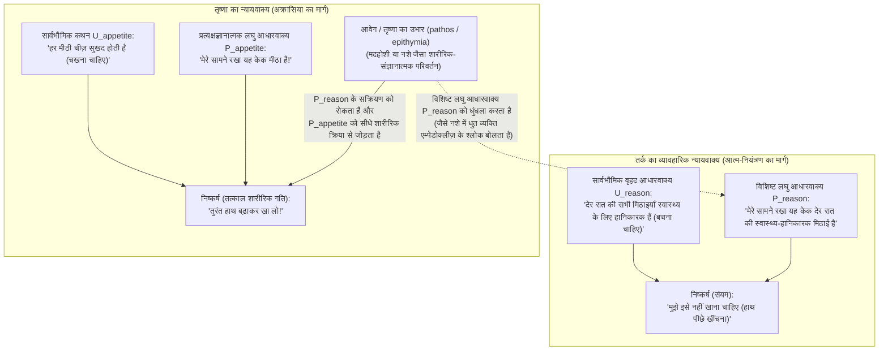
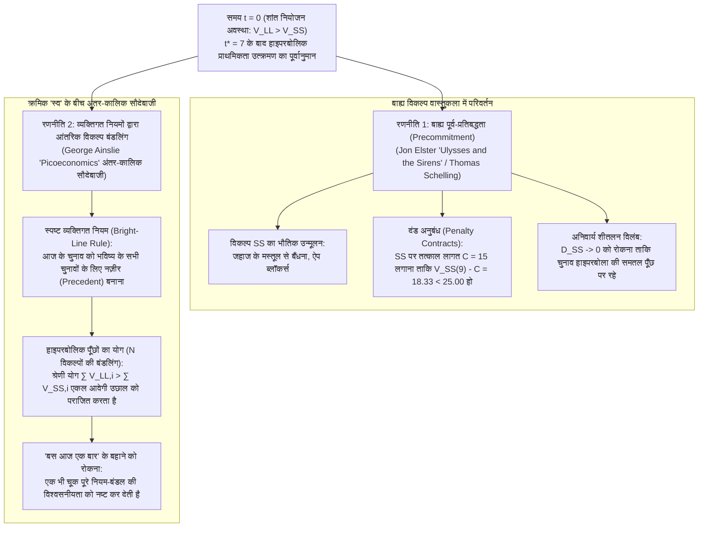

## 1. प्रस्तावना: रात 3 बजे का स्मार्टफोन और यूरिपिडीज़ का *मीडिया* — अक्रासिया (ἀκρασία) की परिभाषा

कल्पना कीजिए कि कल सुबह 8:00 बजे आपकी एक निर्णायक प्रस्तुति या परीक्षा है। आप किसी भी अन्य व्यक्ति से बेहतर जानते हैं कि यदि आप तुरंत नहीं सोए, तो कल आपका संज्ञानात्मक प्रदर्शन गंभीर रूप से प्रभावित होगा। फिर भी रात के 3:00 बजे आपका अंगूठा स्मार्टफोन की स्क्रीन को लगातार स्क्रॉल कर रहा है। या एक ऐसे मरीज़ की कल्पना करें जो डॉक्टर की चेतावनी को पूरे मन से स्वीकार करता है कि हृदय का स्वास्थ्य उसकी सर्वोच्च प्राथमिकता है, फिर भी आधी रात को जानबूझकर उच्च कैलोरी वाली मिठाई की ओर हाथ बढ़ाता है।

प्राचीन यूनानी दार्शनिकों ने इस सार्वभौमिक मानवीय घटना को <strong>अक्रासिया (ἀκρασία / Akrasia)</strong> नाम दिया — जो निषेधात्मक उपसर्ग $\alpha$- ("बिना") और $\kappa\rho\acute{\alpha}\tau\omicron\varsigma$ (*kratos*, "शक्ति, शासन या आत्म-नियंत्रण") से मिलकर बना है, जिसका शाब्दिक अर्थ है <strong>"आत्म-नियंत्रण का अभाव"</strong> या <strong>"असंयम"</strong> (लैटिन में *incontinentia*, और आधुनिक दर्शन में <strong>"इच्छाशक्ति की कमज़ोरी / Weakness of Will"</strong>)। यूरिपिडीज़ की त्रासदी *मीडिया* (431 ईसा पूर्व, पंक्तियाँ 1078–1080) और रोमन कवि ओविड के *मेटामोर्फोसेज़* (7.20–21) में इस आंतरिक द्वंद्व को अमर शब्दों में व्यक्त किया गया है:

> <strong>"Video meliora proboque, deteriora sequor."</strong>
> ("मैं बेहतर को देखता हूँ और उसका समर्थन करता हूँ, फिर भी मैं बदतर का अनुसरण करता हूँ।")

समकालीन क्रिया-दर्शन (Philosophy of Action) में, किसी कर्ता $S$ द्वारा समय $t$ पर किया गया कार्य $y$ <strong>सख्त (समकालिक) रूप से अक्रातिक</strong> तभी कहलाता है जब समय $t$ पर तीन शर्तें एक साथ पूरी होती हैं:

1. <strong>साभिप्रायता और स्वतंत्रता (Intentionality and Freedom):</strong> $S$ बिना किसी बाहरी भौतिक बल या अनैच्छिक प्रतिवर्त के, जानबूझकर और स्वतंत्र रूप से $y$ करता है, और विश्वास करता है कि वैकल्पिक कार्य $x$ उस समय उसके वश में है।
2. <strong>सचेत सर्व-समावेशी श्रेष्ठ निर्णय (All-Things-Considered Judgment):</strong> उपलब्ध सभी प्रासंगिक कारणों पर विचार करते हुए, $S$ समय $t$ पर सचेत रूप से निर्णय करता है कि $y$ करने की तुलना में $x$ करना बेहतर है ($x \succ y$)।
3. <strong>निर्णय के विरुद्ध समकालिक आचरण:</strong> समय $t$ पर $x \succ y$ का सचेत निर्णय बनाए रखने के बावजूद, $S$ उसी समय $t$ पर जानबूझकर $y$ को चुनता और निष्पादित करता है।

सख्त अक्रासिया दार्शनिक रूप से इतना बड़ा संकट क्यों है? क्योंकि सामान्य लोक-मनोविज्ञान और तर्कसंगत विकल्प सिद्धांत (*प्रकट प्राथमिकता / Revealed Preference*) दोनों यह मानते हैं कि $x$ के बजाय $y$ को जानबूझकर चुनना यह दर्शाता है कि चुनाव के क्षण में कर्ता ने $y$ को अधिक मूल्यवान माना था।

---

## 2. सुकरात का बौद्धिकतावाद (*प्रोटागोरस*) और अरस्तू का व्यावहारिक न्यायवाक्य

### 2.1 सुकरात की मापन-कला और कालिक परिप्रेक्ष्य का भ्रम

प्लेटो के संवाद *प्रोटागोरस* (352a–358d) में, सुकरात आम लोगों (οἱ πολλοί) की इस धारणा का खंडन करते हैं कि ज्ञान (ἐπιστήμη) को वासना और सुख द्वारा "एक गुलाम (ἀνδράποδον) की तरह" घसीटा जाता है। <strong>सुकराती बौद्धिकतावाद (Socratic Intellectualism)</strong> के अनुसार, सच्चा ज्ञान सर्वोच्च शासक है और <strong>"कोई भी व्यक्ति स्वेच्छा से (जानबूझकर) बुरा नहीं करता" (οὐδεὶς ἑκὼν ἁμαρτάνει)</strong>।

तब मनुष्य निरंतर <strong>भविष्य के बड़े हित (LL: Larger-Later)</strong> का बलिदान <strong>तात्कालिक छोटे सुख (SS: Smaller-Sooner)</strong> के लिए क्यों कर देता है? सुकरात इसे <strong>कालिक परिप्रेक्ष्य का दृष्टि-भ्रम</strong> बताते हैं: जिस प्रकार स्थानिक निकटता वस्तुओं को उनके वास्तविक आकार से बड़ा दिखाती है, उसी प्रकार समय की निकटता तात्कालिक सुख को दूरस्थ भविष्य के कष्ट या पुरस्कार की तुलना में विशाल बनाकर दिखाती है। क्रिया के क्षण $t$ में कर्ता का मूल्यांकनपरक निर्णय स्वयं पलट जाता है ($y \succ x$)। इसलिए जीवन की रक्षा केवल इच्छाशक्ति से नहीं, बल्कि एक सटीक विज्ञान — <strong>"मापन की कला" (μετρητικὴ τέχνη / Art of Measurement)</strong> — से होती है।

### 2.2 प्लेटो की त्रिभाजित आत्मा और अरस्तू का *निकोमेकियन एथिक्स* (पुस्तक VII)

*रिपब्लिक* (पुस्तक IV, 436a–441c) में, प्लेटो 'विपरीतता के सिद्धांत' के आधार पर आत्मा को तीन भागों में विभाजित करते हैं: <strong>तार्किक भाग (λογιστικόν)</strong>, <strong>उत्साही/मनोवेगी भाग (θυμοειδές)</strong>, और <strong>तृष्णापरक भाग (ἐπιθυμητικόν)</strong> — जिसे उन्होंने <strong>लियोन्टियस (Leontius)</strong> के उदाहरण से स्पष्ट किया, जिसने अपनी ही आँखों को कोसते हुए उन्हें ज़बरदस्ती खोलकर मृत्युदंड पाए शवों को देखा था।

*निकोमेकियन एथिक्स* (पुस्तक VII, 1145a–1152a) में अरस्तू चार नैतिक चरित्रों का वर्गीकरण करते हैं:

| चरित्र प्रकार (यूनानी) | हिंदी / अंग्रेजी शब्द | तार्किक निर्णय (Logos) | तृष्णा की दिशा | आंतरिक द्वंद्व | अंतिम कार्य और पश्चातवर्ती भाव |
| :--- | :--- | :--- | :--- | :--- | :--- |
| <strong>ἀρετή / σωφροσύνη</strong> | <strong>सद्गुण / संयम</strong> (Temperance) | सही (शुभ को जानता है) | तर्क के साथ पूर्ण सामंजस्य | <strong>कोई नहीं</strong> | आनंदपूर्वक श्रेष्ठ कार्य करता है |
| <strong>ἐγκράτεια</strong> | <strong>आत्म-नियंत्रण</strong> (Continence) | सही (शुभ को जानता है) | अत्यधिक सुख की ओर खिंचाव | <strong>तीव्र</strong> | तर्क तृष्णा को दबा देता है; सही कार्य करता है |
| <strong>ἀκρασία</strong> | <strong>असंयम / अक्रासिया</strong> (Akrasia) | सही (शुभ को जानता है) | अत्यधिक सुख की ओर खिंचाव | <strong>तीव्र</strong> | तृष्णा के आगे झुकता है; <strong>तीव्र पश्चाताप (μεταμέλεια)</strong> करता है |
| <strong>κακία / ἀκολασία</strong> | <strong>दुर्गुण / दुराचार</strong> (Vice) | भ्रष्ट (सुख को ही सिद्धांत मानता है) | अत्यधिक सुख की ओर खिंचाव | <strong>कोई नहीं</strong> | जानबूझकर (προαίρεσις) बुरा चुनता है; <strong>कोई पश्चाताप नहीं</strong> |

अरस्तू ज्ञान के <strong>सुप्त अधिकार (ἔχειν)</strong> और उसके <strong>सक्रिय प्रयोग (ἐνεργεῖν)</strong> में अंतर करते हुए <strong>व्यावहारिक न्यायवाक्य (Practical Syllogism)</strong> के माध्यम से अक्रासिया की व्याख्या करते हैं:

अक्रातिक व्यक्ति सार्वभौमिक आधारवाक्य $U_{\text{reason}}$ को नहीं खोता, किंतु तीव्र आवेग (πάθος) विशिष्ट प्रत्यक्षज्ञानात्मक लघु आधारवाक्य $P_{\text{reason}}$ को सुन्न कर देता है और $P_{\text{appetite}}$ ("यह मीठा है!") को सीधे शारीरिक क्रिया से जोड़ देता है। खाते समय यदि वह नैतिक वचन बोलता भी है, तो वह <strong>"नशे में धुत उन लोगों जैसा है जो एम्पेडोक्लीज़ के श्लोक दुहराते हैं"</strong> (1147a18–24)।

---

## 3. डेविडसन के सशर्त निर्णय और होल्टन का 'संकल्प' सिद्धांत

### 3.1 डोनाल्ड डेविडसन (1970): असंगत त्रयी (Inconsistent Triad)

1970 के अपने प्रसिद्ध शोधपत्र *"How is Weakness of the Will Possible?"* में <strong>डोनाल्ड डेविडसन (Donald Davidson)</strong> तीन परस्पर विरोधी दिखने वाले सिद्धांत प्रस्तुत करते हैं (<strong>P1</strong>: $y$ से अधिक $x$ करने की इच्छा होने पर कर्ता जानबूझकर $x$ करेगा; <strong>P2</strong>: $x$ को $y$ से बेहतर मानने पर कर्ता $x$ को अधिक चाहेगा; <strong>P3</strong>: असंयमी कार्य वास्तव में होते हैं)।

कार्ल हेम्पेल के आगमनात्मक प्रायिकता तर्क के आधार पर डेविडसन <strong>सशर्त (*prima facie*) निर्णयों</strong> और <strong>बिना शर्त (*all-out*) निर्णयों</strong> में भेद करते हैं:
1. P3 में <strong>"सर्व-समावेशी निर्णय" (ATC Judgment)</strong> तार्किक रूप से कुल उपलब्ध कारणों के समुच्चय $\mathcal{E} = \{r_1, r_2, \dots, r_n\}$ के सापेक्ष एक सशर्त निर्णय है:
   $$\text{pf}(x \succ y,\; \mathcal{E})$$
2. इसके विपरीत, P1 और P2 को संचालित करने वाला अंतिम इरादा एक <strong>बिना शर्त (*sans phrase*) निर्णय</strong> है:
   $$y \succ x$$

$\text{pf}(x \succ y,\; \mathcal{E})$ और $y \succ x$ को एक साथ रखने में कोई औपचारिक तार्किक विरोधाभास नहीं है। किंतु अक्रातिक कर्ता <strong>संयम के सिद्धांत (Principle of Continence)</strong> का उल्लंघन करता है, क्योंकि <strong>मानसिक विभाजन (Mental Partitioning)</strong> के कारण आंशिक इच्छा $r_2$ *"एक ऐसे मानसिक कारण के रूप में कार्य करती है जो तार्किक आधार नहीं है"*।

### 3.2 गैरी वाटसन (1977) और रिचर्ड होल्टन (1999)

जहाँ <strong>गैरी वाटसन</strong> P2 को अस्वीकार करते हुए <strong>मूल्यांकन प्रणाली ($\text{Val}(x) > \text{Val}(y)$)</strong> और <strong>अभिप्रेरणा प्रणाली ($\text{Mot}(y) > \text{Mot}(x)$)</strong> को अलग करते हैं, वहीं <strong>रिचर्ड होल्टन</strong> (1999) दिखाते हैं कि सामान्य <strong>इच्छाशक्ति की कमज़ोरी</strong> एक कालानुक्रमिक (diachronic) विफलता है: अर्थात् प्रलोभन के समय <strong>पूर्व-निर्धारित 'संकल्प' (Resolution) पर बहुत जल्दी पुनर्विचार (reconsideration) कर उसे त्याग देना</strong>।

---

## 4. व्यवहारिक अर्थशास्त्र में हाइपरबोलिक डिस्काउंटिंग और आत्म-नियंत्रण की रणनीतियाँ

### 4.1 सैमुअलसन का घातांकीय बनाम ऐन्सली का हाइपरबोलिक डिस्काउंटिंग

पॉल सैमुअलसन (1937) का मानक <strong>घातांकीय डिस्काउंटिंग मॉडल (Exponential Discounting)</strong> $U_{\text{exp}}(A, D) = A \cdot e^{-rD}$ सख्त <strong>समय-संगतता (Time Consistency)</strong> प्रदर्शित करता है। इसके विपरीत, <strong>जॉर्ज ऐन्सली (George Ainslie, 1975, 1992)</strong> ने सिद्ध किया कि मनुष्य और जीव भविष्य के पुरस्कारों का अवमूल्यन विलंब $D = T - t$ के व्युत्क्रमानुपाती <strong>हाइपरबोलिक डिस्काउंटिंग फलन</strong> के अनुसार करते हैं:

$$V(D) = \frac{A}{1 + k D} = \frac{A}{1 + k(T - t)}, \qquad \rho(D) = -\frac{V'(D)}{V(D)} = \frac{k}{1 + k D}$$

आवेगशीलता प्राचल $k = 0.5$, तात्कालिक छोटे प्रलोभन $A_{\text{SS}} = 50$ ($t_{\text{SS}} = 10$ पर) और भविष्य के बड़े पुरस्कार $A_{\text{LL}} = 100$ ($t_{\text{LL}} = 15$ पर) के लिए, <strong>प्राथमिकता उत्क्रमण बिंदु $t^*$</strong> जहाँ $V_{\text{SS}}(t^*) = V_{\text{LL}}(t^*)$ है:

$$\frac{50}{1 + 0.5(10 - t^*)} = \frac{100}{1 + 0.5(15 - t^*)} \implies 8.5 - 0.5 t^* = 12 - t^* \implies \mathbf{t^* = 7.0}$$

| समय $t$ | विलंब $D_{\text{SS}}$ | विलंब $D_{\text{LL}}$ | हाइपरबोलिक मूल्य $V_{\text{SS}}(t)$ | हाइपरबोलिक मूल्य $V_{\text{LL}}(t)$ | प्रभावी विकल्प और मनोवैज्ञानिक स्थिति |
| :---: | :---: | :---: | :---: | :---: | :--- |
| $t = 0$ | $10$ | $15$ | $8.33$ | <strong>$11.76$</strong> | <strong>LL प्रभावी:</strong> शांत नियोजन और संकल्प ($\text{LL} \succ \text{SS}$) |
| <strong>$t^* = 7$</strong> | <strong>$3$</strong> | <strong>$8$</strong> | <strong>$20.00$</strong> | <strong>$20.00$</strong> | <strong>प्रतिच्छेदन बिंदु:</strong> अधिकतम आंतरिक संघर्ष |
| $t = 9$ | $1$ | $6$ | <strong>$33.33$</strong> | $25.00$ | <strong>SS प्रभावी (उत्क्रमण):</strong> हाइपरबोलिक उछाल और अक्रासिया |
| $t = 10$ | $0$ | $5$ | <strong>$50.00$</strong> | $28.57$ | <strong>SS शिखर:</strong> तात्कालिक समर्पण और उसके बाद पश्चाताप |

न्यूरोइकोनॉमिक्स (McClure et al., *Science*, 2004) ने fMRI द्वारा प्रमाणित किया कि यह संघर्ष तात्कालिक पुरस्कार ($D \to 0$) पर सक्रिय होने वाले <strong>मेसोलिम्बिक डोपामाइन $\beta$-तंत्र</strong> (वेंट्रल स्ट्रिएटम) और दीर्घकालिक मूल्य की गणना करने वाले <strong>ललाट-पार्श्विका $\delta$-तंत्र</strong> (dlPFC) के बीच की प्रतिस्पर्धा है।

### 4.2 पूर्व-प्रतिबद्धता (*यूलिसिस और साइरन*) तथा विकल्पों का बंडलिंग (Bundling)

1. <strong>जॉन एल्स्टर (*Ulysses and the Sirens*, 1979) की पूर्व-प्रतिबद्धता (Precommitment):</strong> जिस प्रकार होमर के <strong>यूलिसिस (ओडिसियस)</strong> ने साइरन के द्वीप के पास पहुँचने से पहले नाविकों के कानों में मोम भरवा दिया और स्वयं को मस्तूल से बँधवा लिया, उसी प्रकार शांत 'स्व' $S_{t_0}$ भविष्य के आवेगी 'स्व' $S_{t_1}$ को भौतिक रूप से रोकता है या SS पर $C = 15$ का तत्काल दंड लगाता है ($33.33 - 15 = 18.33 < 25.00$)।
2. <strong>जॉर्ज ऐन्सली की विकल्प बंडलिंग (Bundling via Personal Rules):</strong> चूँकि हाइपरबोलिक वक्रों की दीर्घकालिक पूँछ घातांकीय वक्रों की तुलना में बहुत मोटी होती है, इसलिए एक <strong>स्पष्ट व्यक्तिगत नियम (Bright-Line Rule)</strong> बनाकर $\tau = 10$ के अंतराल वाले मात्र $N+1 = 5$ क्रमिक चुनावों को एक साथ बाँधने पर $t = 9$ पर असमानता पलट जाती है:
   $$V_{\text{bundle}}^{\text{LL}}(9) = \sum_{i=0}^{4} \frac{100}{1 + 0.5(6 + 10i)} \approx \mathbf{52.68} > V_{\text{bundle}}^{\text{SS}}(9) = \sum_{i=0}^{4} \frac{50}{1 + 0.5(1 + 10i)} \approx \mathbf{50.73}$$
   यह गणितीय रूप से स्पष्ट करता है कि <strong>"बस आज एक बार अपवाद"</strong> का आत्म-छल इतना घातक क्यों है: यह आज के चुनाव को भविष्य की श्रृंखला से अलग कर नियम की विश्वसनीयता को नष्ट कर देता है। सच्ची व्यावहारिक प्रज्ञा (φρόνησις) शांत क्षणों में पूर्व-प्रतिबद्धता और व्यक्तिगत नियमों की वास्तुकला गढ़ने में निहित है।
