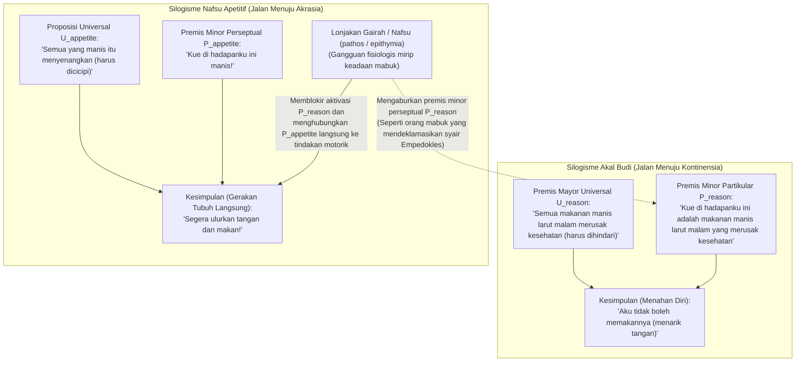
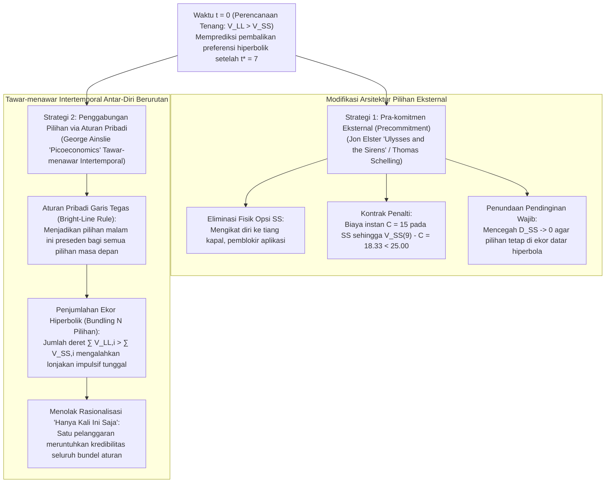

## 1. Pendahuluan: Ponsel Pintar Pukul 3 Pagi dan *Medea* Karya Euripides — Mendefinisikan Akrasia (ἀκρασία)

Besok pagi pukul 08.00 Anda memiliki presentasi atau ujian yang sangat menentukan. Anda tahu lebih baik daripada siapa pun bahwa jika Anda tidak segera tidur sekarang, kinerja kognitif Anda besok akan rusak parah. Namun pada pukul 03.00 dini hari, ibu jari Anda masih terus menggulir layar ponsel pintar tanpa henti. Atau bayangkan seorang pasien yang dengan tulus menyetujui peringatan dokter bahwa kesehatan jantung adalah prioritas utamanya, tetapi secara sengaja meraih makanan penutup berkalori tinggi di tengah malam.

Para filsuf Yunani Kuno menamai fenomena universal ini <strong>akrasia (ἀκρασία)</strong> — berasal dari awalan privatif $\alpha$- ("tanpa") dan $\kappa\rho\acute{\alpha}\tau\omicron\varsigma$ (*kratos*, "kekuasaan, kendali, atau penguasaan") — yang secara harfiah berarti <strong>"kurangnya penguasaan diri"</strong> atau <strong>"inkontinensia"</strong> (bahasa Latin *incontinentia*, dan dalam filsafat modern diterjemahkan sebagai <strong>"kelemahan kehendak / weakness of will"</strong>). Dalam tragedi *Medea* karya Euripides (431 SM, baris 1078–1080) dan *Metamorphoses* karya Ovidius (7.20–21), keretakan batin ini memperoleh rumusan abadi:

> <strong>"Video meliora proboque, deteriora sequor."</strong>
> ("Aku melihat yang lebih baik dan menyetujuinya, namun aku mengikuti yang lebih buruk.")

Dalam filsafat tindakan (philosophy of action) kontemporer, suatu tindakan $y$ yang dilakukan oleh agen $S$ pada waktu $t$ disebut <strong>akratik secara ketat (sinkronis)</strong> jika dan hanya jika tiga syarat terpenuhi secara bersamaan pada waktu $t$:

1. <strong>Intensionalitas dan Kebebasan:</strong> $S$ melakukan $y$ secara sengaja tanpa paksaan fisik atau refleks bawah sadar, serta percaya bahwa tindakan alternatif $x$ terbuka dan berada dalam kuasanya pada waktu $t$.
2. <strong>Penilaian Terbaik "Setelah Mempertimbangkan Segalanya" (All-Things-Considered Judgment):</strong> Dengan memperhitungkan semua alasan relevan yang tersedia, $S$ secara sadar menilai pada waktu $t$ bahwa melakukan $x$ lebih baik daripada melakukan $y$ ($x \succ y$).
3. <strong>Pertentangan Sinkronis terhadap Penilaian:</strong> Meskipun memegang penilaian sadar $x \succ y$ pada waktu $t$, $S$ secara sengaja memilih dan mengeksekusi $y$ pada waktu $t$.

Mengapa akrasia ketat menjadi skandal filosofis? Karena baik psikologi awam maupun teori pilihan rasional (*preferensi terungkap / revealed preference*) mengasumsikan bahwa memilih $y$ secara sengaja di atas $x$ membuktikan bahwa agen menilai $y$ lebih tinggi pada saat pemilihan.

---

## 2. Intelektualisme Sokrates (*Protagoras*) dan Silogisme Praktis Aristoteles

### 2.1 Seni Pengukuran Sokrates dan Ilusi Perspektif Temporal

Dalam dialog Plato *Protagoras* (352a–358d), Sokrates membantah pandangan orang banyak (οἱ πολλοί) bahwa pengetahuan (ἐπιστήμη) sering diseret-seret oleh nafsu dan kenikmatan "layaknya seorang budak (ἀνδράποδον)". Menurut <strong>Intelektualisme Sokrates</strong>, pengetahuan sejati bersifat memerintah secara mutlak, sehingga <strong>"tidak seorang pun berbuat salah atau jahat secara sukarela" (οὐδεὶς ἑκὼν ἁμαρτάνει)</strong>.

Lalu mengapa manusia terus-menerus mengorbankan <strong>kebaikan masa depan yang lebih besar (LL: Larger-Later)</strong> demi <strong>kenikmatan sesaat yang lebih kecil (SS: Smaller-Sooner)</strong>? Sokrates mendiagnosis adanya <strong>ilusi optik perspektif temporal</strong>: sebagaimana kedekatan spasial membuat benda tampak lebih besar daripada ukuran aslinya, kedekatan waktu membuat kenikmatan instan tampak raksasa dibandingkan rasa sakit atau imbalan di masa depan yang jauh. Pada detik tindakan $t$, penilaian evaluatif agen itu sendiri berbalik ($y \succ x$). Karena itu, penyelamat hidup kita bukanlah gertakan kemauan semata, melainkan ilmu eksakta: <strong>"seni pengukuran" (μετρητικὴ τέχνη)</strong>.

### 2.2 Jiwa Tripartit Plato dan *Etika Nikomakea* Buku VII Karya Aristoteles

Dalam *Republik* (Buku IV, 436a–441c), Plato melampaui monisme Sokrates melalui <strong>Prinsip Oposisi</strong> dan membagi jiwa menjadi tiga bagian: <strong>bagian rasional (λογιστικόν)</strong>, <strong>bagian bersemangat/emosi mulia (θυμοειδές)</strong>, dan <strong>bagian nafsu/apetitif (ἐπιθυμητικόν)</strong> — yang diilustrasikan lewat kisah <strong>Leontius</strong>, yang mengutuk matanya sendiri sambil membukanya paksa untuk menatap mayat-mayat tempat eksekusi.

Dalam *Etika Nikomakea* (Buku VII, 1145a–1152a), Aristoteles memetakan empat tipe karakter moral:

| Tipe Karakter (Yunani) | Istilah Indonesia / Inggris | Penilaian Rasional (Logos) | Arah Nafsu / Apetit | Konflik Batin | Tindakan Akhir & Afek Setelahnya |
| :--- | :--- | :--- | :--- | :--- | :--- |
| <strong>ἀρετή / σωφροσύνη</strong> | <strong>Kebajikan / Pengendalian Diri</strong> (Temperance) | Benar (memahami kebaikan) | Selaras sepenuhnya dengan akal | <strong>Tidak ada</strong> | Melakukan tindakan mulia dengan gembira |
| <strong>ἐγκράτεια</strong> | <strong>Kontinensia / Penguasaan Diri</strong> | Benar (memahami kebaikan) | Menarik ke kenikmatan berlebih | <strong>Hebat</strong> | Akal mengalahkan nafsu; bertindak benar |
| <strong>ἀκρασία</strong> | <strong>Inkontinensia / Akrasia</strong> | Benar (memahami kebaikan) | Menarik ke kenikmatan berlebih | <strong>Hebat</strong> | Menyerah pada nafsu; <strong>menyesal mendalam (μεταμέλεια)</strong> |
| <strong>κακία / ἀκολασία</strong> | <strong>Keburukan / Pengumbaran</strong> (Vice) | Rusak (kenikmatan jadi prinsip) | Menarik ke kenikmatan berlebih | <strong>Tidak ada</strong> | Memilih keburukan secara sengaja (προαίρεσις); <strong>tanpa sesal</strong> |

Aristoteles membedakan antara <strong>kepemilikan disposisional (ἔχειν)</strong> atas pengetahuan dan <strong>pelaksanaan aktifnya (ἐνεργεῖν)</strong> di dalam <strong>Silogisme Praktis</strong>:

Agen akratik tetap memegang premis mayor universal $U_{\text{reason}}$, tetapi lonjakan nafsu (πάθος) mengaburkan premis minor perseptual $P_{\text{reason}}$ sembari menyalakan $P_{\text{appetite}}$ ("Ini manis!"). Kalaupun ia mengucapkan kalimat moral saat makan, ia <strong>"bagaikan orang mabuk yang mendeklamasikan syair-syair Empedokles"</strong> (1147a18–24).

---

## 3. Penilaian Bersyarat Davidson dan Teori Resolusi Holton

### 3.1 Donald Davidson (1970): Trias yang Tidak Konsisten

Dalam *"How is Weakness of the Will Possible?"* (1970), <strong>Donald Davidson</strong> merumuskan tiga prinsip yang tampak saling bertentangan (<strong>P1</strong>: lebih menginginkan $x$ daripada $y$ berarti melakukan $x$ secara sengaja; <strong>P2</strong>: menilai $x$ lebih baik daripada $y$ berarti lebih menginginkan $x$; <strong>P3</strong>: tindakan inkontinen benar-benar ada).

Dengan menganalogikan logika konfirmasi probabilistik Carl Hempel, Davidson membedakan <strong>penilaian bersyarat (*prima facie*)</strong> dari <strong>penilaian tanpa syarat (*all-out*)</strong>:
1. <strong>Penilaian "setelah mempertimbangkan segalanya" (ATC)</strong> dalam P3 secara logis tetap merupakan penilaian bersyarat relatif terhadap totalitas alasan yang tersedia $\mathcal{E} = \{r_1, r_2, \dots, r_n\}$:
   $$\text{pf}(x \succ y,\; \mathcal{E})$$
2. Sebaliknya, niat akhir yang mengatur P1 dan P2 adalah <strong>penilaian tanpa syarat (*sans phrase*)</strong>:
   $$y \succ x$$

Memegang $\text{pf}(x \succ y,\; \mathcal{E})$ dan $y \succ x$ secara bersamaan tidak mengandung kontradiksi logika formal. Namun agen akratik melanggar <strong>Prinsip Kontinensia (Principle of Continence)</strong> karena melalui <strong>Partisi Mental (Mental Partitioning)</strong>, keinginan parsial $r_2$ bekerja sebagai *"penyebab mental yang bukan merupakan alasan"*.

### 3.2 Gary Watson (1977) dan Richard Holton (1999)

Sementara <strong>Gary Watson</strong> menolak P2 dengan memisahkan <strong>Sistem Penilaian ($\text{Val}(x) > \text{Val}(y)$)</strong> dari <strong>Sistem Motivasi ($\text{Mot}(y) > \text{Mot}(x)$)</strong>, <strong>Richard Holton</strong> (1999) menunjukkan bahwa <strong>kelemahan kehendak</strong> sehari-hari adalah kegagalan diakronis: <strong>peninjauan ulang (reconsideration) yang terlalu mudah atas suatu resolusi sebelumnya</strong>, yang menggabungkan niat tingkat pertama dengan meta-niat untuk *tidak membuka kembali deliberasi* saat godaan datang.

---

## 4. Diskonto Hiperbolik dalam Ekonomi Perilaku dan Strategi Pengendalian Diri

### 4.1 Diskonto Eksponensial (Samuelson) vs. Hiperbolik (Ainslie)

Sementara model <strong>diskonto eksponensial</strong> Paul Samuelson (1937), $U_{\text{exp}}(A, D) = A \cdot e^{-rD}$, menjamin <strong>konsistensi waktu</strong> yang ketat, <strong>George Ainslie</strong> (1975, *Picoeconomics*, 1992) membuktikan bahwa manusia dan hewan mendiskonto imbalan masa depan menurut <strong>fungsi diskonto hiperbolik</strong> yang berbanding terbalik dengan penundaan $D = T - t$:

$$V(D) = \frac{A}{1 + k D} = \frac{A}{1 + k(T - t)}, \qquad \rho(D) = -\frac{V'(D)}{V(D)} = \frac{k}{1 + k D}$$

Dengan parameter impulsivitas $k = 0.5$, godaan segera $A_{\text{SS}} = 50$ pada $t_{\text{SS}} = 10$, dan imbalan lebih besar $A_{\text{LL}} = 100$ pada $t_{\text{LL}} = 15$, <strong>titik pembalikan preferensi $t^*$</strong> di mana $V_{\text{SS}}(t^*) = V_{\text{LL}}(t^*)$ adalah:

$$\frac{50}{1 + 0.5(10 - t^*)} = \frac{100}{1 + 0.5(15 - t^*)} \implies 8.5 - 0.5 t^* = 12 - t^* \implies \mathbf{t^* = 7.0}$$

| Waktu $t$ | Penundaan $D_{\text{SS}}$ | Penundaan $D_{\text{LL}}$ | Nilai Hiperbolik $V_{\text{SS}}(t)$ | Nilai Hiperbolik $V_{\text{LL}}(t)$ | Pilihan Dominan & Kondisi Psikologis |
| :---: | :---: | :---: | :---: | :---: | :--- |
| $t = 0$ | $10$ | $15$ | $8.33$ | <strong>$11.76$</strong> | <strong>LL Dominan:</strong> Perencanaan tenang & resolusi ($\text{LL} \succ \text{SS}$) |
| <strong>$t^* = 7$</strong> | <strong>$3$</strong> | <strong>$8$</strong> | <strong>$20.00$</strong> | <strong>$20.00$</strong> | <strong>Titik Persilangan:</strong> Konflik batin maksimum |
| $t = 9$ | $1$ | $6$ | <strong>$33.33$</strong> | $25.00$ | <strong>SS Dominan (Pembalikan):</strong> Lonjakan hiperbolik & akrasia |
| $t = 10$ | $0$ | $5$ | <strong>$50.00$</strong> | $28.57$ | <strong>Puncak SS:</strong> Pemuasan instan diikuti penyesalan |

Neuroekonomi (McClure et al., *Science*, 2004) lewat fMRI mengonfirmasi bahwa hal ini mencerminkan kompetisi antara <strong>sistem dopamin mesolimbik $\beta$</strong> (striatum ventral, aktif saat $D \to 0$) dan <strong>sistem eksekutif frontoparietal $\delta$</strong> (dlPFC).

### 4.2 Pra-komitmen (*Ulysses dan Siren*) dan Penggabungan Pilihan (Bundling)

1. <strong>Pra-komitmen Jon Elster (*Ulysses and the Sirens*, 1979):</strong> Seperti <strong>Ulysses (Odysseus)</strong> yang meminta dirinya diikat ke tiang kapal sebelum mendengar nyanyian Siren, diri rasional $S_{t_0}$ mengikat diri impulsif masa depan $S_{t_1}$ dengan menghilangkan opsi SS secara fisik atau mengenakan penalti instan $C = 15$ ($33.33 - 15 = 18.33 < 25.00$).
2. <strong>Penggabungan Pilihan (Bundling) George Ainslie:</strong> Karena kurva hiperbolik memiliki ekor jangka panjang yang jauh lebih tebal daripada kurva eksponensial, menetapkan <strong>Aturan Pribadi Garis Tegas (Bright-Line Rule)</strong> yang menggabungkan $N+1 = 5$ pilihan berurutan berjarak $\tau = 10$ membalikkan ketidaksamaan pada $t = 9$:
   $$V_{\text{bundle}}^{\text{LL}}(9) = \sum_{i=0}^{4} \frac{100}{1 + 0.5(6 + 10i)} \approx \mathbf{52.68} > V_{\text{bundle}}^{\text{SS}}(9) = \sum_{i=0}^{4} \frac{50}{1 + 0.5(1 + 10i)} \approx \mathbf{50.73}$$
   Ini menjelaskan secara matematis mengapa rasionalisasi <strong>"Hanya kali ini saja"</strong> sangat mematikan: alasan itu memisahkan pilihan malam ini dari rangkaian masa depan dan menghancurkan kredibilitas aturan. Kebijaksanaan praktis sejati (φρόνησις) terletak pada perancangan arsitektur pra-komitmen dan aturan pribadi saat kita berada dalam pikiran tenang.
