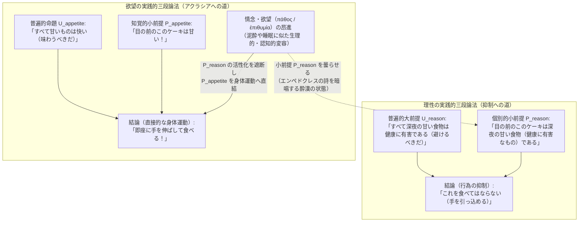
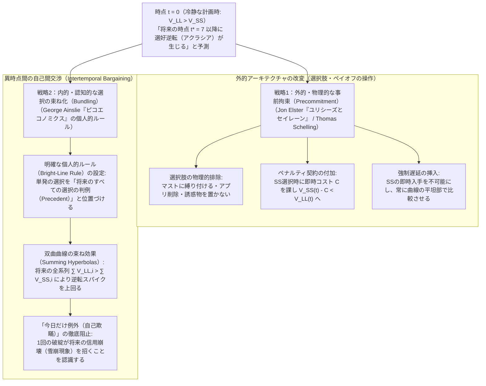

## 1. 序論：午前3時のスマートフォンとエウリピデス『メディア』の嘆き——アクラシア（ἀκρασία）の定義と哲学的衝撃

明日の朝には重要なプレゼンテーションや試験が控えており、今すぐ眠らなければ翌日のパフォーマンスが決定的に損なわれることを誰よりも自分自身が熟知しているにもかかわらず、午前3時を過ぎてもスマートフォンの画面をスクロールし続けてしまう。あるいは、医師から厳格な食事制限を言い渡され、自分でも「健康こそが最優先の価値である」と心から納得して決意したはずなのに、目の前に差し出された高カロリーの深夜食や甘い菓子に手を伸ばしてしまう。さらには、自分のキャリアにとって最も重要な執筆や研究課題を先延ばし（プロクラスティネーション）にし、どうでもよい雑務や動画視聴に時間を費やした末に、深い自己嫌悪と後悔に苛まれる——。

このような経験は、特別な道徳的欠陥を持つ人間にだけ生じる例外的な病理ではなく、理性を持つ人間であれば誰もが日常的に直面している極めて普遍的な現象である。しかし、このありふれた現象をひとたび厳密な哲学的・論理的レンズの下に置いて観察すると、そこには人間の「合理性（Rationality）」「行為（Action）」「自由意志（Free Will）」の根幹を揺るがす巨大なパラドックスが潜んでいることがわかる。

古代ギリシアの哲学者たちは、この現象を<strong>アクラシア（$\dot{\alpha}\kappa\rho\alpha\sigma\acute{\iota}\alpha$ / Akrasia）</strong>と呼んだ。語源的には、否定の接頭辞 $\alpha$- と「力・支配・統御」を意味する $\kappa\rho\acute{\alpha}\tau\omicron\varsigma$（kratos）が結合した言葉であり、文字通りには<strong>「自己統御の欠如」「無抑制」</strong>、近代以降の哲学用語としては<strong>「意志の弱さ（Weakness of Will）」</strong>と訳される（ラテン語では *incontinentia*）。

文学の歴史において、このアクラシアの苦悩を最も鮮烈に言語化したのは、紀元前431年に上演されたエウリピデスの悲劇『メディア（Medea）』第1078〜1080行における、主人公メディアの独白である。夫イアソンへの復讐のために自らの子どもたちを手にかけようとする直前、メディアは次のように嘆く。

> 「私は自分がこれからいかに恐ろしい悪を行おうとしているかをよく理解している（$\kappa\alpha\grave{\iota}\;\mu\alpha\nu\theta\acute{\alpha}\nu\omega\;\mu\grave{\epsilon}\nu\;\omicron\tilde{\iota}\alpha\;\delta\rho\tilde{\alpha}\nu\;\mu\varepsilon\lambda\lambda\omega\;\kappa\alpha\kappa\acute{\alpha}$）。だが、私の熟慮（$\beta\omicron\upsilon\lambda\epsilon\upsilon\mu\acute{\alpha}\tau\omega\nu$）よりも激情（$\theta\upsilon\mu\acute{\omicron}\varsigma$）のほうが強いのだ。それこそが人間に最大の災いをもたらすものであるのに。」

また、ローマの詩人オウィディウスも『変身物語（Metamorphoses）』第7巻において、メディアの口を借りて後世に広く知られることになる格言を残している。

> <strong>"Video meliora proboque, deteriora sequor."</strong>
> （私はより善いものを見てそれを是認しながら、より悪いものに従ってしまう。）

行為の哲学（Philosophy of Action）において、ある行為主体 $S$ が時点 $t$ において行う行為 $y$ が厳密な意味で<strong>「アクラシア的（akratic / incontinent）」</strong>であるとは、以下の3つの条件が同時に成立している状態を指す。

1. <strong>意図性と自由（Intentionality and Freedom）</strong>：主体 $S$ は、外部からの物理的強制や反射的痙攣によってではなく、自発的かつ意図的（intentionally）に行為 $y$ を遂行しており、かつ代替的な行為 $x$ を行うことも可能であると信じている。
2. <strong>最善判断の保持（Conscious Better Judgment）</strong>：主体 $S$ は、利用可能なすべての事情を考慮に入れた上で（all things considered）、時点 $t$ において行為 $y$ を行うよりも行為 $x$ を行うほうがより善い（$x \succ y$）と明晰に判断している。
3. <strong>共時的背反（Synchronic Conflict）</strong>：それにもかかわらず、主体 $S$ はまさにその判断を保持している時点 $t$ において、自らの最善判断に反して行為 $y$ を選択し、実行する。

なぜこれが哲学にとって深刻なスキャンダルとなるのか。それは、私たちが他者や自分の行動を理解し説明する際に用いている「素朴心理学（Folk Psychology）」や標準的な「合理的選択理論（Rational Choice Theory）」が、<strong>「人が意図的にある行為を選ぶということは、その人にとってその行為が（他の選択肢よりも）行うべきより強い理由・価値を持っていると評価したことの表れである」</strong>という大前提に立脚しているからである。もし人が「$x$ のほうが絶対に善い」と本気で判断しながら、同時に何の物理的強制もなしに自発的に $y$ を行いうるのだとすれば、「判断（評価）」「欲求（動機）」「意図」「行為」を結ぶ合理的な因果の鎖はどこで断ち切られてしまったのか。以下では、古代ギリシアのソクラテス、プラトン、アリストテレスから、20世紀分析哲学のドナルド・デイヴィドソン、ゲイリー・ワトソン、リチャード・ホルトン、さらには現代の行動経済学・神経経済学における「双曲割引（Hyperbolic Discounting）」と「事前拘束（Precommitment）」に至る2400年の知的格闘を徹底的に辿っていく。

---

## 2. ソクラテスの主知主義（『プロタゴラス』352a–358d）——なぜ「誰も進んで悪を行わない」のか？計量術と時間的遠近法の錯覚

アクラシアの歴史において最初の、そして最も挑発的なテーゼを打ち立てたのはソクラテスである。プラトンの初期対話篇『プロタゴラス（Protagoras）』（352a–358d）において、ソクラテスは世間の人々（$\omicron\ἱ\;\pi\omicron\lambda\lambda\omicron\acute{\iota}$ / 大衆）が当然視している常識に真っ向から挑戦する。

世間の人々は、知識（$\dot{\epsilon}\pi\iota\sigma\tau\acute{\eta}\mu\eta$）というものは人間の中でしばしば無力であり、激情（$\theta\upsilon\mu\acute{\omicron}\varsigma$）や快楽（$\dot{\eta}\delta\omicron\nu\acute{\eta}$）、苦痛（$\lambda\upsilon\pi\eta$）、愛欲（$\varepsilon\rho\omega\varsigma$）、恐怖（$\phi\acute{\omicron}\beta\omicron\varsigma$）といった非理性的力によって、まるで<strong>「奴隷（$\dot{\alpha}\nu\delta\rho\acute{\alpha}\pi\omicron\delta\omicron\nu$）のように引きずり回される」</strong>と考えている。これに対してソクラテスは、知識こそが人間を統治する最強の力（$\kappa\alpha\lambda\acute{\omicron}\nu\;\tau\epsilon\;\kappa\alpha\grave{\iota}\;\alpha\rho\chi\iota\kappa\acute{\omicron}\nu$）であり、<strong>「何が最善であるかを真に知っている者が、他の何かに打ち負かされてそれと異なる行動をとることはありえない」</strong>と断言する。これこそが哲学史上名高い<strong>「ソクラテスの主知主義（Socratic Intellectualism）」</strong>であり、<strong>「誰も進んで（知りながら自発的に）悪を行わない（$\omicron\dot{\upsilon}\delta\epsilon\grave{\iota}\varsigma\;\dot{\varepsilon}\kappa\grave{\omega}\nu\;\dot{\alpha}\mu\alpha\rho\tau\alpha\nu\epsilon\iota$ / No one errs willingly）」</strong>というソクラテス的パラドックスの核心である。

では、ソクラテスは私たちが日常的に目撃する「快楽に負けて悪を行う（$\tau\grave{\omicron}\;\dot{\upsilon}\pi\grave{\omicron}\;\tau\tilde{\omega}\nu\;\dot{\eta}\delta\omicron\nu\tilde{\omega}\nu\;\dot{\eta}\tau\tau\tilde{\alpha}\sigma\theta\alpha\iota$）」という現象をどのように説明するのか。彼の論証は驚くほど精緻であり、20世紀後半の行動経済学を2400年前に先取りする洞察を含んでいる。

ソクラテスはまず、議論の前提として（大衆が暗黙のうちに受け入れている）通約的な価値尺度を導入する。すなわち、ある行為が「善い」とされるのはそれがもたらす長期的・総合的な快楽（幸福・利益）が苦痛を上回るからであり、ある行為が「悪い」とされるのはそれが最終的に快楽を上回る大きな苦痛や損失（病気、貧困、不名誉など）をもたらすからであるとする。

もし「善い＝総合的な快（プラスの価値）」「悪い＝総合的な苦（マイナスの価値）」という単一の価値尺度が成り立つならば、「ある人が、行為 $y$ は悪いと知りながら、快楽に負けて $y$ を行う」という大衆の言い回しを、「善い／悪い」あるいは「快／苦」という語に統一して書き換えてみると、即座に論理的不条理が露呈する。

* <strong>書き換え1（「善」で統一）</strong>：「ある人は、行為 $y$ が（総合的に見て）悪いと知りながら、行為 $y$ の中にある『善さ』に打ち負かされて $y$ を行う。」
* <strong>書き換え2（「快・苦」で統一）</strong>：「ある人は、行為 $y$ が将来もたらす巨大な苦痛を知りながら、今目の前にある小さな快楽に打ち負かされて $y$ を行う。」

ここでソクラテスは問う。行為 $y$ の中にある快楽が、それがもたらす苦痛に「打ち勝つ」とはどういうことか。それは、天秤にかけたときに、快楽のほうが苦痛よりも<strong>より大きく、より多い</strong>と判断された場合にしか起こりえないはずである。逆に、もし本当に「行為 $y$ は総合的に見て悪い（＝得られる快楽よりも失う価値・苦痛のほうがはるかに大きい）」と今この瞬間に認識しているのであれば、それは「より小さな善（快）のために、より大きな善（快）を自ら進んで捨てる」ことを意味する。しかし、同じ価値尺度の上で「より少ないもの」を「より多いもの」より選ぶ人間など存在しない。

ならば、なぜ人は客観的には「小さな目先の快楽（SS: Smaller-Sooner）」のために「大きな将来の利益（LL: Larger-Later）」を犠牲にしてしまうのか。ソクラテスの答えは明快である。それは<strong>「時間的距離による錯覚（The Illusion of Temporal Perspective）」</strong>である。

> 「視覚（$\tau\tilde{\eta}\varsigma\;\omicron\psi\epsilon\omega\varsigma$）において、同じ大きさのものでも、近くから見れば大きく見え、遠くから見れば小さく見えるではないか。厚みや数についても同様であるし、同じ大きさの声でも近くで聞けば大きく、遠くで聞けば小さく聞こえる。……もし我々の幸福が、長いものを選択し短いものを避けることにかかっているとしたら、我々の生を救うもの（$\sigma\omega\tau\eta\rho\acute{\iota}\alpha\;\tau\omicron\tilde{\upsilon}\;\beta\acute{\iota}\omicron\upsilon$）は何であっただろうか。それは、視覚という錯覚を生む力ではなく、<strong>計量術（$\mu\epsilon\tau\rho\eta\tau\iota\kappa\grave{\eta}\;\tau\varepsilon\chi\nu\eta$ / Art of Measurement）</strong>ではないか。」（『プロタゴラス』356c–e）

ソクラテスによれば、快楽と苦痛の評価においても、空間的な遠近法とまったく同じ錯覚が生じる。すなわち、<strong>時間的に目の前に迫っている快楽（今夜の夜更かし、目の前の甘い菓子）は、その至近性（proximity）ゆえに主観的視野の中で巨大に膨れ上がって見え、逆に時間的に遠く離れた未来の苦痛や報酬（明日の疲労、数年後の健康被害）は、遠近法のゆがみによって豆粒のように小さく見えてしまう</strong>のである。

したがって、ソクラテスにとって「意志の弱さ（アクラシア）」と呼ばれる現象の正体は、判断と欲望の間の共時的な分裂ではない。行為のまさにその瞬間（時点 $t$）において、主体は時間的遠近法の錯覚に陥り、「今この瞬間は $y$ をすることのほうが $x$ をするよりも善い（価値が大きい）」へと<strong>認知的判断そのものを誤って書き換えてしまっている</strong>のである。ゆえに、「快楽に負ける」とは実は「最大の無知（$\dot{\alpha}\mu\alpha\theta\acute{\iota}\alpha\;\dot{\eta}\;\mu\epsilon\gamma\acute{\iota}\sigma\tau\eta$）」にほかならず、それを克服する道は「歯を食いしばって意志の力を振り絞ること」ではなく、時間的距離による価値の歪みを正確に補正する<strong>「計量の技術・知識（$\mu\epsilon\tau\rho\eta\tau\iota\kappa\grave{\eta}\;\tau\varepsilon\chi\nu\eta$）」</strong>を獲得することにある。

---

## 3. プラトン『国家』第4巻の魂の三分説と、アリストテレス『ニコマコス倫理学』第7巻の実践的三段論法

### 3.1 プラトンによるソクラテス的一元論の超克：魂の三分説とレオンティオスの葛藤

ソクラテスの主知主義は驚異的な論理的一貫性を備えていたが、「人は本当に自らの最善判断を保持したまま、それに逆らう欲求に引きずられることはないのか？」という経験的実感との乖離は依然として残された。中期対話篇『国家（Republic）』第4巻（436a–441c）において、プラトンは師ソクラテスの魂の一元論（すべての欲求は「善」への希求に還元されるという見解）を決定的に乗り越え、<strong>「魂の三分説（Tripartite Theory of the Soul）」</strong>を提示する。

プラトンが依拠するのは<strong>「対立律（Principle of Opposites）」</strong>である。「同じものが、自己の同じ部分において、同じ対象に対して、同時に反対のことを行ったり被ったりすることはない」（436b）。もし一人の人間の内部で、ある対象へと向かう牽引力と、同じ対象から引き戻そうとする拒絶力が<strong>同時に（共時的に）</strong>衝突しているならば、その魂は単一の均質な計算機ではなく、互いに独立した複数の動機づけの源泉（部分）から構成されていなければならない。こうしてプラトンは魂を以下の3つの部分に区分する。

1. <strong>理性的部分（$\lambda\omicron\gamma\iota\sigma\tau\iota\kappa\acute{\omicron}\nu$ / Logistikon）</strong>：魂全体の長期的利益と善を計算し、推論し、統治する部分。
2. <strong>気概的部分（$\theta\upsilon\mu\omicron\epsilon\iota\delta\varepsilon\varsigma$ / Thymoeides）</strong>：名誉心、自尊心、義憤、怒りを司る部分。堕落していない限り、本来は理性の自然な同盟者（味方）として欲望を抑え込む働きをする。
3. <strong>欲望的部分（$\dot{\epsilon}\pi\iota\theta\upsilon\mu\eta\tau\iota\kappa\acute{\omicron}\nu$ / Epithymetikon）</strong>：食欲、渇き、性欲、金銭欲、感覚的刺激への渇望など、理性的な善悪の計算とは無関係に、対象そのものへと盲目的に向かう非理性的な動機の束。

この内面的な分裂とアクラシアの生々しい実例として、プラトンは『国家』第4巻（439e–440a）で<strong>「アグライオンの子レオンティオス（Leontius）」</strong>の有名な逸話を紹介する。

> レオンティオスがあるときピライエウス港からアテナイの北壁の外側を通って上ってくると、処刑人の足元に処刑された死体がいくつも横たわっているのに気づいた。彼はそれを見たいという強い欲望（$\dot{\epsilon}\pi\iota\theta\upsilon\mu\acute{\iota}\alpha$）に駆られたが、同時に嫌悪と憤りを覚えて顔を背けた。しばらくの間、彼は自分の内面で格闘し、頭を覆い隠していたが、ついに欲望に打ち負かされると、自分の両目を指で無理やり大きくこじ開け、死体のもとへ駆け寄ってこう叫んだ——「さあ見ろ、忌まわしい目玉どもめ、この美しい見世物を存分に堪能するがよい！」

レオンティオスの事例が画期的である理由は、彼が死体を見ているまさにその瞬間においても、彼の理性と気概は「こんなものを見るのは恥ずべき悪である」という判断を決して失っておらず、自分の目玉を呪いながら（激しい自己嫌悪と怒りを伴いながら）欲望に引きずられている点にある。これによりプラトンは、<strong>「善についての評価的信念（判断）」とは独立に作動する「非理性的な動機づけの力」</strong>が存在することを証明し、共時的アクラシアの心理学的可能性を開いたのである。

### 3.2 アリストテレス『ニコマコス倫理学』第7巻：道徳的性格の4類型と実践的三段論法

この問題を古代哲学において最も体系的に分析したのが、アリストテレスの『ニコマコス倫理学（Nicomachean Ethics）』第7巻（第1章〜第10章、1145a–1152a）である。アリストテレスの方法論は、ソクラテスのように日常的経験（現象）を単なる錯覚として切り捨てるのではなく、<strong>「現象を救う（$\tau\grave{\alpha}\;\phi\alpha\iota\nu\acute{\omicron}\mu\epsilon\nu\alpha\;\sigma\dot{\omega}\zeta\epsilon\iota\nu$）」</strong>こと、すなわちソクラテスが指摘した「知識の尊厳」と、私たちが日々経験する「情念による敗北」の両方を整合的に説明する精緻な理論を構築することにあった。

まずアリストテレスは、理性的判断（$\lambda\acute{\omicron}\gamma\omicron\varsigma$）と欲望（$\omicron\rho\epsilon\xi\iota\varsigma$）、および実際の行為の間の関係に基づいて、人間の性格・状態を以下の<strong>4つの類型</strong>へと鮮やかに整理する。

| 性格類型（ギリシア語） | 日本語訳・英語訳 | 理性的判断（ロゴス） | 欲望・情念の方向 | 内的葛藤の有無 | 最終的な行為と事後の感情 |
| :--- | :--- | :--- | :--- | :--- | :--- |
| <strong>$\dot{\alpha}\rho\epsilon\tau\acute{\eta}$ / $\sigma\omega\phi\rho\omicron\sigma\upsilon\nu\eta$</strong> | <strong>徳 / 節制</strong> (Virtue / Temperance) | 正しい（善を把握） | 理性完全に調和（善を喜ぶ） | <strong>なし</strong>（調和） | 善き行為を喜びとともに遂行する |
| <strong>$\dot{\epsilon}\gamma\kappa\rho\acute{\alpha}\tau\epsilon\iota\alpha$</strong> | <strong>抑制 / 自己制御</strong> (Continence / Self-Control) | 正しい（善を把握） | 悪・過剰な快楽へ向かう | <strong>あり</strong>（激しい葛藤） | 理性が欲望を抑え込み、正しい行為を遂行する |
| <strong>$\dot{\alpha}\kappa\rho\alpha\sigma\acute{\iota}\alpha$</strong> | <strong>無抑制 / 意志の弱さ</strong> (Incontinence / Akrasia) | 正しい（善を把握） | 悪・過剰な快楽へ向かう | <strong>あり</strong>（激しい葛藤） | 欲望に負けて悪い行為に走るが、<strong>事後に深く後悔する</strong> |
| <strong>$\kappa\alpha\kappa\acute{\iota}\alpha$ / $\dot{\alpha}\kappa\omicron\lambda\alpha\sigma\acute{\iota}\alpha$</strong> | <strong>悪徳 / 放埒</strong> (Vice / Intemperance) | 誤っている（快楽の追求を善と誤認） | 悪・過剰な快楽へ向かう | <strong>なし</strong>（歪んだ一致） | 意図的選択（$\pi\rho\omicron\alpha\acute{\iota}\rho\epsilon\sigma\iota\varsigma$）として悪を行い、<strong>後悔しない</strong> |

ここでアリストテレスが強調する決定的な区別は、<strong>「無抑制な人（$\dot{\alpha}\kappa\rho\alpha\tau\acute{\eta}\varsigma$）」と「放埒な人（$\dot{\alpha}\kappa\acute{\omicron}\lambda\alpha\sigma\tau\omicron\varsigma$ / 悪徳の人）」の違い</strong>である。放埒な人は、「目先の快楽を徹底的に追求することこそが人生の最善である」という歪んだ原則そのものを自らの理性的選択（$\pi\rho\omicron\alpha\acute{\iota}\rho\epsilon\sigma\iota\varsigma$）として採用しているため、悪を行う際に内的葛藤を持たず、したがって後悔もしない（ゆえに治癒不可能である）。これに対し、アクラシアの人は「正しい理性的原則（何が善であるか）」を失っていないからこそ、情念が去った後に激しい後悔（$\mu\epsilon\tau\alpha\mu\varepsilon\lambda\epsilon\iota\alpha$）を覚える。アリストテレスはさらにアクラシアを2つの下位類型に分類する（1150b19–28）。

* <strong>弱さ（$\dot{\alpha}\sigma\theta\varepsilon\nu\epsilon\iota\alpha$ / Astheneia）</strong>：一度は理性的に熟慮（$\beta\omicron\upsilon\lambda\epsilon\upsilon\sigma\acute{\alpha}\mu\epsilon\nu\omicron\iota$）して「$x$ を行うべきだ」という結論に達したにもかかわらず、情念の圧力に耐えきれず、自らの熟慮の結果に踏みとどまれない（$\omicron\dot{\upsilon}\kappa\;\dot{\epsilon}\μ\μ\varepsilon\nu\omicron\upsilon\sigma\iota\nu$）タイプ。
* <strong>先走り・性急（$\pi\rho\omicron\pi\varepsilon\tau\epsilon\iota\alpha$ / Propeteia）</strong>：気質が激しく敏感すぎるために、知覚や想像力（$\phi\alpha\nu\tau\alpha\sigma\acute{\iota}\alpha$）が刺激された瞬間、理性的熟慮を働かせる前に情念に突き動かされて突発的に行動してしまうタイプ。

では、ソクラテスが問いかけた核心問題——「もし正しい知識を持っているのなら、なぜそれに反して行動できるのか？」——に対して、アリストテレスはどう答えるのか（『ニコマコス倫理学』第7巻第3章、1146b–1147b）。彼は<strong>「知識を持つ（知るの意）」ということの多義性</strong>と、<strong>「実践的三段論法（Practical Syllogism）」</strong>の構造を用いてこの謎を鮮やかに解剖する。

第一に、「知識を持っている」という状態には、(1) 知識を潜在的な能力・習慣として<strong>保持しているだけの状態（$\varepsilon\chi\epsilon\iota\nu$）</strong>と、(2) 今まさにその知識に意識を向けて<strong>現実的に働かせている状態（$\theta\epsilon\omega\rho\epsilon\tilde{\iota}\nu$ / $\dot{\epsilon}\nu\epsilon\rho\gamma\epsilon\tilde{\iota}\nu$）</strong>の2段階がある。さらに(1)の保持状態の中にも、眠っている人や狂乱している人、あるいは<strong>「泥酔している人（$\omicron\ἱ\;\mu\epsilon\theta\upsilon\omicron\nu\tau\epsilon\varsigma$）」</strong>のように、知識を所有してはいるが身体的・生理的撹乱によってそれを正常に機能させられない状態が存在する。

第二に、行為を導く実践的推論（実践的三段論法）は、<strong>普遍的前提（$\dot{\eta}\;\kappa\alpha\theta\acute{\omicron}\lambda\omicron\upsilon$ / 大前提）</strong>と、眼前の個別的状況に関する知覚的な<strong>個別的前提（$\dot{\eta}\;\kappa\alpha\theta'\;\varepsilon\kappa\alpha\sigma\tau\alpha$ / 小前提）</strong>の組み合わせによって成立する。今、甘い菓子を前にした人物の心の中に、2つの競合する実践的三段論法が存在するとしよう。

アリストテレスの洞察の白眉は以下の点にある。アクラシアに陥る人は、普遍的な大前提 $U_{\text{reason}}$（「深夜に甘いものを食べるのは健康に悪い」）を失っているわけではない。それどころか、食べながら口先では「あー、これは体に悪いんだけれどな」と語ることさえできる。しかし、強い欲望や情念（$\pi\acute{\alpha}\theta\omicron\varsigma$）が身体と魂を襲うと、ちょうどアルコールが脳を麻痺させるように、<strong>眼前の個別的対象を「健康に有害なもの（$P_{\text{reason}}$）」として生々しく知覚・活性化する回路が麻痺し、代わりに「これは甘い！（$P_{\text{appetite}}$）」という知覚が「甘いものは快い（$U_{\text{appetite}}$）」と直結して、自動的に身体運動（食べるという行為）を引き起こしてしまう</strong>のである。

このとき、アクラシアの人が口にする道徳的・理性的言葉は、その言葉本来の実践的意味を伴っていない。アリストテレスはこれを、哲学史上最も有名な比喩でこう表現した。

> 「情念のうちにある人々が知識の言葉を口にするとしても、それはちょうど<strong>泥酔した人々がエンペドクレスの自然学の詩句を暗唱しているようなもの（$\check{\omega}\sigma\pi\epsilon\rho\;\omicron\ἱ\;\mu\epsilon\theta\upsilon\omicron\nu\tau\epsilon\varsigma\;\tau\grave{\alpha}\;\Ἐ\mu\pi\epsilon\delta\omicron\kappa\lambda\varepsilon\omicron\upsilon\varsigma$）</strong>であり、あるいは舞台の上の俳優が台詞を喋っているようなものにすぎない。」（『ニコマコス倫理学』1147a18–24）

こうしてアリストテレスは、「厳密で完全な意味での活動的知識（普遍知と個別的知覚が結びついた実践的知恵 $\phi\rho\acute{\omicron}\nu\eta\sigma\iota\varsigma$）が情念に引きずり回されることはない」というソクラテスの洞察に一定の敬意を払いつつ、情念が実践的三段論法の<strong>個別的小前提（知覚的注意）を一時的に無力化する</strong>ことによってアクラシアが現実的に生じるメカニズムを見事に解き明かしたのである。

---

## 4. ドナルド・デイヴィドソンの記念碑的論文「意志の弱さはいかにして可能か」（1970年）——不整合な三命題と条件付き判断の論理

古代ギリシア以降、キリスト教神学（パウロの『ローマ人への手紙』第7章「私は自分の望む善を行わず、かえって望まない悪を行っている」やアウグスティヌスの「意志の分裂」）や近代哲学を経由して議論されてきたアクラシア問題は、1970年、現代分析哲学の巨人<strong>ドナルド・デイヴィドソン（Donald Davidson, 1917–2003）</strong>が発表した記念碑的論文<strong>「意志の弱さはいかにして可能か（How is Weakness of the Will Possible?）」</strong>（のちに『行為と出来事（Essays on Actions and Events）』1980年に収録）によって、劇的なルネサンスを迎えた。

デイヴィドソンはまず、アクラシアの問題を狭い道徳主義や特定の心理学的語彙（「情念」「獣的欲望」など）から解放し、極めて一般的かつ冷静な「意図的行為の理論」の枠組みの中で再定義した。彼によれば、冷酷な計算の上で道徳的悪を選ぶこともあれば、逆に（マーク・トウェインの『ハックルベリー・フィン』が逃亡奴隷ジムを密告すべきだという道徳的良心に逆らってジムを助けたように）自らの道徳的判断に反して「情に流されて」行動することもある。したがって、アクラシア（無抑制な行為）の本質は「道徳的善対肉体的快楽」の対立ではなく、<strong>「主体自身の最善判断（All-things-considered judgment）と意図的行為の間の論理的・因果的乖離」</strong>そのものにある。

デイヴィドソンは、私たちが人間の意図的行為と実践的推論について抱いている最も基本的で自明と思われる3つの前提を並べると、それらが互いに論理的に両立しない<strong>「不整合な三命題（Inconsistent Triad）」</strong>を形成してしまうことを鮮やかに示した。

### 4.1 デイヴィドソンの「不整合な三命題（P1, P2, P3）」

* <strong>命題 P1（欲求と意図的行為の結合原理）</strong>：
  もしある行為主体が、行為 $y$ を行うことよりも行為 $x$ を行うことをより強く欲しており（wants to do $x$ more than $y$）、かつ $x$ も $y$ も自由に行いうると信じているならば、その主体が $x$ か $y$ のいずれかを意図的に行う場合には、意図的に $x$ を行うであろう。
* <strong>命題 P2（評価的判断と欲求の結合原理）</strong>：
  もしある行為主体が、行為 $y$ を行うよりも行為 $x$ を行うほうがより善い（better to do $x$ than $y$）と判断するならば、その主体は $y$ を行うことよりも $x$ を行うことをより強く欲している。
* <strong>命題 P3（無抑制な行為の存在）</strong>：
  無抑制な行為（incontinent actions）が存在する。すなわち、行為主体が「すべての事情を考慮すれば、$y$ を行うよりも $x$ を行うほうがより善い」と判断していながら、意図的に $y$ を行うケースが実際に存在する。

一見して明らかなように、<strong>P1 と P2 が真であれば、必然的に $\neg\text{P3}$ が導かれる</strong>（主体が $x$ のほうが善いと判断するならば、P2 により $x$ をより強く欲し、P1 により意図的に行動する際には必ず $x$ を行うことになるため、意図的に $y$ を行うことは論理的に不可能となる）。

従来の哲学者の多くは、この矛盾を解消するために P1, P2, P3 のいずれか1つを放棄しようとしてきた。たとえばソクラテスやリチャード・ヘア（R. M. Hare）の指令主義は P3 を否定（あるいは骨抜きに）し、一方でプラトン的な分割心モデルや外在主義者は P2（「より善いと判断すること」と「より強く欲すること」の結びつき）を切り離そうとした。

しかしデイヴィドソンは、<strong>P1, P2, P3 の3つすべてが意図的行為に関する不可欠な真理を含んでおり、どれも放棄してはならない</strong>と主張する。なぜなら、デイヴィドソンの「行為の因果説（Causal Theory of Action）」においては、ある行為を「意図的に」行うとは、その行為が主体の持つ最も強い理由（信念と欲求のペア）によって適切に引き起こされることであり（P1）、また実践的文脈において「$x$ のほうが $y$ より善い」と最終的に判断することは、まさに $x$ に対してより強い実践的態度（欲求・意図）を持つことと同値である（P2）からである。

では、P1, P2, P3 のすべてを真として保持しながら、いかにして論理的矛盾を回避できるのか。ここでデイヴィドソンが繰り出した論理学的ウルトラCこそが、<strong>「条件付き（Prima Facie）の実践的判断」と「無条件（All-Out / Unconditional）の実践的判断」の峻別</strong>である。

### 4.2 条件付き判断 $\text{pf}(x \succ y, \mathcal{E})$ と無条件判断 $x \succ y$ の論理的峻別

デイヴィドソンは、科学哲学者のカール・ヘンペル（Carl Hempel）が定式化した<strong>「帰納的確率（確証度）の論理」</strong>との深い構造的アナロジーを導入する。

私たちが不確実な事象について確率的推論を行う場面を考えてみよう。
* 証拠 $e_1$（「空が暗い雲に覆われている」）に照らせば、仮説 $H$（「まもなく雨が降る」）の確率は高い：$\text{pr}(H, e_1) = 0.85$。
* しかし、そこへ新たな証拠 $e_2$（「気圧が急速に上昇しており、風向きが乾燥した北風に変わった」）が加わった全体証拠 $e_1 \land e_2$ に照らせば、仮説 $H$ の確率は低い：$\text{pr}(\neg H, e_1 \land e_2) = 0.90$。

ここで極めて重要な論理的事実は、<strong>$\text{pr}(H, e_1)$ と $\text{pr}(\neg H, e_1 \land e_2)$ の間にはいかなる論理的矛盾も存在しない</strong>ということである。なぜなら、確率演算子 $\text{pr}(\cdot, \cdot)$ は「特定の証拠集合に対して条件付けられた関係的言明（Relational / Conditional Statement）」だからである。したがって、証拠 $e_1$ が真であり、かつ $\text{pr}(H, e_1)$ が高いからといって、そこからモードゥス・ポネンス（分離規則）によって無条件の結論「ゆえに $H$ は高確率である」を直接切り離す（detachする）ことは論理的に許されない。

デイヴィドソンによれば、私たちが日常的に行う<strong>「実践的推論（Practical Reasoning）」の構造もこれと完全に同型である</strong>。私たちが様々な「行為の理由（Reasons for action）」を比較考量するとき、個々の理由が支持する価値判断は本質的に<strong>「一応の／条件付きの判断（Prima Facie Judgment, $\text{pf}$）」</strong>という論理形式をとる。

1. 理由 $r_1$（「明日の朝一番に重要な発表があり、睡眠不足は致命的である」）に照らせば、今すぐ眠ること（$x$）はスマートフォンを見続けること（$y$）よりも善い：
   $$\text{pf}(x \succ y,\; r_1)$$
2. 理由 $r_2$（「今見ている動画の続きが気になって仕方がなく、今すぐ見れば快楽が得られる」）に照らせば、スマートフォンを見続けること（$y$）は今すぐ眠ること（$x$）よりも善い：
   $$\text{pf}(y \succ x,\; r_2)$$
3. ここで、主体が現在認識し利用可能な<strong>すべての関連する理由・証拠の総体（Total available relevant reasons）を $\mathcal{E} = \{r_1, r_2, \dots, r_n\}$</strong> と置こう。主体が熟慮の末に下す<strong>「すべての事情を考慮した上での判断（All-Things-Considered Judgment, ATC判断）」</strong>とは、論理的にはどのような形式をしているか。デイヴィドソンは、ATC判断もまた「利用可能な理由の総体 $\mathcal{E}$ に照らせば」という条件節を伴う<strong>条件付き（関係的）判断</strong>であると看破する。
   $$\text{pf}(x \succ y,\; \mathcal{E})$$
4. これに対して、P1 および P2 において意図的行為へと直結する「最終的な実践的判断（＝意図 Intention）」は、いかなる条件節も持たない<strong>「無条件の全面的判断（Unconditional / All-Out Judgment）」</strong>である。
   $$y \succ x \quad (\text{sans phrase / 無条件に } y \text{ のほうが善い})$$

この論理的区別を導入した瞬間、不整合な三命題（P1, P2, P3）のパラドックスは氷解する。

* <strong>P1 と P2 が厳密に成り立つのは、「無条件の判断（All-out judgment）」についてである。</strong> すなわち、主体が無条件に $y \succ x$ と判断（意図）するならば、主体は $y$ をより強く欲しており（P2）、意図的に行動する際には必ず $y$ を行う（P1）。
* <strong>一方、P3 においてアクラシアの主体が保持している「最善判断」とは、条件付きのATC判断 $\text{pf}(x \succ y,\; \mathcal{E})$ である。</strong>
* そして、<strong>条件付き判断 $\text{pf}(x \succ y,\; \mathcal{E})$ と、無条件判断 $y \succ x$ を同時に保持することは、形式論理学上の矛盾（$A \land \neg A$）を一切引き起こさない！</strong>

こうしてデイヴィドソンは、論理法則や P1・P2 を一切破ることなく、人が「すべての事情を考慮すれば $x$ のほうが善い（$\text{pf}(x \succ y,\; \mathcal{E})$）」と本気で判断しながら、同時に「無条件には $y$ を選ぶ（$y \succ x$）」というアクラシアの状態がいかにして可能であるかを論理的に証明したのである。

### 4.3 「抑制の原理（Principle of Continence）」の侵犯と心の区画化

しかし、論理的矛盾ではないということは、アクラシアが「合理的（rational）」であることを意味するわけではない。帰納論理において、ルドルフ・カルナップ（Rudolf Carnap）が「全体証拠の原理（Principle of Total Evidence：手持ちの証拠の一部だけでなく、利用可能なすべての証拠 $\mathcal{E}$ に基づいて信念の度合いを決定せよ）」を合理的信念形成の規範としたように、実践的理性にもそれに厳密に対応する根本規範が存在する。デイヴィドソンはそれを<strong>「抑制の原理（Principle of Continence）」</strong>と呼ぶ。

> <strong>抑制の原理（Principle of Continence）</strong>：
> 「利用可能なすべての関連する理由（$\mathcal{E}$）に基づいて最善と判断される行為（$\text{pf}(x \succ y,\; \mathcal{E})$）を、無条件の判断（$x \succ y$）として選択し遂行せよ。」

アクラシアに陥る主体は、自分でもこの「抑制の原理」を承認しており、かつ $\text{pf}(x \succ y,\; \mathcal{E})$ というATC判断も持っている。それにもかかわらず、部分的な理由 $r_2$ に基づく $\text{pf}(y \succ x,\; r_2)$（目先の快楽）が、正当な推論プロセスを経由せずに、<strong>非理性的な心的原因（a mental cause that is not a reason）</strong>として無条件判断 $y \succ x$ を直接引き起こしてしまう。

デイヴィドソンは論文の結びおよび後年の『非合理性のパラドックス（Paradoxes of Irrationality）』（1982年）において、ここから極めて重要な結論を引き出す。

> 「無抑制な行為を行う人が他の人々よりも非合理的である点は、彼が（無条件に $y \succ x$ とするのに十分な）理由がないときに無条件判断を下してしまうことにある。実際、彼自身もそれが不十分であるとみなす理由（$\mathcal{E}$）を自覚している。<strong>彼は行為 $y$ を行う理由を持ってはいるが、しかし『より善い理由（$\mathcal{E}$）に打ち勝つことをその弱い理由（$r_2$）に許すための理由』を持っていないのである。</strong> アクラシアのどこが特別なのかといえば、行為者が自らの行為を、自分自身の最も深い基準に照らしてさえ正当化することができないという点にある。」

この「理由ではない心的因果（non-rational mental causation）」が同一の心の中で作動するためには、ちょうど<strong>「自己欺瞞（Self-Deception）」</strong>において不都合な証拠を知っている部分とそれから目を背ける部分が分かれるように、心の中に一定の<strong>「区画化（Mental Partitioning）」</strong>が存在しなければならない。すなわち、各サブシステムは内部的には整合的でありながら、サブシステム間の境界においては「論理的・推論的関係」ではなく「単なる因果的干渉」が生じる。これがデイヴィドソンによるアクラシアと自己欺瞞の統一的理論である。

---

## 5. 現代行為論における批判的展開——ゲイリー・ワトソン（評価と動機の乖離）、リチャード・ホルトン（決意の過剰な再考）、アルフレッド・ミール

デイヴィドソンの1970年論文は行為の哲学に巨大な衝撃を与え、それに対する批判的応答から現代の自己制御論が大きく花開いた。ここでは特に重要な3つの展開——<strong>ゲイリー・ワトソン（Gary Watson）</strong>、<strong>リチャード・ホルトン（Richard Holton）</strong>、そして<strong>アメリー・ローティ（Amélie Rorty）＆アルフレッド・ミール（Alfred Mele）</strong>——を検討する。

### 5.1 ゲイリー・ワトソン（1977年）：「評価システム」と「動機づけシステム」の分離、および強迫との境界問題

ゲイリー・ワトソンは、名高い論文<strong>「自由な行為主体性（Free Agency）」（1975年）</strong>および<strong>「意志の弱さについての懐疑論（Scepticism about Weakness of Will）」（1977年）</strong>において、デイヴィドソンの三命題のうち<strong>命題 P2（「より善いと判断するならば、より強く欲する」）そのものを真っ向から批判</strong>した。

ワトソンによれば、デイヴィドソンは「条件付きATC判断 $\text{pf}(x \succ y, \mathcal{E})$」と「無条件判断 $y \succ x$」を区別したが、なぜアクラシアの主体が自分の結論である $\text{pf}(x \succ y, \mathcal{E})$ を無条件判断 $x \succ y$ へとそのまま移行させないのかと問われれば、結局のところ「$y$ への欲求のほうが因果的に強かったから」と答えるほかない。それならば、最初からプラトンの魂の三分説に立ち返り、人間の心における<strong>2つの異なるシステム</strong>を明確に分離すべきではないか。

1. <strong>評価システム（Valuation System）</strong>：主体が自らの価値観や理性的基準に照らして「何が善いか、何を大切にすべきか」を順序付けるシステム（$\text{Val}(x) > \text{Val}(y)$）。
2. <strong>動機づけシステム（Motivational System）</strong>：主体を実際の行動へと駆り立てる欲求や衝動の因果的強度のシステム（$\text{Mot}(y) > \text{Mot}(x)$）。

ワトソンは、評価的ランキング（$\text{Val}$）と動機づけの強度（$\text{Mot}$）はそもそも独立に変動しうるため、主体は「無条件かつ全面的に $x$ のほうが善い（$\text{Val}(x) > \text{Val}(y)$）」と判断しながら、同時に「$y$ への欲求のほうが強い（$\text{Mot}(y) > \text{Mot}(x)$）」という状態にありうると主張する（すなわち P2 の棄却）。

しかし、P2 を棄却して「より強い欲求が勝った」と説明すると、今度は別の深刻な問題——<strong>「意志の弱さ（Akrasia）と強迫（Compulsion / 嗜癖）をどう区別するのか」というワトソンのジレンマ</strong>——が立ち現れる。

* もし行為 $y$ への欲求が、いかなる人間にとっても抗えないほど文字通り<strong>抵抗不可能（irresistible）</strong>な強さを持っていたのだとすれば、それは「意志の弱さ（非難の対象となるアクラシア）」ではなく、病的な<strong>「強迫（Compulsion）」</strong>や薬物中毒の発作である。
* 逆に、もしその欲求が<strong>抵抗可能（resistible）</strong>なものであったのだとすれば、なぜその主体は抵抗しなかったのか？

ワトソンの答えはこうである。私たちが「意志の弱さ」と呼ぶケースにおいて、主体が直面している欲求の強さは、通常の節制ある人々（あるいは社会が標準として期待する自己制御能力）であれば十分に抵抗可能なレベルのものである。それにもかかわらず主体が屈してしまうのは、通常の人間が備えているべき<strong>「自己制御のスキル・能力（Capacities of Self-Control）」</strong>を十分に発達させていなかったか、あるいはその場面で行使することを怠ったからである。

### 5.2 リチャード・ホルトン（1999年）：共時的アクラシアと通時的「意志の弱さ（決意の過剰な再考）」の峻別

1999年、<strong>リチャード・ホルトン（Richard Holton）</strong>は論文<strong>「意図と意志の弱さ（Intention and Weakness of Will）」</strong>（および2009年の著書 *Willing, Wanting, Waiting*）において、ソクラテス以来2400年にわたって哲学者が前提としてきた「意志の弱さ（Weakness of Will）＝アクラシア（自らの最善判断に反する行為）」という等式そのものを根底から覆す概念的革命を起こした。

ホルトンは問う。私たちが日常言語で「あの人は意志が弱い（weak-willed）」と言うとき、本当に「今現在の最善判断に反して行動すること（共時的アクラシア）」を指しているだろうか？ むしろ、<strong>「自分で一度固めた『決意（Resolution）』を、いざ誘惑の場面になると簡単に撤回・放棄してしまうこと（通時的な決意の挫け）」</strong>を指しているのではないか？

マイケル・ブラットマン（Michael Bratman）の「計画としての意図の理論（Planning Theory of Intention）」を発展させたホルトンによれば、私たちが未来に向けて形成する意図の中には、単なる予定（例：「明日は天気が良ければ散歩に行こう」）とは異なる、特殊な構造を持った意図が存在する。それが<strong>「決意（Resolution）」</strong>である。

<strong>決意（Resolution）の二階的構造</strong>：
決意とは、<strong>「将来のある時点 $t_1$ が到来したとき、自分の中にその意図を覆そうとする逆方向の欲求・誘惑（contrary inclination）が生じることをあらかじめ予測し、まさにその将来の誘惑に打ち勝つために時点 $t_0$ で形成される意図」</strong>である。そのため決意は、(1)「行為 $x$ を行う」という一階の意図と、(2)「将来、逆方向の欲求が湧き上がってきても、この意図を再考（reconsider）したり書き換えたりしない」という<strong>メタレベルの再考禁止意図</strong>の二重構造を持っている。

なぜ「再考しないこと（Non-reconsideration）」が合理的なのか。なぜなら、誘惑が目の前に迫った時点 $t_1$（深夜や酒席、疲労時）においては、人間の認知能力は自己正当化（Rationalization）や時間的近視眼によって歪められやすく、その場でゼロから再計算（再考）を始めれば、必ず誘惑に都合のよい理屈（「今日だけは特別だ」「明日から2倍頑張ればいい」）を捏造して負けてしまうからである。

したがって、ホルトンによれば、<strong>真の「意志の弱さ（Weakness of Will）」とは、合理的に保持すべき決意を、まさにその決意が警戒していた誘惑の圧力のもとで「あまりにも安易に再考し、撤回してしまうこと（Overly ready reconsideration of resolutions）」である</strong>。

このホルトンの定義を用いると、従来のアクラシア理論では説明できなかった2つの決定的な現象が鮮やかに分類できる。

| 現象のカテゴリー | 共時的な最善判断への違反（アクラシア） | 通時的な決意の安易な撤回（ホルトンの意志の弱さ） | 具体例と哲学的意味 |
| :--- | :--- | :--- | :--- |
| <strong>古典的・重複ケース</strong> | <strong>あり</strong>（判断 $x \succ y$ のまま $y$ を行う） | <strong>あり</strong>（事前の決意 $x$ を破る） | 「深夜にスマホを見ない」と決意し、深夜にも「見るべきではない」と思いながら見てしまう標準例。 |
| <strong>アクラシアなき意志の弱さ</strong> (Weakness of Will without Akrasia) | <strong>なし</strong>（時点 $t_1$ では判断自体も $y \succ x$ に変質） | <strong>あり</strong>（時点 $t_0$ の決意を安易に再考・破棄） | 禁煙を決意した人が、飲み会で「やはり人生には社交の楽しみが一番大切だ」と<strong>最善判断そのものを書き換えて</strong>吸ってしまうケース。共時的アクラシアではないが、典型的な「意志の弱さ」である。 |
| <strong>意志の弱さなきアクラシア</strong> (Akrasia without Weakness of Will) | <strong>あり</strong>（自分の道徳的判断に反して行動） | <strong>なし</strong>（決意を破ったわけではない／むしろ人間的共感） | マーク・トウェインの<strong>ハックルベリー・フィン</strong>（Jonathan Bennett が分析）。ハックは当時の歪んだ南部道徳に従い「逃亡奴隷ジムを密告するのが道徳的に正しい」と判断しつつ、友情から密告しない。最善判断に反するアクラシアだが、「意志が弱い」わけではない。 |

### 5.3 アメリー・ローティ（1980年）とアルフレッド・ミール（1987年, 2012年）：実践的推論の破綻箇所と注意の制御

さらに<strong>アメリー・オクセンバーグ・ローティ（Amélie Oksenberg Rorty）</strong>は論文「アクラシアはどこでどのように生じるのか（Where Does the Akratic Break Take Place?）」（1980年）において、アクラシアが単一のポイントで生じるのではなく、(1) 一般的価値へのコミットメント、(2) 個別的状況の解釈、(3) 実践的決定（意図の形成）、(4) 決定から実際の身体運動への<strong>遂行的移行（Executive Akrasia）</strong>という4つのフェーズのどの段階でも生じうることを体系化した。

また、現代の行為の哲学において最も包括的なアクラシア理論を展開する<strong>アルフレッド・ミール（Alfred Mele, *Irrationality*, 1987; *Backsliding*, 2012）</strong>は、デイヴィドソン、ワトソン、および認知心理学（ウォルター・ミシェルのマシュマロ実験における Hot/Cool システム理論）を統合した。ミールによれば、私たちが下す<strong>「理由の評価的判断（Evaluative assessment）」</strong>は、そのまま自動的に同等の<strong>「動機づけの力（Motivational force）」</strong>に変換されるわけではない。なぜなら、欲求の動機づけの強度は、対象への知覚的近接性や<strong>「注意の焦点化（Attentional focus）」</strong>によって劇的に増幅されるからである。したがって、厳密なアクラシアに抗う自己制御（Self-control）の核心は、目の前の報酬の感覚的・情動的側面（Hot representation）から注意を逸らし、それを抽象的・長期的文脈（Cool representation）へと認知的に再フレーム化するメタ認知的介入にあるとされる。

---

## 6. 行動経済学と認知神経科学による数理的定式化——双曲割引（Hyperbolic Discounting）と動学的非整合性

さて、ここで時計の針をソクラテスの『プロタゴラス』へと戻してみよう。ソクラテスは「時間的に近い快楽は巨大に見え、遠い快楽や苦痛は小さく見える」という時間的遠近法の錯覚を指摘した。驚くべきことに、20世紀後半から21世紀にかけて、行動経済学（Behavioral Economics）、実験心理学、および認知神経科学（Neuroeconomics）は、このソクラテスの洞察を<strong>厳密な微分方程式と割引関数（Discount Function）</strong>として数理的に定式化し、実証的に証明することに成功したのである。

### 6.1 新古典派経済学の標準モデル：サミュエルソンの「指数割引（Exponential Discounting）」と時間整合性

1937年、近代経済学の巨匠<strong>ポール・サミュエルソン（Paul Samuelson）</strong>は、合理的な経済人（*Homo economicus*）が異時点間の選択（Intertemporal Choice）を行う際の標準モデルとして<strong>「割引効用モデル（Discounted Utility Model：指数割引モデル）」</strong>を定式化した。

時点 $t$ にいる主体が、将来の時点 $T$（すなわち現在からの遅延時間 $D = T - t \ge 0$）において得られる客観的報酬 $A$ を現在価値（主観的効用 $U$）へと割り引く際、時間あたりの割引率（時間選好率）が常に一定の定数 $r > 0$ であると仮定すると、連続時間における割引価値関数は<strong>指数関数（Exponential Function）</strong>となる（離散時間では $U = A / (1+r)^D$）。

$$U_{\text{exp}}(A, D) = A \cdot e^{-r D} = A \cdot e^{-r(T - t)}$$

この指数割引モデルが持つ最も重要かつ驚異的な数学的性質は、<strong>「時間整合性（Time Consistency / Stationarity：動学的整合性）」</strong>である。

今、比較的早く手に入るが小さな報酬<strong>「SS（Smaller-Sooner：目先の小さな快楽、時点 $t_{\text{SS}}$ で報酬 $A_{\text{SS}}$）」</strong>と、遅れて手に入るが大きな報酬<strong>「LL（Larger-Later：将来の大きな利益、時点 $t_{\text{LL}}$ で報酬 $A_{\text{LL}}$、ただし $t_{\text{SS}} < t_{\text{LL}}$ かつ $A_{\text{SS}} < A_{\text{LL}}$）」</strong>の2つの選択肢があるとしよう。任意の現在時点 $t$（$t \le t_{\text{SS}}$）において、LL と SS の主観的現在価値の<strong>比率</strong>を計算してみる。

$$\frac{U_{\text{exp}}(\text{LL}, t)}{U_{\text{exp}}(\text{SS}, t)} = \frac{A_{\text{LL}} \cdot e^{-r(t_{\text{LL}} - t)}}{A_{\text{SS}} \cdot e^{-r(t_{\text{SS}} - t)}} = \frac{A_{\text{LL}}}{A_{\text{SS}}} \cdot e^{-r(t_{\text{LL}} - t_{\text{SS}})}$$

この数式の右辺に注目してほしい。現在時点 $t$ が分子と分母で約分されて完全に消去され、価値の比率は<strong>2つの報酬の時間差 $\Delta t = t_{\text{LL}} - t_{\text{SS}}$ だけに依存する定数</strong>となっている！

これが意味するところは決定的である。もし指数割引に従う主体が、朝10時（$t=0$）の時点で「深夜に動画を見る（SS）よりも、早く寝て明日の発表で成功する（LL）ほうが価値が高い（$U_{\text{exp}}(\text{LL}, 0) > U_{\text{exp}}(\text{SS}, 0)$）」と判断したならば、時間が経過して深夜0時（$t \to t_{\text{SS}}$）になろうとも、<strong>2つの指数曲線は絶対に交差しない</strong>。したがって、指数割引モデルの世界では、いかなる選好の逆転（Preference Reversal）も、決意の崩壊も、アクラシアも数学的に起こりえないのである。

### 6.2 ジョージ・エインズリーとリチャード・セイラー：「双曲割引（Hyperbolic Discounting）」と選好逆転の数理導出

しかし、ハトやラットを用いた動物実験（Richard Herrnstein, James Mazur 1987）から人間の金銭・健康選択の行動実験（Richard Thaler 1981）に至るまで、現実の生物および人間の時間割引を測定したすべての実証研究は、サミュエルソンの指数割引モデルが体系的に破綻していることを明らかにした。精神医学者・行動経済学者の<strong>ジョージ・エインズリー（George Ainslie, 1975, *Picoeconomics*, 1992）</strong>が示したように、人間を含む生物が実際に従っているのは指数関数ではなく、遅延時間 $D$ に反比例して減衰する<strong>「双曲割引（Hyperbolic Discounting）」</strong>である。

エインズリー＝メイザー型の標準的な双曲割引関数は、以下の数式で表される。

$$V(D) = \frac{A}{1 + k D} = \frac{A}{1 + k(T - t)}$$

ここで、$V(D)$ は遅延時間 $D = T - t$ における主観的現在価値、$A$ は報酬の客観的大きさ、そして $k > 0$ はその個人の<strong>衝動性（双曲割引の傾き）を表すパラメータ</strong>である（なお、行動経済学者のデヴィッド・レイブソン David Laibson 1997 は、これを離散時間で近似した<strong>準双曲割引モデル / $\beta\text{–}\delta$ モデル</strong> $U_t = u_t + \beta \sum_{\tau=1}^{\infty} \delta^\tau u_{t+\tau}$ [$0 < \beta < 1$] として定式化し、現在バイアス Present Bias の分析に広く応用している）。

なぜ双曲割引関数 $V(D) = \frac{A}{1 + k D}$ はアクラシアと選好逆転を引き起こすのか。瞬間割引率（Instantaneous Discount Rate）$-\frac{V'(D)}{V(D)}$ を微分して求めてみよう。

$$\rho(D) = -\frac{\frac{d}{dD} V(D)}{V(D)} = \frac{k}{1 + k D}$$

* 指数割引では瞬間割引率は常に一定の $\rho(D) = r$ であった。
* これに対し双曲割引では、遅延 $D$ が大きいとき（遠い未来のことを冷静に考えているとき）には、分母 $1 + k D$ が大きいため瞬間割引率 $\rho(D)$ は極めて小さく、人間は非常に忍耐強く客観的な判断を下すことができる。
* ところが、<strong>遅延 $D$ が $0$ に近づく（報酬が今まさに目の前に迫る）と、瞬間割引率は急激に増大して $\rho(0) = k$ に達し、目先の報酬 $A_{\text{SS}}$ の主観的価値が垂直に近い角度で爆発的に跳ね上がる</strong>のである！

これを具体的な数値例で厳密に計算し、2つの双曲曲線がどのように交差するかを確かめてみよう。

* <strong>目先の小さな報酬 SS（Smaller-Sooner）</strong>：客観的価値 $A_{\text{SS}} = 50$、獲得時点 $t_{\text{SS}} = 10$（例：夜10時の誘惑・快楽）。
* <strong>将来の大きな報酬 LL（Larger-Later）</strong>：客観的価値 $A_{\text{LL}} = 100$、獲得時点 $t_{\text{LL}} = 15$（例：翌朝の健康と達成感、SSより $\Delta t = 5$ だけ後）。
* <strong>衝動性パラメータ</strong>：$k = 0.5$。

任意の現在時点 $t \in [0, 10]$ における SS と LL の双曲割引価値 $V_{\text{SS}}(t)$ と $V_{\text{LL}}(t)$ は次のようになる。

$$V_{\text{SS}}(t) = \frac{50}{1 + 0.5(10 - t)}, \qquad V_{\text{LL}}(t) = \frac{100}{1 + 0.5(15 - t)}$$

1. <strong>時点 $t = 0$（朝の冷静な計画時：$D_{\text{SS}} = 10,\; D_{\text{LL}} = 15$）</strong>：
   $$V_{\text{SS}}(0) = \frac{50}{1 + 0.5 \times 10} = \frac{50}{6} \approx 8.33$$
   $$V_{\text{LL}}(0) = \frac{100}{1 + 0.5 \times 15} = \frac{100}{8.5} \approx 11.76$$
   この時点では $V_{\text{LL}}(0) > V_{\text{SS}}(0)$（$11.76 > 8.33$）であり、主体は心から「目先の快楽 SS よりも将来の大きな利益 LL のほうが価値が高い」と判断し、LL を選ぶ固い決意（Resolution）を形成する。

2. <strong>選好逆転の交差点 $t^*$（Preference Reversal Point）の算出</strong>：
   時間が経過するにつれて $V_{\text{SS}}(t)$ と $V_{\text{LL}}(t)$ が等しくなる交差点 $t^*$ を求める。
   $$\frac{50}{1 + 0.5(10 - t^*)} = \frac{100}{1 + 0.5(15 - t^*)}$$
   両辺に共通分母を掛けて整理すると：
   $$1 + 7.5 - 0.5 t^* = 2\bigl(1 + 5 - 0.5 t^*\bigr) \implies 8.5 - 0.5 t^* = 12 - t^* \implies 0.5 t^* = 3.5 \implies t^* = 7.0$$
   なんと、<strong>時点 $t^* = 7.0$（SS が手に入る3単位時間前）において、2つの価値曲線が逆転する！</strong>

3. <strong>時点 $t = 9$（誘惑の直前：$D_{\text{SS}} = 1,\; D_{\text{LL}} = 6$）</strong>：
   $$V_{\text{SS}}(9) = \frac{50}{1 + 0.5 \times 1} = \frac{50}{1.5} \approx 33.33$$
   $$V_{\text{LL}}(9) = \frac{100}{1 + 0.5 \times 6} = \frac{100}{4.0} = 25.00$$
   そして SS が目の前に到来する $t = 10$（$D_{\text{SS}} = 0,\; D_{\text{LL}} = 5$）においては、$V_{\text{SS}}(10) = 50.00$ に対して $V_{\text{LL}}(10) = \frac{100}{3.5} \approx 28.57$ となり、SS の主観的衝動価値が LL を圧倒してしまうのである。

| 現在時点 $t$ | SSまでの遅延 $D_{\text{SS}}$ | LLまでの遅延 $D_{\text{LL}}$ | SSの双曲価値 $V_{\text{SS}}(t)$ | LLの双曲価値 $V_{\text{LL}}(t)$ | 優位な選択肢と主体の心理状態 |
| :---: | :---: | :---: | :---: | :---: | :--- |
| $t = 0$ | $10$ | $15$ | $8.33$ | <strong>$11.76$</strong> | <strong>LL 優位</strong>：冷静な計画・決意の形成（$\text{LL} \succ \text{SS}$） |
| $t = 4$ | $6$ | $11$ | $12.50$ | <strong>$15.38$</strong> | <strong>LL 優位</strong>：まだ決意は揺らいでいない |
| <strong>$t^* = 7$</strong> | <strong>$3$</strong> | <strong>$8$</strong> | <strong>$20.00$</strong> | <strong>$20.00$</strong> | <strong>交差点（無差別点）</strong>：内的葛藤が極限に達する分岐点 |
| $t = 9$ | $1$ | $6$ | <strong>$33.33$</strong> | $25.00$ | <strong>SS 優位（選好逆転）</strong>：誘惑の急騰による決意の崩壊・アクラシア |
| $t = 10$ | $0$ | $5$ | <strong>$50.00$</strong> | $28.57$ | <strong>SS 爆発</strong>：眼前の快楽への屈服（直後に後悔へ転じる） |

さらに興味深いことに、サミュエル・マクルーア（Samuel McClure et al., *Science*, 2004）らによるfMRIを用いた<strong>神経経済学（Neuroeconomics）</strong>の研究は、この双曲割引とデイヴィドソン／プラトンのモデルが脳内の2つの神経回路の競合に対応していることを実証した。

* <strong>$\beta$ システム（大脳辺縁系・中脳辺縁系ドーパミン回路：腹側線条体 Ventral Striatum、内側前頭前皮質 mPFC）</strong>：今すぐ手に入る即時報酬（$D \to 0$）に対して選択的かつ爆発的に発火するシステム（プラトンの欲望的部分 $\dot{\epsilon}\pi\iota\theta\upsilon\mu\eta\tau\iota\kappa\acute{\omicron}\nu$、ミシェルの Hot システム）。
* <strong>$\delta$ システム（外側前頭前皮質 dlPFC、頭頂葉後部皮質 PPC）</strong>：時間的遅延に関わらず、すべての選択肢の客観的・長期的価値を計算・比較するシステム（プラトンの理性的部分 $\lambda\omicron\gamma\iota\sigma\tau\iota\kappa\acute{\omicron}\nu$、ソクラテスの計量術、デイヴィドソンのATC判断 $\text{pf}(x \succ y, \mathcal{E})$）。

つまり、時点 $t=9 \sim 10$ において、外側前頭前皮質（$\delta$ システム）は依然として「総合的に見れば LL のほうが価値が高い（$\text{pf}(\text{LL} \succ \text{SS}, \mathcal{E})$）」と計算し続けているにもかかわらず、腹側線条体（$\beta$ システム）のドーパミン的急騰が運動系への主導権を奪うことで、「よくないとわかっているのに選んでしまう」という共時的アクラシアが神経生物学的に実現されるのである。

---

## 7. 自己制御の戦略と『ユリシーズとセイレーン』——事前拘束（Precommitment）と個人的ルール（Personal Rules）

もし私たち人間が、生物学的に双曲割引のバイアス（現在バイアス）を組み込まれた存在であるならば、私たちは永遠にアクラシアの奴隷であり続けるしかないのだろうか。決してそうではない。ソクラテスが「計量術」に希望を託し、アリストテレスが「習慣づけ（$\dot{\epsilon}\theta\iota\sigma\mu\acute{\omicron}\varsigma$）」による徳の形成を説いたように、現代の哲学者・経済学者・心理学者たちは、双曲割引の罠を打ち破るための極めて実践的かつ数理的な<strong>「自己制御のテクノロジー（Technologies of Self-Control）」</strong>を解明してきた。その二大柱が、<strong>ヨン・エルスター（Jon Elster）とトーマス・シェリング（Thomas Schelling）の「事前拘束（Precommitment）」</strong>と、<strong>ジョージ・エインズリーの「個人的ルールによる選択の束ね化（Bundling via Personal Rules）」</strong>である。

### 7.1 ヨン・エルスター『ユリシーズとセイレーン』（1979年）とシェリングの「エゴノミクス」：事前拘束（Precommitment）

ノーベル経済学賞受賞者の<strong>トーマス・シェリング（Thomas Schelling, *Egonomics*, 1978; *Choice and Consequence*, 1984）</strong>および社会哲学者<strong>ヨン・エルスター（Jon Elster, *Ulysses and the Sirens*, 1979; *Ulysses Unbound*, 2000）</strong>は、アクラシアの問題を「同一人物の異なる時点における複数の自己（時間的自己 $S_{t_0}$ と $S_{t_1}$）の間の戦略的ゲーム」として定式化した。

その古典的原型は、ホメロスの『オデュッセイア』第12歌における<strong>ユリシーズ（オデュッセウス）とセイレーン（Sirens）の物語</strong>である。美しい歌声で船乗りを惑わせて難破させるセイレーンの島に近づく前（時点 $t_0$）、ユリシーズは自分が今は冷静に「島に立ち寄らず無事に帰還すること（LL）」を望んでいるが、ひとたび歌声が聞こえる距離（時点 $t_1$）に入れば、双曲割引のスパイクによって「今すぐ島へ漕ぎ寄せること（SS）」を欲するアクラシアに陥ることを正確に予見していた。

そこで「時点 $t_0$ の冷静なユリシーズ」は、「時点 $t_1$ の誘惑に狂う未来のユリシーズ」を信用せず、あらかじめ以下の<strong>事前拘束（Precommitment / Self-Binding）</strong>を実行した。すなわち、漕ぎ手である部下たちの耳には蜜蝋を詰めて歌声が聞こえないようにし、自分自身の身体は船の帆柱（マスト）にロープで固く縛り付けさせ、さらに<strong>「もし私が後で涙を流して縄を解けと命じても、決して解いてはならず、むしろさらに強く縛り上げよ」</strong>と厳命したのである。

エルスターとシェリングによれば、合理的な事前拘束には主に以下の3つのメカニズムがある。

1. <strong>選択肢の物理的排除（Eliminative Binding）</strong>：
   時点 $t_1$ において SS を物理的に選択不可能にする（例：寝室にスマートフォンを持ち込まず別室のタイムロックコンテナに入れる、高カロリーな食品を最初から家に買っておかない、ギャンブル施設の自己排除プログラムに登録する）。
2. <strong>ペイオフ構造の改変・ペナルティ契約（Payoff Modification / Commitment Contracts）</strong>：
   時点 $t_1$ で SS を選択した場合に、即座に発生するペナルティ（コスト $C > 0$）を事前に設定しておく。先ほどの数値例（$t=9$ で $V_{\text{SS}}(9) = 33.33,\; V_{\text{LL}}(9) = 25.00$）において、もし事前に「SS を選んだら即座に $C = 15$ の罰金（または社会的恥）が発生する」という拘束契約を結んでおけば、$t=9$ における SS の純価値は $33.33 - 15 = 18.33 < 25.00$ となり、選好逆転そのものが数学的に消滅する！
3. <strong>強制的遅延の挿入（Delay Injection / Cooling-off）</strong>：
   双曲割引が暴走するのは遅延 $D_{\text{SS}} \to 0$ の極限だけである。したがって、SS を欲してから実際に入手できるまでに必ず一定の待機時間 $\delta$（例：$D_{\text{SS}} \ge 4$）が生じるよう環境を設計すれば、比較は常に曲線の平坦な裾野で行われ、常に $V_{\text{LL}} > V_{\text{SS}}$ が維持される。

### 7.2 ジョージ・エインズリーの『ピコエコノミクス』：個人的ルール（Personal Rules）と選択の束ね効果（Bundling）

しかし、日常生活のあらゆる場面で自分の身体を物理的にマストへ縛り付けることはできない。外部の拘束具がない状況で、内的な「意志の力（Willpower）」やホルトンの言う「決意（Resolution）」が機能するとき、心の中では何が起きているのか。

ジョージ・エインズリーは主著『ピコエコノミクス（Picoeconomics）』（1992年）および『意志の解体（Breakdown of Will）』（2001年）において、<strong>「意志の力とは、現在の自己と未来の自己たちの間で行われる『異時点間の繰り返し囚人のジレンマ（Repeated Intertemporal Prisoner's Dilemma）』における交渉と、選択の束ね化（Bundling）である」</strong>という画期的な理論を提示した。

なぜ人は「今日1回だけなら夜更かししても（あるいはタバコを1本だけ吸っても）、人生全体の健康にはほとんど影響がない」と考えてアクラシアに負けてしまうのか。それは、今夜の選択を<strong>「他の日とは無関係な単発の選択（Isolated Choice）」</strong>として切り離して評価しているからである。単発の比較では、先ほど見たように $t=9$ で必ず $V_{\text{SS}}(9) > V_{\text{LL}}(9)$ となって負けてしまう。

ところが、もし主体が<strong>「明確な境界線を持つ個人的ルール（Bright-Line Personal Rule）」</strong>——たとえば「平日はいかなる理由があっても午前0時以降はスマートフォンを見ない」——を定め、<strong>「今夜の私がこのルールを守るか破るかは、明日以降のすべての未来の私がこのルールを信じて守るかどうかの『判例（Precedent）』になる」</strong>と認識したとしたらどうなるか。

このとき、時点 $t=9$ の主体が天秤にかけているのは、「今夜1回分の SS 対 今夜1回分の LL」ではなく、<strong>「今日から将来にわたる $N$ 回分の SS の系列全体の現在価値」対「今日から将来にわたる $N$ 回分の LL の系列全体の現在価値」という『束（Bundle）』の比較</strong>へと変化する！

ここで双曲関数 $V(D) = \frac{A}{1 + k D}$ のもう一つの驚くべき数学的性質が味方をする。双曲関数は $D \to 0$ で急騰する代わりに、<strong>遠い未来（$D$ が大きい領域）における減衰が指数関数 $e^{-rD}$ よりもはるかに緩やかであり、裾野が非常に厚い（Fat Tail）</strong>という特徴を持つ。そのため、未来の $N$ 回分の報酬（たとえば間隔 $\tau = 10$ ごとに到来する一連の報酬 $i = 0, 1, 2, \dots, N$）を足し合わせると、以下のようになる。

$$V_{\text{bundle}}^{\text{LL}}(t) = \sum_{i=0}^{N} \frac{A_{\text{LL}}}{1 + k(D_{\text{LL}} + i \cdot \tau)}, \qquad V_{\text{bundle}}^{\text{SS}}(t) = \sum_{i=0}^{N} \frac{A_{\text{SS}}}{1 + k(D_{\text{SS}} + i \cdot \tau)}$$

先ほどの数値例（$A_{\text{SS}}=50, A_{\text{LL}}=100, k=0.5$、単発では $t=9$ で $V_{\text{SS}}(9) = 33.33 > V_{\text{LL}}(9) = 25.00$）において、周期 $\tau = 10$ で今後わずか $N = 5$ 回分の選択を「1つのルールとして束ねた（Bundled）」場合の合計現在価値を $t=9$ で計算してみよう。

* <strong>SS の5回分の束の価値</strong>（遅延 $D = 1, 11, 21, 31, 41$）：
  $$V_{\text{bundle}}^{\text{SS}}(9) = \frac{50}{1.5} + \frac{50}{6.5} + \frac{50}{11.5} + \frac{50}{16.5} + \frac{50}{21.5} \approx 33.33 + 7.69 + 4.35 + 3.03 + 2.33 = 50.73$$
* <strong>LL の5回分の束の価値</strong>（遅延 $D = 6, 16, 26, 36, 46$）：
  $$V_{\text{bundle}}^{\text{LL}}(9) = \frac{100}{4.0} + \frac{100}{9.0} + \frac{100}{14.0} + \frac{100}{19.0} + \frac{100}{24.0} \approx 25.00 + 11.11 + 7.14 + 5.26 + 4.17 = 52.68$$

なんと、単発では $33.33$ 対 $25.00$ で圧倒的に負けていた $t=9$ の直前局面において、<strong>わずか5回分の選択を「個人的ルール」として束ねるだけで、$V_{\text{bundle}}^{\text{LL}}(9) = 52.68 > V_{\text{bundle}}^{\text{SS}}(9) = 50.73$ となり、誘惑の直前でも LL の優位（自己制御）が逆転せずに維持される</strong>のである！（束ねる回数 $N$ が増えれば増えるほど、対数級数的に LL の優位は盤石になる）。

同時に、このエインズリーのモデルは以下の2つの重大な実践的教訓を私たちに教えてくれる。

1. <strong>なぜ「今日だけは特別（Just this once）」という自己欺瞞が致命的なのか</strong>：
   アクラシアに陥る際、私たちが最も頻繁に用いる認知的トリックは「今日は特別に疲れているから例外だ（だから今日破っても明日以降のルールには影響しない）」という<strong>例外化の合理化（Rationalization / Loophole seeking）</strong>である。これは数学的には、今夜の選択を「束（Bundle）」から切り離して単発勝負（$i=0$ のみ）に持ち込もうとする試みにほかならない。しかし、あいまいな例外を一度認めれば、「未来の自分に対する信用（Credibility）」が崩壊し、明日以降の自分も「昨日も例外にしたのだから今日もいいだろう」と考えるため、束全体が一気に崩壊する。
2. <strong>なぜルールは「検証可能で明確な境界線（Bright Line）」でなければならないのか</strong>：
   「なるべく夜更かししない」「適度に食べる」といった曖昧な目標では、誘惑の瞬間（$t=9$）に自分がルールを守っているのか破っているのかの境界がぼやけ、束ね効果が作動しない。一方で、厳格すぎるルールを設定して一度の小さな失敗で「もう全部ダメだ（Abstinence Violation Effect / どうにでもなれ効果）」と自暴自棄になるのを防ぐためには、あらかじめ「万が一破ってしまった場合の明確な復帰プロトコル」をルール自体に組み込んでおくことが求められる。

---

## 8. 結論：実践的知恵（フロネーシス）としての自己理解と環境の設計

本稿では、「よくないとわかっているのに、なぜ選んでしまうのか」というアクラシア（意志の弱さ）の謎をめぐって、2400年にわたる哲学と科学の対話を辿ってきた。最後に、私たちが到達した知見を統合しておこう。

1. <strong>ソクラテスの洞察の現代的復権</strong>：ソクラテスが『プロタゴラス』で喝破した「時間的近接性が快楽と苦痛の主観的大きさを歪める」という指摘は、単なる比喩ではなく、現代行動経済学における<strong>双曲割引関数 $V(D) = \frac{A}{1 + k D}$</strong> として文字通り数理的に実証された。
2. <strong>プラトン・アリストテレスから神経科学へ</strong>：人間の心は単一の冷徹な計算機ではなく、長期的・総合的価値を推論する理性的システム（外側前頭前皮質 / $\delta$ システム）と、眼前の知覚的報酬に反応する情動・欲求システム（腹側線条体 / $\beta$ システム）の複合体であり、情念の高まりは実践的三段論法の個別的小前提（知覚的注意）を麻痺させる。
3. <strong>デイヴィドソンとホルトンによる論理構造の解明</strong>：私たちは「すべての事情を考慮した条件付き判断 $\text{pf}(x \succ y, \mathcal{E})$」を保持したまま、非理性的な因果的干渉によって「無条件の意図 $y \succ x$」へと飛躍してしまう（デイヴィドソン）。また、誘惑の渦中で「事前の決意（Resolution）」を安易に再考・再計算すること自体が意志の弱さの核心である（ホルトン）。
4. <strong>事前拘束と選択の束ね化による克服</strong>：したがって、真の自己制御（Self-Control）およびアリストテレスの言う<strong>実践的知恵（$\phi\rho\acute{\omicron}\nu\eta\sigma\iota\varsigma$ / Phronesis）</strong>とは、誘惑が目の前に迫った午前3時（$t=9$）になってから精神論で歯を食いしばることではない。その時点ではすでに双曲曲線は交差し、脳の報酬系はハイジャックされている。真の知恵とは、自分が冷静な時点（$t=0$）において、<strong>「未来の自分は必ず時間的錯覚と情念によって認知的に揺らぐ有限な存在である」という人間的脆弱性を謙虚に認め、ユリシーズのように物理的・制度的な事前拘束（Precommitment）を環境に仕掛け、あるいはエインズリーが示した明確な個人的ルールによって日々の選択を未来への一貫した束（Bundle）として織り上げていくアーキテクチャの技法</strong>にほかならないのである。

---

## 参考文献（References）

* Plato. *Protagoras* (352a–358d) & *Republic* (Book IV, 436a–441c).
* Aristotle. *Nicomachean Ethics* (Book VII, Chapters 1–10, 1145a–1152a).
* Davidson, Donald (1970). "How is Weakness of the Will Possible?" In *Moral Concepts*, ed. Joel Feinberg, Oxford University Press; reprinted in *Essays on Actions and Events* (1980), Clarendon Press, pp. 21–42.
* Davidson, Donald (1982). "Paradoxes of Irrationality." In *Philosophical Essays on Freud*, ed. Richard Wollheim and James Hopkins, Cambridge University Press.
* Watson, Gary (1977). "Scepticism about Weakness of Will." *The Philosophical Review*, 86(3), 316–339.
* Rorty, Amélie Oksenberg (1980). "Where Does the Akratic Break Take Place?" *Australasian Journal of Philosophy*, 58(4), 333–346.
* Mele, Alfred R. (1987). *Irrationality: An Essay on Akrasia, Self-Deception, and Self-Control*. Oxford University Press.
* Holton, Richard (1999). "Intention and Weakness of Will." *The Journal of Philosophy*, 96(5), 241–262.
* Ainslie, George (1975). "Specious Reward: A Behavioral Theory of Impulsiveness and Impulse Control." *Psychological Bulletin*, 82(4), 463–496.
* Ainslie, George (1992). *Picoeconomics: The Strategic Interaction of Successive Motivational States within the Person*. Cambridge University Press.
* Elster, Jon (1979). *Ulysses and the Sirens: Studies in Rationality and Irrationality*. Cambridge University Press.
* Schelling, Thomas C. (1984). *Choice and Consequence*. Harvard University Press.
* Laibson, David (1997). "Golden Eggs and Hyperbolic Discounting." *Quarterly Journal of Economics*, 112(2), 443–478.
* McClure, Samuel M., Laibson, David I., Loewenstein, George, & Cohen, Jonathan D. (2004). "Separate Neural Systems Value Immediate and Delayed Monetary Rewards." *Science*, 306(5695), 503–507.
