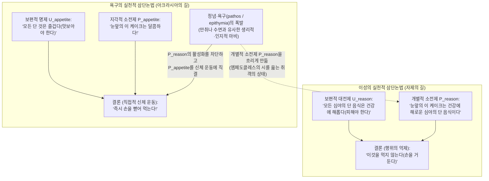
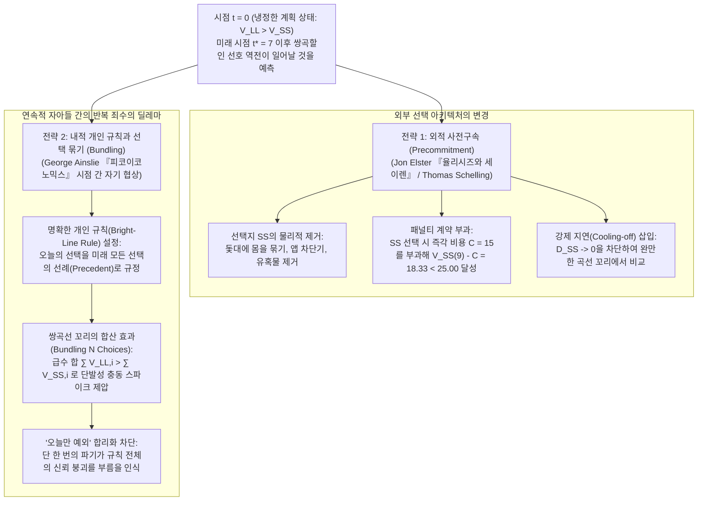

## 1. 서론: 새벽 3시의 스마트폰과 에우리피데스 『메데이아』 — 아크라시아(Akrasia)의 정의와 철학적 스캔들

내일 아침 8시에 인생을 좌우할 중요한 발표나 시험이 예정되어 있어서, 지금 당장 잠들지 않으면 내일의 인지적 수행 능력이 치명적으로 손상된다는 사실을 누구보다 잘 알고 있음에도 새벽 3시가 넘도록 스마트폰 화면을 스크롤하고 있는 자신을 발견한다.あるいは 의사로부터 엄격한 식단 관리를 권고받고 스스로도 건강이 최우선 가치라고 진심으로 결심했음에도 눈앞의 고칼로리 야식에 손을 뻗는다.

고대 그리스 철학자들은 이러한 보편적 현상을 <strong>아크라시아(ἀκρασία / Akrasia)</strong>라고 불렀다. 부정 접두사 $\alpha$-와 ‘지배·통제력’을 뜻하는 $\kappa\rho\acute{\alpha}\tau\omicron\varsigma$(kratos)가 결합된 이 용어는 문자 그대로 <strong>‘자기통제의 결여(무절제)’</strong>를 뜻하며, 근대 이후 철학에서는 <strong>‘의지박약(Weakness of Will)’</strong>으로 번역된다. 에우리피데스의 비극 『메데이아』(1078–1080행)와 로마 시인 오비디우스의 『변신이야기』(제7권)는 이를 다음과 같이 압축했다.

> <strong>"Video meliora proboque, deteriora sequor."</strong>
> (“나는 더 나은 것을 보고 그것을 시인하면서도, 더 나쁜 것을 따른다.”)

현대 행위철학(Philosophy of Action)에서 행위 주체 $S$가 시점 $t$에 수행하는 행위 $y$가 엄밀한 의미의 <strong>공시적 아크라시아(Synchronic Akrasia)</strong>가 되기 위해서는 다음 세 가지 조건이 동시에 성립해야 한다.

1. <strong>의도성과 자유(Intentionality and Freedom)</strong>: 주체 $S$는 물리적 강제나 단순 반사가 아니라 자유롭고 의도적으로 행위 $y$를 수행하며, 대안적 행위 $x$를 수행할 수 있다고 믿는다.
2. <strong>모든 것을 고려한 최선 판단(All-Things-Considered Judgment)</strong>: $S$는 가용한 모든 이유를 종합할 때 시점 $t$에 $y$보다 $x$를 행하는 것이 더 낫다고($x \succ y$) 의식적으로 판단한다.
3. <strong>공시적 배반(Synchronic Conflict)</strong>: 그 판단을 유지하고 있는 바로 그 시점 $t$에, $S$는 자신의 최선 판단을 거슬러 의도적으로 $y$를 선택하고 실행한다.

왜 이것이 철학적 스캔들인가? 일상적 통속심리학과 표준 합리적 선택 이론(현시선호 이론)은 “주체가 의도적으로 $y$를 선택했다면 선택의 순간 $y$를 더 가치 있게 평가했기 때문”이라고 전제하기 때문이다.

---

## 2. 소크라테스의 주지주의(『프로타고라스』)와 아리스토텔레스의 실천적 삼단논법

### 2.1 소크라테스의 계량술과 시간적 원근법의 착각

플라톤의 초기 대화편 『프로타고라스』(352a–358d)에서 소크라테스는 지식이 격정이나 쾌락에 의해 “노예(ἀνδράποδον)처럼 끌려다닌다”는 대중의 통념을 부정하고 <strong>소크라테스적 주지주의(Socratic Intellectualism)</strong>를 선언한다. 무엇이 최선인지 참으로 아는 자는 결코 그에 반해 행동할 수 없으며, <strong>“누구도 자발적으로(알면서) 악을 행하지 않는다(οὐδεὶς ἑκὼν ἁμαρτάνει)”</strong>는 것이다.

그렇다면 왜 사람들은 <strong>미래의 더 큰 이익(LL: Larger-Later)</strong>을 버리고 <strong>눈앞의 작은 쾌락(SS: Smaller-Sooner)</strong>을 선택하는가? 소크라테스에 따르면 이는 지식이 욕망에 패배했기 때문이 아니라, 시각적 원근법처럼 <strong>시간적 근접성이 가치를 왜곡하는 착각</strong> 때문이다. 눈앞에 다가온 쾌락은 거대해 보이고 미래의 고통이나 보상은 작아 보여, 행위의 순간 $t$에 판단 자체가 $y \succ x$로 뒤집힌다는 것이다. 따라서 구원의 기술은 의지력이 아니라 시간적 왜곡을 교정하는 <strong>‘계량술(μετρητικὴ τέχνη / Art of Measurement)’</strong>이다.

### 2.2 플라톤의 영혼 삼분설과 아리스토텔레스의 실천적 삼단논법

플라톤은 『국가』 제4권(436a–441c)에서 ‘대립률’에 입각해 영혼을 <strong>이성적 부분(λογιστικόν)</strong>, <strong>기개적 부분(θυμοειδές)</strong>, <strong>욕구적 부분(ἐπιθυμητικόν)</strong>으로 나누고, 처형된 시체를 보려는 욕망에 굴복해 자신의 눈을 저주하며 눈꺼풀을 억지로 벌린 <strong>레온티오스(Leontius)</strong>의 일화를 통해 공시적 갈등의 실재를 입증했다.

이어 아리스토텔레스는 『니코마코스 윤리학』 제7권(1145a–1152a)에서 도덕적 성격을 네 가지 유형으로 체계화했다.

| 성격 유형(그리스어) | 한국어 및 영어 명칭 | 이성적 판단(Logos) | 욕구·정념의 방향 | 내적 갈등 | 최종 행위 및 사후 감정 |
| :--- | :--- | :--- | :--- | :--- | :--- |
| <strong>ἀρετή / σωφροσύνη</strong> | <strong>덕 / 절제</strong> (Virtue / Temperance) | 올바름 (선을 파악) | 이성과 완전히 조화 | <strong>없음</strong> | 기쁨과 함께 선한 행위를 수행함 |
| <strong>ἐγκράτεια</strong> | <strong>자제</strong> (Continence / Self-Control) | 올바름 (선을 파악) | 과도한 쾌락으로 향함 | <strong>격렬함</strong> | 이성이 욕구를 제압하고 올바르게 행동함 |
| <strong>ἀκρασία</strong> | <strong>무절제 / 의지박약</strong> (Incontinence / Akrasia) | 올바름 (선을 파악) | 과도한 쾌락으로 향함 | <strong>격렬함</strong> | 욕구에 굴복하나 <strong>사후에 깊이 후회함(μεταμέλεια)</strong> |
| <strong>κακία / ἀκολασία</strong> | <strong>악덕 / 방탕</strong> (Vice / Intemperance) | 왜곡됨 (쾌락 추구를 원칙화) | 과도한 쾌락으로 향함 | <strong>없음</strong> | 고의적 선택(προαίρεσις)으로 악을 행하며 <strong>후회 없음</strong> |

아리스토텔레스는 지식을 <strong>잠재적으로 보유한 상태(ἔχειν)</strong>와 <strong>현실적으로 작동시키는 상태(ἐνεργεῖν)</strong>로 구분하고, <strong>실천적 삼단논법(Practical Syllogism)</strong>의 구조를 통해 아크라시아의 메커니즘을 해명한다.

아크라시아에 빠진 사람은 보편적 대전제 $U_{\text{reason}}$을 잃지 않았으나, 강렬한 정념(πάθος)이 개별적 지각 소전제 $P_{\text{reason}}$을 마비시키고 $P_{\text{appetite}}$(“이것은 달다!”)만을 신체 운동에 직결시킨다. 이때 그가 도덕적 말을 중얼거리더라도 그것은 <strong>“만취한 사람이 엠페도클레스의 시구를 암송하는 것”</strong>(1147a18–24)과 같다.

---

## 3. 데이비슨의 조건부 판단 논리와 홀턴의 ‘결심(Resolution)’ 이론

### 3.1 도널드 데이비슨(1970): 비정합적 삼명제와 조건부 판단

1970년 <strong>도널드 데이비슨(Donald Davidson)</strong>은 「의지박약은 어떻게 가능한가?」에서 <strong>비정합적 삼명제(Inconsistent Triad: P1, P2, P3)</strong>를 제시하고, 카를 헴펠의 귀납적 확증 확률 논리를 원용하여 <strong>조건부(Prima Facie) 판단</strong>과 <strong>무조건적(All-Out) 판단</strong>을 구분함으로써 모순을 해결했다.
1. 가용한 모든 이유의 총체 $\mathcal{E} = \{r_1, r_2, \dots, r_n\}$에 비추어 내리는 <strong>‘모든 것을 고려한 판단(ATC 판단)’</strong>은 여전히 조건부 관계 명제이다:
   $$\text{pf}(x \succ y,\; \mathcal{E})$$
2. 반면 P1·P2에서 의도적 행위와 직결되는 최종 판단(의도)은 조건절이 없는 <strong>무조건적 판단</strong>이다:
   $$y \succ x \quad (\text{무조건적으로 } y \text{가 더 낫다})$$

따라서 $\text{pf}(x \succ y,\; \mathcal{E})$와 $y \succ x$를 동시에 보유하는 것은 형식논리학상 모순이 아니다. 아크라시아 행위자는 실천적 이성의 근본 규범인 <strong>‘자제의 원리(Principle of Continence)’</strong>를 위반한 것이며, 이는 <strong>마음의 구획화(Mental Partitioning)</strong> 속에서 부분적 욕망 $r_2$가 ‘이유가 아닌 심적 원인’으로 작용했기 때문이다.

### 3.2 게리 왓슨(1977)과 리처드 홀턴(1999)

* <strong>게리 왓슨(Gary Watson)</strong>은 데이비슨의 P2를 기각하고 <strong>평가 체계($\text{Val}(x) > \text{Val}(y)$)</strong>와 <strong>동기부여 체계($\text{Mot}(y) > \text{Mot}(x)$)</strong>를 분리했다.
* <strong>리처드 홀턴(Richard Holton, 1999)</strong>은 일상적 의미의 <strong>‘의지박약’</strong>이 공시적 아크라시아가 아니라 <strong>사전에 내린 ‘결심(Resolution)’을 유혹 앞에서 너무 쉽게 재고(reconsider)하고 철회하는 통시적 실패</strong>임을 밝혔다. 결심은 (1) $x$를 하겠다는 1차 의도와 (2) 유혹이 와도 이를 다시 계산하거나 재심의하지 않겠다는 2차 메타 의도의 결합이기 때문이다.

---

## 4. 행동경제학의 쌍곡할인(Hyperbolic Discounting)과 자기통제 전략

### 4.1 사뮤엘슨의 지수할인 vs. 에인슬리의 쌍곡할인 수리 모델

폴 사뮤엘슨(1937)의 표준 <strong>지수할인(Exponential Discounting)</strong> 모델 $U_{\text{exp}}(A, D) = A \cdot e^{-rD}$에서는 두 보상의 가치 비율이 시간 $t$와 무관하게 일정하므로 엄격한 <strong>시간 일관성(Time Consistency)</strong>이 성립한다. 그러나 <strong>조지 에인슬리(George Ainslie, 1975, 1992)</strong>가 입증했듯 실제 인간과 동물은 지연 시간 $D = T - t$에 반비례하는 <strong>쌍곡할인(Hyperbolic Discounting)</strong>을 따른다:

$$V(D) = \frac{A}{1 + k D} = \frac{A}{1 + k(T - t)}, \qquad \rho(D) = -\frac{V'(D)}{V(D)} = \frac{k}{1 + k D}$$

여기서 $k > 0$는 충동성 파라미터이다. 눈앞의 작은 보상 $A_{\text{SS}} = 50$($t_{\text{SS}} = 10$), 미래의 큰 보상 $A_{\text{LL}} = 100$($t_{\text{LL}} = 15$), $k = 0.5$일 때, $V_{\text{SS}}(t^*) = V_{\text{LL}}(t^*)$가 되는 <strong>선호 역전(Preference Reversal) 교차점</strong>을 구하면 다음과 같다:

$$\frac{50}{1 + 0.5(10 - t^*)} = \frac{100}{1 + 0.5(15 - t^*)} \implies 8.5 - 0.5 t^* = 12 - t^* \implies \mathbf{t^* = 7.0}$$

| 현재 시점 $t$ | SS 지연 $D_{\text{SS}}$ | LL 지연 $D_{\text{LL}}$ | SS 쌍곡가치 $V_{\text{SS}}(t)$ | LL 쌍곡가치 $V_{\text{LL}}(t)$ | 우위 선택지 및 심리적 상태 |
| :---: | :---: | :---: | :---: | :---: | :--- |
| $t = 0$ | $10$ | $15$ | $8.33$ | <strong>$11.76$</strong> | <strong>LL 우위</strong>: 냉정한 계획 및 결심 형성($\text{LL} \succ \text{SS}$) |
| <strong>$t^* = 7$</strong> | <strong>$3$</strong> | <strong>$8$</strong> | <strong>$20.00$</strong> | <strong>$20.00$</strong> | <strong>선호 역전 교차점</strong>: 내적 갈등이 극에 달하는 분기점 |
| $t = 9$ | $1$ | $6$ | <strong>$33.33$</strong> | $25.00$ | <strong>SS 우위 (선호 역전)</strong>: 충동 가치 급등 및 아크라시아 발생 |
| $t = 10$ | $0$ | $5$ | <strong>$50.00$</strong> | $28.57$ | <strong>SS 폭발</strong>: 눈앞의 쾌락에 굴복 후 즉각적 후회 |

신경경제학 연구(McClure et al., *Science*, 2004)는 이 현상이 즉각적 보상($D \to 0$)에 폭발적으로 반응하는 <strong>변연계 도파민 $\beta$ 시스템(복측 선조체)</strong>과 장기적 가치를 계산하는 <strong>외측 전두전피질 $\delta$ 시스템(dlPFC)</strong>의 신경학적 경쟁임을 입증했다.

### 4.2 사전구속(율리시즈의 계약)과 개인적 규칙을 통한 선택 묶기(Bundling)

1. <strong>존 엘스터(Jon Elster, 1979)의 사전구속(Precommitment)</strong>: 세이렌의 섬에 접근하기 전 부하들의 귀를 밀랍으로 막고 자신을 돛대에 묶게 한 <strong>율리시즈(오디세우스)</strong>처럼, 냉정한 시점 $t_0$의 자아가 물리적 차단이나 패널티 계약($C=15$)을 통해 미래의 충동적 자아 $S_{t_1}$을 사전에 구속하는 전략이다.
2. <strong>에인슬리의 선택 묶기(Bundling via Personal Rules)</strong>: 쌍곡함수는 지수함수보다 장기 꼬리(Tail)가 두껍다는 수학적 성질을 갖는다. 따라서 명확한 <strong>개인적 규칙(Bright-Line Rule)</strong>을 세워 오늘의 선택을 향후 주기 $\tau = 10$으로 반복되는 $N+1 = 5$회의 선택 전체에 대한 <strong>선례(Precedent)</strong>로 묶으면, 유혹 직전인 $t=9$에서도 다음이 성립한다:
   $$V_{\text{bundle}}^{\text{LL}}(9) = \sum_{i=0}^{4} \frac{100}{1 + 0.5(6 + 10i)} \approx \mathbf{52.68} > V_{\text{bundle}}^{\text{SS}}(9) = \sum_{i=0}^{4} \frac{50}{1 + 0.5(1 + 10i)} \approx \mathbf{50.73}$$
   단발 승부에서는 $25.00 < 33.33$으로 패배하던 이성이 5회의 선택을 묶는 것만으로 $52.68 > 50.73$의 역전승을 거둔다. 이는 왜 <strong>“오늘 딱 한 번만 예외”</strong>라는 자기기만이 치명적인지를 수학적으로 보여준다. 진정한 실천적 지혜(φρόνησις)는 새벽 3시의 정신력이 아니라, 냉정한 시간에 사전구속과 명확한 규칙의 아키텍처를 설계하는 기술이다.
