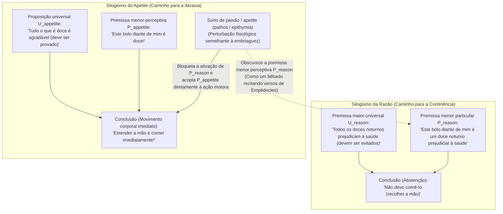
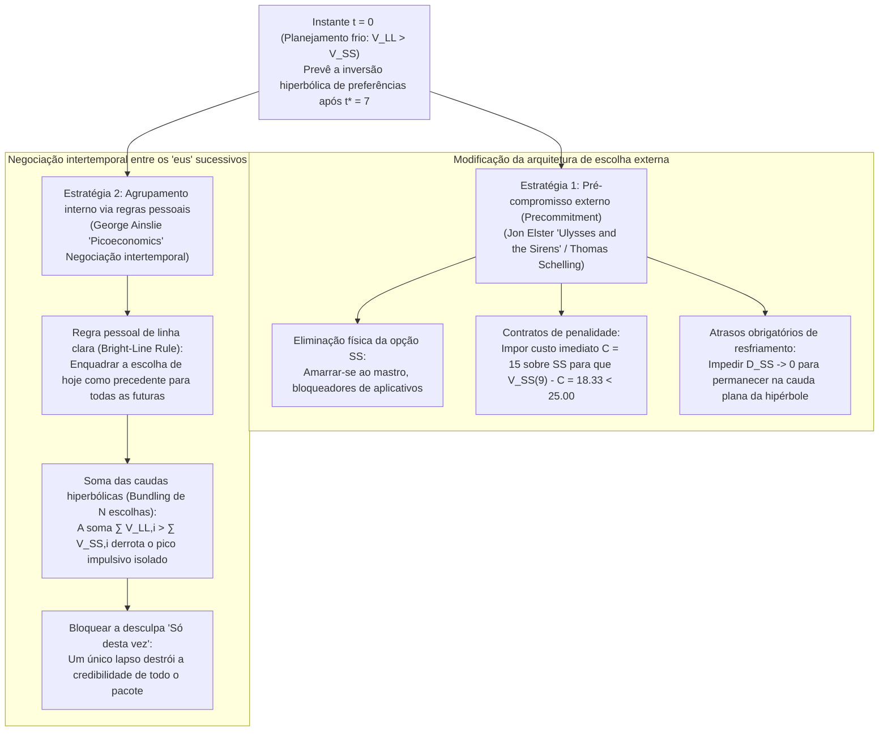

## 1. Introdução: O smartphone às 3h da manhã e a *Medeia* de Eurípides — Definindo a akrasia (ἀκρασία)

Amanhã às 8h00 você tem uma apresentação ou exame decisivo. Você sabe melhor do que ninguém que, se não dormir imediatamente, seu desempenho cognitivo amanhã será gravemente prejudicado. No entanto, às 3h00 da manhã, seu polegar continua rolando interminavelmente a tela do smartphone. Ou pense em um paciente que endossa sinceramente o alerta médico sobre sua saúde cardiovascular, mas estende a mão intencionalmente para uma sobremesa noturna.

Os filósofos da Grécia Antiga chamaram esse fenômeno universal de <strong>akrasia (ἀκρασία)</strong> — do prefixo privativo $\alpha$- ("sem") e $\kappa\rho\acute{\alpha}\tau\omicron\varsigma$ (*kratos*, "poder, domínio ou autogoverno") —, significando literalmente <strong>"falta de autodomínio"</strong> ou <strong>"incontinência"</strong> (em latim *incontinentia*, e na filosofia moderna <strong>"fraqueza da vontade"</strong>). Na tragédia *Medeia* de Eurípides (431 a.C., vv. 1078–1080) e nas *Metamorfoses* de Ovídio (7.20–21), esse conflito recebeu sua formulação imortal:

> <strong>"Video meliora proboque, deteriora sequor."</strong>
> ("Vejo o melhor e o aprovo, mas sigo o pior.")

Na filosofia analítica da ação contemporânea, uma ação $y$ realizada por um agente $S$ no instante $t$ é <strong>estritamente (sincronicamente) acrática</strong> se e somente se três condições forem satisfeitas simultaneamente em $t$:

1. <strong>Intencionalidade e liberdade:</strong> $S$ realiza $y$ intencionalmente, sem coerção física ou reflexo subpessoal, acreditando que uma ação alternativa $x$ está aberta e ao seu alcance em $t$.
2. <strong>Juízo consciente "tudo considerado" (All-Things-Considered Judgment):</strong> Levando em conta todas as razões relevantes disponíveis, $S$ julga conscientemente em $t$ que é melhor realizar $x$ do que realizar $y$ ($x \succ y$).
3. <strong>Contrariedade sincrônica ao juízo:</strong> Apesar de manter o juízo consciente $x \succ y$ em $t$, $S$ escolhe e executa intencionalmente $y$ em $t$.

Por que a akrasia estrita constitui um escândalo filosófico? Porque tanto a psicologia do senso comum quanto a teoria da escolha racional (*preferência revelada*) pressupõem que escolher intencionalmente $y$ em vez de $x$ demonstra que o agente atribuía maior valor a $y$ no momento da escolha.

---

## 2. O intelectualismo socrático (*Protágoras*) e o silogismo prático de Aristóteles

### 2.1 A arte da medida em Sócrates e a ilusão da perspectiva temporal

No *Protágoras* de Platão (352a–358d), Sócrates refuta a opinião da multidão (οἱ πολλοί) segundo a qual o conhecimento (ἐπιστήμη) é arrastado pelas paixões e prazeres "como um escravo (ἀνδράποδον)". Segundo o <strong>intelectualismo socrático</strong>, o verdadeiro conhecimento é soberano e <strong>"ninguém erra ou faz o mal voluntariamente" (οὐδεὶς ἑκὼν ἁμαρτάνει)</strong>.

Por que, então, os seres humanos sacrificam continuamente um <strong>bem maior futuro (LL: Larger-Later)</strong> por um <strong>prazer menor imediato (SS: Smaller-Sooner)</strong>? Sócrates diagnostica uma <strong>ilusão de ótica da perspectiva temporal</strong>: assim como a proximidade espacial faz os objetos parecerem maiores do que são, a iminência temporal agiganta subjetivamente o prazer imediato diante da dor ou recompensa distante. No instante $t$, o próprio juízo avaliativo se inverte ($y \succ x$). A salvação de nossa vida reside, portanto, em uma ciência exata: a <strong>"arte da medida" (μετρητικὴ τέχνη)</strong>.

### 2.2 A alma tripartida de Platão e o Livro VII da *Ética a Nicômaco* de Aristóteles

Na *República* (Livro IV, 436a–441c), Platão supera o monismo socrático por meio do <strong>princípio dos opostos</strong> e divide a alma em três subsistemas: a <strong>parte racional (λογιστικόν)</strong>, a <strong>parte irascível (θυμοειδές)</strong> e a <strong>parte apetitiva (ἐπιθυμητικόν)</strong> — ilustrados pelo caso de <strong>Leôncio</strong>, que amaldiçoa os próprios olhos enquanto os abre à força para contemplar os cadáveres de executados.

Na *Ética a Nicômaco* (Livro VII, 1145a–1152a), Aristóteles sistematiza quatro tipos de caráter moral:

| Tipo de caráter (Grego) | Termo português / inglês | Juízo racional (Logos) | Direção do apetite | Conflito interno | Ação final e afeto posterior |
| :--- | :--- | :--- | :--- | :--- | :--- |
| <strong>ἀρετή / σωφροσύνη</strong> | <strong>Virtude / Temperança</strong> (Temperance) | Correto (apreende o bem) | Em harmonia com a razão | <strong>Nenhum</strong> | Realiza ações nobres com prazer |
| <strong>ἐγκράτεια</strong> | <strong>Continência / Autocontrole</strong> | Correto (apreende o bem) | Impele ao prazer excessivo | <strong>Severo</strong> | A razão vence o apetite; age corretamente |
| <strong>ἀκρασία</strong> | <strong>Incontinência / Akrasia</strong> | Correto (apreende o bem) | Impele ao prazer excessivo | <strong>Severo</strong> | Cede ao apetite; sente <strong>agudo remorso (μεταμέλεια)</strong> |
| <strong>κακία / ἀκολασία</strong> | <strong>Vício / Intemperança</strong> (Vice) | Corrompido (adota o prazer como princípio) | Impele ao prazer excessivo | <strong>Nenhum</strong> | Escolhe o mal por escolha deliberada (προαίρεσις); <strong>sem remorso</strong> |

Aristóteles distingue entre a <strong>posse disposicional (ἔχειν)</strong> do saber e seu <strong>exercício ativo (ἐνεργεῖν)</strong> dentro do <strong>silogismo prático</strong>:

O agente acrático conserva a premissa maior universal $U_{\text{reason}}$, mas o surto passional (πάθος) obscurece a premissa menor perceptiva $P_{\text{reason}}$ enquanto ativa $P_{\text{appetite}}$ ("É doce!"). Mesmo que pronuncie máximas morais enquanto come, ele é <strong>"como os homens embriagados que recitam os versos de Empédocles"</strong> (1147a18–24).

---

## 3. Os juízos condicionais de Davidson e a teoria das resoluções de Holton

### 3.1 Donald Davidson (1970): A tríade inconsistente

Em *"How is Weakness of the Will Possible?"* (1970), <strong>Donald Davidson</strong> formula três princípios aparentemente incompatíveis (<strong>P1</strong>: querer fazer $x$ mais do que $y$ implica fazer $x$ intencionalmente; <strong>P2</strong>: julgar $x$ melhor do que $y$ implica querer $x$ mais do que $y$; <strong>P3</strong>: existem ações incontinentes).

Inspirando-se na lógica da confirmação probabilística de Carl Hempel, Davidson distingue os <strong>juízos condicionais (*prima facie*)</strong> dos <strong>juízos incondicionais (*all-out*)</strong>:
1. O <strong>juízo "tudo considerado" (ATC)</strong> em P3 é logicamente um juízo condicional relativo ao conjunto total de razões disponíveis $\mathcal{E} = \{r_1, r_2, \dots, r_n\}$:
   $$\text{pf}(x \succ y,\; \mathcal{E})$$
2. Em contrapartida, a intenção final que rege P1 e P2 é um <strong>juízo incondicional (*sans phrase*)</strong>:
   $$y \succ x$$

Manter simultaneamente $\text{pf}(x \succ y,\; \mathcal{E})$ e $y \succ x$ não gera contradição lógica formal. O agente acrático viola o <strong>princípio da continência (Principle of Continence)</strong> porque, por meio de uma <strong>partição mental (Mental Partitioning)</strong>, o desejo parcial $r_2$ atua como *"uma causa mental que não é uma razão"*.

### 3.2 Gary Watson (1977) e Richard Holton (1999)

Enquanto <strong>Gary Watson</strong> rejeita P2 separando o <strong>sistema de valoração ($\text{Val}(x) > \text{Val}(y)$)</strong> do <strong>sistema motivacional ($\text{Mot}(y) > \text{Mot}(x)$)</strong>, <strong>Richard Holton</strong> (1999) mostra que a <strong>fraqueza da vontade</strong> comum é uma falha diacrônica: a <strong>reconsideração precipitada de uma resolução prévia</strong>, a qual combinava uma intenção de primeira ordem com uma metaintenção de *não reabrir a deliberação* sob tentação.

---

## 4. Desconto hiperbólico na economia comportamental e estratégias de autocontrole

### 4.1 Desconto exponencial (Samuelson) vs. hiperbólico (Ainslie)

Enquanto o modelo de <strong>desconto exponencial</strong> de Paul Samuelson (1937), $U_{\text{exp}}(A, D) = A \cdot e^{-rD}$, garante estrita <strong>consistência temporal</strong>, <strong>George Ainslie</strong> (1975, *Picoeconomics*, 1992) demonstrou que humanos e animais descontam recompensas futuras segundo uma <strong>função de desconto hiperbólico</strong> inversamente proporcional ao atraso $D = T - t$:

$$V(D) = \frac{A}{1 + k D} = \frac{A}{1 + k(T - t)}, \qquad \rho(D) = -\frac{V'(D)}{V(D)} = \frac{k}{1 + k D}$$

Com o parâmetro de impulsividade $k = 0.5$, uma tentação imediata $A_{\text{SS}} = 50$ em $t_{\text{SS}} = 10$ e uma recompensa maior $A_{\text{LL}} = 100$ em $t_{\text{LL}} = 15$, o <strong>ponto de inversão de preferências $t^*$</strong> onde $V_{\text{SS}}(t^*) = V_{\text{LL}}(t^*)$ é:

$$\frac{50}{1 + 0.5(10 - t^*)} = \frac{100}{1 + 0.5(15 - t^*)} \implies 8.5 - 0.5 t^* = 12 - t^* \implies \mathbf{t^* = 7.0}$$

| Instante $t$ | Atraso $D_{\text{SS}}$ | Atraso $D_{\text{LL}}$ | Valor hiperbólico $V_{\text{SS}}(t)$ | Valor hiperbólico $V_{\text{LL}}(t)$ | Escolha dominante e estado psicológico |
| :---: | :---: | :---: | :---: | :---: | :--- |
| $t = 0$ | $10$ | $15$ | $8.33$ | <strong>$11.76$</strong> | <strong>LL dominante:</strong> Planejamento frio e resolução ($\text{LL} \succ \text{SS}$) |
| <strong>$t^* = 7$</strong> | <strong>$3$</strong> | <strong>$8$</strong> | <strong>$20.00$</strong> | <strong>$20.00$</strong> | <strong>Ponto de cruzamento:</strong> Conflito interno máximo |
| $t = 9$ | $1$ | $6$ | <strong>$33.33$</strong> | $25.00$ | <strong>SS dominante (Inversão):</strong> Disparo hiperbólico e akrasia |
| $t = 10$ | $0$ | $5$ | <strong>$50.00$</strong> | $28.57$ | <strong>Pico de SS:</strong> Indulgência imediata seguida de arrependimento |

A neuroeconomia (McClure et al., *Science*, 2004) confirmou via fMRI que essa disputa opõe o <strong>sistema dopaminérgico mesolímbico $\beta$</strong> (estriado ventral, ativo quando $D \to 0$) ao <strong>sistema executivo frontoparietal $\delta$</strong> (dlPFC).

### 4.2 Pré-compromisso (*Ulisses e as Sereias*) e agrupamento de escolhas (Bundling)

1. <strong>O pré-compromisso de Jon Elster (*Ulysses and the Sirens*, 1979):</strong> Como <strong>Ulisses</strong> fazendo-se amarrar ao mastro antes de ouvir as Sereias, o eu racional $S_{t_0}$ restringe antecipadamente o eu impulsivo $S_{t_1}$ eliminando fisicamente SS ou impondo-lhe uma penalidade imediata $C = 15$ ($33.33 - 15 = 18.33 < 25.00$).
2. <strong>O agrupamento de escolhas (Bundling) de George Ainslie:</strong> Como as curvas hiperbólicas possuem caudas muito mais espessas no longo prazo do que as exponenciais, adotar uma <strong>regra pessoal de linha clara (Bright-Line Rule)</strong> que agrupe $N+1 = 5$ escolhas sucessivas espaçadas por $\tau = 10$ inverte a desigualdade em $t = 9$:
   $$V_{\text{bundle}}^{\text{LL}}(9) = \sum_{i=0}^{4} \frac{100}{1 + 0.5(6 + 10i)} \approx \mathbf{52.68} > V_{\text{bundle}}^{\text{SS}}(9) = \sum_{i=0}^{4} \frac{50}{1 + 0.5(1 + 10i)} \approx \mathbf{50.73}$$
   Isso explica matematicamente por que a racionalização <strong>"Só desta vez"</strong> é fatal: ela desagrupa a escolha de hoje da série futura e destrói a credibilidade da regra. A verdadeira sabedoria prática (φρόνησις) consiste em projetar preventivamente nossa arquitetura de pré-compromissos e regras pessoais.
