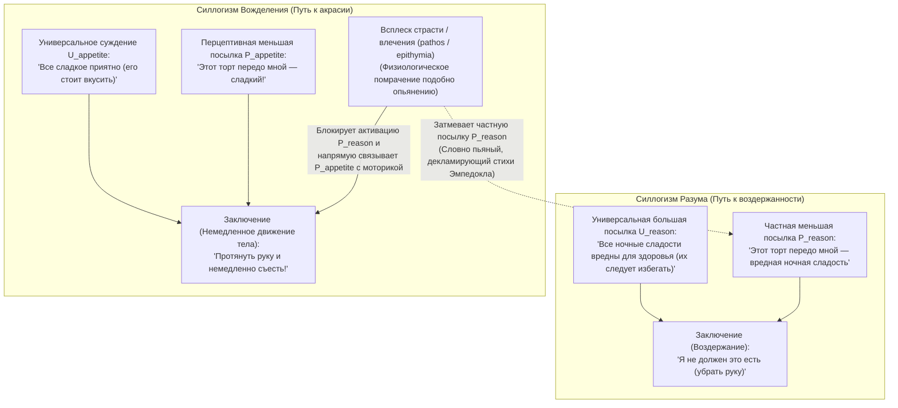
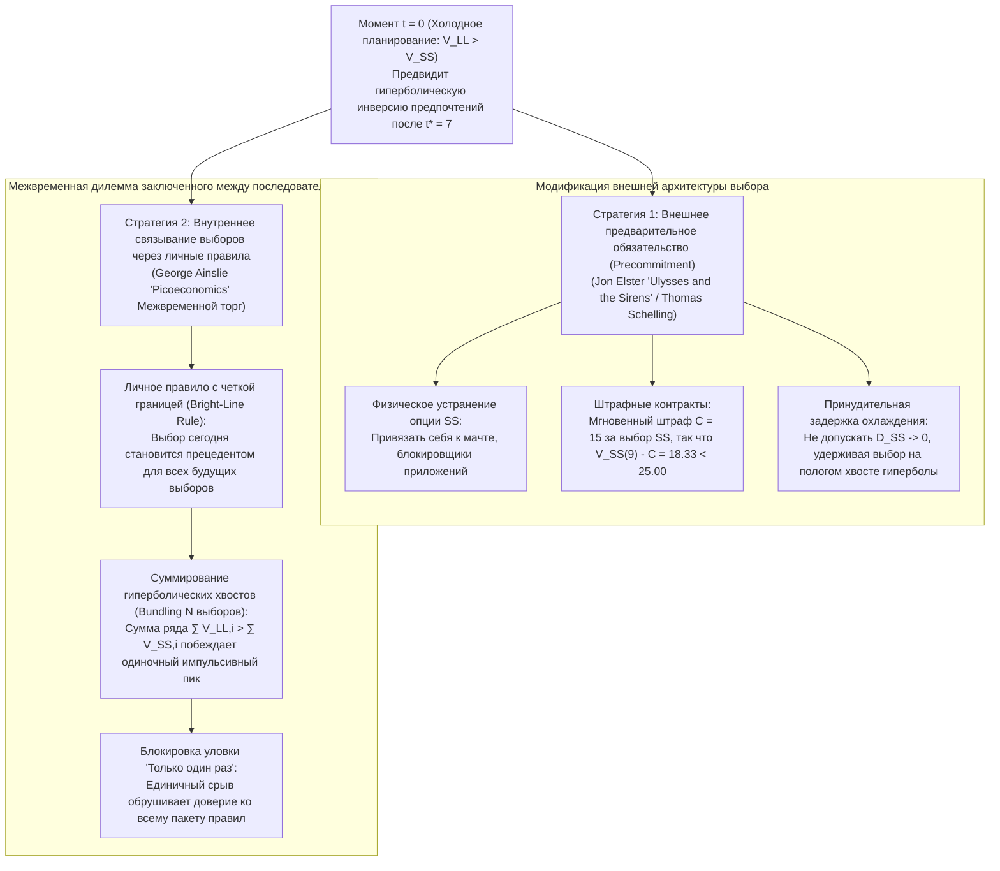

## 1. Введение: Смартфон в 3 часа ночи и «Медея» Еврипида — Определение акрасии (ἀκρασία)

Завтра в 8:00 утра вам предстоит решающий доклад или экзамен. Вы лучше кого бы то ни было знаете, что если не уснете прямо сейчас, ваши когнитивные способности завтра будут серьезно подорваны. И все же в 3:00 ночи ваш палец продолжает бесконечно листать ленту смартфона. Или представим пациента, который искренне согласен с предупреждением врача о приоритете здоровья сердца, но сознательно тянется к ночному десерту.

Древнегреческие философы назвали этот универсальный феномен <strong>акрасией (ἀκρασία)</strong> — от отрицательной приставки $\alpha$- («без») и $\kappa\rho\acute{\alpha}\tau\omicron\varsigma$ (*kratos*, «власть, господство, самообладание»), что буквально означает <strong>«отсутствие самообладания»</strong> или <strong>«невоздержанность»</strong> (лат. *incontinentia*, в современной философии — <strong>«слабость воли»</strong>). В трагедии Еврипида «Медея» (431 г. до н. э., ст. 1078–1080) и «Метаморфозах» Овидия (7.20–21) этот внутренний раскол получил бессмертную формулировку:

> <strong>«Video meliora proboque, deteriora sequor.»</strong>
> («Вижу лучшее и одобряю его, но следую худшему.»)

В современной аналитической философии действия поступок $y$, совершаемый агентом $S$ в момент времени $t$, считается <strong>строго (синхронно) акратическим</strong> тогда и только тогда, когда одновременно выполняются три условия:

1. <strong>Интенциональность и свобода:</strong> $S$ совершает $y$ намеренно, без физического принуждения или рефлекса, полагая, что альтернативное действие $x$ доступно и находится в его власти в момент $t$.
2. <strong>Осознанное суждение «с учетом всех обстоятельств» (All-Things-Considered Judgment):</strong> Принимая во внимание все доступные релевантные основания, $S$ сознательно судит в момент $t$, что совершить $x$ лучше, чем совершить $y$ ($x \succ y$).
3. <strong>Синхронное действие вопреки суждению:</strong> Удерживая сознательное суждение $x \succ y$ в момент $t$, $S$ намеренно выбирает и осуществляет $y$ в тот же момент $t$.

Почему строгая акрасия представляет собой философский скандал? Потому что и обыденная психология, и теория рационального выбора (*выявленные предпочтения*) предполагают: намеренный выбор $y$ вместо $x$ доказывает, что в момент выбора агент ценил $y$ выше, чем $x$.

---

## 2. Интеллектуализм Сократа («Протагор») и практический силлогизм Аристотеля

### 2.1 «Искусство измерения» у Сократа и оптическая иллюзия временной перспективы

В диалоге Платона «Протагор» (352a–358d) Сократ отвергает мнение большинства (οἱ πολλοί), будто знание (ἐπιστήμη) влачится страстями и удовольствиями «словно раб (ἀνδράποδον)». Согласно <strong>сократовскому интеллектуализму</strong>, подлинное знание неодолимо, и <strong>«никто не погрешает добровольно» (οὐδεὶς ἑκὼν ἁμαρτάνει)</strong>.

Почему же люди постоянно жертвуют <strong>большим будущим благом (LL: Larger-Later)</strong> ради <strong>меньшего сиюминутного удовольствия (SS: Smaller-Sooner)</strong>? Сократ объясняет это <strong>оптической иллюзией временной перспективы</strong>: подобно тому как пространственная близость заставляет предметы казаться крупнее, временная близость удовольствия гипертрофирует его субъективный размер по сравнению с отдаленной болью или наградой. В момент действия $t$ само оценочное суждение агента переворачивается ($y \succ x$). Следовательно, спасение жизни заключается в точной науке — <strong>«искусстве измерения» (μετρητικὴ τέχνη)</strong>.

### 2.2 Трехчастная душа Платона и Книга VII «Никомаховой этики» Аристотеля

В «Государстве» (Книга IV, 436a–441c) Платон преодолевает монизм Сократа на основе <strong>принципа противоположностей</strong>, выделяя в душе <strong>разумное начало (λογιστικόν)</strong>, <strong>яростное начало (θυμοειδές)</strong> и <strong>вожделеющее начало (ἐπιθυμητικόν)</strong> — что иллюстрируется историей <strong>Леонтия</strong>, который проклинал собственные глаза, но насильно раскрывал их, чтобы смотреть на трупы казненных.

В Книге VII «Никомаховой этики» (1145a–1152a) Аристотель классифицирует четыре нравственных склада:

| Нравственный склад | Русский / английский термин | Суждение разума (Logos) | Направление влечения | Внутренний конфликт | Поступок и последующее чувство |
| :--- | :--- | :--- | :--- | :--- | :--- |
| <strong>ἀρετή / σωφροσύνη</strong> | <strong>Добродетель / Благоразумие</strong> | Истинное (постигает благо) | В полной гармонии с разумом | <strong>Отсутствует</strong> | Радостно совершает прекрасные поступки |
| <strong>ἐγκράτεια</strong> | <strong>Воздержанность / Самообладание</strong> | Истинное (постигает благо) | Тянет к чрезмерному удовольствию | <strong>Острый</strong> | Разум подавляет влечение; поступает верно |
| <strong>ἀκρασία</strong> | <strong>Невоздержанность / Акрасия</strong> | Истинное (постигает благо) | Тянет к чрезмерному удовольствию | <strong>Острый</strong> | Уступает влечению; испытывает <strong>острое раскаяние (μεταμέλεια)</strong> |
| <strong>κακία / ἀκολασία</strong> | <strong>Порок / Распущенность</strong> (Vice) | Искажено (удовольствие как принцип) | Тянет к чрезмерному удовольствию | <strong>Отсутствует</strong> | Творит зло по сознательному выбору (προαίρεσις); <strong>без раскаяния</strong> |

Аристотель различает <strong>потенциальное обладание (ἔχειν)</strong> знанием и его <strong>актуальное применение (ἐνεργεῖν)</strong> в структуре <strong>практического силлогизма</strong>:

Акратик сохраняет универсальную большую посылку $U_{\text{reason}}$, но всплеск страсти (πάθος) блокирует частную перцептивную посылку $P_{\text{reason}}$, активируя $P_{\text{appetite}}$ («Оно сладкое!»). Даже если он произносит при этом моральные сентенции, он подобен <strong>«охмелевшим людям, которые декламируют стихи Эмпедокла»</strong> (1147a18–24).

---

## 3. Условные суждения Дэвидсона и теория решимости Холтона

### 3.1 Дональд Дэвидсон (1970): Несовместимая триада

В статье *«How is Weakness of the Will Possible?»* (1970) <strong>Дональд Дэвидсон</strong> формулирует три кажущихся несовместимыми принципа (<strong>P1</strong>: большее желание делать $x$ влечет намеренное совершение $x$; <strong>P2</strong>: суждение о том, что $x$ лучше $y$, влечет большее желание делать $x$; <strong>P3</strong>: существуют невоздержанные действия).

Опираясь на логику вероятностного подтверждения Карла Гемпеля, Дэвидсон разграничивает <strong>условные (*prima facie*) суждения</strong> и <strong>безусловные (*all-out*) суждения</strong>:
1. <strong>Суждение «с учетом всех обстоятельств» (ATC)</strong> в P3 логически остается условным суждением относительно всей совокупности доступных оснований $\mathcal{E} = \{r_1, r_2, \dots, r_n\}$:
   $$\text{pf}(x \succ y,\; \mathcal{E})$$
2. Напротив, финальное намерение в P1 и P2 представляет собой <strong>безусловное суждение (*sans phrase*)</strong>:
   $$y \succ x$$

Одновременное принятие $\text{pf}(x \succ y,\; \mathcal{E})$ и $y \succ x$ не содержит формально-логического противоречия. Однако акратик нарушает <strong>принцип воздержанности (Principle of Continence)</strong>, поскольку из-за <strong>ментальной партиционализации (Mental Partitioning)</strong> частное желание $r_2$ срабатывает как *«ментальная причина, не являющаяся основанием»*.

### 3.2 Гэри Уотсон (1977) и Ричард Холтон (1999)

В то время как <strong>Гэри Уотсон</strong> отвергает P2, разделяя <strong>систему оценивания ($\text{Val}(x) > \text{Val}(y)$)</strong> и <strong>систему мотивации ($\text{Mot}(y) > \text{Mot}(x)$)</strong>, <strong>Ричард Холтон</strong> (1999) доказывает, что обыденная <strong>слабость воли</strong> — это диахронический сбой: <strong>чрезмерно поспешный пересмотр (reconsideration) ранее принятой решимости (Resolution)</strong>, включавшей мета-намерение *не возобновлять обсуждение* в момент искушения.

---

## 4. Гиперболическое дисконтирование в поведенческой экономике и стратегии самоконтроля

### 4.1 Экспоненциальное (Самуэльсон) против гиперболического дисконтирования (Эйнсли)

В модели <strong>экспоненциального дисконтирования</strong> Пола Самуэльсона (1937) $U_{\text{exp}}(A, D) = A \cdot e^{-rD}$ отношение ценностей двух наград не зависит от текущего момента $t$, обеспечивая строгую <strong>временную согласованность</strong>. Однако <strong>Джордж Эйнсли</strong> (1975, *Picoeconomics*, 1992) доказал, что люди и животные обесценивают будущие награды по <strong>формуле гиперболического дисконтирования</strong> обратно пропорционально задержке $D = T - t$:

$$V(D) = \frac{A}{1 + k D} = \frac{A}{1 + k(T - t)}, \qquad \rho(D) = -\frac{V'(D)}{V(D)} = \frac{k}{1 + k D}$$

При параметре импульсивности $k = 0.5$, меньшем близком соблазне $A_{\text{SS}} = 50$ в $t_{\text{SS}} = 10$ и большей будущей награде $A_{\text{LL}} = 100$ в $t_{\text{LL}} = 15$ <strong>точка инверсии предпочтений $t^*$</strong>, где $V_{\text{SS}}(t^*) = V_{\text{LL}}(t^*)$, равна:

$$\frac{50}{1 + 0.5(10 - t^*)} = \frac{100}{1 + 0.5(15 - t^*)} \implies 8.5 - 0.5 t^* = 12 - t^* \implies \mathbf{t^* = 7.0}$$

| Момент $t$ | Задержка $D_{\text{SS}}$ | Задержка $D_{\text{LL}}$ | Гиперболическая ценность $V_{\text{SS}}(t)$ | Гиперболическая ценность $V_{\text{LL}}(t)$ | Доминирующий выбор и психологическое состояние |
| :---: | :---: | :---: | :---: | :---: | :--- |
| $t = 0$ | $10$ | $15$ | $8.33$ | <strong>$11.76$</strong> | <strong>Доминирует LL:</strong> Спокойное планирование и решимость ($\text{LL} \succ \text{SS}$) |
| <strong>$t^* = 7$</strong> | <strong>$3$</strong> | <strong>$8$</strong> | <strong>$20.00$</strong> | <strong>$20.00$</strong> | <strong>Точка пересечения:</strong> Максимальный внутренний конфликт |
| $t = 9$ | $1$ | $6$ | <strong>$33.33$</strong> | $25.00$ | <strong>Доминирует SS (Инверсия):</strong> Гиперболический скачок и акрасия |
| $t = 10$ | $0$ | $5$ | <strong>$50.00$</strong> | $28.57$ | <strong>Пик SS:</strong> Капитуляция перед соблазном и последующее сожаление |

Нейроэкономика (McClure et al., *Science*, 2004) с помощью фМРТ подтвердила, что за этим стоит конкуренция между <strong>мезолимбической дофаминовой $\beta$-системой</strong> (вентральный стриатум, вспыхивающий при $D \to 0$) и <strong>фронтопариетальной исполнительной $\delta$-системой</strong> (dlPFC).

### 4.2 Предварительное обязательство («Улисс и сирены») и связывание выборов (Bundling)

1. <strong>Предварительное обязательство Йона Эльстера (*Ulysses and the Sirens*, 1979):</strong> Подобно <strong>Одиссею (Улиссу)</strong>, велевшему привязать себя к мачте перед островом Сирен, холодное «Я» $S_{t_0}$ заранее ограничивает импульсивное «Я» $S_{t_1}$, физически устраняя SS или вводя мгновенный штраф $C = 15$ ($33.33 - 15 = 18.33 < 25.00$).
2. <strong>Связывание выборов (Bundling) Джорджа Эйнсли:</strong> Поскольку у гиперболы длинный хвост значительно толще, чем у экспоненты, принятие <strong>четкого личного правила (Bright-Line Rule)</strong>, объединяющего $N+1 = 5$ последовательных выборов с интервалом $\tau = 10$ в единый прецедент, меняет знак неравенства в момент $t = 9$:
   $$V_{\text{bundle}}^{\text{LL}}(9) = \sum_{i=0}^{4} \frac{100}{1 + 0.5(6 + 10i)} \approx \mathbf{52.68} > V_{\text{bundle}}^{\text{SS}}(9) = \sum_{i=0}^{4} \frac{50}{1 + 0.5(1 + 10i)} \approx \mathbf{50.73}$$
   Это математически объясняет, почему оправдание <strong>«Только сегодня в виде исключения»</strong> смертельно опасно: оно вычленяет сегодняшний выбор из пакета и разрушает доверие будущих «Я» к правилу. Истинная практическая мудрость (φρόνησις) — это заблаговременное проектирование архитектуры обязательств и личных правил.
