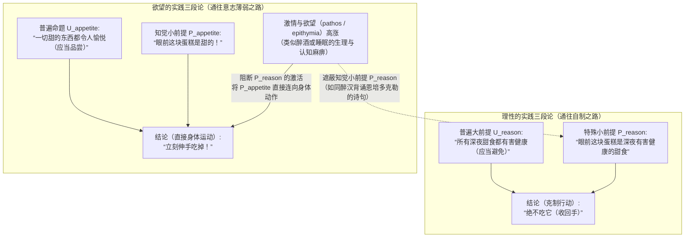
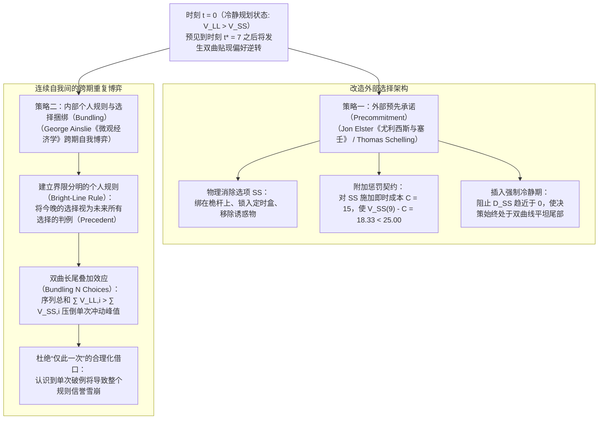

## 1. 引言：凌晨三点的智能手机与欧里庇得斯《美狄亚》——定义“意志薄弱（Akrasia）”

明天早晨八点有一场至关重要的学术报告或考试，你比任何人都清楚，如果不立刻入睡，明天的认知表现将遭受灾难性的打击。然而到了凌晨三点，你的手指却依然在智能手机屏幕上无休止地滑动。或者，一位完全认同医生警告、决心将心血管健康置于首位的患者，却在深夜主动伸手拿起了高热量甜点。

这种现象并非罕见的精神病理，而是理性人类普遍面临的日常困境。古希腊哲学家将其称为<strong>“阿克拉西亚（ἀκρασία / Akrasia）”</strong>，由否定前缀 $\alpha$- 与意为“统治、力量”的 $\kappa\rho\acute{\alpha}\tau\omicron\varsigma$（kratos）组合而成，字面意义是<strong>“缺乏自我控制”</strong>或<strong>“不自制”</strong>，在现代哲学中通常译为<strong>“意志薄弱（Weakness of Will）”</strong>。

在文学史上，公元前431年欧里庇得斯的悲剧《美狄亚》（第1078–1080行）与罗马诗人奥维德的《变形记》留下了最著名的感叹：

> <strong>"Video meliora proboque, deteriora sequor."</strong>
> （“我看见那更好的，也赞同它，却追随那更坏的。”）

在当代行动哲学（Philosophy of Action）中，行为主体 $S$ 在时刻 $t$ 的行动 $y$ 构成严格意义上的<strong>共时性意志薄弱（Synchronic Akrasia）</strong>，当且仅当同时满足以下三个条件：

1. <strong>意向性与自由（Intentionality and Freedom）</strong>：$S$ 并非出于物理强制或生理反射，而是自由、有意向地执行行动 $y$，且相信替代行动 $x$ 在当时完全可行。
2. <strong>全盘考量的最优判断（All-Things-Considered Judgment）</strong>：综合所有相关理由，$S$ 在时刻 $t$ 清楚地判断执行 $x$ 优于执行 $y$（$x \succ y$）。
3. <strong>共时性背离（Synchronic Conflict）</strong>：尽管保持着 $x \succ y$ 的判断，$S$ 依然在同一时刻 $t$ 选择并执行了 $y$。

为什么这会成为哲学的核心丑闻？因为无论是日常的通俗心理学还是标准理性选择理论（显性偏好理论），都假定“有意向地选择 $y$”意味着主体在该时刻赋予 $y$ 更高的评估价值。如果主体在真诚判断 $x \succ y$ 的同时自由选择了 $y$，评价、欲望、意向与行动之间的理性锁链究竟在哪里断裂了？

---

## 2. 苏格拉底的理智主义（《普罗泰戈拉篇》）与亚里士多德的实践三段论

### 2.1 苏格拉底的“无人自愿作恶”与时间透视错觉

在柏拉图早期对话《普罗泰戈拉篇》（352a–358d）中，苏格拉底反驳了大众（οἱ πολλοί）认为“知识常常像奴隶（ἀνδράποδον）一样被激情与快乐拖着走”的常识，提出了著名的<strong>苏格拉底理智主义（Socratic Intellectualism）</strong>：真正的知识具有至高无上的统治力，<strong>“无人自愿（明知故犯地）趋恶”（οὐδεὶς ἑκὼν ἁμαρτάνει）</strong>。

苏格拉底指出，人们之所以为了<strong>眼前的较小快乐（SS: Smaller-Sooner）</strong>而牺牲<strong>未来的较大利益（LL: Larger-Later）</strong>，并不是因为知识被欲望击败，而是因为<strong>“时间距离造成的透视错觉”</strong>：正如视觉上近处的物体显得巨大、远处的物体显得渺小一样，时间上迫在眉睫的享乐在主观视野中被极度放大，而遥远未来的代价则被缩小。在行动瞬间 $t$，主体的价值判断本身发生了翻转（误以为 $y \succ x$）。因此，克服这种错觉需要的是科学的<strong>“测量术（μετρητικὴ τέχνη / Art of Measurement）”</strong>。

### 2.2 柏拉图的灵魂三分说与亚里士多德的实践三段论

在《理想国》第四卷（436a–441c）中，柏拉图基于“对立律”超越了苏格拉底的一元论，提出<strong>灵魂三分说</strong>：<strong>理性部分（λογιστικόν）</strong>、<strong>意气部分（θυμοειδές）</strong>与独立于善恶计算的<strong>欲望部分（ἐπιθυμητικόν）</strong>。他以<strong>莱昂提俄斯（Leontius）</strong>一边咒骂自己的眼睛、一边忍不住扒开眼皮观看死刑尸体的案例，证明了理性谴责与盲目欲望可以在同一瞬间剧烈冲突。

亚里士多德在《尼各马可伦理学》第七卷（1145a–1152a）中进一步将人类品格划分为四类：

| 品格类型（希腊语） | 中文与英文术语 | 理性判断（Logos） | 欲望方向 | 内在冲突 | 最终行动与事后情感 |
| :--- | :--- | :--- | :--- | :--- | :--- |
| <strong>ἀρετή / σωφροσύνη</strong> | <strong>德性 / 节制</strong> (Virtue / Temperance) | 正确（把握善） | 与理性完全和谐 | <strong>无</strong> | 愉悦而自然地践行善行 |
| <strong>ἐγκράτεια</strong> | <strong>自制</strong> (Continence / Self-Control) | 正确（把握善） | 趋向过度享乐 | <strong>剧烈冲突</strong> | 理性战胜欲望，做出正确行动 |
| <strong>ἀκρασία</strong> | <strong>不自制 / 意志薄弱</strong> (Incontinence / Akrasia) | 正确（把握善） | 趋向过度享乐 | <strong>剧烈冲突</strong> | 屈服于欲望，但<strong>事后深深悔恨（μεταμέλεια）</strong> |
| <strong>κακία / ἀκολασία</strong> | <strong>恶德 / 放纵</strong> (Vice / Intemperance) | 败坏（以享乐为原则） | 趋向过度享乐 | <strong>无</strong> | 出于蓄意选择（προαίρεσις）作恶，<strong>毫无悔意</strong> |

为了解释不自制者如何违背知识行动，亚里士多德区分了知识的<strong>潜在拥有（ἔχειν）</strong>与<strong>现实运用（ἐνεργεῖν）</strong>，并构建了<strong>实践三段论（Practical Syllogism）</strong>的冲突模型：

亚里士多德指出，不自制者并未丧失普遍大前提 $U_{\text{reason}}$，但强烈的情欲（πάθος）像酒精一样麻痹了针对眼前具体事物的知觉小前提 $P_{\text{reason}}$，使“它是甜的（$P_{\text{appetite}}$）”直接驱动了身体动作。此时即便他嘴上念叨道德训诫，也只不过<strong>“像醉汉背诵恩培多克勒的诗句一样”</strong>（1147a18–24）。

---

## 3. 戴维森的条件判断逻辑与霍尔顿的“决心”理论

### 3.1 唐纳德·戴维森（1970）：不相容三命题与条件性判断

1970年，分析哲学家<strong>唐纳德·戴维森（Donald Davidson）</strong>在经典论文《意志薄弱何以可能？》（*How is Weakness of the Will Possible?*）中提出了著名的<strong>不相容三命题（Inconsistent Triad）</strong>：
* <strong>P1（欲望与意向行动原则）</strong>：若主体想要做 $x$ 胜过想要做 $y$，且相信自己可自由选择，则当他有意向地做其中之一时，必有意向地做 $x$。
* <strong>P2（价值判断与欲望原则）</strong>：若主体判断做 $x$ 优于做 $y$，则他想要做 $x$ 胜过想要做 $y$。
* <strong>P3（不自制行动的存在）</strong>：存在这样的行动：主体在全盘考量下判断做 $x$ 优于做 $y$，却有意向地做了 $y$。

戴维森借鉴亨佩尔（Carl Hempel）的归纳确证概率逻辑，区分了<strong>“初步/条件性判断（Prima Facie / Conditional Judgment）”</strong>与<strong>“无条件决断判断（Unconditional / All-Out Judgment）”</strong>：
1. 相对于总体可用理由集合 $\mathcal{E} = \{r_1, r_2, \dots, r_n\}$，主体的<strong>全盘考量判断（ATC Judgment）</strong>在逻辑形式上仍然是条件性的关系判断：
   $$\text{pf}(x \succ y,\; \mathcal{E})$$
2. 相反，P1 与 P2 中直接构成行动意向的最终判断，是不带任何条件从句的<strong>无条件判断</strong>：
   $$y \succ x \quad (\text{无条件地选择 } y)$$

因为 $\text{pf}(x \succ y,\; \mathcal{E})$ 与 $y \succ x$ 具有不同的逻辑形式，同时持有两者并不产生形式逻辑矛盾（$A \land \neg A$）。不自制者违背的是实践理性的规范性原则——<strong>“自制原则（Principle of Continence）”</strong>（即应当根据总体证据 $\mathcal{E}$ 所支持的最优判断来形成无条件意向）。由于<strong>心理区隔化（Mental Partitioning）</strong>，局部欲望 $r_2$ 作为“非理由的心理原因”越界触发了 $y \succ x$。

### 3.2 沃森与理查德·霍尔顿（1999）：评价与动机分离、决心的过度重审

* <strong>加里·沃森（Gary Watson, 1977）</strong>直接拒绝了 P2，区分了<strong>评价系统（$\text{Val}(x) > \text{Val}(y)$）</strong>与<strong>动机系统（$\text{Mot}(y) > \text{Mot}(x)$）</strong>：不自制者在无条件评价上依然认为 $x$ 最好，但对 $y$ 的欲望在因果强度上压倒了评价。
* <strong>理查德·霍尔顿（Richard Holton, 1999）</strong>则指出，日常所谓的<strong>“意志薄弱”</strong>并非共时性的违背最优判断（Akrasia），而是<strong>历时性地未能坚守先前的“决心（Resolution）”</strong>。决心是一种双层意向结构：既包含在 $t_1$ 执行 $x$ 的一阶意向，又包含在诱惑出现时<strong>“不重新审议（not to reconsider）”</strong>的二阶元意向。当诱惑来临时轻易重启审议并推翻决心，才是意志薄弱的本质。

---

## 4. 行为经济学的双曲贴现与尤利西斯式的自我控制策略

### 4.1 萨缪尔森的指数贴现 vs. 艾因斯利的“双曲贴现（Hyperbolic Discounting）”

1937年保罗·萨缪尔森提出的标准<strong>指数贴现模型</strong>假设贴现率恒定为 $r > 0$，即 $U_{\text{exp}}(A, D) = A \cdot e^{-rD}$。此时，延迟为 $D_{\text{LL}}$ 的较大远期回报（LL）与延迟为 $D_{\text{SS}}$ 的较小近期回报（SS）的价值比值与当前时间 $t$ 无关，具有严格的<strong>时间一致性（Time Consistency）</strong>，两条曲线永不相交。

然而，精神病学家与行为经济学家<strong>乔治·艾因斯利（George Ainslie, 1975, 1992）</strong>通过大量实证研究证明，人类与动物实际遵循的是与延迟时间 $D = T - t$ 成反比的<strong>双曲贴现函数（Hyperbolic Discounting）</strong>：

$$V(D) = \frac{A}{1 + k D} = \frac{A}{1 + k(T - t)}, \qquad \rho(D) = -\frac{V'(D)}{V(D)} = \frac{k}{1 + k D}$$

其中 $k > 0$ 为冲动性参数。当延迟 $D$ 很大时，瞬时贴现率 $\rho(D)$ 很小，人表现得冷静而有远见；但当 $D \to 0$（诱惑迫在眉睫）时，$\rho(D)$ 飙升至 $k$，导致 SS 的主观价值垂直暴涨并反超 LL！

设近期诱惑 $A_{\text{SS}} = 50$（在 $t_{\text{SS}} = 10$ 获得），远期健康回报 $A_{\text{LL}} = 100$（在 $t_{\text{LL}} = 15$ 获得），冲动参数 $k = 0.5$。令 $V_{\text{SS}}(t^*) = V_{\text{LL}}(t^*)$：

$$\frac{50}{1 + 0.5(10 - t^*)} = \frac{100}{1 + 0.5(15 - t^*)} \implies 8.5 - 0.5 t^* = 12 - t^* \implies \mathbf{t^* = 7.0}$$

| 当前时刻 $t$ | SS 延迟 $D_{\text{SS}}$ | LL 延迟 $D_{\text{LL}}$ | SS 双曲价值 $V_{\text{SS}}(t)$ | LL 双曲价值 $V_{\text{LL}}(t)$ | 占优选择与心理状态 |
| :---: | :---: | :---: | :---: | :---: | :--- |
| $t = 0$ | $10$ | $15$ | $8.33$ | <strong>$11.76$</strong> | <strong>LL 占优</strong>：清晨冷静规划，立下决心（$\text{LL} \succ \text{SS}$） |
| <strong>$t^* = 7$</strong> | <strong>$3$</strong> | <strong>$8$</strong> | <strong>$20.00$</strong> | <strong>$20.00$</strong> | <strong>偏好逆转交叉点</strong>：内心冲突达到极点的分水岭 |
| $t = 9$ | $1$ | $6$ | <strong>$33.33$</strong> | $25.00$ | <strong>SS 占优（偏好逆转）</strong>：多巴胺冲动飙升，意志薄弱发作 |
| $t = 10$ | $0$ | $5$ | <strong>$50.00$</strong> | $28.57$ | <strong>SS 爆发峰值</strong>：向眼前诱惑屈服，随后陷入悔恨 |

神经经济学（McClure et al., *Science*, 2004）通过 fMRI 证实，这一动态博弈对应着对即时奖励（$D \to 0$）爆发性激活的<strong>边缘多巴胺 $\beta$ 系统（腹侧纹状体）</strong>与跨时间恒定评估长远价值的<strong>外侧前额叶 $\delta$ 系统（dlPFC）</strong>之间的神经竞争。

### 4.2 预先承诺（尤利西斯契约）与个人规则的“选择捆绑（Bundling）”

为了战胜双曲贴现造成的偏好逆转，哲学与行为经济学提出了两大核心自我控制技术：

1. <strong>乔恩·埃尔斯特（Jon Elster, 1979）与谢林的“预先承诺（Precommitment）”</strong>：正如荷马史诗中<strong>尤利西斯（奥德修斯）</strong>在靠近塞壬女妖岛之前，用蜂蜡封住水手耳朵并将自己紧紧绑在桅杆上一样，冷静时的自我 $S_{t_0}$ 通过物理移除选项、签订带有即时惩罚成本 $C$ 的契约（使 $V_{\text{SS}}(9) - C < V_{\text{LL}}(9)$）或设置强制延迟，预先限制未来冲动自我 $S_{t_1}$ 的行动空间。
2. <strong>艾因斯利的“个人规则与选择捆绑（Bundling）”</strong>：由于双曲线在远期具有比指数函数厚得多的长尾（Fat Tail），如果主体建立一条界限分明的个人规则（如“工作日午夜12点后绝不看手机”），将当前选择与未来间隔 $\tau = 10$ 的连续 $N+1 = 5$ 次选择捆绑为一个整体判例：
   $$V_{\text{bundle}}^{\text{LL}}(9) = \sum_{i=0}^{4} \frac{100}{1 + 0.5(6 + 10i)} \approx \mathbf{52.68} > V_{\text{bundle}}^{\text{SS}}(9) = \sum_{i=0}^{4} \frac{50}{1 + 0.5(1 + 10i)} \approx \mathbf{50.73}$$
   原本在单次博弈中以 $25.00 < 33.33$ 落败的远期理性选择，通过短短5次选择的捆绑即实现了 $52.68 > 50.73$ 的反超！这也从数学上揭示了为什么<strong>“今天只是特殊例外（下不为例）”</strong>是最致命的自我欺骗：一旦允许把今晚的选择从规则束中剥离出来，个人规则在未来自我眼中的信誉便会瞬间崩塌。真正的实践智慧（φρόνησις），正是在清醒之时设计外部约束与内部原则的架构艺术。
