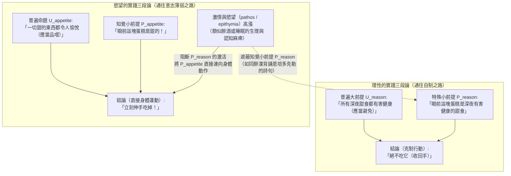
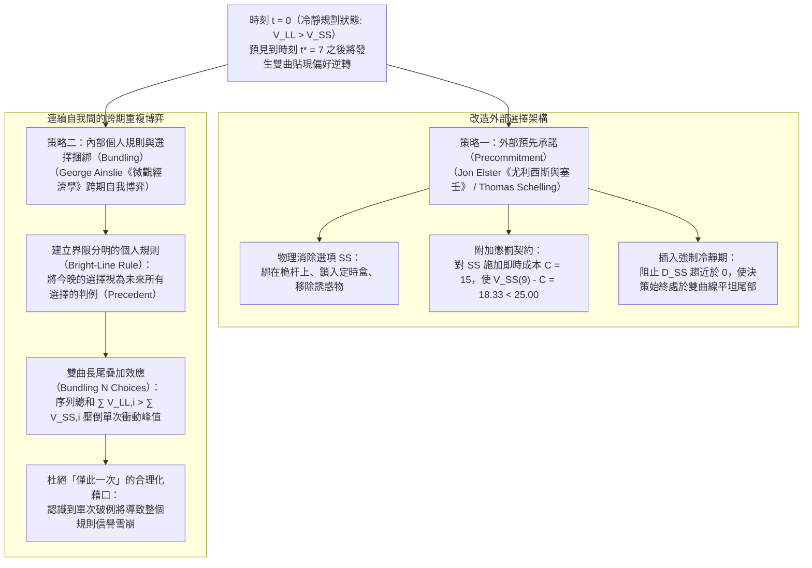

## 1. 引言：凌晨三點的智慧型手機與歐里庇得斯《美狄亞》——定義「意志薄弱（Akrasia）」

明天早晨八點有一場至關重要的學術報告或考試，你比任何人都清楚，如果不立刻入睡，明天的認知表現將遭受災難性的打擊。然而到了凌晨三點，你的手指卻依然在智慧型手機螢幕上無休止地滑動。或者，一位完全認同醫師警告、決心將心血管健康置於首位的患者，卻在深夜主動伸手拿起了高熱量甜點。

這種現象並非罕見的精神病理，而是理性人類普遍面臨的日常困境。古希臘哲學家將其稱為<strong>「阿克拉西亞（ἀκρασία / Akrasia）」</strong>，由否定前綴 $\alpha$- 與意為「統治、力量」的 $\kappa\rho\acute{\alpha}\tau\omicron\varsigma$（kratos）組合而成，字面意義是<strong>「缺乏自我控制」</strong>或<strong>「不自制」</strong>，在現代哲學中通常譯為<strong>「意志薄弱（Weakness of Will）」</strong>。

在文學史上，西元前431年歐里庇得斯的悲劇《美狄亞》（第1078–1080行）與羅馬詩人奧維德的《變形記》留下了最著名的感嘆：

> <strong>"Video meliora proboque, deteriora sequor."</strong>
> （「我看見那更好的，也贊同它，卻追隨那更壞的。」）

在當代行動哲學（Philosophy of Action）中，行為主體 $S$ 在時刻 $t$ 的行動 $y$ 構成嚴格意義上的<strong>共時性意志薄弱（Synchronic Akrasia）</strong>，當且僅當同時滿足以下三個條件：

1. <strong>意向性與自由（Intentionality and Freedom）</strong>：$S$ 並非出於物理強制或生理反射，而是自由、有意向地執行行動 $y$，且相信替代行動 $x$ 在當時完全可行。
2. <strong>全盤考量的最優判斷（All-Things-Considered Judgment）</strong>：綜合所有相關理由，$S$ 在時刻 $t$ 清楚地判斷執行 $x$ 優於執行 $y$（$x \succ y$）。
3. <strong>共時性背離（Synchronic Conflict）</strong>：儘管保持著 $x \succ y$ 的判斷，$S$ 依然在同一時刻 $t$ 選擇並執行了 $y$。

為什麼這會成為哲學的核心醜聞？因為無論是日常的通俗心理學還是標準理性選擇理論（顯性偏好理論），都假定「有意向地選擇 $y$」意味著主體在該時刻賦予 $y$ 更高的評估價值。如果主體在真誠判斷 $x \succ y$ 的同時自由選擇了 $y$，評價、慾望、意向與行動之間的理性鎖鏈究竟在哪裡斷裂了？

---

## 2. 蘇格拉底的理智主義（《普羅泰戈拉篇》）與亞里斯多德的實踐三段論

### 2.1 蘇格拉底的「無人自願作惡」與時間透視錯覺

在柏拉圖早期對話《普羅泰戈拉篇》（352a–358d）中，蘇格拉底反駁了大眾（οἱ πολλοί）認為「知識常常像奴隸（ἀνδράποδον）一樣被激情與快樂拖著走」的常識，提出了著名的<strong>蘇格拉底理智主義（Socratic Intellectualism）</strong>：真正的知識具有至高無上的統治力，<strong>「無人自願（明知故犯地）趨惡」（οὐδεὶς ἑκὼν ἁμαρτάνει）</strong>。

蘇格拉底指出，人們之所以為了<strong>眼前的較小快樂（SS: Smaller-Sooner）</strong>而犧牲<strong>未來的較大利益（LL: Larger-Later）</strong>，並不是因為知識被慾望擊敗，而是因為<strong>「時間距離造成的透視錯覺」</strong>：正如視覺上近處的物體顯得巨大、遠處的物體顯得渺小一樣，時間上迫在眉睫的享樂在主觀視野中被極度放大，而遙遠未來的代價則被縮小。在行動瞬間 $t$，主體的價值判斷本身發生了翻轉（誤以為 $y \succ x$）。因此，克服這種錯覺需要的是科學的<strong>「測量術（μετρητικὴ τέχνη / Art of Measurement）」</strong>。

### 2.2 柏拉圖的靈魂三分說與亞里斯多德的實踐三段論

在《理想國》第四卷（436a–441c）中，柏拉圖基於「對立律」超越了蘇格拉底的一元論，提出<strong>靈魂三分說</strong>：<strong>理性部分（λογιστικόν）</strong>、<strong>意氣部分（θυμοειδές）</strong>與獨立於善惡計算的<strong>慾望部分（ἐπιθυμητικόν）</strong>。他以<strong>萊昂提俄斯（Leontius）</strong>一邊咒罵自己的眼睛、一邊忍不住扒開眼皮觀看死刑屍體的案例，證明了理性譴責與盲目慾望可以在同一瞬間劇烈衝突。

亞里斯多德在《尼各馬可倫理學》第七卷（1145a–1152a）中進一步將人類品格劃分為四類：

| 品格類型（希臘語） | 中文與英文術語 | 理性判斷（Logos） | 慾望方向 | 內在衝突 | 最終行動與事後情感 |
| :--- | :--- | :--- | :--- | :--- | :--- |
| <strong>ἀρετή / σωφροσύνη</strong> | <strong>德性 / 節制</strong> (Virtue / Temperance) | 正確（把握善） | 與理性完全和諧 | <strong>無</strong> | 愉悅而自然地踐行善行 |
| <strong>ἐγκράτεια</strong> | <strong>自制</strong> (Continence / Self-Control) | 正確（把握善） | 趨向過度享樂 | <strong>劇烈衝突</strong> | 理性戰勝慾望，做出正確行動 |
| <strong>ἀκρασία</strong> | <strong>不自制 / 意志薄弱</strong> (Incontinence / Akrasia) | 正確（把握善） | 趨向過度享樂 | <strong>劇烈衝突</strong> | 屈服於慾望，但<strong>事後深深悔恨（μεταμέλεια）</strong> |
| <strong>κακία / ἀκολασία</strong> | <strong>惡德 / 放縱</strong> (Vice / Intemperance) | 敗壞（以享樂為原則） | 趨向過度享樂 | <strong>無</strong> | 出於蓄意選擇（προαίρεσις）作惡，<strong>毫無悔意</strong> |

為了解釋不自制者如何違背知識行動，亞里斯多德區分了知識的<strong>潛在擁有（ἔχειν）</strong>與<strong>現實運用（ἐνεργεῖν）</strong>，並構建了<strong>實踐三段論（Practical Syllogism）</strong>的衝突模型：

亞里斯多德指出，不自制者並未喪失普遍大前提 $U_{\text{reason}}$，但強烈的情慾（πάθος）像酒精一樣麻痺了針對眼前具體事物的知覺小前提 $P_{\text{reason}}$，使「它是甜的（$P_{\text{appetite}}$）」直接驅動了身體動作。此時即便他嘴上念叨道德訓誡，也只不過<strong>「像醉漢背誦恩培多克勒的詩句一樣」</strong>（1147a18–24）。

---

## 3. 戴維森的條件判斷邏輯與霍爾頓的「決心」理論

### 3.1 唐納德·戴維森（1970）：不相容三命題與條件性判斷

1970年，分析哲學家<strong>唐納德·戴維森（Donald Davidson）</strong>在經典論文《意志薄弱何以可能？》（*How is Weakness of the Will Possible?*）中提出了著名的<strong>不相容三命題（Inconsistent Triad）</strong>：
* <strong>P1（慾望與意向行動原則）</strong>：若主體想要做 $x$ 勝過想要做 $y$，且相信自己可自由選擇，則當他有意向地做其中之一時，必有意向地做 $x$。
* <strong>P2（價值判斷與慾望原則）</strong>：若主體判斷做 $x$ 優於做 $y$，則他想要做 $x$ 勝過想要做 $y$。
* <strong>P3（不自制行動的存在）</strong>：存在這樣的行動：主體在全盤考量下判斷做 $x$ 優於做 $y$，卻有意向地做了 $y$。

戴維森借鑑亨佩爾（Carl Hempel）的歸納確證機率邏輯，區分了<strong>「初步/條件性判斷（Prima Facie / Conditional Judgment）」</strong>與<strong>「無條件決斷判斷（Unconditional / All-Out Judgment）」</strong>：
1. 相對於總體可用理由集合 $\mathcal{E} = \{r_1, r_2, \dots, r_n\}$，主體的<strong>全盤考量判斷（ATC Judgment）</strong>在邏輯形式上仍然是條件性的關係判斷：
   $$\text{pf}(x \succ y,\; \mathcal{E})$$
2. 相反，P1 與 P2 中直接構成行動意向的最終判斷，是不帶任何條件從句的<strong>無條件判斷</strong>：
   $$y \succ x \quad (\text{無條件地選擇 } y)$$

因為 $\text{pf}(x \succ y,\; \mathcal{E})$ 與 $y \succ x$ 具有不同的邏輯形式，同時持有兩者並不產生形式邏輯矛盾（$A \land \neg A$）。不自制者違背的是實踐理性的規範性原則——<strong>「自制原則（Principle of Continence）」</strong>（即應當根據總體證據 $\mathcal{E}$ 所支持的最優判斷來形成無條件意向）。由於<strong>心理區隔化（Mental Partitioning）</strong>，局部慾望 $r_2$ 作為「非理由的心理原因」越界觸發了 $y \succ x$。

### 3.2 沃森與理查德·霍爾頓（1999）：評價與動機分離、決心的過度重審

* <strong>加里·沃森（Gary Watson, 1977）</strong>直接拒絕了 P2，區分了<strong>評價系統（$\text{Val}(x) > \text{Val}(y)$）</strong>與<strong>動機系統（$\text{Mot}(y) > \text{Mot}(x)$）</strong>：不自制者在無條件評價上依然認為 $x$ 最好，但對 $y$ 的慾望在因果強度上壓倒了評價。
* <strong>理查德·霍爾頓（Richard Holton, 1999）</strong>則指出，日常所謂的<strong>「意志薄弱」</strong>並非共時性的違背最優判斷（Akrasia），而是<strong>歷時性地未能堅守先前的「決心（Resolution）」</strong>。決心是一種雙層意向結構：既包含在 $t_1$ 執行 $x$ 的一階意向，又包含在誘惑出現時<strong>「不重新審議（not to reconsider）」</strong>的二階元意向。當誘惑來臨時輕易重啟審議並推翻決心，才是意志薄弱的本質。

---

## 4. 行為經濟學的雙曲貼現與尤利西斯式的自我控制策略

### 4.1 薩繆爾森的指數貼現 vs. 艾因斯利的「雙曲貼現（Hyperbolic Discounting）」

1937年保羅·薩繆爾森提出的標準<strong>指數貼現模型</strong>假設貼現率恆定為 $r > 0$，即 $U_{\text{exp}}(A, D) = A \cdot e^{-rD}$。此時，延遲為 $D_{\text{LL}}$ 的較大遠期回報（LL）與延遲為 $D_{\text{SS}}$ 的較小近期回報（SS）的價值比值與當前時間 $t$ 無關，具有嚴格的<strong>時間一致性（Time Consistency）</strong>，兩條曲線永不相交。

然而，精神病學家與行為經濟學家<strong>喬治·艾因斯利（George Ainslie, 1975, 1992）</strong>透過大量實證研究證明，人類與動物實際遵循的是與延遲時間 $D = T - t$ 成反比的<strong>雙曲貼現函數（Hyperbolic Discounting）</strong>：

$$V(D) = \frac{A}{1 + k D} = \frac{A}{1 + k(T - t)}, \qquad \rho(D) = -\frac{V'(D)}{V(D)} = \frac{k}{1 + k D}$$

其中 $k > 0$ 為衝動性參數。當延遲 $D$ 很大時，瞬時貼現率 $\rho(D)$ 很小，人表現得冷靜而有遠見；但當 $D \to 0$（誘惑迫在眉睫）時，$\rho(D)$ 飆升至 $k$，導致 SS 的主觀價值垂直暴漲並反超 LL！

設近期誘惑 $A_{\text{SS}} = 50$（在 $t_{\text{SS}} = 10$ 獲得），遠期健康回報 $A_{\text{LL}} = 100$（在 $t_{\text{LL}} = 15$ 獲得），衝動參數 $k = 0.5$。令 $V_{\text{SS}}(t^*) = V_{\text{LL}}(t^*)$：

$$\frac{50}{1 + 0.5(10 - t^*)} = \frac{100}{1 + 0.5(15 - t^*)} \implies 8.5 - 0.5 t^* = 12 - t^* \implies \mathbf{t^* = 7.0}$$

| 當前時刻 $t$ | SS 延遲 $D_{\text{SS}}$ | LL 延遲 $D_{\text{LL}}$ | SS 雙曲價值 $V_{\text{SS}}(t)$ | LL 雙曲價值 $V_{\text{LL}}(t)$ | 占優選擇與心理狀態 |
| :---: | :---: | :---: | :---: | :---: | :--- |
| $t = 0$ | $10$ | $15$ | $8.33$ | <strong>$11.76$</strong> | <strong>LL 占優</strong>：清晨冷靜規劃，立下決心（$\text{LL} \succ \text{SS}$） |
| <strong>$t^* = 7$</strong> | <strong>$3$</strong> | <strong>$8$</strong> | <strong>$20.00$</strong> | <strong>$20.00$</strong> | <strong>偏好逆轉交叉點</strong>：內心衝突達到極點的分水嶺 |
| $t = 9$ | $1$ | $6$ | <strong>$33.33$</strong> | $25.00$ | <strong>SS 占優（偏好逆轉）</strong>：多巴胺衝動飆升，意志薄弱發作 |
| $t = 10$ | $0$ | $5$ | <strong>$50.00$</strong> | $28.57$ | <strong>SS 爆發峰值</strong>：向眼前誘惑屈服，隨後陷入悔恨 |

神經經濟學（McClure et al., *Science*, 2004）透過 fMRI 證實，這一動態博弈對應著對即時獎勵（$D \to 0$）爆發性激活的<strong>邊緣多巴胺 $\beta$ 系統（腹側紋狀體）</strong>與跨時間恆定評估長遠價值的<strong>外側前額葉 $\delta$ 系統（dlPFC）</strong>之間的神經競爭。

### 4.2 預先承諾（尤利西斯契約）與個人規則的「選擇捆綁（Bundling）」

為了戰勝雙曲貼現造成的偏好逆轉，哲學與行為經濟學提出了兩大核心自我控制技術：

1. <strong>喬恩·埃爾斯特（Jon Elster, 1979）與謝林的「預先承諾（Precommitment）」</strong>：正如荷馬史詩中<strong>尤利西斯（奧德修斯）</strong>在靠近塞壬女妖島之前，用蜂蠟封住水手耳朵並將自己緊緊綁在桅杆上一樣，冷靜時的自我 $S_{t_0}$ 透過物理移除選項、簽訂帶有即時懲罰成本 $C$ 的契約（使 $V_{\text{SS}}(9) - C < V_{\text{LL}}(9)$）或設置強制延遲，預先限制未來衝動自我 $S_{t_1}$ 的行動空間。
2. <strong>艾因斯利的「個人規則與選擇捆綁（Bundling）」</strong>：由於雙曲線在遠期具有比指數函數厚得多的長尾（Fat Tail），如果主體建立一條界限分明的個人規則（如「工作日午夜12點後絕不看手機」），將當前選擇與未來間隔 $\tau = 10$ 的連續 $N+1 = 5$ 次選擇捆綁為一個整體判例：
   $$V_{\text{bundle}}^{\text{LL}}(9) = \sum_{i=0}^{4} \frac{100}{1 + 0.5(6 + 10i)} \approx \mathbf{52.68} > V_{\text{bundle}}^{\text{SS}}(9) = \sum_{i=0}^{4} \frac{50}{1 + 0.5(1 + 10i)} \approx \mathbf{50.73}$$
   原本在單次博弈中以 $25.00 < 33.33$ 落敗的遠期理性選擇，透過短短5次選擇的捆綁即實現了 $52.68 > 50.73$ 的反超！這也從數學上揭示了為什麼<strong>「今天只是特殊例外（下不為例）」</strong>是最致命的自我欺騙：一旦允許把今晚的選擇從規則束中剝離出來，個人規則在未來自我眼中的信譽便會瞬間崩塌。真正的實踐智慧（φρόνησις），正是在清醒之時設計外部約束與內部原則的架構藝術。
