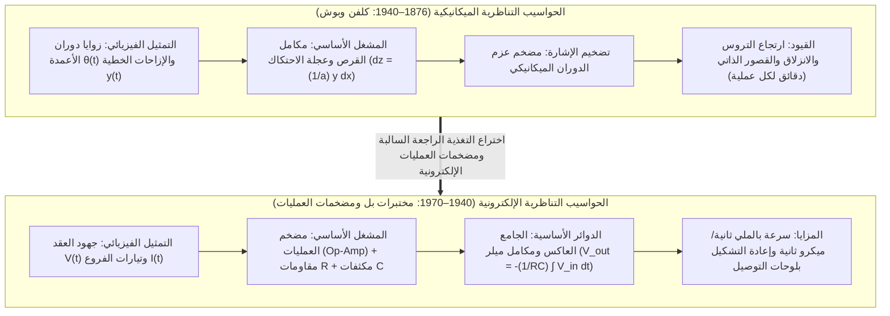

## 1. مقدمة: هل تعني «الحوسبة» بالضرورة عدّ الأرقام المنفصلة؟

عندما نسمع كلمة «حاسوب (Computer)» اليوم، يتبادر إلى أذهاننا فوراً <strong>الحاسوب الرقمي (Digital Computer)</strong>. في النموذج الرقمي، يجب أولاً تحويل كل ظاهرة متصلة في الكون الفيزيائي — من الموجات الصوتية واضطرابات الموائع ومدارات الكواكب إلى استدلال الشبكات العصبية — عبر أخذ العينات (Sampling) والتكميم (Quantization) إلى سلاسل منتهية من الأرقام الثنائية ($0$ و$1$). ثم تتبدل مليارات البوابات المنطقية بتزامن مع ساعة النظام لتقريب الرياضيات المتصلة عبر مليارات الخطوات الحسابية الأولية.

غير أن اختزال كل العمليات الحسابية في «عدّ الأرقام المنفصلة» (من اللاتينية *digitus* بمعنى إصبع) هو في الواقع مسار حديث نسبياً في تاريخ العلم. فالقوانين الأساسية للطبيعة — ميكانيكا نيوتن، ومعادلات ماكسويل للكهرومغناطيسية، ومعادلات نافييه-ستوكس للموائع، ومعادلة شرودنغر — مصاغة أصلاً بلغة <strong>المتغيرات الحقيقية المتصلة والمعادلات التفاضلية (Differential Equations)</strong>.

وقبل أن تهيمن الحواسيب الرقمية في منتصف القرن العشرين، طوّر العلماء والمهندسون فلسفة حوسبية مختلفة جذرياً: <strong>الحاسوب التناظري (Analog Computer)</strong>.

الحاسوب التناظري لا يعدّ الأرقام إطلاقاً؛ فلا يمتلك عناوين ذاكرة، ولا عدّاد برامج، ولا دورات ساعة منفصلة، ولا حلقات تكامل عددي تكرارية (مثل طريقتي أويلر أو رونغ-كوتا). بدلاً من ذلك، يحل الحاسوب التناظري المسألة الرياضية عبر بناء <strong>نظام فيزيائي — يتألف من تروس ميكانيكية، أو مكاملات قرصية، أو مضخمات عمليات (Op-Amps) ومكثفات، أو مقاييس تداخل ضوئية — تكون معادلاته الفيزيائية الحاكمة متشاكلة رياضياً (Isomorphic) مع المعادلات التفاضلية للمسألة المراد حلها</strong>. وبمجرد إغلاق الدائرة الكهربائية، تُجبر قوانين كيرشوف وحفظ الشحنة جهود العقد المتصلة $V(t)$ وتيارات الفروع $I(t)$ على التطور في الزمن الحقيقي لترسم الحل الدقيق للمعادلة التفاضلية على شاشة راسم الإشارة (Oscilloscope) دون أخطاء اقتطاع ناجمة عن التقطيع الرقمي، ودون «عنق زجاجة فون نيومان» الناتج عن نقل البيانات بين الذاكرة والمعالج.

تستعرض هذه المقالة التاريخ والأسس الفيزيائية والرياضية للحوسبة التناظرية: من المكاملات الميكانيكية لجيمس طومسون ولورد كلفن وفانيفار بوش، إلى اختراع مضخم العمليات (Op-Amp) ومكامل ميلر وطريقة كلفن للتغذية الراجعة، وصولاً إلى حدود الضوضاء الحرارية لجونسون-نايكويست، ثم <strong>النهضة الكبرى للحوسبة التناظرية في القرن الحادي والعشرين</strong> عبر الحوسبة داخل الذاكرة (Memristor Crossbars) والحوسبة الضوئية والرقائق العصبية.

---

## 2. السلالة الميكانيكية: تنفيذ التفاضل والتكامل بالتروس والأقراص

### 2.1 من آلة أنتيكيثيرا إلى المسطرة الحاسبة

أقدم حاسوب تناظري معقد معروف في التاريخ البشري هو <strong>آلة أنتيكيثيرا (Antikythera Mechanism)</strong> التي صُنعت في اليونان الهلنستية في القرن الثاني قبل الميلاد، واستخدمت أكثر من ثلاثين ترساً برونزياً (بما في ذلك ترس تفاضلي) لحساب المواقع الفلكية المتصلة للشمس والقمر والكواكب ودورات الكسوف والخسوف. وفي عشرينيات القرن السابع عشر، وبناءً على اكتشاف جون نابيير للوغاريتمات، اخترع ويليام أوتريد <strong>المسطرة الحاسبة (Slide Rule)</strong> التي تمثل العدد الموجب $x$ بطول فيزيائي يتناسب مع $\log_{10} x$، محولةً عملية الضرب $x \cdot y$ إلى جمع ميكانيكي متصل لإزاحتين مكانيتين $\log_{10} x + \log_{10} y = \log_{10}(xy)$.

### 2.2 جيمس طومسون ولورد كلفن ومكامل القرص والعجلة

تحققت القفزة الحاسمة لحل <strong>المعادلات التفاضلية</strong> ميكانيكياً عام 1876 عندما اخترع المهندس <strong>جيمس طومسون</strong>، الشقيق الأكبر للفيزيائي ويليام طومسون (<strong>اللورد كلفن</strong>)، <strong>مكامل القرص وعجلة الاحتكاك (Wheel-and-Disk Integrator)</strong>:

1. يدور <strong>قرص أفقي</strong> بزاوية متناهية الصغر $dx$ تتناسب مع المتغير المستقل $x$.
2. تستند <strong>عجلة احتكاك عمودية</strong> صغيرة نصف قطرها $a$ على سطح القرص على مسافة شعاعية $y(x)$ من المركز (تمثل الدالة المراد تكاملها).
3. عندما يدور القرص بمقدار $dx$، فإن طول القوس المقطوع تحت نقطة التلامس يساوي $y(x)\,dx$. وبافتراض تدحرج مثالي دون انزلاق، فإن زاوية دوران العجلة $dz$ تحقق $a\,dz = y(x)\,dx$، وبالتالي فإن زاوية الدوران التراكمية للعجلة $z(x)$ تحسب التكامل المحدد فيزيائياً:

$$z(x) = \frac{1}{a} \int_{x_0}^{x} y(x')\,dx'$$

استخدم اللورد كلفن هذا المكامل لبناء <strong>آلة التنبؤ بالمد والجزر (Tide-Predicting Machine)</strong> التي جمعت عشرات المركبات التوافقية لجاذبية القمر والشمس $\sum_k A_k \cos(\omega_k t + \phi_k)$ لترسم منحنيات المد والجزر لعام كامل في أربع ساعات فقط.

### 2.3 المحلل التفاضلي لفانيفار بوش ومضخم عزم الدوران

ظل ربط عدة مكاملات ميكانيكية على التوالي مستحيلاً لعقود بسبب <strong>ضعف عزم الدوران الخارج</strong> من عجلة الاحتكاك التي كانت تنزلق فور تحميلها بأي ثقل ميكانيكي. وفي عام 1931 في معهد MIT، حلّ <strong>فانيفار بوش (Vannevar Bush)</strong> هذه المعضلة باختراع <strong>مضخم عزم الدوران الميكانيكي (Torque Amplifier)</strong> المستوحى من مبدأ الرافعة البحرية (Capstan)، مما سمح بتضخيم العزم آلاف المرات عبر محرك خارجي دون إجهاد عجلة التكامل. وفي عام 1941، أثبت <strong>كلود شانون (Claude Shannon)</strong> في ورقته الشهيرة حول النظرية الرياضية للمحلل التفاضلي أن الدوال التي يمكن توليدها بعدد منتهٍ من المكاملات تطابق تماماً حلول <strong>المعادلات التفاضلية الجبرية (ADE)</strong>.

---

## 3. قلب الحوسبة التناظرية الإلكترونية: مضخم العمليات (Op-Amp)

خلال الحرب العالمية الثانية، استبدل رواد مثل <strong>كارل سواتزل</strong> في مختبرات بل، و<strong>هيلموت هولتسر</strong> (مصمم الحاسوب التناظري لتوجيه صاروخ V-2)، و<strong>جون راغازيني (John R. Ragazzini)</strong> في جامعة كولومبيا، الأعمدة الفولاذية بدوائر الصمامات المفرغة. وقد صاغ راغازيني مصطلح <strong>«مضخم العمليات (Operational Amplifier, Op-Amp)»</strong> عام 1947 للإشارة إلى مضخم التيار المستمر ذي الكسب العالي المصمم لتنفيذ <strong>العمليات الرياضية</strong> (الجمع، والضرب القياسي، والتكامل).

### 3.1 مضخم العمليات المثالي وسحر «الأرضي الافتراضي (Virtual Ground)»

مع كسب حلقة مفتوحة هائل $A_{\text{OL}} \sim 10^5 \text{–} 10^8$، يكون جهد الخرج $V_{\text{out}} = A_{\text{OL}}(V_+ - V_-)$. وعند تأريض المدخل غير العاكس ($V_+ = 0\,\text{V}$) وتطبيق <strong>تغذية راجعة سالبة (Negative Feedback)</strong> إلى المدخل العاكس $V_-$، فإن النهاية $A_{\text{OL}} \to \infty$ (مع ممانعة دخل لا نهائية $Z_{\text{in}} \to \infty$) تفرض:

$$V_+ - V_- = \frac{V_{\text{out}}}{A_{\text{OL}}} \to 0 \implies V_- = V_+ = 0\,\text{V}, \quad I_- = 0$$

تظل العقدة $V_-$ مثبتة عند $0\,\text{V}$ دون اتصال فيزيائي بالأرضي، وهو ما يُعرف <strong>بالأرضي الافتراضي (Virtual Ground)</strong>، مما يلغي تقلبات المضخم الداخلية من المعادلة الرياضية تماماً!

### 3.2 الاشتقاق الدقيق لدائرة الجمع ومكامل ميلر

1. <strong>الجامع العاكس الموزون (Summing Amplifier)</strong>:
   بتطبيق قانون كيرشوف للتيار (KCL) عند عقدة الأرضي الافتراضي ($V_- = 0$) لعدد $N$ من جهود الدخل $V_k(t)$ عبر المقاومات $R_k$ ومقاومة التغذية الراجعة $R_f$:
   $$\sum_{k=1}^N \frac{V_k(t)}{R_k} + \frac{V_{\text{out}}(t)}{R_f} = 0 \implies V_{\text{out}}(t) = -\sum_{k=1}^N \left(\frac{R_f}{R_k}\right) V_k(t)$$
2. <strong>مكامل ميلر للزمن المتصل (Miller Integrator)</strong>:
   باستبدال $R_f$ بمكثف سعته $C$ يمر به تيار $I_C(t) = C \frac{d V_{\text{out}}(t)}{dt}$، نحصل من قانون كيرشوف على:
   $$\frac{V_{\text{in}}(t)}{R} + C \frac{d V_{\text{out}}(t)}{dt} = 0 \implies V_{\text{out}}(t) = -\frac{1}{RC} \int_0^t V_{\text{in}}(\tau)\,d\tau + V_{\text{out}}(0)$$
3. <strong>لماذا تتجنب الحواسيب التناظرية استخدام المفاضلات وتعتمد كلياً على المكاملات؟</strong>
   في نطاق التردد ($s = j\omega$)، يمتلك المكامل دالة نقل $|H_{\text{int}}(\omega)| = \frac{1}{\omega RC}$ تعمل <strong>كمرشح تمرير منخفض (Low-Pass Filter)</strong> يخمّد الضوضاء الحرارية عالية التردد. أما المفاضل فدالة نقله $|H_{\text{diff}}(\omega)| = \omega RC$ (<strong>مرشح تمرير عالٍ</strong>) يضخم أي ضوضاء عالية التردد $\varepsilon \sin(\omega_{\text{high}} t)$ بمعامل $\omega_{\text{high}}$، مما يؤدي فوراً إلى تشبع المضخم واهتزازه.

---

## 4. حل المعادلات التفاضلية بالتوصيل الكهربائي: طريقة كلفن للتغذية الراجعة (Bootstrap)

لحل معادلة المتذبذب التوافقي المخمّد $m \ddot{x} + c \dot{x} + k x = F(t)$ باستخدام المكاملات فقط، تتبع <strong>طريقة كلفن للتغذية الراجعة</strong> أربع خطوات:

1. <strong>عزل المشتقة ذات الرتبة الأعلى</strong>: $\ddot{x}(t) = -\frac{c}{m}\dot{x}(t) - \frac{k}{m}x(t) + \frac{1}{m}F(t)$.
2. <strong>افتراض وجود سلك يحمل جهد المشتقة العليا $\ddot{x}(t)$ مسبقاً</strong>.
3. <strong>التكامل المتتالي</strong>: يمرر $\ddot{x}(t)$ عبر المكامل العاكس الأول (بشرط ابتدائي $-v_0$) لإنتاج $-\dot{x}(t)$، ثم عبر المكامل العاكس الثاني (بشرط ابتدائي $+x_0$) لإنتاج الحل $+x(t)$.
4. <strong>إغلاق حلقة التغذية الراجعة</strong>: تُجمع الإشارات $-\dot{x}(t)$ و$-x(t)$ و$F(t)$ عبر مقاييس فرق الجهد (Potentiometers) وجامع عاكس لتكوين الطرف الأيمن للمعادلة، ثم <strong>يوصل خرج الجامع مباشرة بعقدة الدخل $\ddot{x}(t)$ المفترضة في الخطوة الثانية!</strong>

---

## 5. فيزياء الدقة والضوضاء: لماذا تفوق الرقمي على التناظري؟

تولّد أي مقاومة $R$ عند درجة حرارة مطلقة $T > 0\,\text{K}$ <strong>ضوضاء جونسون-نايكويست الحرارية (Johnson-Nyquist Thermal Noise)</strong> عبر عرض النطاق $\Delta f$:

$$v_{\text{rms}} = \sqrt{4 k_B T R \Delta f}$$

ولتمثيل دقة قدرها $b$ بت ($2^b = V_{\max}/v_{\text{noise}}$) على سلك تناظري متصل، يجب أن تبلغ نسبة قدرة الإشارة إلى الضوضاء $\text{SNR}_{\text{power}} = 2^{2b}$. <strong>أي أن كل بت إضافي من الدقة في الحوسبة التناظرية يتطلب مضاعفة قدرة الإشارة أو السعة أربع مرات — مما يجعل التكلفة الفيزيائية تنمو أسياً بمعدل $O(2^{2b})$!</strong> ولذلك يقتصر السقف العملي لدقة الحواسيب التناظرية الإلكترونية على <strong>3 إلى 4 أرقام عشرية ($10\text{–}14\text{ بت}$، خطأ نسبي $0.01\%\text{–}0.1\%$)</strong>. في المقابل، يميز كل ترانزستور في الحاسوب الرقمي حالتين فقط ($0$ و$1$)، فتنمو التكلفة المادية لعدد $b$ من البتات <strong>خطياً أو حدودياً فقط بمعدل $O(b \sim b^2)$</strong>.

| البعد المعماري | الحاسوب التناظري الإلكتروني | الحاسوب الرقمي (معمارية فون نيومان) |
| :--- | :--- | :--- |
| <strong>تمثيل الكميات</strong> | كميات فيزيائية متصلة ($V(t), I(t)$) | كلمات ثنائية منفصلة ($b$ بت، فاصلة عائمة IEEE 754) |
| <strong>آلية التكامل</strong> | تراكم فيزيائي متصل للشحنة $V = -\frac{1}{RC}\int V_{\text{in}}\,dt$ | تقريب عددي منفصل (أويلر، رونغ-كوتا) |
| <strong>التوازي وزمن التنفيذ</strong> | <strong>توازٍ مكاني كامل</strong> (زمن حقيقي $O(1)$ مستقل عن حجم النظام $N$) | تنفيذ متسلسل متعدد المهام ($O(N \sim N^3)$) |
| <strong>سقف الدقة العملي</strong> | <strong>$3\text{–}4$ أرقام عشرية ($10\text{–}14\text{ بت}$)</strong> | دقة اختيارية ($64\text{ بت} \approx 16$ رقماً عشرياً) |
| <strong>نمو التكلفة مع الدقة $b$</strong> | <strong>نمو أسي $\propto O(2^{2b})$</strong> (محدود بالضوضاء الحرارية $k_B T$) | <strong>نمو خطي / حدودي $\propto O(b \sim b^2)$</strong> |

وفي برنامج أبولو الفضائي، جمعت <strong>الحواسيب الهجينة (Hybrid Computers)</strong> بين السرعة الفورية للحواسيب التناظرية (لمحاكاة ديناميكا الطيران ذات 6 درجات حرية في الزمن الحقيقي) والدقة الرقمية ذات 64 بت للملاحة المدارية إلى القمر.

---

## 6. نهضة القرن الحادي والعشرين: الحوسبة داخل الذاكرة (AIMC) والضوئيات والرقائق العصبية

اليوم، مع وصول قانون مور إلى حدوده الذرية وتفاقم أزمة استهلاك الطاقة الناتجة عن نقل البيانات بين الذاكرة والمعالج (<strong>عنق زجاجة فون نيومان</strong>) في نماذج التعلم العميق والنماذج اللغوية الكبيرة (LLMs)، تشهد الحوسبة التناظرية عودة مذهلة:

- <strong>الحوسبة التناظرية داخل الذاكرة (AIMC) بمصفوفات الميمريستور</strong>: أكثر من $99\%$ من حسابات الذكاء الاصطناعي هي ضرب مصفوفة في متجه $y_i = \sum_{j=1}^N W_{ij} x_j$ لا يحتاج إلا لدقة منخفضة ($4\text{–}8\text{ بت}$). وبتخزين الأوزان $W_{ij}$ كقيم مواصلة كهربائية $G_{ij} = 1/R_{ij}$ في مصفوفة ميمريستور (ReRAM/PCM)، ينفذ <strong>قانون أوم</strong> ($I_{ij} = G_{ij} V_j$) و<strong>قانون كيرشوف للتيار</strong> ($I_i = \sum_j G_{ij} V_j$) عملية ضرب المصفوفة كاملة في بضع نانوثوانٍ بزمن $O(1)$ مباشرة داخل الذاكرة!
- <strong>ضوئيات السيليكون والرقائق العصبية والمعادلات التفاضلية العصبية (Neural ODEs)</strong>: تستخدم المعالجات الضوئية تداخل الليزر في شبكات مقاييس تداخل ماخ-زيندر (MZI) لضرب المصفوفات بسرعة الضوء؛ وتعتمد <strong>الرقائق العصبية تحت العتبة (Subthreshold CMOS)</strong> التي ابتكرها كارفر ميد على الفيزياء الأسية للترانزستورات لمحاكاة المعادلات التفاضلية للقنوات الأيونية في الخلايا العصبية الحيوية، بينما تعيد <strong>الشبكات العصبية السائلة (Liquid Neural Networks) وNeural ODEs</strong> المعادلات التفاضلية المتصلة إلى قلب الذكاء الاصطناعي الحديث.
