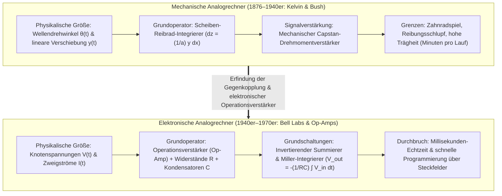
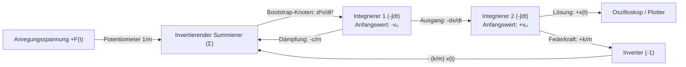

## 1. Einleitung: Bedeutet „Rechnen“ zwangsläufig das Zählen diskreter Zahlen?

Wenn wir heute das Wort „Computer“ hören, denken wir fast ausschließlich an den <strong>Digitalrechner (Digital Computer)</strong>. Im digitalen Paradigma wird jedes kontinuierliche Phänomen der Natur – Schallwellen, Lichtintensitäten, Turbulenzen, Planetenbahnen oder neuronale Inferenz – zunächst durch Abtastung (Sampling) und Quantisierung in diskrete Folgen binärer Ziffern ($0$ und $1$) zerlegt. Anschließend schalten Milliarden von Logikgattern im Takt eines globalen Systemtakts, um kontinuierliche Mathematik durch Milliarden elementarer Arithmetikschritte anzunähern.

Historisch und physikalisch betrachtet ist die Reduktion aller Berechnungen auf das Zählen diskreter Ziffern (von lateinisch *digitus*, „Finger“) jedoch ein überraschend junger Umweg. Die Grundgesetze des Universums – die Newtonschen Bewegungsgleichungen, die Maxwell-Gleichungen der Elektrodynamik, die Navier-Stokes-Gleichungen und die Schrödinger-Gleichung – sind von Natur aus in der Sprache <strong>kontinuierlicher reeller Größen und Differentialgleichungen</strong> formuliert.

Lange bevor digitale Computer Mitte des 20. Jahrhunderts die Vorherrschaft übernahmen, verfolgten Wissenschaftler und Ingenieure eine radikal andere Berechnungsphilosophie: den <strong>Analogrechner (Analog Computer)</strong>.

Ein Analogrechner zählt keine Ziffern. Er besitzt weder Speicheradressen noch Befehlszähler, keinen diskreten Systemtakt und keine numerischen Integrationsschleifen (wie das Euler- oder Runge-Kutta-Verfahren). Stattdessen löst ein Analogrechner ein Problem, indem er ein <strong>physikalisches Modellsystem konstruiert – bestehend aus Zahnrädern, mechanischen Reibrad-Integrierern, Operationsverstärkern (Op-Amps), Kondensatoren oder optischen Interferometern –, dessen physikalische Grundgleichungen mathematisch isomorph (strukturgleich) zu den Differentialgleichungen des zu untersuchenden Problems sind</strong>. Sobald der Stromkreis geschlossen wird, zwingen die Kirchhoffschen Gesetze und die Ladungserhaltung die kontinuierlichen Knotenspannungen $V(t)$ und Zweigströme $I(t)$ dazu, sich exakt gemäß der Differentialgleichung in Echtzeit zu entwickeln – frei von Diskretisierungsfehlern und ohne den Von-Neumann-Flaschenhals des Datentransfers zwischen Prozessor und Speicher.

Dieser Artikel beleuchtet die gesamte Entwicklung des analogen Rechnens: von den mechanischen Integrierern von James Thomson, Lord Kelvin und Vannevar Bush über die Erfindung des Operationsverstärkers und Kelvins Bootstrap-Rückkopplungsmethode bis hin zu den thermodynamischen und informationstheoretischen Grenzen (Johnson-Nyquist-Rauschen) sowie der spektakulären <strong>Renaissance des Analogrechners im 21. Jahrhundert</strong> durch Analog In-Memory Computing (Memristor-Crossbars), Silizium-Photonik und neuromorphe Hardware.

---

## 2. Die mechanische Ära: Analysis mit Zahnrädern und Reibscheiben

### 2.1 Vom Mechanismus von Antikythera bis zum Rechenschieber

Der älteste bekannte komplexe Analogrechner der Menschheit ist der <strong>Mechanismus von Antikythera</strong> aus dem 2. Jahrhundert v. Chr., der mit über 30 präzisen Bronzezahnradgetrieben (einschließlich eines Differentialgetriebes) die kontinuierlichen ekliptikalen Positionen von Sonne, Mond und Planeten sowie Finsterniszyklen berechnete. Um 1622 erfand William Oughtred auf Basis von John Napiers Logarithmen den <strong>Rechenschieber (Slide Rule)</strong>: Durch die Abbildung einer Zahl $x$ auf eine physikalische Streckenlänge proportional zu $\log_{10} x$ verwandelte er die Multiplikation $x \cdot y$ in die kontinuierliche mechanische Addition zweier Längen $\log_{10} x + \log_{10} y = \log_{10}(xy)$.

### 2.2 James Thomson, Lord Kelvin und der Scheiben-Kugel-Zylinder-Integrierer

Der entscheidende Durchbruch zur mechanischen Lösung von <strong>Differentialgleichungen</strong> gelang 1876 in Großbritannien. <strong>James Thomson</strong>, der ältere Bruder von William Thomson (<strong>Lord Kelvin</strong>), erfand den <strong>Reibrad-Scheiben-Integrierer (Wheel-and-Disk Integrator)</strong>:

1. Eine horizontale <strong>Kreisscheibe (Disk)</strong> dreht sich um einen differentiellen Winkel $dx$, der die unabhängige Variable $x$ repräsentiert.
2. Ein kleines vertikales <strong>Reibrad (Integrator Wheel)</strong> mit Radius $a$ liegt im radialen Abstand $y(x)$ (dem Integranden) auf der Scheibe auf.
3. Dreht sich die Scheibe um $dx$, legt der Kontaktpunkt im Abstand $y(x)$ die Bogenlänge $y(x)\,dx$ zurück. Bei schlupffreiem Abrollen gilt für den Drehwinkel $dz$ des Reibrads $a\,dz = y(x)\,dx$, sodass der Gesamtdrehwinkel $z(x)$ exakt das bestimmte Integral berechnet:

$$z(x) = \frac{1}{a} \int_{x_0}^{x} y(x')\,dx'$$

Lord Kelvin nutzte dieses Prinzip für seine berühmte <strong>Gezeiten-Vorhersagemaschine (Tide-Predicting Machine)</strong>, die Dutzende harmonische Partialtiden $\sum_k A_k \cos(\omega_k t + \phi_k)$ über Seilzüge summierte und innerhalb von vier Stunden die Gezeitenkurven eines ganzen Jahres aufzeichnete.

### 2.3 Vannevar Bushs „Differential Analyzer“ und der Drehmomentverstärker

Lange Zeit scheiterte die Kopplung mehrerer mechanischer Integrierer am <strong>geringen Ausgangsdrehmoment</strong> des Reibrads: Jede mechanische Last führte sofort zum Durchrutschen auf der Scheibe. Zwischen 1927 und 1931 löste <strong>Vannevar Bush</strong> am MIT dieses Problem durch den nach dem Spill-Prinzip (Capstan) arbeitenden mechanischen <strong>Drehmomentverstärker (Torque Amplifier)</strong>, der das Ausgangsdrehmoment mithilfe eines externen Elektromotors tausendfach verstärkte, ohne das Reibrad zu belasten. 1941 bewies <strong>Claude Shannon</strong> in seiner Arbeit *Mathematical Theory of the Differential Analyzer*, dass die Klasse der von einem solchen Analysator erzeugbaren Funktionen exakt den Lösungen <strong>algebraischer Differentialgleichungen (ADE)</strong> entspricht.

---

## 3. Das Herz des elektronischen Analogrechners: Der Operationsverstärker (Op-Amp)

Während des Zweiten Weltkriegs ersetzten Pioniere wie <strong>Karl D. Swartzel Jr.</strong> (Bell Labs), <strong>Helmut Hoelzer</strong> (Entwickler des analogen Bordrechners der V2-Rakete) und <strong>John R. Ragazzini</strong> (Columbia University) mechanische Wellen durch Röhrenschaltungen. Der Begriff <strong>„Operationsverstärker (Operational Amplifier, Op-Amp)“</strong> wurde 1947 von Ragazzini geprägt, weil diese Gleichspannungsverstärker speziell zur Ausführung mathematischer Operationen (Addition, Integration, Skalierung) in Analogrechnern entwickelt wurden.

### 3.1 Idealer Op-Amp und das Prinzip der „Virtuellen Masse (Virtual Ground)“

Ein Operationsverstärker verstärkt die Differenz zwischen nicht-invertierendem Eingang ($V_+$) und invertierendem Eingang ($V_-$) mit einer enormen Leerlaufverstärkung $A_{\text{OL}} \sim 10^5 \text{–} 10^8$:

$$V_{\text{out}} = A_{\text{OL}} (V_+ - V_-)$$

Wird $V_+ = 0\,\text{V}$ auf Masse gelegt und über ein passives Rückkopplungsnetzwerk eine <strong>Gegenkopplung (Negative Feedback)</strong> vom Ausgang $V_{\text{out}}$ zum Eingang $V_-$ geführt, erzwingt der Grenzübergang $A_{\text{OL}} \to \infty$ (bei unendlichem Eingangswiderstand $Z_{\text{in}} \to \infty$):

$$V_+ - V_- = \frac{V_{\text{out}}}{A_{\text{OL}}} \to 0 \implies V_- = V_+ = 0\,\text{V}, \quad I_- = 0$$

Der Knoten $V_-$ liegt damit auf einer <strong>virtuellen Masse (Virtual Ground)</strong>. Dadurch fallen die internen Verstärkerparameter vollständig aus der Übertragungsfunktion heraus!

### 3.2 Exakte Herleitung von Summierer und Miller-Integrierer

1. <strong>Invertierender gewichteter Summierer (Summing Amplifier)</strong>:
   Über $N$ Eingangswiderstände $R_1, \dots, R_N$ fließen die Ströme $I_k = V_k(t)/R_k$ zum Summierpunkt ($V_- = 0$). Nach der Kirchhoffschen Knotenregel (KCL) muss ihre Summe vollständig durch den Rückkopplungswiderstand $R_f$ abfließen:
   $$\sum_{k=1}^N \frac{V_k(t)}{R_k} + \frac{V_{\text{out}}(t)}{R_f} = 0 \implies V_{\text{out}}(t) = -\sum_{k=1}^N \left(\frac{R_f}{R_k}\right) V_k(t)$$
2. <strong>Kontinuierlicher Zeitintegrierer (Miller-Integrator)</strong>:
   Ersetzt man $R_f$ durch einen Präzisionskondensator der Kapazität $C$, gilt mit $I_C(t) = C \frac{d V_{\text{out}}(t)}{dt}$ am Summierpunkt $V_- = 0$:
   $$\frac{V_{\text{in}}(t)}{R} + C \frac{d V_{\text{out}}(t)}{dt} = 0 \implies V_{\text{out}}(t) = -\frac{1}{RC} \int_0^t V_{\text{in}}(\tau)\,d\tau + V_{\text{out}}(0)$$
3. <strong>Warum Analogrechner niemals Differenzierer, sondern ausschließlich Integrierer verwenden</strong>:
   Im Frequenzbereich ($s = j\omega$) wirkt der Integrierer mit $|H_{\text{int}}(\omega)| = \frac{1}{\omega RC}$ als stabilisierender <strong>Tiefpassfilter</strong>, der hochfrequentes Rauschen glättet. Ein Differenzierer hingegen besitzt die Übertragungsfunktion $|H_{\text{diff}}(\omega)| = \omega RC$ (<strong>Hochpassfilter</strong>): Er verstärkt selbst winziges hochfrequentes Rauschen $\varepsilon \sin(\omega_{\text{high}} t)$ um den Faktor $\omega_{\text{high}}$, was sofort zur Übersteuerung und zu parasitären Oszillationen führt.

---

## 4. Differentialgleichungen durch Verdrahtung lösen: Kelvins Bootstrap-Methode

Um die Differentialgleichung eines gedämpften harmonischen Oszillators $m \ddot{x} + c \dot{x} + k x = F(t)$ ausschließlich mit Integrierern zu lösen, wendet man <strong>Kelvins Rückkopplungsmethode (Bootstrap-Verfahren)</strong> an:

1. <strong>Nach der höchsten Ableitung auflösen</strong>: $\ddot{x}(t) = -\frac{c}{m}\dot{x}(t) - \frac{k}{m}x(t) + \frac{1}{m}F(t)$.
2. <strong>Annehmen, dass die Spannung $\ddot{x}(t)$ bereits an einem Schaltungsknoten vorliegt</strong>.
3. <strong>Durch Kaskadierung von Integrierern alle niedrigeren Ableitungen erzeugen</strong>: Ein erster invertierender Integrierer (Anfangswert $-v_0$) integriert $\ddot{x}(t)$ zu $-\dot{x}(t)$; ein zweiter invertierender Integrierer (Anfangswert $+x_0$) integriert $-\dot{x}(t)$ zur gesuchten Trajektorie $+x(t)$.
4. <strong>Den Rückkopplungskreis schließen</strong>: Aus $-\dot{x}(t)$, $-x(t)$ und $F(t)$ wird über Potentiometer und einen Summierer die rechte Seite der Gleichung gebildet und direkt auf den in Schritt 2 angenommenen Eingangsknoten $\ddot{x}(t)$ zurückgeführt!

Durch <strong>Amplitudenskalierung</strong> (z. B. $\pm 10\,\text{V}$ als 1 Machine Unit), <strong>Zeitskalierung</strong> (repetierendes Rechnen im Millisekunden-Takt) und <strong>Parabelmultiplizierer (Quarter-Square Multipliers)</strong> nach $XY = \frac{1}{4}[(X+Y)^2 - (X-Y)^2]$ lassen sich auch hochgradig nichtlineare Differentialgleichungen in Echtzeit lösen.

---

## 5. Physik der Präzision und des Rauschens: Warum Digital über Analog triumphierte

Warum wurden Analogrechner trotz ihrer $O(1)$-Echtzeitparallelität in den 1970er Jahren von Digitalrechnern verdrängt? Der fundamentale Grund liegt im <strong>thermischen Rauschen und der exponentiellen Skalierung der Präzisionskosten</strong>:

An jedem Widerstand $R$ bei absoluter Temperatur $T > 0\,\text{K}$ entsteht durch die Brownsche Bewegung der Elektronen das <strong>thermische Johnson-Nyquist-Rauschen</strong>:

$$v_{\text{rms}} = \sqrt{4 k_B T R \Delta f}$$

Hinzu kommen Schrotrauschen, $1/f$-Rauschen und Offset-Drift $V_{\text{os}}$ (die erst 1949 durch Edwin Goldbergs <strong>Chopper-stabilisierten Verstärker</strong> drastisch reduziert werden konnte). Um eine Genauigkeit von $b$ Bits ($2^b = V_{\max}/v_{\text{noise}}$) auf einer analogen Leitung darzustellen, muss das Signal-Rausch-Leistungsverhältnis $\text{SNR}_{\text{power}} = 2^{2b}$ betragen. <strong>Jedes zusätzliche Bit an Genauigkeit erfordert im Analogen eine Vervierfachung der Signalleistung bzw. Kapazität – ein exponentieller Ressourcenaufwand von $O(2^{2b})$!</strong> Praktisch sind elektronische Analogrechner daher auf <strong>3 bis 4 Dezimalstellen ($10\text{–}14\text{ Bit}$, $0{,}01\%\text{–}0{,}1\%$ Fehler)</strong> begrenzt. Im Digitalrechner hingegen unterscheidet jeder Transistor nur zwei Zustände ($0$ und $1$), sodass der Hardwareaufwand für $b$ Bits lediglich <strong>linear bzw. polynomiell mit $O(b \text{ bis } b^2)$</strong> wächst!

| Merkmal | Elektronischer Analogrechner | Digitalrechner (Von-Neumann-Architektur) |
| :--- | :--- | :--- |
| <strong>Informationsdarstellung</strong> | Kontinuierliche physikalische Größen ($V(t), I(t)$) | Diskrete Binärwörter ($b$-Bit-Gleitkommazahlen) |
| <strong>Integration</strong> | Exakte physikalische Ladungsintegration am Kondensator | Numerische Approximation in diskreten Zeitschritten $\Delta t$ |
| <strong>Parallelität & Laufzeit</strong> | <strong>Vollständig räumlich parallel</strong> ($O(1)$ Echtzeit unabhängig von $N$) | Zeitmultiplex auf endlichen ALU-Kernen ($O(N \sim N^3)$) |
| <strong>Maximale Rechengenauigkeit</strong> | <strong>$3\text{–}4$ Dezimalstellen ($10\text{–}14\text{ Bit}$)</strong> | Beliebig skalierbar ($64\text{-Bit IEEE 754} \approx 16$ Dezimalstellen) |
| <strong>Kostenwachstum mit Präzision $b$</strong> | <strong>Exponentiell $\propto O(2^{2b})$</strong> (begrenzt durch $k_B T$-Rauschen) | <strong>Linear / Polynomiell $\propto O(b \sim b^2)$</strong> |

Im Apollo-Raumfahrtprogramm kombinierten <strong>Hybridrechner (Hybrid Computers)</strong> die Echtzeit-Differentialgleichungslösung analoger Subsysteme (für Hardware-in-the-Loop-Flugsimulatoren) mit der hohen Präzision digitaler Bahnnavigationsrechner.

---

## 6. Die Renaissance im 21. Jahrhundert: Analoges KI-Computing, Photonik und Neuromorphik

Heute stößt die digitale CMOS-Skalierung an atomare Grenzen, während Deep-Learning-Modelle unter dem enormen Energieverbrauch des Datentransfers zwischen Speicher und Prozessor (<strong>Von-Neumann-Flaschenhals</strong>) leiden. Da künstliche neuronale Netze für Matrix-Vektor-Multiplikationen $y_i = \sum_{j=1}^N W_{ij} x_j$ keine 64-Bit-Genauigkeit benötigen, sondern mit $4\text{–}8\text{ Bit}$ (`INT4`/`INT8`) auskommen, erlebt das analoge Rechnen ein spektakuläres Comeback:

- <strong>Analog In-Memory Computing (AIMC) mit Memristor-Crossbars</strong>: Gewichte $W_{ij}$ werden als Leitwerte $G_{ij} = 1/R_{ij}$ in nichtflüchtigen Memristor-Arrays (ReRAM, PCM) gespeichert. Das Anlegen eines Spannungsvektors $V_j$ führt über das <strong>Ohmsche Gesetz</strong> ($I_{ij} = G_{ij} V_j$) und die <strong>Kirchhoffsche Knotenregel</strong> ($I_i = \sum_j G_{ij} V_j$) eine komplette Matrixmultiplikation in wenigen Nanosekunden direkt im Speicher in $O(1)$ Zeit bei einem Bruchteil der Energie aus!
- <strong>Silizium-Photonik, Neuromorphe Chips und Neural ODEs</strong>: Kohärente optische Prozessoren berechnen Matrixmultiplikationen durch Lichtinterferenz in Mach-Zehnder-Interferometern mit Lichtgeschwindigkeit; <strong>neuromorphe Subthreshold-CMOS-Schaltungen</strong> (nach Carver Mead) bilden die exponentielle Ionenkanal-Physik biologischer Neuronen direkt im Silizium nach, und <strong>Liquid Neural Networks / Neural ODEs</strong> vereinen kontinuierliche Differentialgleichungen mit moderner Künstlicher Intelligenz.
