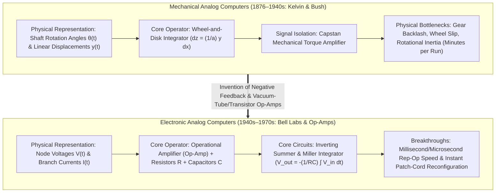
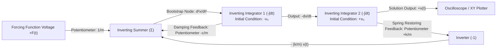
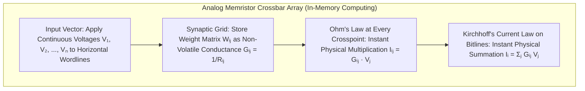

## 1. Introduction: Does "Computation" Mean Counting Numbers?

When we hear the word "computer" today, we almost reflexively picture a <strong>digital computer</strong>. In the digital paradigm, every phenomenon of the physical universe—sound waves, light intensities, turbulent fluid vortices, planetary orbits, and neural representations—must first be discretized through sampling and quantization into finite strings of binary digits ($0$ and $1$). Those bits are then shuttled back and forth between memory banks and arithmetic logic units (ALUs), where billions of discrete logic gates switch in lockstep with a global clock to approximate continuous mathematics through billions of elementary arithmetic steps.

Yet from the perspective of the history of science and physics, reducing all calculation to counting discrete digits (from the Latin *digitus*, meaning "finger") is a surprisingly recent detour. The fundamental laws of nature—Newtonian mechanics, Maxwell's electrodynamics, the Navier-Stokes equations of fluid flow, general relativity, and the Schrödinger wave equation—are formulated natively in the language of <strong>continuous real and complex variables governed by differential equations</strong>.

Long before electronic digital computers achieved dominance in the mid-twentieth century, scientists and engineers pursued a radically different computational philosophy: <strong>the Analog Computer</strong>.

An analog computer does not count digits. It possesses no instruction pointer, no memory addresses, no discrete clock cycles, and no iterative numerical integration loops (such as Euler's method or Runge-Kutta schemes). Instead, an analog computer solves a mathematical problem by constructing a <strong>physical system—composed of rotating gears, mechanical integrators, fluid pressures, operational amplifiers, capacitors, or optical interferometers—whose governing physical equations are mathematically isomorphic (identical in form) to the differential equations of the problem under investigation</strong>.

In an electronic analog computer, mathematical variables are represented directly by continuous physical quantities: node voltages $V(t)$ and branch currents $I(t)$. Once the circuit is wired together, simply flipping the power switch forces the electrons, governed by Kirchhoff's circuit laws and conservation of charge, to evolve in continuous time. Reading the output voltage on an oscilloscope yields the exact, continuous solution to the system of differential equations in real time—without algorithmic convergence delays, without discretization truncation error, and without the von Neumann bottleneck of memory-processor data movement.

In this article, we trace the full arc of analog computation: from the mechanical marvels of James Thomson, Lord Kelvin, and Vannevar Bush, through the invention of the operational amplifier (op-amp) and Kelvin's feedback bootstrap method for solving ordinary differential equations (ODEs), to the fundamental thermodynamic and information-theoretic limits (Johnson-Nyquist thermal noise and exponential precision scaling) that handed victory to digital CMOS in the 1970s—and finally to the breathtaking <strong>twenty-first-century renaissance of analog computing</strong> in AI In-Memory Computing (memristor crossbars), silicon photonics, and neuromorphic engineering.

---

## 2. The Mechanical Lineage: Computing Calculus with Gears and Disks

### 2.1 From the Antikythera Mechanism to the Slide Rule

The earliest known complex analog computer in human history is the <strong>Antikythera Mechanism</strong>, crafted in the Hellenistic world around the second century BCE. Housing over thirty precision bronze gears—including a sophisticated epicyclic differential gear assembly—it computed the continuous celestial longitudes of the Sun, Moon, and planets, as well as the Saros eclipse cycle, by mapping astronomical time into continuous gear-rotation ratios. Seventeen centuries later, following John Napier's discovery of logarithms in 1614, William Oughtred invented the <strong>slide rule</strong> (c. 1622). By mapping a positive real number $x$ onto a physical length proportional to $\log_{10} x$, the slide rule transformed multiplication $x \cdot y$ into the continuous mechanical addition of two spatial displacements, $\log_{10} x + \log_{10} y = \log_{10}(xy)$—serving as the indispensable pocket computer of engineers right through the Apollo Moon landings.

### 2.2 James Thomson, Lord Kelvin, and the Wheel-and-Disk Integrator

While slide rules and planimeters handled arithmetic and area measurement, the decisive leap that enabled machines to solve <strong>differential equations</strong> occurred in 1876. <strong>James Thomson</strong>, Professor of Engineering at Glasgow and elder brother of William Thomson (<strong>Lord Kelvin</strong>), invented the <strong>Disk-Globe-Cylinder Integrator</strong> (soon refined into the classic <strong>Wheel-and-Disk Integrator</strong>).

Its geometric principle is a triumph of kinematic elegance:

1. A flat horizontal circular <strong>disk</strong> rotates by an infinitesimal angle $dx$, driven by a shaft representing the independent variable $x$.
2. A small vertical <strong>friction wheel</strong> of radius $a$ rests perpendicular to the surface of the disk at a radial distance $y(x)$ from the disk's center. A lead-screw mechanism moves the wheel radially inward or outward so that its position tracks the dependent integrand variable $y(x)$.
3. As the disk rotates by $dx$, the arc length traced on the disk directly beneath the contact point at radius $y(x)$ is $ds = y(x)\,dx$. Assuming ideal rolling contact without slipping, this arc length must equal the arc length $a\,dz$ rotated by the friction wheel of radius $a$:

$$a\,dz = y(x)\,dx \implies z(x) = \frac{1}{a} \int_{x_0}^{x} y(x')\,dx'$$

Thus, the cumulative rotation angle $z(x)$ of the friction wheel physically evaluates the definite integral of $y(x)$ with respect to $x$ in continuous time!

Lord Kelvin immediately recognized the revolutionary implications of his brother's mechanism. Between 1872 and 1876, Kelvin constructed the first <strong>Tide-Predicting Machine</strong>, combining harmonic crank-and-pulley synthesizers to sum the principal lunar and solar tidal constituents $\sum_k A_k \cos(\omega_k t + \phi_k)$, and laid out the mathematical theory for solving general differential equations mechanically.

### 2.3 Vannevar Bush's Differential Analyzer and the Torque Amplifier

Despite Kelvin's theoretical blueprint, building a general-purpose mechanical differential equation solver remained impossible for fifty years due to a single mechanical obstacle: <strong>insufficient output torque</strong>. Because the integrator wheel is driven solely by delicate rolling friction against the face of the disk, attempting to use its output shaft to drive the heavy lead screws of subsequent integrators causes the wheel to slip on the disk, destroying mathematical accuracy.

In 1927–1931 at MIT, <strong>Vannevar Bush</strong> and his colleagues solved this problem by inventing the <strong>Differential Analyzer</strong>. Bush incorporated the <strong>Niemann Torque Amplifier</strong>—a mechanical servo mechanism operating on the principle of a ship's capstan winch. When the delicate integrator wheel rotated with minuscule force, it tightened a friction band wrapped around a drum spun continuously by a powerful external electric motor. The drum supplied thousands of times more torque to the output shaft while imposing virtually zero mechanical drag on the integrator wheel itself.

With torque amplification, Bush could cascade six to eighteen mechanical integrators, differential gear adders, and input/output plotting tables on a massive frame of interconnected steel shafts. In 1941, <strong>Claude Shannon</strong> published his landmark paper *Mathematical Theory of the Differential Analyzer*, proving rigorously that a differential analyzer with a finite number of integrators can generate a function $f(x)$ if and only if $f(x)$ satisfies an <strong>Algebraic Differential Equation (ADE)</strong> (demonstrating that hypertranscendental functions such as Euler's Gamma function $\Gamma(x)$ and Riemann's Zeta function $\zeta(x)$ cannot be generated exactly by finite bush-type analyzers).

---

## 3. The Heart of Electronic Analog Computing: The Operational Amplifier

Mechanical differential analyzers were marvels of engineering, but reprogramming them required hours of unbolting gears and shafts, and mechanical inertia limited their operating speed to minutes per solution run. During World War II, engineers including <strong>Karl D. Swartzel Jr.</strong> at Bell Labs (designing the M9 anti-aircraft gun director), <strong>Helmut Hoelzer</strong> in Germany (developing the onboard analog guidance computer for the V-2 rocket), and <strong>John R. Ragazzini</strong>, <strong>Robert H. Randall</strong>, and <strong>Frederick A. Russell</strong> at Columbia University replaced rotating steel shafts with vacuum-tube electronic circuits.

In fact, the very term <strong>"Operational Amplifier (Op-Amp)"</strong> was coined in Ragazzini's classic 1947 paper (*"Analysis of Problems in Dynamics by Electronic Circuits"*, *Proceedings of the IRE*) because these high-gain DC amplifiers were designed specifically to perform <strong>mathematical operations</strong>—addition, subtraction, scaling, and integration—inside electronic analog computers.

### 3.1 The Ideal Op-Amp and the Magic of the "Virtual Ground"

An operational amplifier is a differential voltage amplifier with a non-inverting input terminal ($V_+$), an inverting input terminal ($V_-$), and an output terminal ($V_{\text{out}}$) governed by a massive open-loop voltage gain $A_{\text{OL}}$ (typically $10^5$ to $10^8$):

$$V_{\text{out}} = A_{\text{OL}} (V_+ - V_-)$$

By itself, an open-loop amplifier is too unstable and nonlinear for precision mathematics; its gain $A_{\text{OL}}$ drifts with temperature, power supply fluctuations, and vacuum-tube or transistor aging. However, by applying <strong>Negative Feedback</strong>—invented by Harold S. Black in 1927, routing the output $V_{\text{out}}$ back to the inverting input $V_-$ through precision passive impedance networks—a remarkable mathematical simplification occurs.

Consider an ideal op-amp ($A_{\text{OL}} \to \infty$, input impedance $Z_{\text{in}} \to \infty$, output impedance $Z_{\text{out}} \to 0$) with its non-inverting terminal grounded ($V_+ = 0\,\text{V}$). Because $V_{\text{out}}$ remains bounded within the linear supply rails (e.g., $\pm 10\,\text{V}$ or $\pm 100\,\text{V}$), dividing by $A_{\text{OL}} \to \infty$ forces the differential input voltage to vanish:

$$V_+ - V_- = \frac{V_{\text{out}}}{A_{\text{OL}}} \xrightarrow{A_{\text{OL}} \to \infty} 0 \implies V_- = V_+ = 0\,\text{V}$$

Even though the inverting node $V_-$ is not physically wired to ground, the op-amp's negative feedback actively drives $V_{\text{out}}$ to whatever voltage is required to hold $V_-$ at exactly $0\,\text{V}$. This node is called a <strong>Virtual Ground (Summing Junction)</strong>. Furthermore, because the input impedance is infinite, <strong>zero current flows into the op-amp's input terminal ($I_- = 0$)</strong>.

Together, $V_- = 0$ and $I_- = 0$ completely eliminate the op-amp's internal parameters from the input-output transfer function, leaving the mathematical operation determined solely by precision external resistors and capacitors!

### 3.2 Exact Circuit Derivations of the Mathematical Operators

#### 1. The Inverting Weighted Summer (Summing Amplifier)

Connect $N$ input voltage signals $V_1(t), V_2(t), \dots, V_N(t)$ through input resistors $R_1, R_2, \dots, R_N$ to the virtual ground summing junction ($V_- = 0$), and connect a feedback resistor $R_f$ from the output $V_{\text{out}}(t)$ back to the summing junction.
By Ohm's Law, the current arriving from the $k$-th input branch is $I_k(t) = \frac{V_k(t) - V_-}{R_k} = \frac{V_k(t)}{R_k}$. Since $I_- = 0$, Kirchhoff's Current Law (KCL) at the summing junction dictates that the algebraic sum of all input currents plus the feedback current $I_f(t) = \frac{V_{\text{out}}(t) - V_-}{R_f}$ must equal zero:

$$\sum_{k=1}^N \frac{V_k(t)}{R_k} + \frac{V_{\text{out}}(t)}{R_f} = 0 \implies V_{\text{out}}(t) = -\sum_{k=1}^N \left(\frac{R_f}{R_k}\right) V_k(t)$$

By combining this circuit with precision voltage-divider <strong>potentiometers</strong> (which multiply any voltage by a constant coefficient $0 \le \alpha \le 1$), an analog computer evaluates arbitrary linear combinations $-\sum_{k=1}^N a_k V_k(t)$ instantaneously and continuously at the speed of electromagnetic propagation.

#### 2. The Continuous-Time Integrator (Miller Integrator)

Now replace the feedback resistor $R_f$ with a precision polystyrene or Teflon feedback <strong>capacitor</strong> of capacitance $C$, while feeding an input voltage $V_{\text{in}}(t)$ through an input resistor $R$ to the summing junction ($V_- = 0$).
The charge on the capacitor is $Q(t) = C(V_- - V_{\text{out}}(t)) = -C V_{\text{out}}(t)$, so the current flowing from the output through the capacitor into the summing junction is $I_C(t) = C \frac{d V_{\text{out}}(t)}{dt}$. Applying KCL at the virtual ground node $V_- = 0$ yields:

$$\frac{V_{\text{in}}(t)}{R} + C \frac{d V_{\text{out}}(t)}{dt} = 0 \implies \frac{d V_{\text{out}}(t)}{dt} = -\frac{1}{RC} V_{\text{in}}(t)$$

Integrating both sides with respect to time from $t = 0$ to $t$, and pre-charging the capacitor via an Initial Condition (IC) relay network to voltage $V_{\text{out}}(0)$ prior to the run, we obtain the fundamental equation of electronic analog integration:

$$V_{\text{out}}(t) = -\frac{1}{RC} \int_0^t V_{\text{in}}(\tau)\,d\tau + V_{\text{out}}(0)$$

When $R = 1\,\text{M}\Omega$ and $C = 1\,\mu\text{F}$, the time constant is $RC = 1\,\text{s}$, and the output voltage is the exact negative time integral of the input voltage! Moreover, by connecting multiple input resistors $R_1, R_2, \dots, R_N$ to the same summing junction, a single op-amp acts as a <strong>Summing Integrator</strong>:

$$V_{\text{out}}(t) = -\int_0^t \left(\sum_{k=1}^N \frac{V_k(\tau)}{R_k C}\right) d\tau + V_{\text{out}}(0)$$

#### 3. Why Analog Computers Must Avoid Differentiators and Use Only Integrators

At first glance, swapping the positions of the resistor $R$ and capacitor $C$ creates an electronic differentiator: $V_{\text{out}}(t) = -RC \frac{d V_{\text{in}}(t)}{dt}$. Why, then, is it an ironclad rule of analog computer engineering to <strong>never solve differential equations using differentiators, and instead reformulate every problem exclusively in terms of integrators</strong>?

The answer lies in the Laplace frequency domain ($s = j\omega$) and the physics of high-frequency noise:

- <strong>The Integrator Transfer Function</strong>: $H_{\text{int}}(j\omega) = -\frac{1}{j\omega RC}$, with magnitude $|H_{\text{int}}(\omega)| = \frac{1}{\omega RC}$. Gain falls off at $-20\,\text{dB/decade}$ as frequency $\omega$ increases. An integrator acts as a natural <strong>low-pass filter</strong> that smooths out high-frequency thermal noise, electromagnetic interference, and switching transients.
- <strong>The Differentiator Transfer Function</strong>: $H_{\text{diff}}(j\omega) = -j\omega RC$, with magnitude $|H_{\text{diff}}(\omega)| = \omega RC$. Gain rises relentlessly at $+20\,\text{dB/decade}$ with frequency! If the input signal contains even a microscopic high-frequency noise component $n(t) = \varepsilon \sin(\omega_{\text{high}} t)$, its derivative is $\dot{n}(t) = \varepsilon \omega_{\text{high}} \cos(\omega_{\text{high}} t)$. Because $\omega_{\text{high}}$ can be millions of radians per second, the differentiator amplifies invisible microvolt noise into massive rail-to-rail voltage spikes that saturate the op-amp and induce parasitic phase-shift oscillations.

---

## 4. Solving Differential Equations by Wiring: Kelvin's Feedback Bootstrap Method

How do we solve an $n$-th order differential equation using only integrators, adders, and coefficient potentiometers? We apply <strong>Kelvin's Feedback (Bootstrap) Method</strong>, originally conceived by Lord Kelvin in 1876 for mechanical integrators.

### 4.1 Complete Synthesis of the Damped Driven Harmonic Oscillator

Let us walk step-by-step through wiring an electronic analog computer to solve the canonical second-order ordinary differential equation of a damped harmonic oscillator (e.g., an aircraft wing flutter mode, an automotive suspension, or an RLC resonator) with mass $m$, damping coefficient $c$, spring constant $k$, and external driving force $F(t)$:

$$m \frac{d^2 x}{dt^2} + c \frac{dx}{dt} + k x(t) = F(t), \quad x(0) = x_0, \quad \dot{x}(0) = v_0$$

Kelvin's procedure unfolds in four rigorous steps:

1. <strong>Isolate the Highest-Order Derivative</strong>:
   Algebraically solve the differential equation for the highest derivative $\ddot{x}(t) = \frac{d^2 x}{dt^2}$:
   $$\frac{d^2 x}{dt^2} = -\frac{c}{m}\frac{dx}{dt} - \frac{k}{m}x(t) + \frac{1}{m}F(t)$$
2. <strong>Assume the Highest Derivative Signal Already Exists</strong>:
   Postulate a wire (circuit node) that carries the voltage representing $\ddot{x}(t)$.
3. <strong>Integrate Successively to Generate All Lower-Order Derivatives</strong>:
   - Feed the assumed $\ddot{x}(t)$ wire into <strong>Integrator 1</strong> (an inverting integrator initialized with $-v_0$). Its output wire carries $-\dot{x}(t)$.
   - Feed the $-\dot{x}(t)$ wire into <strong>Integrator 2</strong> (an inverting integrator initialized with $+x_0$). Its output wire carries $+x(t)$, the desired position trajectory!
4. <strong>Close the Loop (Bootstrap) via the Governing Equation</strong>:
   Look at the right-hand side of Step 1: $-\frac{c}{m}\dot{x}(t) - \frac{k}{m}x(t) + \frac{1}{m}F(t)$. Since we now possess $-\dot{x}(t)$ from Integrator 1, $+x(t)$ from Integrator 2, and the external signal $F(t)$, we scale them using three potentiometers, invert the signs appropriately, sum them in a <strong>Summing Amplifier</strong>, and <strong>wire the output of that summer directly back into the input node of Integrator 1 that we assumed in Step 2 to be $\ddot{x}(t)$</strong>!

The moment the computer's mode-control relays switch from `RESET` (where capacitors are charged to initial conditions $-v_0$ and $+x_0$) to `OPERATE / COMPUTE`, Kirchhoff's laws force the closed feedback loop to satisfy the differential equation continuously at every instant $t \ge 0$.

### 4.2 Amplitude Scaling, Time Scaling, and Nonlinear Function Generation

Operating a large-scale analog computer—such as the Electronic Associates Inc. (EAI) PACE 231R or EAI 8800, which featured hundreds of chopper-stabilized op-amps and removable patch panels with thousands of color-coded patch cords—required mastery of two mathematical transformations:

- <strong>Amplitude Scaling</strong>: Every analog computer defines a reference voltage—typically $\pm 100\,\text{V}$ in vacuum-tube machines and $\pm 10\,\text{V}$ in solid-state machines—as <strong>$1\text{ Machine Unit (MU)}$</strong>. If a physical variable causes an op-amp output to exceed $\pm 10\,\text{V}$, the amplifier clips (saturates), invalidating the differential equation and flashing an overload alarm light. Conversely, if a signal remains below a few millivolts, it drowns in the noise floor. Engineers therefore introduced dimensionless scaled variables $\left[\frac{x}{x_{\max}}\right]$ so every amplifier operated near full scale.
- <strong>Time Scaling</strong>: By choosing the integrator time constants $\tau = RC = 1/\beta$, the machine time $t_m = \beta t_p$ can run either much slower or much faster than real physical time $t_p$. By selecting small capacitors ($C \sim 0.001\,\mu\text{F}$) and switching the IC relays thousand of times per second, the machine operated in <strong>Repetitive Operation (Rep-Op)</strong> mode: displaying a steady, flicker-free solution curve on an oscilloscope screen that morphed instantaneously as the engineer twisted a potentiometer knob to explore parameter space!

To solve <strong>nonlinear differential equations</strong>—such as the Navier-Stokes boundary layer equations, chemical reaction kinetics, or Edward Lorenz's chaotic convection equations ($\dot{x} = \sigma(y-x),\; \dot{y} = x(\rho - z) - y,\; \dot{z} = xy - \beta z$)—analog computers employed specialized nonlinear modules:

- <strong>Quarter-Square Analog Multipliers</strong>: To multiply two time-varying voltages $X(t)$ and $Y(t)$ across all four quadrants without slow mechanical servo-multipliers, circuits exploited the algebraic identity
  $$X(t)Y(t) = \frac{1}{4}\left[(X(t) + Y(t))^2 - (X(t) - Y(t))^2\right]$$
  using precision biased-diode networks to synthesize the parabolic squaring curves $u^2$ with megahertz bandwidth, later supplanted by Barrie Gilbert's monolithic bipolar <strong>Gilbert Cell</strong> transconductance multiplier (1968).
- <strong>Diode Function Generators (DFGs)</strong> and <strong>Resolvers</strong>: Piecewise-linear diode networks approximated arbitrary empirical functions (such as aerodynamic drag coefficients $C_D(\alpha, M)$ as a function of angle of attack and Mach number) as well as trigonometric coordinate rotations $\sin\theta, \cos\theta$.

---

## 5. The Physics of Precision and Noise: Why Digital Conquered Analog

If an analog computer solves arbitrarily large systems of coupled nonlinear ODEs in parallel in $O(1)$ real time without discretization error, why did digital computers displace them so thoroughly between 1965 and 1980?

The deepest answer is not merely the inconvenience of plugging patch cords, but a fundamental barrier at the intersection of <strong>statistical thermodynamics and Shannon information theory: the exponential cost of analog precision against physical noise</strong>.

### 5.1 Thermal Noise, Shot Noise, $1/f$ Flicker, and Integrator Drift

In any physical conductor at absolute temperature $T > 0\,\text{K}$, thermal agitation of charge carriers generates <strong>Johnson-Nyquist Thermal Noise</strong>. Across a resistor $R$ over measurement bandwidth $\Delta f$, the root-mean-square (RMS) noise voltage is given by Nyquist's 1928 theorem:

$$v_{\text{rms}} = \sqrt{4 k_B T R \Delta f}$$

where $k_B \approx 1.3806 \times 10^{-23}\,\text{J/K}$ is Boltzmann's constant. Alongside thermal noise, active devices suffer from <strong>shot noise</strong> ($i_{\text{rms}} = \sqrt{2 q I_{\text{DC}} \Delta f}$) due to the discrete quantization of electron charge $q$, low-frequency <strong>$1/f$ flicker noise</strong>, and thermal <strong>input offset voltage drift</strong> $V_{\text{os}}(T)$.

In a continuous-time integrator, any residual DC input offset voltage $V_{\text{os}}$ or input bias current $I_B$ is integrated alongside the true signal:

$$V_{\text{out}}(t) = -\frac{1}{RC}\int_0^t V_{\text{in}}(\tau)\,d\tau - \left(\frac{V_{\text{os}}}{RC} + \frac{I_B}{C}\right) t + V_{\text{out}}(0)$$

Thus, integrator error grows linearly and unboundedly with elapsed time $t$! Although Edwin Goldberg's 1949 invention of the <strong>chopper-stabilized amplifier</strong> reduced DC offset drift from millivolts down to microvolts, long-time integration (such as multi-year orbital mechanics) remained fundamentally vulnerable to cumulative drift.

### 5.2 Exponential vs. Linear Resource Scaling ($O(2^{2b})$ vs. $O(b)$)

Let us quantify the information-theoretic cost of achieving $b$ bits of precision (equivalent to a relative error of $\varepsilon = 2^{-b}$):

- <strong>In an Analog Computer</strong>: Representing $b$ bits of precision on a single continuous wire requires distinguishing $M = 2^b$ voltage levels between full scale $V_{\max}$ and the RMS noise floor $v_{\text{noise}}$:
  $$2^b = \frac{V_{\max}}{v_{\text{noise}}} \implies \text{SNR}_{\text{power}} = \left(\frac{V_{\max}}{v_{\text{noise}}}\right)^2 = 2^{2b}$$
  Every single additional bit of precision ($b \to b+1$) requires quadrupling the signal-to-noise power ratio ($4\times$ higher signal power or $4\times$ larger capacitance $C$ to suppress $k_B T / C$ thermal noise) and halving the manufacturing and thermal tolerances of every resistor and capacitor in the circuit! Consequently, <strong>the physical energy and hardware cost of analog computation scales exponentially with bit precision as $O(2^{2b})$</strong>. In practice, component matching tolerances and thermal noise limit electronic analog computers to an ceiling of <strong>3 to 4 decimal digits ($10\text{ to }14\text{ bits}$, or $0.1\%$ to $0.01\%$ precision)</strong>.
- <strong>In a Digital Computer</strong>: John von Neumann and Claude Shannon realized that by restricting each wire to just $2$ macroscopic states ($0$ and $1$) separated by a wide voltage noise margin, thermal noise is completely regenerated and erased at every logic gate! To increase precision from $10$ bits to $64$ bits (16 decimal digits, IEEE 754 `double`), a digital engineer does not need resistors accurate to $10^{-16}$; they simply place $64$ binary flip-flops and full-adder cells side by side. Thus, <strong>the hardware and energy cost of digital computation scales only linearly or polynomially with bit precision, $O(b)$ to $O(b^2)$</strong>!

| Architectural Dimension | Electronic Analog Computer | Von Neumann Digital Computer |
| :--- | :--- | :--- |
| <strong>Quantity Representation</strong> | Continuous physical variables (Voltage $V(t)$, Current $I(t)$, Charge $Q(t)$) | Discrete symbolic binary words ($b$-bit integers or IEEE 754 floating-point) |
| <strong>Progression of Time</strong> | Continuous real/scaled time (no clock; governed by $RC$ time constants) | Discrete clocked time steps $\Delta t$ (synchronized by $f_{\text{clk}}$) |
| <strong>Integration Mechanism</strong> | Exact physical charge accumulation $V = -\frac{1}{RC}\int V_{\text{in}}\,dt$ | Discrete numerical quadrature (Euler, Runge-Kutta, Verlet steps) |
| <strong>Execution Parallelism</strong> | <strong>Fully Spatial & Parallel</strong> ($O(1)$ runtime independent of system size $N$) | Time-multiplexed sequential execution over finite ALU cores ($O(N \sim N^3)$) |
| <strong>Practical Precision Ceiling</strong> | <strong>$3\text{–}4$ decimal digits ($10\text{–}14\text{ bits}$, $0.01\%\text{–}0.1\%$ error)</strong> | Arbitrary precision ($32\text{-bit} \approx 7$ digits; $64\text{-bit} \approx 16$ digits) |
| <strong>Cost Scaling vs. Precision $b$</strong> | <strong>Exponential scaling $\propto O(2^{2b})$</strong> (bounded by $k_B T$ noise & tolerances) | <strong>Linear / Polynomial scaling $\propto O(b \text{ to } b^2)$</strong> (just add more bit lines) |
| <strong>Hardware Scaling vs. Problem Size $N$</strong> | Requires physical op-amps and wires proportional to equation size $O(N)$ | Fixed ALU hardware reused across millions of variables stored in RAM |
| <strong>Reprogrammability</strong> | Physical patch-cord rewiring or crosspoint switch matrices | Stored-program software in memory (instant context switching) |

---

## 6. The Golden Age of Hybrid Computers in the Apollo Space Program

During the 1960s and 1970s, aerospace engineers faced a computational dilemma that neither pure analog nor pure digital machines could solve alone. Simulating the six-degree-of-freedom (6-DoF) flight dynamics, gimbaled rocket thrust vectoring, and bending-mode structural vibrations of the Saturn V launch vehicle and the Apollo Lunar Module in real time—so that human astronauts and physical flight hardware could be tested in <strong>Hardware-in-the-Loop Simulations (HILS)</strong>—exceeded the speed of 1960s digital mainframes by orders of magnitude. Conversely, integrating the translunar navigation trajectory over $384,400\,\text{km}$ required $64$-bit digital precision to avoid missing the Moon by hundreds of kilometers.

The solution was the <strong>Hybrid Computer</strong>, which coupled a large-scale solid-state analog computer (such as the EAI 8800 or Beckman 2200) to a high-precision digital computer (such as an SDS Sigma 7 or IBM System/360) via high-speed multichannel <strong>Analog-to-Digital (ADC)</strong> and <strong>Digital-to-Analog (DAC)</strong> converters:

1. <strong>The Analog Subsystem</strong> integrated the stiff, high-frequency rotational differential equations, actuator hydraulics, and aerodynamic stability derivatives continuously in real time.
2. <strong>The Digital Subsystem</strong> computed the high-precision translational orbital navigation integrals, evaluated multi-variable aerodynamic lookup tables, managed mission logic, and automatically set and calibrated the analog potentiometers via servo-set / digital attenuator buses between simulation runs.

---

## 7. The 21st-Century Renaissance: Analog Computing for AI, Photonics, and Quantum Physics

For four decades, Moore's Law and Dennard scaling propelled digital CMOS processors so rapidly that analog computing seemed permanently consigned to history. Yet in the 2020s, as transistor miniaturization hits atomic limits and the energy consumption of <strong>Deep Learning and Large Language Models (LLMs)</strong> reaches gigawatt data-center scales, analog computation is staging an extraordinary comeback.

### 7.1 The Von Neumann Bottleneck and the Physics of AI Workloads

Over $99\%$ of the computational burden in modern deep neural networks consists of massive <strong>Matrix-Vector Multiplications (MVM / Multiply-Accumulate operations)</strong>:

$$y_i = \sum_{j=1}^N W_{ij} x_j$$

In a conventional digital GPU or TPU, computing $y_i$ requires fetching billions of weight parameters $W_{ij}$ from SRAM or off-chip HBM/DRAM across metal interconnects to digital multiplier-adder trees. In modern sub-5nm CMOS technology, while a digital $8$-bit multiply-accumulate operation consumes less than $0.2\,\text{pJ}$, <strong>shuttling those bytes across memory buses consumes $100\times$ to $1,000\times$ more energy</strong>—the infamous <strong>Von Neumann Bottleneck (Memory Wall)</strong>.

Crucially, artificial neural networks—just like biological brains—are inherently noise-tolerant statistical approximators: <strong>they do not need 64-bit (16-digit) precision!</strong> Modern AI inference operates with virtually zero accuracy loss at `INT8` ($8$-bit) or `INT4` ($4$-bit) precision—well inside the $8\text{–}12\text{ bit}$ sweet spot where analog physics is orders of magnitude more energy-efficient than digital logic!

### 7.2 Analog In-Memory Computing (AIMC) and Memristor Crossbar Arrays

This insight has given birth to <strong>Analog In-Memory Computing (AIMC)</strong> using dense nanoscale crossbar arrays of non-volatile resistive memory devices—such as <strong>Resistive RAM (ReRAM / Memristors)</strong>, Phase-Change Memory (PCM), or Magnetoresistive RAM (MRAM):

1. An input vector $\mathbf{x} \in \mathbb{R}^N$ is encoded as continuous voltages $V_1, V_2, \dots, V_N$ (or pulse durations) applied to $N$ horizontal wordlines.
2. At each intersection $(i, j)$ with $M$ vertical bitlines sits a programmable memristive crosspoint whose electrical conductance $G_{ij} = 1/R_{ij}$ encodes the neural weight $W_{ij}$.
3. By <strong>Ohm's Law</strong>, the current passing through crosspoint $(i, j)$ into the $i$-th vertical bitline held at virtual ground is $I_{ij} = G_{ij} V_j$. This performs <strong>analog multiplication directly inside the memory cell</strong>.
4. By <strong>Kirchhoff's Current Law (KCL)</strong>, the currents from all $N$ rows along the $i$-th column sum naturally on the metal wire itself:

$$I_i = \sum_{j=1}^N G_{ij} V_j$$

In a single physical settling time (a few nanoseconds), an entire $N \times M$ matrix-vector multiplication is executed in $O(1)$ time right where the weights are stored, eliminating memory movement altogether and achieving energy efficiencies exceeding $10\text{–}100\,\text{TOPS/W}$ (tera-operations per second per watt).

### 7.3 Photonic Analog Processors, Neuromorphic Subthreshold Silicon, and Ising Machines

Beyond electronic crossbars, three additional frontiers are expanding the analog renaissance:

- <strong>Coherent Photonic Analog Computing</strong>: By encoding input vectors into the amplitude and phase of laser light and routing them through programmable meshes of silicon-photonic <strong>Mach-Zehnder Interferometers (MZIs)</strong> or microring resonators, matrix multiplication $\mathbf{U}\mathbf{x}$ is computed passively by optical wave interference as light propagates through the chip at the speed of light with near-zero resistive heating.
- <strong>Neuromorphic Subthreshold CMOS</strong>: Pioneered by <strong>Carver Mead</strong> at Caltech in the late 1980s, neuromorphic chips operate MOSFET transistors in their weak-inversion (subthreshold) regime, where drain current depends exponentially on gate voltage via Boltzmann diffusion statistics: $I_D = I_0 \exp\left(\frac{q V_{GS}}{n k_B T}\right)$. Rather than fighting transistor physics to force binary switching, neuromorphic circuits harness this native exponential conductance and capacitor integration to directly emulate the Hodgkin-Huxley ion-channel differential equations of biological spiking neurons at microwatt power levels.
- <strong>Continuous-Time Deep Learning (Neural ODEs & Liquid Neural Networks) and Analog Ising Machines</strong>: In machine learning theory, <strong>Neural Ordinary Differential Equations (Neural ODEs)</strong> and <strong>Liquid Time-Constant Networks</strong> replace discrete layer stacks with continuous-time dynamical systems $\frac{d\mathbf{h}(t)}{dt} = f(\mathbf{h}(t), t, \theta)$. Meanwhile, <strong>Coherent Ising Machines</strong>, coupled oscillator networks, and <strong>Quantum Annealers</strong> map NP-hard combinatorial optimization problems onto the continuous physical relaxation of an analog Hamiltonian toward its ground state.

---

## 8. Conclusion: The Synthesis of Discrete and Continuous Computation

The story of the analog computer teaches us a profound foundational lesson: <strong>computation is not merely an abstract manipulation of discrete symbols; at its root, computation is a physical process</strong>.

In the mid-twentieth century, humanity traded away the natural parallelism of continuous physical laws in exchange for the noise immunity, programmability, and arbitrary precision scaling ($O(b)$) of digital logic. Now, in the twenty-first century, as digital architectures confront the thermodynamic cost of data movement, the future of high-performance computing is converging back toward a <strong>new hybrid synthesis</strong>: combining the rock-solid logical orchestration and error correction of digital processors with the massive, continuous-time, ultra-low-energy physical parallelism of analog electronic, neuromorphic, and photonic co-processors.
