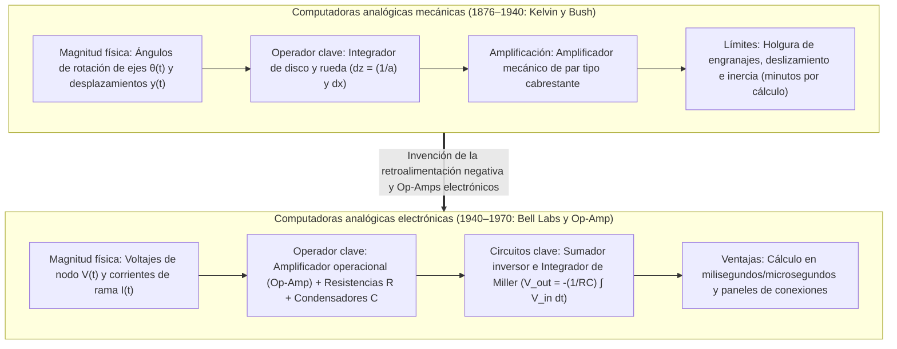
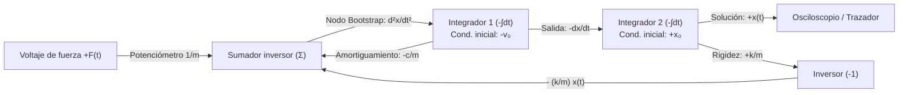

## 1. Introducción: ¿«Calcular» significa necesariamente contar dígitos?

Cuando hoy escuchamos la palabra «computadora», casi invariablemente imaginamos una <strong>computadora digital (Digital Computer)</strong>. En el paradigma digital, todo fenómeno continuo del universo físico —ondas sonoras, turbulencias de fluidos, órbitas planetarias o la inferencia de redes neuronales— debe primero discretizarse mediante muestreo y cuantificación en secuencias finitas de dígitos binarios ($0$ y $1$). Miles de millones de puertas lógicas conmutan al ritmo de un reloj global para aproximar las matemáticas continuas mediante miles de millones de pasos aritméticos elementales.

Sin embargo, desde la perspectiva de la física y la historia de la ciencia, reducir todo cálculo a contar dígitos discretos (del latín *digitus*, «dedo») es un desvío relativamente reciente. Las leyes fundamentales de la naturaleza —la mecánica de Newton, la electrodinámica de Maxwell, las ecuaciones de Navier-Stokes y la ecuación de Schrödinger— están formuladas de manera nativa en el lenguaje de las <strong>variables reales continuas gobernadas por ecuaciones diferenciales</strong>.

Mucho antes de que las computadoras digitales alcanzaran la hegemonía a mediados del siglo XX, los científicos e ingenieros desarrollaron una filosofía computacional radicalmente distinta: la <strong>computadora analógica (Analog Computer)</strong>.

Una computadora analógica no cuenta números. No posee direcciones de memoria, ni contador de programa, ni ciclos de reloj discretos, ni bucles iterativos de integración numérica (como los métodos de Euler o Runge-Kutta). En su lugar, resuelve un problema construyendo un <strong>sistema físico —compuesto por engranajes, integradores mecánicos de disco, amplificadores operacionales (Op-Amps), condensadores o interferómetros ópticos— cuyas ecuaciones físicas gobernantes son matemáticamente isomorfas a las ecuaciones diferenciales del problema estudiado</strong>. En el instante en que se cierra el interruptor, las leyes de Kirchhoff y la conservación de la carga obligan a los voltajes continuos de los nodos $V(t)$ y a las corrientes de rama $I(t)$ a evolucionar en tiempo real siguiendo la solución exacta de la ecuación diferencial, sin errores de truncamiento por discretización y sin el cuello de botella de von Neumann del movimiento de datos entre memoria y procesador.

En este artículo exploramos la historia y la física completas de la computación analógica: desde los integradores mecánicos de James Thomson, Lord Kelvin y Vannevar Bush hasta el amplificador operacional, el método de retroalimentación (Bootstrap) de Kelvin, los límites termodinámicos de ruido de Johnson-Nyquist y el espectacular <strong>renacimiento analógico del siglo XXI</strong> en la computación en memoria (memristores), la fotónica de silicio y los chips neuromórficos.

---

## 2. El linaje mecánico: cálculo infinitesimal con engranajes y discos

### 2.1 Del mecanismo de Anticitera a la regla de cálculo

La computadora analógica compleja más antigua conocida es el <strong>mecanismo de Anticitera</strong>, construido en la Grecia helenística hacia el siglo II a. C. Con más de treinta engranajes de bronce (incluido un mecanismo diferencial epicicloidal), calculaba las posiciones eclípticas continuas del Sol, la Luna y los planetas, así como los ciclos de eclipses de Saros. Hacia 1622, basándose en los logaritmos de John Napier, William Oughtred inventó la <strong>regla de cálculo (Slide Rule)</strong>, que mapeaba cada número real positivo $x$ en una longitud física proporcional a $\log_{10} x$, transformando la multiplicación $x \cdot y$ en la suma mecánica continua de dos desplazamientos espaciales $\log_{10} x + \log_{10} y = \log_{10}(xy)$.

### 2.2 James Thomson, Lord Kelvin y el integrador de disco y rueda

El salto decisivo para resolver mecánicamente <strong>ecuaciones diferenciales</strong> se produjo en 1876 cuando <strong>James Thomson</strong>, hermano mayor de William Thomson (<strong>Lord Kelvin</strong>), inventó el <strong>integrador de disco y rueda de fricción (Wheel-and-Disk Integrator)</strong>:

1. Un <strong>disco horizontal</strong> gira un ángulo infinitesimal $dx$ proporcional a la variable independiente $x$.
2. Una pequeña <strong>rueda de fricción vertical</strong> de radio $a$ apoya sobre el disco a una distancia radial $y(x)$ desde el centro (representando el integrando).
3. Al girar el disco un ángulo $dx$, el arco recorrido bajo el punto de contacto es $y(x)\,dx$. Suponiendo rodadura sin deslizamiento, el ángulo $dz$ girado por la rueda cumple $a\,dz = y(x)\,dx$, por lo que la rotación acumulada $z(x)$ evalúa físicamente la integral definida:

$$z(x) = \frac{1}{a} \int_{x_0}^{x} y(x')\,dx'$$

Lord Kelvin empleó este integrador para construir su célebre <strong>máquina predictora de mareas (Tide-Predicting Machine)</strong>, sumando las componentes armónicas lunares y solares $\sum_k A_k \cos(\omega_k t + \phi_k)$ para trazar en cuatro horas las curvas continuas de marea de todo un año.

### 2.3 El analizador diferencial de Vannevar Bush y el amplificador de par

Acoplar varios integradores mecánicos en serie fue imposible durante décadas debido al <strong>bajo par de salida</strong> de la rueda de fricción, que patinaba bajo carga. En 1931 en el MIT, <strong>Vannevar Bush</strong> resolvió este obstáculo inventando el <strong>amplificador mecánico de par (Torque Amplifier)</strong> basado en el cabrestante naval, multiplicando el par miles de veces mediante un motor externo sin cargar la rueda integradora. En 1941, <strong>Claude Shannon</strong> demostró en su *Teoría matemática del analizador diferencial* que las funciones generables por un número finito de integradores coinciden exactamente con las soluciones de las <strong>ecuaciones diferenciales algebraicas (ADE)</strong>.

---

## 3. El corazón de la computación analógica electrónica: el amplificador operacional (Op-Amp)

Durante la Segunda Guerra Mundial, <strong>Karl D. Swartzel Jr.</strong> (Bell Labs), <strong>Helmut Hoelzer</strong> (creador de la computadora analógica de guiado del cohete V-2) y <strong>John R. Ragazzini</strong> (Universidad de Columbia) sustituyeron los ejes mecánicos por circuitos electrónicos de válvulas. El propio término <strong>«amplificador operacional (Operational Amplifier, Op-Amp)»</strong> fue acuñado por Ragazzini en 1947 para designar un amplificador de corriente continua de alta ganancia diseñado específicamente para ejecutar <strong>operaciones matemáticas</strong> (suma, escalado e integración).

### 3.1 El Op-Amp ideal y la magia de la «tierra virtual (Virtual Ground)»

Con una ganancia en lazo abierto $A_{\text{OL}} \sim 10^5 \text{–} 10^8$, el voltaje de salida es $V_{\text{out}} = A_{\text{OL}}(V_+ - V_-)$. Conectando la entrada no inversora a tierra ($V_+ = 0\,\text{V}$) y aplicando <strong>retroalimentación negativa (Negative Feedback)</strong> hacia la entrada inversora $V_-$, el límite $A_{\text{OL}} \to \infty$ (con impedancia de entrada infinita $Z_{\text{in}} \to \infty$) impone:

$$V_+ - V_- = \frac{V_{\text{out}}}{A_{\text{OL}}} \to 0 \implies V_- = V_+ = 0\,\text{V}, \quad I_- = 0$$

El nodo $V_-$ permanece clavado en $0\,\text{V}$ sin estar conectado físicamente a masa: es la <strong>tierra virtual (Virtual Ground)</strong>, que elimina las imperfecciones internas del amplificador de la ecuación matemática.

### 3.2 Derivación exacta del sumador y del integrador de Miller

1. <strong>Sumador inversor ponderado (Summing Amplifier)</strong>:
   Aplicando la ley de corrientes de Kirchhoff (KCL) en la tierra virtual ($V_- = 0$) para $N$ voltajes de entrada $V_k(t)$ a través de resistencias $R_k$ y una resistencia de retroalimentación $R_f$:
   $$\sum_{k=1}^N \frac{V_k(t)}{R_k} + \frac{V_{\text{out}}(t)}{R_f} = 0 \implies V_{\text{out}}(t) = -\sum_{k=1}^N \left(\frac{R_f}{R_k}\right) V_k(t)$$
2. <strong>Integrador continuo de Miller (Miller Integrator)</strong>:
   Sustituyendo $R_f$ por un condensador de capacidad $C$, la corriente de carga es $I_C(t) = C \frac{d V_{\text{out}}(t)}{dt}$, lo que arroja por KCL:
   $$\frac{V_{\text{in}}(t)}{R} + C \frac{d V_{\text{out}}(t)}{dt} = 0 \implies V_{\text{out}}(t) = -\frac{1}{RC} \int_0^t V_{\text{in}}(\tau)\,d\tau + V_{\text{out}}(0)$$
3. <strong>Por qué las computadoras analógicas nunca usan diferenciadores sino solo integradores</strong>:
   En el dominio de la frecuencia ($s = j\omega$), el integrador tiene ganancia $|H_{\text{int}}(\omega)| = \frac{1}{\omega RC}$ y actúa como un <strong>filtro paso bajo</strong> que atenúa el ruido térmico de alta frecuencia. En cambio, un diferenciador tiene ganancia $|H_{\text{diff}}(\omega)| = \omega RC$ (<strong>filtro paso alto</strong>), amplificando cualquier ruido de alta frecuencia $\varepsilon \sin(\omega_{\text{high}} t)$ por un factor $\omega_{\text{high}}$ y saturando el Op-Amp.

---

## 4. Resolver ecuaciones diferenciales mediante cableado: el método Bootstrap de Kelvin

Para resolver el oscilador armónico amortiguado $m \ddot{x} + c \dot{x} + k x = F(t)$ usando únicamente integradores, el <strong>método de retroalimentación (Bootstrap) de Kelvin</strong> sigue cuatro pasos:

1. <strong>Despejar la derivada de mayor orden</strong>: $\ddot{x}(t) = -\frac{c}{m}\dot{x}(t) - \frac{k}{m}x(t) + \frac{1}{m}F(t)$.
2. <strong>Suponer que el cable con la señal $\ddot{x}(t)$ ya existe</strong>.
3. <strong>Integrar en cascada</strong>: Un primer integrador inversor (condición inicial $-v_0$) genera $-\dot{x}(t)$, y un segundo integrador inversor (condición inicial $+x_0$) genera $+x(t)$.
4. <strong>Cerrar el lazo de retroalimentación</strong>: Combinar $-\dot{x}(t)$, $-x(t)$ y $F(t)$ mediante potenciómetros y un sumador para sintetizar el miembro derecho y <strong>conectar su salida directamente al nodo de entrada $\ddot{x}(t)$ supuesto en el paso 2</strong>.

---

## 5. Física de la precisión y el ruido: por qué lo digital destronó a lo analógico

Toda resistencia $R$ a temperatura absoluta $T > 0\,\text{K}$ genera inevitablemente <strong>ruido térmico de Johnson-Nyquist</strong> en un ancho de banda $\Delta f$:

$$v_{\text{rms}} = \sqrt{4 k_B T R \Delta f}$$

Para representar $b$ bits de precisión ($2^b = V_{\max}/v_{\text{noise}}$) en un cable analógico continuo, la relación señal-ruido en potencia debe ser $\text{SNR}_{\text{power}} = 2^{2b}$. <strong>¡Cada bit adicional de precisión multiplica por cuatro la energía o la capacitancia requerida, haciendo que el costo físico analógico escale exponencialmente como $O(2^{2b})$!</strong> Por ello, las computadoras analógicas electrónicas están limitadas a <strong>3 o 4 dígitos decimales ($10\text{–}14\text{ bits}$, error de $0{,}01\% \text{ a } 0{,}1\%$)</strong>. En una computadora digital, cada transistor solo distingue dos estados ($0$ y $1$), por lo que el costo de hardware para $b$ bits crece solo <strong>lineal o polinómicamente como $O(b \text{ a } b^2)$</strong>.

| Dimensión arquitectónica | Computadora analógica electrónica | Computadora digital (Von Neumann) |
| :--- | :--- | :--- |
| <strong>Representación de cantidades</strong> | Variables físicas continuas ($V(t), I(t)$) | Palabras binarias discretas ($b$ bits, coma flotante IEEE 754) |
| <strong>Mecanismo de integración</strong> | Integración física continua de carga $V = -\frac{1}{RC}\int V_{\text{in}}\,dt$ | Cuadratura numérica discreta (Euler, Runge-Kutta) |
| <strong>Paralelismo y tiempo de ejecución</strong> | <strong>Paralelismo espacial total</strong> ($O(1)$ tiempo real independiente de $N$) | Ejecución secuencial multiplexada ($O(N \sim N^3)$) |
| <strong>Techo práctico de precisión</strong> | <strong>$3\text{–}4$ dígitos decimales ($10\text{–}14\text{ bits}$)</strong> | Precisión arbitraria ($64\text{ bits} \approx 16$ dígitos decimales) |
| <strong>Costo según precisión $b$</strong> | <strong>Crecimiento exponencial $\propto O(2^{2b})$</strong> (ruido térmico $k_B T$) | <strong>Crecimiento lineal / polinómico $\propto O(b \sim b^2)$</strong> |

Durante el programa Apolo, las <strong>computadoras híbridas (Hybrid Computers)</strong> combinaron la velocidad en tiempo real analógica (simulación de vuelo de 6 grados de libertad con hardware en el lazo) con la precisión digital de 64 bits para la navegación translunar.

---

## 6. El renacimiento en el siglo XXI: computación en memoria (AIMC), fotónica y chips neuromórficos

Hoy, ante el agotamiento de la ley de Moore y el muro energético del movimiento de datos entre memoria y procesador (<strong>cuello de botella de von Neumann</strong>) en el aprendizaje profundo y los grandes modelos de lenguaje (LLM), la computación analógica vive un renacimiento extraordinario:

- <strong>Computación analógica en memoria (AIMC) con matrices de memristores</strong>: Más del $99\%$ del cómputo en IA consiste en multiplicaciones matriz-vector $y_i = \sum_{j=1}^N W_{ij} x_j$ que solo requieren $4\text{ a }8\text{ bits}$ de precisión. Al almacenar los pesos $W_{ij}$ como conductancias $G_{ij} = 1/R_{ij}$ en una matriz de memristores (ReRAM/PCM), la <strong>ley de Ohm</strong> ($I_{ij} = G_{ij} V_j$) y la <strong>ley de Kirchhoff</strong> ($I_i = \sum_j G_{ij} V_j$) ejecutan toda la multiplicación matricial en nanosegundos en tiempo $O(1)$ directamente dentro de la memoria.
- <strong>Fotónica de silicio, chips neuromórficos y Neural ODEs</strong>: Los procesadores fotónicos usan interferencia láser en mallas de interferómetros de Mach-Zehnder (MZI) para multiplicar matrices a la velocidad de la luz; los circuitos <strong>neuromórficos subumbral (Subthreshold CMOS)</strong> de Carver Mead emulan directamente las ecuaciones diferenciales de los canales iónicos neuronales, y las <strong>Neural ODEs / redes neuronales líquidas</strong> unen las ecuaciones diferenciales continuas con la inteligencia artificial moderna.
