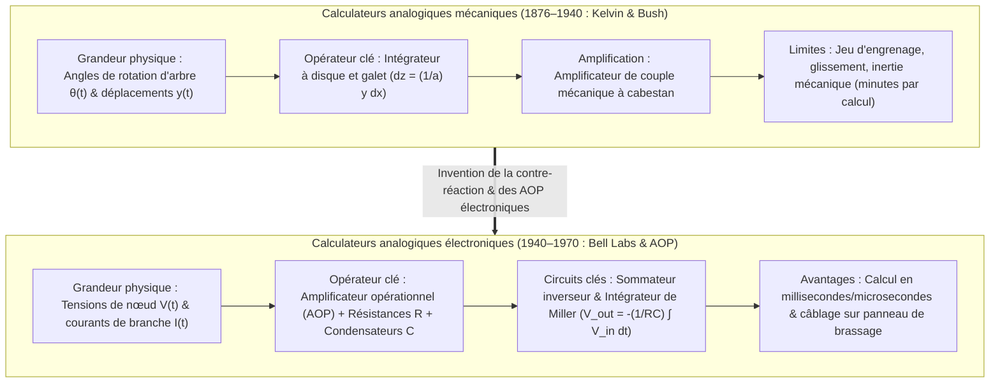
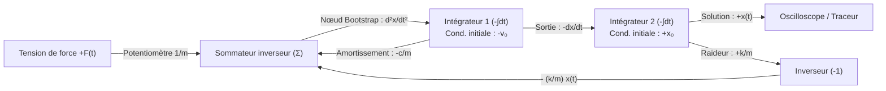

## 1. Introduction : « Calculer » signifie-t-il nécessairement compter des chiffres ?

Lorsque nous entendons le mot « ordinateur » aujourd'hui, nous imaginons presque exclusivement un <strong>calculateur numérique (Digital Computer)</strong>. Dans le paradigme numérique, chaque phénomène continu de l'univers physique — ondes sonores, turbulences fluides, orbites planétaires ou inférence neuronale — doit d'abord être discrétisé par échantillonnage et quantification en suites finies de chiffres binaires ($0$ et $1$). Des milliards de portes logiques commutent ensuite au rythme d'une horloge globale pour approximer les mathématiques continues par des milliards d'opérations arithmétiques élémentaires.

Pourtant, à l'échelle de l'histoire des sciences et de la physique, réduire tout calcul au dénombrement de chiffres discrets (du latin *digitus*, « doigt ») est un détour relativement récent. Les lois fondamentales de la nature — mécanique newtonienne, électrodynamique de Maxwell, équations de Navier-Stokes, équation de Schrödinger — s'expriment nativement dans le langage des <strong>variables réelles continues gouvernées par des équations différentielles</strong>.

Bien avant l'hégémonie du numérique au milieu du XXe siècle, les scientifiques et ingénieurs ont développé une philosophie computationnelle radicalement différente : le <strong>calculateur analogique (Analog Computer)</strong>.

Un calculateur analogique ne compte aucun chiffre. Il ne possède ni adresses mémoire, ni compteur ordinal, ni cycles d'horloge discrets, ni boucles d'intégration numérique itératives (telles que les méthodes d'Euler ou de Runge-Kutta). Au lieu de cela, il résout un problème en construisant un <strong>système physique — composé d'engrenages, d'intégrateurs mécaniques à disque, d'amplificateurs opérationnels (AOP), de condensateurs ou d'interféromètres optiques — dont les équations physiques gouvernantes sont mathématiquement isomorphes aux équations différentielles du problème étudié</strong>. Dès la mise sous tension, les lois de Kirchhoff et la conservation de la charge forcent les tensions continues $V(t)$ et les courants $I(t)$ du circuit à évoluer en temps réel selon la solution exacte de l'équation différentielle, sans erreur de troncature liée à la discrétisation et sans le goulot d'étranglement de von Neumann lié au transfert de données entre mémoire et processeur.

Cet article retrace l'épopée complète du calcul analogique : des intégrateurs mécaniques de James Thomson, Lord Kelvin et Vannevar Bush à l'invention de l'amplificateur opérationnel et de la méthode de bouclage (Bootstrap) de Kelvin, jusqu'aux limites thermodynamiques et théoriques (bruit thermique de Johnson-Nyquist) et à la spectaculaire <strong>renaissance du calcul analogique au XXIe siècle</strong> à travers le calcul en mémoire (memristors), la photonique sur silicium et l'ingénierie neuromorphique.

---

## 2. La lignée mécanique : exécuter le calcul infinitésimal avec des disques et des engrenages

### 2.1 De la machine d'Anticythère à la règle à calcul

Le plus ancien calculateur analogique complexe connu est la <strong>machine d'Anticythère</strong>, conçue en Grèce antique vers le IIe siècle av. J.-C. Grâce à plus de trente engrenages de bronze (dont un train épicycloïdal différentiel), elle calculait les positions écliptiques continues du Soleil, de la Lune et des planètes ainsi que les cycles d'éclipses de Saros. Vers 1622, à la suite de l'invention des logarithmes par John Napier, William Oughtred inventa la <strong>règle à calcul (Slide Rule)</strong> : en associant à tout réel positif $x$ une longueur physique proportionnelle à $\log_{10} x$, elle transforme la multiplication $x \cdot y$ en l'addition mécanique continue de deux déplacements linéaires $\log_{10} x + \log_{10} y = \log_{10}(xy)$.

### 2.2 James Thomson, Lord Kelvin et l'intégrateur à disque et galet

Le saut décisif permettant de résoudre mécaniquement des <strong>équations différentielles</strong> eut lieu en 1876 lorsque <strong>James Thomson</strong>, frère aîné de William Thomson (<strong>Lord Kelvin</strong>), inventa l'<strong>intégrateur à disque et galet (Wheel-and-Disk Integrator)</strong> :

1. Un <strong>disque horizontal</strong> tourne d'un angle infinitésimal $dx$ proportionnel à la variable indépendante $x$.
2. Un petit <strong>galet de friction vertical</strong> de rayon $a$ repose sur la surface du disque à une distance radiale $y(x)$ du centre (représentant la fonction à intégrer).
3. Lorsque le disque tourne de $dx$, l'arc parcouru sous le point de contact vaut $y(x)\,dx$. En supposant un roulement sans glissement, la rotation $dz$ du galet satisfait $a\,dz = y(x)\,dx$, de sorte que l'angle total $z(x)$ du galet évalue physiquement l'intégrale définie :

$$z(x) = \frac{1}{a} \int_{x_0}^{x} y(x')\,dx'$$

Lord Kelvin utilisa cet intégrateur pour construire son célèbre <strong>prédicteur de marées (Tide-Predicting Machine)</strong>, sommant les composantes harmoniques lunaires et solaires $\sum_k A_k \cos(\omega_k t + \phi_k)$ pour tracer en quatre heures les courbes de marées continues d'une année entière.

### 2.3 L'analyseur différentiel de Vannevar Bush et l'amplificateur de couple

Le couplage de plusieurs intégrateurs mécaniques resta longtemps bloqué par la <strong>faiblesse du couple de sortie</strong> du galet de friction, qui glissait dès qu'on lui imposait une charge mécanique. En 1931 au MIT, <strong>Vannevar Bush</strong> résolut ce problème grâce à l'<strong>amplificateur de couple mécanique (Torque Amplifier)</strong> fondé sur le principe du cabestan, amplifiant le couple des milliers de fois via un moteur externe sans charger le galet. En 1941, <strong>Claude Shannon</strong> démontra dans sa *Théorie mathématique de l'analyseur différentiel* que les fonctions générables par un nombre fini d'intégrateurs coïncident exactement avec les solutions des <strong>équations différentielles algébriques (ADE)</strong>.

---

## 3. Le cœur du calcul analogique électronique : l'amplificateur opérationnel (AOP)

Pendant la Seconde Guerre mondiale, <strong>Karl D. Swartzel Jr.</strong> (Bell Labs), <strong>Helmut Hoelzer</strong> (concepteur du calculateur analogique de guidage de la fusée V2) et <strong>John R. Ragazzini</strong> (Université Columbia) remplacèrent les arbres métalliques par des circuits électroniques à tubes. Le terme même d'<strong>« amplificateur opérationnel (Operational Amplifier, Op-Amp) »</strong> fut forgé par Ragazzini en 1947 pour désigner un amplificateur à courant continu à grand gain conçu pour exécuter des <strong>opérations mathématiques</strong> (addition, intégration, mise à l'échelle).

### 3.1 L'AOP idéal et la magie de la « masse virtuelle (Virtual Ground) »

Avec un gain en boucle ouverte $A_{\text{OL}} \sim 10^5 \text{–} 10^8$, la tension de sortie vaut $V_{\text{out}} = A_{\text{OL}}(V_+ - V_-)$. En reliant l'entrée non inverseuse à la masse ($V_+ = 0\,\text{V}$) et en appliquant une <strong>contre-réaction (Negative Feedback)</strong> vers l'entrée inverseuse $V_-$, la limite $A_{\text{OL}} \to \infty$ (et l'impédance d'entrée infinie $Z_{\text{in}} \to \infty$) impose :

$$V_+ - V_- = \frac{V_{\text{out}}}{A_{\text{OL}}} \to 0 \implies V_- = V_+ = 0\,\text{V}, \quad I_- = 0$$

Le nœud $V_-$ est maintenu à $0\,\text{V}$ sans être connecté physiquement à la terre : c'est la <strong>masse virtuelle (Virtual Ground)</strong>, qui rend la fonction de transfert indépendante des fluctuations internes de l'amplificateur.

### 3.2 Dérivation exacte du sommateur et de l'intégrateur de Miller

1. <strong>Sommateur inverseur pondéré (Summing Amplifier)</strong> :
   En appliquant la loi des nœuds de Kirchhoff (KCL) à la masse virtuelle ($V_- = 0$) pour $N$ tensions d'entrée $V_k(t)$ à travers les résistances $R_k$ et une résistance de contre-réaction $R_f$ :
   $$\sum_{k=1}^N \frac{V_k(t)}{R_k} + \frac{V_{\text{out}}(t)}{R_f} = 0 \implies V_{\text{out}}(t) = -\sum_{k=1}^N \left(\frac{R_f}{R_k}\right) V_k(t)$$
2. <strong>Intégrateur continu de Miller (Miller Integrator)</strong> :
   En remplaçant $R_f$ par un condensateur de capacité $C$, le courant de charge est $I_C(t) = C \frac{d V_{\text{out}}(t)}{dt}$, ce qui donne par KCL :
   $$\frac{V_{\text{in}}(t)}{R} + C \frac{d V_{\text{out}}(t)}{dt} = 0 \implies V_{\text{out}}(t) = -\frac{1}{RC} \int_0^t V_{\text{in}}(\tau)\,d\tau + V_{\text{out}}(0)$$
3. <strong>Pourquoi les calculateurs analogiques proscrivent les dérivateurs au profit exclusif des intégrateurs</strong> :
   En fréquence ($s = j\omega$), l'intégrateur possède un gain $|H_{\text{int}}(\omega)| = \frac{1}{\omega RC}$ qui agit comme un <strong>filtre passe-bas</strong> lissant le bruit thermique haute fréquence. À l'inverse, un dérivateur a un gain $|H_{\text{diff}}(\omega)| = \omega RC$ (<strong>filtre passe-haut</strong>) qui amplifie tout bruit haute fréquence $\varepsilon \sin(\omega_{\text{high}} t)$ d'un facteur $\omega_{\text{high}}$, saturant immédiatement l'AOP.

---

## 4. Résoudre les équations différentielles par câblage : la méthode Bootstrap de Kelvin

Pour résoudre l'équation de l'oscillateur harmonique amorti $m \ddot{x} + c \dot{x} + k x = F(t)$ uniquement avec des intégrateurs, la <strong>méthode de bouclage (Bootstrap) de Kelvin</strong> procède en quatre étapes :

1. <strong>Isoler la dérivée d'ordre le plus élevé</strong> : $\ddot{x}(t) = -\frac{c}{m}\dot{x}(t) - \frac{k}{m}x(t) + \frac{1}{m}F(t)$.
2. <strong>Supposer que le fil portant la tension $\ddot{x}(t)$ est déjà disponible</strong>.
3. <strong>Intégrer en cascade</strong> : Un premier intégrateur inverseur (condition initiale $-v_0$) produit $-\dot{x}(t)$, et un second intégrateur inverseur (condition initiale $+x_0$) produit la position $+x(t)$.
4. <strong>Fermer la boucle de rétroaction</strong> : Combiner $-\dot{x}(t)$, $-x(t)$ et $F(t)$ via des potentiomètres et un sommateur pour former le membre de droite, puis <strong>relier la sortie de ce sommateur directement au nœud d'entrée $\ddot{x}(t)$ supposé à l'étape 2 !</strong>

---

## 5. Physique de la précision et du bruit : pourquoi le numérique a détrôné l'analogique

La limite fondamentale du calcul analogique découle de la thermodynamique statistique et de la théorie de l'information de Shannon. Toute résistance $R$ à température absolue $T > 0\,\text{K}$ génère un <strong>bruit thermique de Johnson-Nyquist</strong> sur une bande passante $\Delta f$ :

$$v_{\text{rms}} = \sqrt{4 k_B T R \Delta f}$$

Pour représenter une précision de $b$ bits ($2^b = V_{\max}/v_{\text{noise}}$) sur un fil analogique continu, le rapport signal sur bruit en puissance doit atteindre $\text{SNR}_{\text{power}} = 2^{2b}$. <strong>Chaque bit de précision supplémentaire multiplie par quatre la puissance énergétique ou la capacité requise : le coût physique du calcul analogique croît exponentiellement en $O(2^{2b})$ !</strong> En pratique, la précision analogique plafonne à <strong>3 ou 4 chiffres décimaux ($10\text{–}14\text{ bits}$, erreur de $0{,}01\% \text{ à } 0{,}1\%$)</strong>. Dans un calculateur numérique, chaque transistor ne distingue que deux états ($0$ et $1$) avec une large marge de bruit, de sorte que le coût matériel pour $b$ bits ne croît que <strong>linéairement ou polynomialement en $O(b \text{ à } b^2)$</strong>.

| Dimension architecturale | Calculateur analogique électronique | Ordinateur numérique (Von Neumann) |
| :--- | :--- | :--- |
| <strong>Représentation des quantités</strong> | Grandeurs physiques continues ($V(t), I(t)$) | Mots binaires discrets ($b$ bits, virgule flottante IEEE 754) |
| <strong>Mécanisme d'intégration</strong> | Accumulation physique exacte de charge $V = -\frac{1}{RC}\int V_{\text{in}}\,dt$ | Quadrature numérique discrète (Euler, Runge-Kutta) |
| <strong>Parallélisme et temps d'exécution</strong> | <strong>Parallélisme spatial total</strong> ($O(1)$ temps réel indépendant de $N$) | Exécution séquentielle multiplexée ($O(N \sim N^3)$) |
| <strong>Plafond de précision pratique</strong> | <strong>$3\text{–}4$ chiffres décimaux ($10\text{–}14\text{ bits}$)</strong> | Précision arbitraire ($64\text{ bits} \approx 16$ chiffres décimaux) |
| <strong>Coût matériel en fonction de $b$</strong> | <strong>Croissance exponentielle $\propto O(2^{2b})$</strong> (bruit thermique $k_B T$) | <strong>Croissance linéaire / polynomiale $\propto O(b \sim b^2)$</strong> |

Lors du programme spatial Apollo, les <strong>calculateurs hybrides (Hybrid Computers)</strong> associaient la vitesse temps réel de l'analogique (simulation du vol à 6 degrés de liberté avec matériel dans la boucle) à la précision de 64 bits du numérique pour la navigation translunaire.

---

## 6. La renaissance au XXIe siècle : calcul en mémoire (AIMC), photonique et puces neuromorphiques

Aujourd'hui, face à la fin de la loi de Moore et au mur énergétique du transfert de données mémoire-processeur (<strong>goulot d'étranglement de von Neumann</strong>) dans l'apprentissage profond et les grands modèles de langage (LLM), le calcul analogique connaît une renaissance spectaculaire :

- <strong>Calcul analogique en mémoire (AIMC) à matrices de memristors</strong> : Plus de $99\%$ des calculs d'IA consistent en multiplications matrice-vecteur $y_i = \sum_{j=1}^N W_{ij} x_j$ qui ne requièrent qu'une précision de $4\text{ à }8\text{ bits}$. En stockant les poids $W_{ij}$ sous forme de conductances $G_{ij} = 1/R_{ij}$ dans une grille de memristors (ReRAM/PCM), la <strong>loi d'Ohm</strong> ($I_{ij} = G_{ij} V_j$) et la <strong>loi des nœuds de Kirchhoff</strong> ($I_i = \sum_j G_{ij} V_j$) exécutent la multiplication matricielle entière en quelques nanosecondes en temps $O(1)$ directement dans la mémoire !
- <strong>Photonique sur silicium, puces neuromorphiques et Neural ODEs</strong> : Les processeurs photoniques utilisent l'interférence laser dans des réseaux d'interféromètres de Mach-Zehnder (MZI) pour calculer à la vitesse de la lumière ; les circuits <strong>neuromorphiques sous le seuil (Subthreshold CMOS)</strong> de Carver Mead exploitent la physique exponentielle des transistors pour émuler directement les équations différentielles des neurones biologiques, tandis que les <strong>Neural ODEs et réseaux liquides</strong> réconcilient équations différentielles continues et intelligence artificielle moderne.
