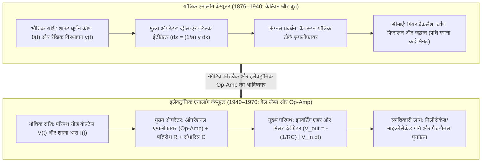
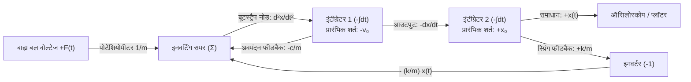

## 1. प्रस्तावना: क्या 'गणना (Computation)' का अर्थ केवल अंकों को गिनना है?

आज जब हम 'कंप्यूटर' शब्द सुनते हैं, तो हमारे मस्तिष्क में लगभग हमेशा एक <strong>डिजिटल कंप्यूटर (Digital Computer)</strong> की छवि उभरती है। डिजिटल प्रतिमान में, भौतिक ब्रह्मांड की प्रत्येक सतत घटना—ध्वनि तरंगें, तरल भंवर, ग्रहों की कक्षाएँ, या न्यूरल नेटवर्क का अनुमान—को पहले सैंपलिंग (Sampling) और क्वांटाइज़ेशन (Quantization) के माध्यम से बाइनरी अंकों ($0$ और $1$) की असतत श्रृंखलाओं में बदला जाता है। इसके बाद अरबों लॉजिक गेट्स एक ग्लोबल क्लॉक की लय पर स्विच करते हुए अरबों बुनियादी अंकगणितीय चरणों के माध्यम से सतत गणित का सन्निकटन (approximation) करते हैं।

किंतु विज्ञान और भौतिकी के इतिहास के दृष्टिकोण से, समस्त गणना को असतत अंकों (लैटिन शब्द *digitus* अर्थात् 'उंगली') को गिनने तक सीमित कर देना एक अपेक्षाकृत नया मोड़ है। प्रकृति के मूलभूत नियम—न्यूटन के गति समीकरण, मैक्सवेल के विद्युत-चुंबकीय समीकरण, नेवियर-स्टोक्स तरल समीकरण और श्रोडिंगर समीकरण—मूल रूप से <strong>सतत वास्तविक संख्याओं (Continuous Real Numbers) और अवकल समीकरणों (Differential Equations)</strong> की भाषा में लिखे गए हैं।

20वीं सदी के मध्य में डिजिटल कंप्यूटरों के वर्चस्व से बहुत पहले, वैज्ञानिकों और इंजीनियरों ने एक बिल्कुल भिन्न कम्प्यूटेशनल दर्शन विकसित किया था: <strong>एनालॉग कंप्यूटर (Analog Computer)</strong>।

एनालॉग कंप्यूटर अंकों को बिल्कुल नहीं गिनता। इसमें न तो मेमोरी एड्रेस होते हैं, न प्रोग्राम काउंटर, न असतत क्लॉक साइकिल, और न ही ऑयलर या रुंगे-कुट्टा (Runge-Kutta) विधि जैसे संख्यात्मक समाकलन लूप। इसके बजाय, एनालॉग कंप्यूटर किसी समस्या को हल करने के लिए एक <strong>भौतिक प्रणाली (Physical System)—जो गियर, यांत्रिक डिस्क इंटीग्रेटर, ऑपरेशनल एम्पलीफायर (Op-Amp), संधारित्र (Capacitor) या ऑप्टिकल इंटरफेरोमीटर से बनी होती है—का निर्माण करता है, जिसके भौतिक समीकरण हल किए जाने वाले अवकल समीकरणों के साथ गणितीय रूप से समरूप (Isomorphic) होते हैं</strong>। जैसे ही स्विच ऑन किया जाता है, किरचॉफ के नियम और आवेश संरक्षण का नियम परिपथ के सतत नोड वोल्टेज $V(t)$ और धारा $I(t)$ को वास्तविक समय (Real-time) में अवकल समीकरण के सटीक समाधान के रूप में विकसित होने के लिए बाध्य कर देते हैं—बिना किसी डिजिटाइजेशन त्रुटि के और बिना मेमोरी व प्रोसेसर के बीच डेटा स्थानांतरण की 'वॉन न्यूमैन बॉटलनेक' के!

इस लेख में हम एनालॉग कंप्यूटिंग के संपूर्ण इतिहास और भौतिकी का विश्लेषण करेंगे: जेम्स थॉमसन, लॉर्ड केल्विन और वैनेवर बुश के यांत्रिक इंटीग्रेटर्स से लेकर ऑपरेशनल एम्पलीफायर (Op-Amp) के वर्चुअल ग्राउंड, केल्विन की फीडबैक बूटस्ट्रैप विधि, जॉनसन-नाइक्विस्ट तापीय रव (Thermal Noise) की सीमा, और 21वीं सदी में AI की ऊर्जा दीवार को तोड़ने के लिए <strong>एनालॉग इन-मेमोरी कंप्यूटिंग (मेमरिस्टर क्रॉसबार), सिलिकॉन फोटोनिक्स और न्यूरोमॉर्फिक चिप्स</strong> के रूप में इसके भव्य पुनर्जागरण तक।

---

## 2. यांत्रिक एनालॉग गणना की परंपरा: गियर और डिस्क से कलन (Calculus)

### 2.1 एंटीकाइथेरा तंत्र से स्लाइड रूल तक

मानव इतिहास का सबसे प्राचीन ज्ञात जटिल एनालॉग कंप्यूटर <strong>एंटीकाइथेरा तंत्र (Antikythera Mechanism)</strong> है, जिसे ईसा पूर्व दूसरी शताब्दी में प्राचीन ग्रीस में बनाया गया था। 30 से अधिक कांस्य गियरों (डिफरेंशियल गियर सहित) की मदद से यह सूर्य, चंद्रमा और ग्रहों की सतत स्थिति तथा ग्रहण चक्रों की गणना करता था। 1622 के आसपास, जॉन नेपियर के लघुगणक (Logarithm) के आधार पर विलियम ऑट्रेड ने <strong>स्लाइड रूल (Slide Rule)</strong> का आविष्कार किया, जो किसी संख्या $x$ को $\log_{10} x$ के समानुपाती भौतिक लंबाई पर मैप करके गुणन $x \cdot y$ को दो भौतिक दूरियों के सतत योग $\log_{10} x + \log_{10} y = \log_{10}(xy)$ में बदल देता था।

### 2.2 जेम्स थॉमसन, लॉर्ड केल्विन और डिस्क-व्हील इंटीग्रेटर

अवकल समीकरणों को यांत्रिक रूप से हल करने की निर्णायक क्रांति 1876 में हुई, जब विलियम थॉमसन (<strong>लॉर्ड केल्विन</strong>) के बड़े भाई इंजीनियर <strong>जेम्स थॉमसन (James Thomson)</strong> ने <strong>व्हील-एंड-डिस्क इंटीग्रेटर (Wheel-and-Disk Integrator)</strong> का आविष्कार किया:

1. एक क्षैतिज <strong>घूर्णन डिस्क (Disk)</strong> स्वतंत्र चर $x$ के समानुपाती सूक्ष्म कोण $dx$ से घूमती है।
2. त्रिज्या $a$ का एक छोटा ऊर्ध्वाधर <strong>घर्षण पहिया (Integrator Wheel)</strong> डिस्क के केंद्र से $y(x)$ की त्रिज्यीय दूरी (समाकल्य फलन) पर डिस्क की सतह को स्पर्श करता है।
3. जब डिस्क $dx$ कोण घूमती है, तो संपर्क बिंदु के नीचे तय की गई चाप की लंबाई $y(x)\,dx$ होती है। बिना फिसलन के आदर्श लोटनिक संपर्क में घर्षण पहिये का घूर्णन कोण $dz$ समीकरण $a\,dz = y(x)\,dx$ को संतुष्ट करता है, जिससे पहिये का कुल घूर्णन कोण $z(x)$ स्वतः ही निश्चित समाकलन (Definite Integral) की गणना कर लेता है:

$$z(x) = \frac{1}{a} \int_{x_0}^{x} y(x')\,dx'$$

लॉर्ड केल्विन ने इस इंटीग्रेटर का उपयोग करके अपनी प्रसिद्ध <strong>ज्वार-भाटा भविष्यवाणी मशीन (Tide-Predicting Machine)</strong> बनाई, जो चंद्रमा और सूर्य के गुरुत्वाकर्षण के दर्जनों हार्मोनिक घटकों $\sum_k A_k \cos(\omega_k t + \phi_k)$ को जोड़कर मात्र 4 घंटे में पूरे वर्ष का सतत ज्वार वक्र खींच देती थी।

### 2.3 वैनेवर बुश का 'डिफरेंशियल एनालाइज़र' और टॉर्क एम्पलीफायर

यांत्रिक इंटीग्रेटरों को श्रृंखला में जोड़ने में सबसे बड़ी बाधा घर्षण पहिये का <strong>अत्यंत कम आउटपुट टॉर्क</strong> था—भार पड़ते ही पहिया डिस्क पर फिसल जाता था। 1931 में MIT में <strong>वैनेवर बुश (Vannevar Bush)</strong> ने जहाज के कैपस्टन (Capstan) सिद्धांत पर आधारित यांत्रिक <strong>टॉर्क एम्पलीफायर (Torque Amplifier)</strong> का आविष्कार करके इस समस्या को हल किया और पहला सर्वसमावेशी यांत्रिक एनालॉग कंप्यूटर <strong>डिफरेंशियल एनालाइज़र (Differential Analyzer)</strong> निर्मित किया। 1941 में <strong>क्लॉड शैनन (Claude Shannon)</strong> ने सिद्ध किया कि परिमित इंटीग्रेटरों द्वारा उत्पन्न किए जा सकने वाले फलन सटीक रूप से <strong>बीजीय अवकल समीकरणों (ADE)</strong> के हल होते हैं।

---

## 3. इलेक्ट्रॉनिक एनालॉग कंप्यूटर का हृदय: ऑपरेशनल एम्पलीफायर (Op-Amp)

द्वितीय विश्व युद्ध के दौरान बेल लैब्स के <strong>कार्ल स्वार्त्ज़ेल</strong>, <strong>हेलमुट होल्ज़र</strong> (V-2 रॉकेट के एनालॉग गाइडेंस कंप्यूटर के निर्माता) और कोलंबिया विश्वविद्यालय के <strong>जॉन रागाज़िनी (John R. Ragazzini)</strong> ने यांत्रिक शाफ्टों को वैक्यूम-ट्यूब इलेक्ट्रॉनिक परिपथों से बदल दिया। वास्तव में <strong>'ऑपरेशनल एम्पलीफायर (Operational Amplifier, Op-Amp)'</strong> शब्द का नामकरण स्वयं रागाज़िनी ने 1947 के अपने शोधपत्र में किया था, क्योंकि ये उच्च-लब्धि (High-gain) DC एम्पलीफायर एनालॉग कंप्यूटरों में <strong>गणितीय संक्रियाओं (Mathematical Operations: योग, गुणन, समाकलन)</strong> को निष्पादित करने के लिए बनाए गए थे।

### 3.1 आदर्श Op-Amp और 'वर्चुअल ग्राउंड (Virtual Ground)' का जादू

एक आदर्श Op-Amp का ओपन-लूप गेन $A_{\text{OL}} \sim 10^5 \text{–} 10^8$ होता है और $V_{\text{out}} = A_{\text{OL}}(V_+ - V_-)$। जब नॉन-इनवर्टिंग टर्मिनल को ग्राउंड ($V_+ = 0\,\text{V}$) किया जाता है और आउटपुट से इनवर्टिंग टर्मिनल $V_-$ पर <strong>ऋणात्मक पुनर्भरण (Negative Feedback)</strong> लगाया जाता है, तो $A_{\text{OL}} \to \infty$ और अनंत इनपुट प्रतिबाधा ($Z_{\text{in}} \to \infty$) के कारण:

$$V_+ - V_- = \frac{V_{\text{out}}}{A_{\text{OL}}} \to 0 \implies V_- = V_+ = 0\,\text{V}, \quad I_- = 0$$

यद्यपि नोड $V_-$ भौतिक रूप से ग्राउंड से नहीं जुड़ा है, फिर भी इसका विभव $0\,\text{V}$ पर स्थिर रहता है—इसे <strong>वर्चुअल ग्राउंड (Virtual Ground)</strong> कहते हैं।

### 3.2 समर (Summer) और मिलर इंटीग्रेटर का सटीक निगमन

1. <strong>इनवर्टिंग भारित योग परिपथ (Summing Amplifier)</strong>:
   वर्चुअल ग्राउंड नोड ($V_- = 0$) पर किरचॉफ के धारा नियम (KCL) से, $N$ इनपुट वोल्टेज $V_k(t)$ (प्रतिरोध $R_k$ के माध्यम से) और फीडबैक प्रतिरोध $R_f$ के लिए:
   $$\sum_{k=1}^N \frac{V_k(t)}{R_k} + \frac{V_{\text{out}}(t)}{R_f} = 0 \implies V_{\text{out}}(t) = -\sum_{k=1}^N \left(\frac{R_f}{R_k}\right) V_k(t)$$
2. <strong>सतत-समय मिलर इंटीग्रेटर (Miller Integrator)</strong>:
   फीडबैक प्रतिरोध $R_f$ के स्थान पर संधारित्र $C$ लगाने पर संधारित्र धारा $I_C(t) = C \frac{d V_{\text{out}}(t)}{dt}$ होती है। KCL लागू करने और समाकलन करने पर:
   $$\frac{V_{\text{in}}(t)}{R} + C \frac{d V_{\text{out}}(t)}{dt} = 0 \implies V_{\text{out}}(t) = -\frac{1}{RC} \int_0^t V_{\text{in}}(\tau)\,d\tau + V_{\text{out}}(0)$$
3. <strong>एनालॉग कंप्यूटरों में 'डिफरेंशिएटर (अवकलक)' का प्रयोग वर्जित क्यों है?</strong>
   आवृत्ति डोमेन ($s = j\omega$) में इंटीग्रेटर का ट्रांसफर फ़ंक्शन $|H_{\text{int}}(\omega)| = \frac{1}{\omega RC}$ एक <strong>लो-पास फ़िल्टर</strong> की तरह काम करता है जो उच्च-आवृत्ति तापीय रव को दबा देता है। इसके विपरीत, डिफरेंशिएटर का गेन $|H_{\text{diff}}(\omega)| = \omega RC$ (<strong>हाई-पास फ़िल्टर</strong>) आवृत्ति $\omega$ के साथ अनंत रूप से बढ़ता है और सूक्ष्म उच्च-आवृत्ति नॉइज़ $\varepsilon \sin(\omega_{\text{high}} t)$ को $\omega_{\text{high}}$ गुना बढ़ाकर एम्पलीफायर को तुरंत संतृप्त (saturate) और अस्थिर कर देता है!

---

## 4. तारों के संयोजन से अवकल समीकरण हल करना: केल्विन की फीडबैक बूटस्ट्रैप विधि

केवल इंटीग्रेटरों की सहायता से अवमंदित सरल आवर्त दोलक $m \ddot{x} + c \dot{x} + k x = F(t)$ को हल करने की <strong>केल्विन की बूटस्ट्रैप विधि</strong> चार चरणों में पूरी होती है:

1. <strong>उच्चतम कोटि के अवकलज को अलग करें</strong>: $\ddot{x}(t) = -\frac{c}{m}\dot{x}(t) - \frac{k}{m}x(t) + \frac{1}{m}F(t)$।
2. <strong>मान लें कि $\ddot{x}(t)$ वोल्टेज सिग्नल वाला तार पहले से उपलब्ध है</strong>।
3. <strong>क्रमिक समाकलन द्वारा निम्न कोटि के अवकलज प्राप्त करें</strong>: पहले इनवर्टिंग इंटीग्रेटर (प्रारंभिक शर्त $-v_0$) से $-\dot{x}(t)$ और दूसरे इनवर्टिंग इंटीग्रेटर (प्रारंभिक शर्त $+x_0$) से विस्थापन समाधान $+x(t)$ प्राप्त करें।
4. <strong>फीडबैक लूप बंद करें (Bootstrap)</strong>: पोटेंशियोमीटर और समर की सहायता से दाएँ पक्ष के पदों $-\frac{c}{m}\dot{x} - \frac{k}{m}x + \frac{1}{m}F(t)$ को जोड़ें और <strong>समर के आउटपुट तार को सीधे चरण 2 में माने गए $\ddot{x}(t)$ इनपुट नोड से जोड़ दें!</strong>

---

## 5. परिशुद्धता और रव (Noise) की भौतिकी: डिजिटल ने एनालॉग को क्यों पीछे छोड़ा?

परम ताप $T > 0\,\text{K}$ पर प्रत्येक प्रतिरोध $R$ में इलेक्ट्रॉनों की तापीय गति के कारण बैंडविड्थ $\Delta f$ में <strong>जॉनसन-नाइक्विस्ट तापीय रव (Johnson-Nyquist Thermal Noise)</strong> उत्पन्न होता है:

$$v_{\text{rms}} = \sqrt{4 k_B T R \Delta f}$$

एक सतत एनालॉग तार पर $b$ बिट की परिशुद्धता ($2^b = V_{\max}/v_{\text{noise}}$) प्राप्त करने के लिए सिग्नल-टू-नॉइज़ पावर अनुपात $\text{SNR}_{\text{power}} = 2^{2b}$ होना चाहिए। अर्थात् <strong>एनालॉग कंप्यूटिंग में परिशुद्धता का प्रत्येक अतिरिक्त बिट सिग्नल ऊर्जा या संधारित्र के आकार को चार गुना बढ़ा देता है—संसाधन लागत $O(2^{2b})$ के रूप में चरघातांकी (Exponential) रूप से विस्फोट करती है!</strong> इसलिए व्यावहारिक इलेक्ट्रॉनिक एनालॉग कंप्यूटर <strong>3 से 4 दशमलव अंकों ($10\text{–}14\text{ bit}$, $0.01\%\text{–}0.1\%$ त्रुटि)</strong> तक ही सीमित रहे। इसके विपरीत, डिजिटल कंप्यूटर में प्रत्येक ट्रांजिस्टर केवल दो अवस्थाओं ($0$ और $1$) को पहचानता है, जिससे $b$ बिट परिशुद्धता के लिए हार्डवेयर लागत केवल <strong>रैखिक या बहुपदीय रूप से $O(b \sim b^2)$</strong> बढ़ती है।

| वास्तुशिल्प आयाम | इलेक्ट्रॉनिक एनालॉग कंप्यूटर | डिजिटल कंप्यूटर (वॉन न्यूमैन) |
| :--- | :--- | :--- |
| <strong>राशियों का निरूपण</strong> | सतत भौतिक राशियाँ ($V(t), I(t)$) | असतत बाइनरी शब्द ($b$-बिट, IEEE 754 फ्लोटिंग-पॉइंट) |
| <strong>समाकलन तंत्र</strong> | संधारित्र आवेश संचय द्वारा सटीक भौतिक समाकलन $V = -\frac{1}{RC}\int V_{\text{in}}\,dt$ | असतत संख्यात्मक सन्निकटन (ऑयलर, रुंगे-कुट्टा) |
| <strong>समानांतरता और गति</strong> | <strong>पूर्ण स्थानिक समानांतरता</strong> ($N$ से स्वतंत्र $O(1)$ वास्तविक-समय समाधान) | समय-विभाजित क्रमिक निष्पादन ($O(N \sim N^3)$) |
| <strong>व्यावहारिक परिशुद्धता सीमा</strong> | <strong>$3\text{–}4$ दशमलव अंक ($10\text{–}14\text{ bit}$)</strong> | मनचाही परिशुद्धता ($64\text{-bit} \approx 16$ दशमलव अंक) |
| <strong>परिशुद्धता $b$ के साथ लागत</strong> | <strong>चरघातांकी वृद्धि $\propto O(2^{2b})$</strong> ($k_B T$ तापीय रव सीमा) | <strong>रैखिक / बहुपदीय वृद्धि $\propto O(b \sim b^2)$</strong> |

अपोलो अंतरिक्ष कार्यक्रम में <strong>हाइब्रिड कंप्यूटरों (Hybrid Computers)</strong> ने एनालॉग की रियल-टाइम गति (6-DoF उड़ान सिमुलेशन) और डिजिटल की 64-बिट कक्षीय नेविगेशन परिशुद्धता दोनों को एक साथ जोड़ा।

---

## 6. 21वीं सदी का पुनर्जागरण: इन-मेमोरी कंप्यूटिंग (AIMC), फोटोनिक्स और न्यूरोमॉर्फिक चिप्स

आज जब मूर का नियम परमाणु सीमाओं से टकरा रहा है और डीप लर्निंग व बड़े भाषा मॉडलों (LLMs) में मेमोरी तथा प्रोसेसर के बीच डेटा स्थानांतरण की ऊर्जा दीवार (<strong>वॉन न्यूमैन बॉटलनेक</strong>) गंभीर हो गई है, एनालॉग कंप्यूटिंग एक शानदार वापसी कर रही है:

- <strong>मेमरिस्टर क्रॉसबार के साथ एनालॉग इन-मेमोरी कंप्यूटिंग (AIMC)</strong>: आधुनिक AI की $99\%$ से अधिक गणना विशाल मैट्रिक्स-वेक्टर गुणन $y_i = \sum_{j=1}^N W_{ij} x_j$ होती है, जिसे केवल $4\text{–}8\text{ bit}$ की कम परिशुद्धता चाहिए। न्यूरल नेटवर्क के भारों $W_{ij}$ को मेमरिस्टर (ReRAM/PCM) क्रॉसबार के चालकता मान $G_{ij} = 1/R_{ij}$ के रूप में संग्रहीत करने पर, <strong>ओम के नियम</strong> ($I_{ij} = G_{ij} V_j$) और <strong>किरचॉफ के धारा नियम</strong> ($I_i = \sum_j G_{ij} V_j$) के माध्यम से संपूर्ण मैट्रिक्स गुणन कुछ ही नैनोसेकंड में $O(1)$ समय में सीधे मेमोरी के भीतर संपन्न हो जाता है!
- <strong>सिलिकॉन फोटोनिक्स, न्यूरोमॉर्फिक चिप्स और Neural ODEs</strong>: फोटोनिक प्रोसेसर माख-ज़ेन्डर इंटरफेरोमीटर (MZI) जाल में लेज़र प्रकाश के व्यतिकरण द्वारा प्रकाश की गति से मैट्रिक्स गुणन करते हैं; कार्वर मीड के <strong>सबथ्रेशोल्ड न्यूरोमॉर्फिक CMOS परिपथ</strong> जैविक न्यूरॉन्स के आयन-चैनल अवकल समीकरणों का सीधा अनुकरण करते हैं, और <strong>Neural ODEs तथा लिक्विड न्यूरल नेटवर्क्स</strong> सतत-समय अवकल समीकरणों को आधुनिक कृत्रिम बुद्धिमत्ता के केंद्र में वापस ला रहे हैं।
