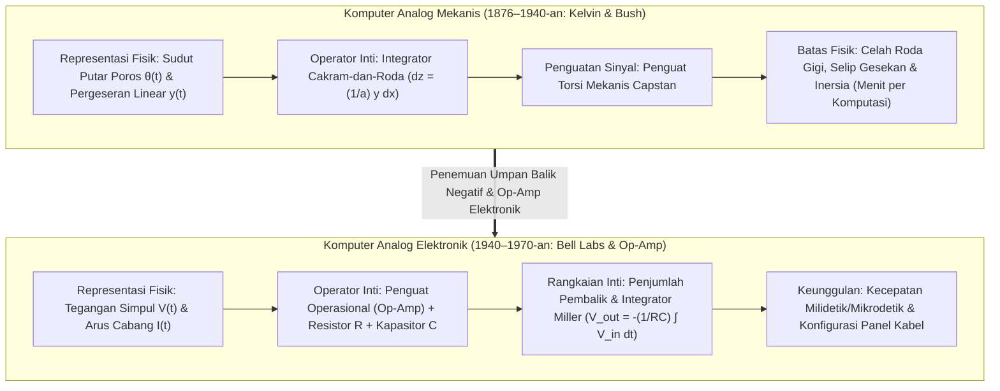
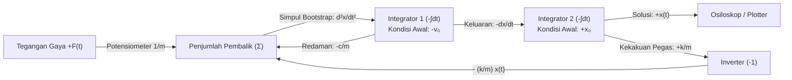

## 1. Pendahuluan: Apakah "Komputasi" Selalu Berarti Menghitung Digit?

Ketika kita mendengar kata "komputer" saat ini, kita hampir selalu membayangkan <strong>komputer digital (Digital Computer)</strong>. Dalam paradigma digital, setiap fenomena kontinu di alam semesta fisik—gelombang suara, turbulensi fluida, orbit planet, hingga inferensi jaringan saraf—harus terlebih dahulu didiskritisasi melalui pencuplikan (*sampling*) dan kuantisasi menjadi barisan bit biner ($0$ dan $1$). Miliaran gerbang logika kemudian beralih mengikuti detak jam (*clock*) global untuk menghampiri matematika kontinu melalui miliaran langkah aritmetika elementer.

Namun, dari sudut pandang sejarah sains dan fisika, mereduksi seluruh perhitungan menjadi pencacahan digit diskrit (dari bahasa Latin *digitus*, "jari") sebenarnya adalah jalan memutar yang relatif baru. Hukum-hukum dasar alam—mekanika Newton, elektrodinamika Maxwell, persamaan fluida Navier-Stokes, dan persamaan gelombang Schrödinger—dirumuskan secara alami dalam bahasa <strong>variabel kontinu bernilai riil yang diatur oleh persamaan diferensial</strong>.

Jauh sebelum komputer digital mendominasi dunia pada pertengahan abad ke-20, para ilmuwan dan insinyur mengembangkan filosofi komputasi yang sama sekali berbeda: <strong>Komputer Analog (Analog Computer)</strong>.

Komputer analog sama sekali tidak membilang angka. Ia tidak memiliki alamat memori, penghitung program (*program counter*), siklus *clock* diskrit, maupun perulangan integrasi numerik iteratif (seperti metode Euler atau Runge-Kutta). Sebaliknya, komputer analog memecahkan masalah matematika dengan membangun <strong>sistem fisik—terdiri dari roda gigi, integrator gesekan cakram mekanis, penguat operasional (Op-Amp), kapasitor, atau interferometer optik—yang persamaan fisika pengaturnya bersifat isomorfik (identik secara matematis) dengan persamaan diferensial dari masalah yang sedang diteliti</strong>. Begitu sakelar dinyalakan, hukum Kirchhoff dan kekekalan muatan memaksa tegangan simpul kontinu $V(t)$ dan arus cabang $I(t)$ berevolusi secara waktu-nyata (*real-time*) mengikuti solusi eksak persamaan diferensial tersebut—tanpa galat pemotongan diskritisasi dan tanpa kemacetan von Neumann (*von Neumann bottleneck*) akibat perpindahan data antara memori dan prosesor.

Artikel ini mengupas tuntas sejarah dan fisika komputasi analog: mulai dari integrator mekanis James Thomson, Lord Kelvin, dan Vannevar Bush, penemuan penguat operasional (Op-Amp) dan metode *bootstrap* umpan balik Kelvin, batas termodinamika derau termal Johnson-Nyquist, hingga <strong>kebangkitan kembali komputasi analog pada abad ke-21</strong> melalui *Analog In-Memory Computing* (barisan *crossbar* memristor), fotonika silikon, dan rekayasa neuromorfik.

---

## 2. Silsilah Mekanis: Menjalankan Kalkulus dengan Roda Gigi dan Cakram

### 2.1 Dari Mekanisme Antikythera hingga Mistar Hitung

Komputer analog kompleks tertua yang diketahui dalam sejarah manusia adalah <strong>Mekanisme Antikythera</strong>, dibuat di Yunani Helenistik sekitar abad ke-2 SM. Dengan lebih dari tiga puluh roda gigi perunggu presisi (termasuk roda gigi diferensial episiklik), alat ini menghitung posisi ekliptika kontinu Matahari, Bulan, dan planet-planet serta siklus gerhana Saros. Pada tahun 1622, berlandaskan penemuan logaritma oleh John Napier, William Oughtred menciptakan <strong>mistar hitung (Slide Rule)</strong> yang memetakan bilangan riil positif $x$ ke panjang fisik yang sebanding dengan $\log_{10} x$, mengubah perkalian $x \cdot y$ menjadi penjumlahan mekanis kontinu dari dua pergeseran panjang $\log_{10} x + \log_{10} y = \log_{10}(xy)$.

### 2.2 James Thomson, Lord Kelvin, dan Integrator Cakram-Roda

Lompatan besar untuk memecahkan <strong>persamaan diferensial</strong> secara mekanis terjadi pada tahun 1876 ketika <strong>James Thomson</strong>, kakak laki-laki William Thomson (<strong>Lord Kelvin</strong>), menemukan <strong>Integrator Cakram-dan-Roda Gesek (Wheel-and-Disk Integrator)</strong>:

1. Sebuah <strong>cakram horizontal</strong> berputar sebesar sudut infinitesimal $dx$ yang sebanding dengan variabel bebas $x$.
2. Sebuah <strong>roda gesek vertikal</strong> kecil berjari-jari $a$ menekan permukaan cakram pada jarak radial $y(x)$ dari pusat cakram (mewakili fungsi integran).
3. Saat cakram berputar sebesar $dx$, panjang busur yang ditempuh di bawah titik kontak adalah $y(x)\,dx$. Dengan asumsi menggelinding sempurna tanpa selip, sudut putar $dz$ roda gesek memenuhi $a\,dz = y(x)\,dx$, sehingga total sudut rotasi roda $z(x)$ secara fisik menghitung integral tentu:

$$z(x) = \frac{1}{a} \int_{x_0}^{x} y(x')\,dx'$$

Lord Kelvin menggunakan integrator ini untuk membangun <strong>Mesin Prediksi Pasang Surut (Tide-Predicting Machine)</strong> yang menjumlahkan komponen harmonik gravitasi Bulan dan Matahari $\sum_k A_k \cos(\omega_k t + \phi_k)$ untuk menggambar kurva pasang surut kontinu selama satu tahun penuh hanya dalam empat jam.

### 2.3 Penganalisis Diferensial Vannevar Bush dan Penguat Torsi

Menggabungkan beberapa integrator mekanis secara berantai sempat terhambat selama puluhan tahun oleh <strong>rendahnya torsi keluaran</strong> roda gesek yang mudah selip jika diberi beban mekanis. Pada tahun 1931 di MIT, <strong>Vannevar Bush</strong> memecahkan masalah ini dengan menciptakan <strong>Penguat Torsi Mekanis (Torque Amplifier)</strong> berbasis prinsip kerekan kapal (*capstan*), yang melipatgandakan torsi ribuan kali menggunakan motor listrik eksternal tanpa membebani roda integrator. Pada tahun 1941, <strong>Claude Shannon</strong> membuktikan dalam *Mathematical Theory of the Differential Analyzer* bahwa fungsi yang dapat dibangkitkan oleh sejumlah berhingga integrator ekuivalen secara eksak dengan solusi <strong>Persamaan Diferensial Aljabar (ADE)</strong>.

---

## 3. Jantung Komputasi Analog Elektronik: Penguat Operasional (Op-Amp)

Selama Perang Dunia II, <strong>Karl D. Swartzel Jr.</strong> (Bell Labs), <strong>Helmut Hoelzer</strong> (perancang komputer analog pemandu roket V-2), dan <strong>John R. Ragazzini</strong> (Universitas Columbia) menggantikan poros baja mekanis dengan rangkaian tabung vakum elektronik. Istilah <strong>"Operational Amplifier (Op-Amp)"</strong> sendiri diciptakan oleh Ragazzini pada tahun 1947 untuk menyebut penguat arus searah berpenguatan tinggi yang dirancang khusus guna melakukan <strong>operasi matematika</strong> (penjumlahan, penskalaan, dan integrasi).

### 3.1 Op-Amp Ideal dan Keajaiban "Ground Semu (Virtual Ground)"

Dengan penguatan simpal terbuka $A_{\text{OL}} \sim 10^5 \text{–} 10^8$, tegangan keluaran adalah $V_{\text{out}} = A_{\text{OL}}(V_+ - V_-)$. Dengan menghubungkan terminal non-pembalik ke *ground* ($V_+ = 0\,\text{V}$) dan menerapkan <strong>umpan balik negatif (Negative Feedback)</strong> ke terminal pembalik $V_-$, batas $A_{\text{OL}} \to \infty$ (dan impedansi masukan tak hingga $Z_{\text{in}} \to \infty$) menghasilkan:

$$V_+ - V_- = \frac{V_{\text{out}}}{A_{\text{OL}}} \to 0 \implies V_- = V_+ = 0\,\text{V}, \quad I_- = 0$$

Simpul $V_-$ terkunci pada potensial $0\,\text{V}$ meskipun tidak terhubung secara fisik ke *ground*: inilah <strong>Ground Semu (Virtual Ground)</strong>, yang menghapus ketidakstabilan internal penguat dari persamaan matematika!

### 3.2 Penurunan Eksak Penjumlah dan Integrator Miller

1. <strong>Penjumlah Pembalik Berbobot (Summing Amplifier)</strong>:
   Dengan menerapkan Hukum Arus Kirchhoff (KCL) pada simpul *virtual ground* ($V_- = 0$) untuk $N$ tegangan masukan $V_k(t)$ melalui resistor $R_k$ dan resistor umpan balik $R_f$:
   $$\sum_{k=1}^N \frac{V_k(t)}{R_k} + \frac{V_{\text{out}}(t)}{R_f} = 0 \implies V_{\text{out}}(t) = -\sum_{k=1}^N \left(\frac{R_f}{R_k}\right) V_k(t)$$
2. <strong>Integrator Waktu-Kontinu Miller (Miller Integrator)</strong>:
   Mengganti $R_f$ dengan kapasitor $C$ menghasilkan arus pengisian $I_C(t) = C \frac{d V_{\text{out}}(t)}{dt}$, sehingga berdasarkan KCL:
   $$\frac{V_{\text{in}}(t)}{R} + C \frac{d V_{\text{out}}(t)}{dt} = 0 \implies V_{\text{out}}(t) = -\frac{1}{RC} \int_0^t V_{\text{in}}(\tau)\,d\tau + V_{\text{out}}(0)$$
3. <strong>Mengapa Komputer Analog Pantang Menggunakan Diferensiator dan Hanya Menggunakan Integrator</strong>:
   Dalam domain frekuensi ($s = j\omega$), integrator memiliki penguatan $|H_{\text{int}}(\omega)| = \frac{1}{\omega RC}$ yang bekerja sebagai <strong>filter lolos-rendah (low-pass filter)</strong> peredam derau frekuensi tinggi. Sebaliknya, diferensiator memiliki penguatan $|H_{\text{diff}}(\omega)| = \omega RC$ (<strong>filter lolos-tinggi</strong>) yang memperkuat derau frekuensi tinggi $\varepsilon \sin(\omega_{\text{high}} t)$ sebesar faktor $\omega_{\text{high}}$, langsung membuat Op-Amp jenuh dan berosilasi.

---

## 4. Memecahkan Persamaan Diferensial lewat Pengabelan: Metode Bootstrap Kelvin

Untuk menyelesaikan persamaan osilator harmonik teredam $m \ddot{x} + c \dot{x} + k x = F(t)$ hanya dengan integrator, <strong>metode umpan balik (Bootstrap) Kelvin</strong> dilakukan dalam empat langkah:

1. <strong>Isolasi turunan orde tertinggi</strong>: $\ddot{x}(t) = -\frac{c}{m}\dot{x}(t) - \frac{k}{m}x(t) + \frac{1}{m}F(t)$.
2. <strong>Asumsikan kabel pembawa sinyal tegangan $\ddot{x}(t)$ sudah tersedia</strong>.
3. <strong>Integrasikan secara berantai</strong>: Integrator pembalik pertama (kondisi awal $-v_0$) menghasilkan $-\dot{x}(t)$, dan integrator pembalik kedua (kondisi awal $+x_0$) menghasilkan solusi $+x(t)$.
4. <strong>Tutup simpal umpan balik (Bootstrap)</strong>: Gabungkan $-\dot{x}(t)$, $-x(t)$, dan $F(t)$ melalui potensiometer dan penjumlah untuk membentuk ruas kanan persamaan, lalu <strong>hubungkan keluarannya langsung kembali ke simpul masukan $\ddot{x}(t)$ yang diasumsikan pada langkah 2!</strong>

---

## 5. Fisika Presisi dan Derau: Mengapa Digital Menggeser Analog?

Setiap resistor $R$ pada suhu mutlak $T > 0\,\text{K}$ menghasilkan <strong>derau termal Johnson-Nyquist</strong> pada lebar pita $\Delta f$:

$$v_{\text{rms}} = \sqrt{4 k_B T R \Delta f}$$

Untuk menyajikan presisi $b$ bit ($2^b = V_{\max}/v_{\text{noise}}$) pada satu kabel analog kontinu, rasio daya sinyal terhadap derau harus mencapai $\text{SNR}_{\text{power}} = 2^{2b}$. <strong>Setiap tambahan 1 bit presisi melipatgandakan kebutuhan daya atau kapasitansi sebesar empat kali lipat—sehingga biaya fisik komputasi analog meningkat secara eksponensial sebesar $O(2^{2b})$!</strong> Akibatnya, presisi praktis komputer analog elektronik dibatasi hingga <strong>3–4 digit desimal ($10\text{–}14\text{ bit}$, galat $0,01\%\text{–}0,1\%$)</strong>. Sebaliknya, pada komputer digital setiap transistor hanya membedakan dua keadaan ($0$ dan $1$), sehingga biaya perangkat keras untuk presisi $b$ bit hanya tumbuh secara <strong>linear atau polinomial sebesar $O(b \text{ hingga } b^2)$</strong>.

| Dimensi Arsitektur | Komputer Analog Elektronik | Komputer Digital (Von Neumann) |
| :--- | :--- | :--- |
| <strong>Representasi Kuantitas</strong> | Variabel fisik kontinu ($V(t), I(t)$) | Kata biner diskrit ($b$ bit, *floating-point* IEEE 754) |
| <strong>Mekanisme Integrasi</strong> | Akumulasi muatan fisik kontinu $V = -\frac{1}{RC}\int V_{\text{in}}\,dt$ | Kuadratur numerik diskrit (Euler, Runge-Kutta) |
| <strong>Paralelisme & Waktu Eksekusi</strong> | <strong>Paralelisme spasial penuh</strong> ($O(1)$ waktu-nyata independen dari $N$) | Eksekusi sekuensial *time-multiplexed* ($O(N \sim N^3)$) |
| <strong>Batas Presisi Praktis</strong> | <strong>$3\text{–}4$ digit desimal ($10\text{–}14\text{ bit}$)</strong> | Presisi arbitrer ($64\text{ bit} \approx 16$ digit desimal) |
| <strong>Skala Biaya terhadap Presisi $b$</strong> | <strong>Pertumbuhan eksponensial $\propto O(2^{2b})$</strong> (derau termal $k_B T$) | <strong>Pertumbuhan linear / polinomial $\propto O(b \sim b^2)$</strong> |

Dalam program luar angkasa Apollo, <strong>Komputer Hibrida (Hybrid Computers)</strong> menggabungkan kecepatan waktu-nyata analog (simulasi penerbangan 6 derajat kebebasan *Hardware-in-the-Loop*) dengan presisi digital 64-bit untuk navigasi orbit translunar.

---

## 6. Kebangkitan Abad ke-21: Komputasi Dalam-Memori (AIMC), Fotonika, dan Chip Neuromorfik

Kini, saat Hukum Moore mendekati batas atomik dan model kecerdasan buatan (*Deep Learning* & LLM) menghadapi krisis energi akibat perpindahan data antara memori dan prosesor (<strong>kemacetan von Neumann</strong>), komputasi analog bangkit kembali secara spektakuler:

- <strong>Analog In-Memory Computing (AIMC) dengan Crossbar Memristor</strong>: Lebih dari $99\%$ beban komputasi AI adalah perkalian matriks-vektor $y_i = \sum_{j=1}^N W_{ij} x_j$ yang hanya membutuhkan presisi rendah $4\text{–}8\text{ bit}$. Dengan menyimpan bobot $W_{ij}$ sebagai konduktansi $G_{ij} = 1/R_{ij}$ pada susunan memristor (ReRAM/PCM), <strong>Hukum Ohm</strong> ($I_{ij} = G_{ij} V_j$) dan <strong>Hukum Arus Kirchhoff</strong> ($I_i = \sum_j G_{ij} V_j$) mengeksekusi seluruh perkalian matriks dalam hitungan nanodetik dalam waktu $O(1)$ langsung di dalam sel memori!
- <strong>Fotonika Silikon, Chip Neuromorfik, dan Neural ODE</strong>: Prosesor fotonik memanfaatkan interferensi laser pada jejaring interferometer Mach-Zehnder (MZI) untuk mengalikan matriks dengan kecepatan cahaya; rangkaian <strong>CMOS sub-ambang neuromorfik</strong> gagasan Carver Mead meniru langsung persamaan diferensial kanal ion neuron biologis, sementara <strong>Neural ODEs dan Liquid Neural Networks</strong> menyatukan kembali persamaan diferensial waktu-kontinu dengan kecerdasan buatan modern.
