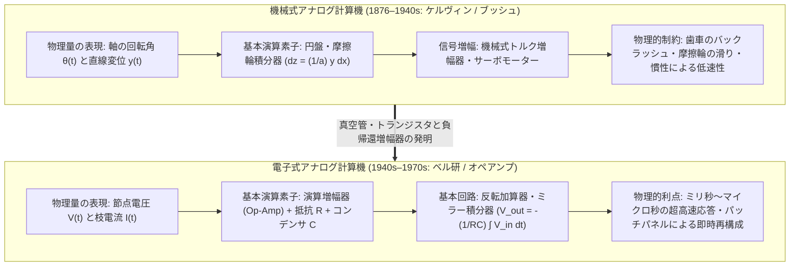
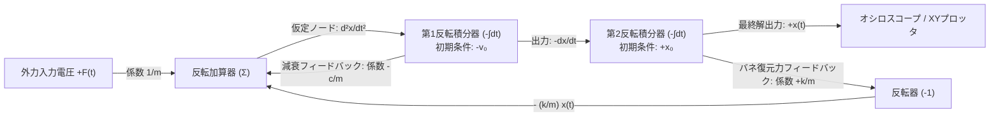
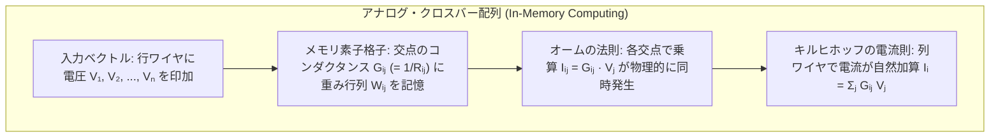

## 1. 序論：「計算（Computation）」とは数字を数えることなのか？

現代において「コンピュータ」という言葉を聞くとき、私たちの脳裏に浮かぶのは例外なく<strong>デジタルコンピュータ（Digital Computer）</strong>である。そこでは世界のあらゆる事象——音声、画像、流体の渦、惑星の軌道、知能の推論——が、離散的な $0$ と $1$ のビット列（2進数）へと量子化（Quantization）および標本化（Sampling）され、クロック周波数に同期した論理ゲート（NAND / NOR）のスイッチングによって、1秒間に数十億回もの四則演算へと還元される。

しかし、人類の科学技術史を紐解けば、「すべてを離散的な数字（Digit＝指で数えるもの）に置き換えて順番に計算する」というパラダイムは、実は20世紀半ば以降に覇権を握った比較的新しい手法にすぎない。そもそも自然界の物理法則——ニュートンの運動方程式、マクスウェルの電磁場方程式、ナビエ・ストークス方程式、シュレーディンガー方程式——は、本来すべて<strong>連続的な実数値（Continuous Real Numbers）と微分方程式</strong>によって記述されている。

ここに、デジタル計算とは根本的に異なるもう一つの計算パラダイムが存在する。それが<strong>アナログコンピュータ（Analog Computer）</strong>である。

アナログコンピュータは、数字を一切数えない。メモリアドレスも、プログラムカウンタも、離散的なクロックサイクルによる数値積分（オイラー法やルンゲ＝クッタ法）のループも持たない。その代わりに、<strong>解きたい問題の数学的変数（位置、速度、圧力、人口など）を、歯車の回転角、流体の水圧、バネの変位、あるいは電気回路の「連続的な電圧 $V(t)$ や電流 $I(t)$」へと直接対応づけ（Analogy＝類推・相似）、物理法則そのものに微分方程式をリアルタイムで解かせる機械</strong>である。

もしある電気回路の支配方程式（キルヒホッフの法則とコンデンサの電荷保存則）が、私たちが解きたい航空機の姿勢制御や神経細胞の膜電位の微分方程式と数学的に<strong>同型（Isomorphic）</strong>であるならば、スイッチを入れて回路に電流を流し、オシロスコープで出力電圧の波形を観測した瞬間、物理現象そのものが「計算」を完了している。そこにはアルゴリズムの収束待ちも、離散化による丸め誤差の蓄積も、フォン・ノイマン・ボトルネック（CPUとメモリ間のデータ転送遅延）も存在しない。

本稿では、機械式アナログ計算機の黄金時代（ケルヴィン卿の潮汐予測機、ヴァネヴァー・ブッシュの微分解析機）から、オペアンプ（Operational Amplifier：演算増幅器）の発明による電子式アナログコンピュータの回路理論、ケルヴィンのフィードバック・ブートストラップ法による微分方程式の直接求解、熱雑音（Johnson-Nyquist Noise）と部品精度がアナログ計算に突きつけた情報理論的限界、そして21世紀の今日、ディープラーニングの電力の壁を打破するために復活した<strong>メモリ内アナログ演算（In-Memory Computing）・光コンピューティング・ニューロモルフィック工学</strong>の最前線までを、回路方程式と情報理論から徹底的に解き明かす。

---

## 2. 機械式アナログ計算の系譜：歯車と円盤が微分積分を実行する

### 2.1 アンティキティラ島の機械から計算尺まで

人類最古のアナログ計算機として知られるのが、紀元前2世紀頃のギリシャで作られた<strong>アンティキティラ島の機械（Antikythera Mechanism）</strong>である。30個以上の精巧な青銅製歯車（差動歯車機構を含む）を組み合わせたこの装置は、ハンドルを回すことで太陽・月・惑星の黄道上の位置や日食・月食の周期（サロス周期）を連続的な歯車の回転角の比率として計算した。さらに1620年代には、ジョン・ネイピアの対数の発見を受けてウィリアム・オートレッドが<strong>計算尺（Slide Rule）</strong>を発明した。計算尺は、数 $x$ を長さ $\log x$ という物理的な直線距離にマッピングすることで、乗除算 $x \cdot y$ を「2本の物差しの長さの足し算 $\log x + \log y = \log(xy)$」という連続的な空間変位の合成へと変換するアナログ計算器であり、アポロ計画で人類を月へ送り届ける1970年代まで世界中の科学者・技術者の必携品であった。

### 2.2 ジェームズ・トムソンとケルヴィン卿の「球・円盤・円筒積分器」

しかし、加減乗除を超えて<strong>「微積分（Calculus）」と「微分方程式」</strong>を機械的に解くための決定的なブレークスルーは、19世紀後半のイギリスでもたらされた。ウィリアム・トムソン（後の<strong>ケルヴィン卿：Lord Kelvin</strong>）の実兄である工学者<strong>ジェームズ・トムソン（James Thomson）</strong>が1876年に発明した<strong>「円盤・球・円筒積分器（Disk-Globe-Cylinder Integrator）」</strong>（およびその改良型である<strong>ホイール・アンド・ディスク積分器：Wheel-and-Disk Integrator</strong>）である。

その幾何学的原理は驚くほどエレガントである。

1. 半径方向の変位が可変な水平の<strong>回転円盤（Disk）</strong>があり、その円盤が入力変数 $x$ に比例した微小角度 $dx$ だけ回転する。
2. この円盤の表面に、半径 $a$ の小さな<strong>摩擦輪（Integrator Wheel）</strong>を垂直に押し当てる。摩擦輪が円盤の中心から距離 $y(x)$ の位置にあるとき、円盤が $dx$ 回転すると、その接点における円弧の移動距離は $y(x)\,dx$ となる。
3. すべり（Slip）がない理想的な転がり接触を仮定すれば、半径 $a$ の摩擦輪が回転する角度 $dz$ は $a\,dz = y(x)\,dx$ を満たす。したがって、摩擦輪の総回転角 $z$ は自動的に次の定積分を計算してしまうのである！

$$z = \frac{1}{a} \int_{x_0}^{x} y(x')\,dx'$$

ケルヴィン卿はこの機械式積分器と滑車・ワイヤーによる調波合成機構を結合し、1872年から1876年にかけて<strong>「潮汐予測機（Tide-Predicting Machine）」</strong>を建造した。港湾の潮位 $h(t)$ は、月や太陽の引力による多数の周期成分（分潮）の重ね合わせ $\sum_k A_k \cos(\omega_k t + \phi_k)$ として表される。人間が手計算でフーリエ級数を計算すれば数週間かかる1年分の潮汐曲線を、ケルヴィンの機械はクランクを回すだけでわずか4時間で紙ロール上に連続的な曲線として描き出した。

### 2.3 ヴァネヴァー・ブッシュの「微分解析機（Differential Analyzer）」

機械式積分器には長らく一つの致命的な弱点があった。それは<strong>「出力トルクの不足」</strong>である。円盤と摩擦輪はわずかな摩擦力だけで回転を伝達しているため、積分器の出力軸に次の計算機構（別の積分器やペン記録計）を直接つなぐと、負荷の重みで摩擦輪が滑ってしまい、積分の精度が完全に崩壊するのである。

この問題を解決し、大規模な常微分方程式を解ける汎用機械式アナログコンピュータ<strong>「微分解析機（Differential Analyzer）」</strong>を1931年にMITで完成させたのが、<strong>ヴァネヴァー・ブッシュ（Vannevar Bush）</strong>と彼の弟子ヘイゼンであった。ブッシュは、キャプスタン（巻き揚げ機）の原理を応用した機械式<strong>トルク増幅器（Torque Amplifier：現代のサーボ機構の先祖）</strong>を導入した。これにより、摩擦輪から取り出す微小な回転角に一切の負荷をかけることなく、外部モーターの動力を使って出力トルクを数千倍に増幅し、何段もの積分器を縦続接続（カスケード接続）することが可能になった。

さらに1947年には、クロード・シャノン（Claude Shannon）が『微分解析機の数学的理論（Mathematical Theory of the Differential Analyzer）』を発表し、ブッシュの微分解析機で生成可能な関数クラスが「代数的微分方程式（Algebraically Differential Equations: ADE）の解」と厳密に一致することを証明した（これにより、オイラーのガンマ関数 $\Gamma(x)$ やリーマンのゼータ関数 $\zeta(x)$ は有限個の積分器の組み合わせでは生成できないことが数学的に示された）。

---

## 3. 電子式アナログ計算の心臓部：「演算増幅器（Operational Amplifier）」の誕生

歯車とシャフトの慣性によって計算速度が数分〜数十分に制限されていた機械式微分解析機を、一瞬にして過去のものとしたのが、第二次世界大戦中にベル研究所の<strong>カール・スワーツェル（Karl D. Swartzel Jr.）</strong>やコロンビア大学の<strong>ジョン・ラガッツィーニ（John R. Ragazzini）</strong>、<strong>ロバート・レフラー</strong>らによって確立された<strong>電子式アナログコンピュータ</strong>である。

今日、あらゆる電子回路に不可欠な基本部品となっている<strong>「オペアンプ（Operational Amplifier：演算増幅器）」</strong>という名称そのものが、実は1947年のラガッツィーニの論文において<strong>「アナログコンピュータの中で加算・減算・積分・微分などの数学的演算（Mathematical Operations）を実行するための直流増幅器」</strong>という意味で名付けられたものなのである。

### 3.1 理想オペアンプと「仮想接地（Virtual Ground）」の魔法

オペアンプは、非反転入力端子（$+$、電位 $V_+$）と反転入力端子（$-$、電位 $V_-$）の電位差を、極めて巨大な開ループ利得 $A_{\text{OL}}$（真空管や現代のICでは $A_{\text{OL}} \sim 10^5 \text{〜} 10^8$）倍に増幅して出力する差動増幅器である。

$$V_{\text{out}} = A_{\text{OL}} (V_+ - V_-)$$

オペアンプ単体では利得が大きすぎてすぐに飽和してしまう上、温度や経年変化によって利得 $A_{\text{OL}}$ が変動し、非線形な歪みも持つ。しかし、ハロルド・ブラック（Harold S. Black）が1927年に発明した<strong>「負帰還（Negative Feedback）」</strong>——出力端子 $V_{\text{out}}$ から反転入力端子 $V_-$ へ受動素子（抵抗やコンデンサ）を介して信号を戻す構造——を導入すると、驚くべき数学的奇跡が起こる。

理想的なオペアンプ（入力インピーダンス $Z_{\text{in}} \to \infty$、出力インピーダンス $Z_{\text{out}} \to 0$、開ループ利得 $A_{\text{OL}} \to \infty$）において、非反転端子 $V_+$ をグラウンド（$0\,\text{V}$）に接続し、負帰還をかけた状態を考えよう。出力電圧 $V_{\text{out}}$ が有限の値（たとえば $\pm 10\,\text{V}$ の範囲内）に保たれているならば、

$$V_+ - V_- = \frac{V_{\text{out}}}{A_{\text{OL}}} \xrightarrow{A_{\text{OL}} \to \infty} 0 \implies V_- = V_+ = 0\,\text{V}$$

となる。反転入力端子 $V_-$ はグラウンドに物理的に短絡されていないにもかかわらず、負帰還の働きによって常に電位が $0\,\text{V}$ に保たれる。これを<strong>「仮想接地（Virtual Ground / Virtual Short）」</strong>と呼ぶ。しかも入力インピーダンスが無限大であるため、オペアンプの入力端子内部へ流れ込む電流は $I_- = 0$ である。

この「仮想接地（$V_- = 0$）」と「入力電流ゼロ（$I_- = 0$）」という2つの性質により、オペアンプ自身の不安定な内部特性は方程式から完全に消去され、<strong>外付けされた受動素子（抵抗 $R$ とコンデンサ $C$）の物理法則だけで、極めて高精度な数学的演算器が構成できる</strong>のである。

### 3.2 基本演算回路の厳密な導出

#### ① 反転増幅器・重み付き加算器（Summing Amplifier）

$N$ 個の入力電圧 $V_1(t), V_2(t), \dots, V_N(t)$ を、それぞれ入力抵抗 $R_1, R_2, \dots, R_N$ を介してオペアンプの反転入力節点（$V_- = 0$）に接続し、出力端子 $V_{\text{out}}(t)$ からその節点へ帰還抵抗 $R_f$ を接続する。
オームの法則より、各入力から仮想接地節点（$V_- = 0$）へ流れ込む電流の和は $\sum_{k=1}^N \frac{V_k(t) - 0}{R_k}$ である。オペアンプ内部には電流が流れ込まないため、キルヒホッフの電流則（KCL）により、この電流はすべて帰還抵抗 $R_f$ を通って出力端子へ流れ出なければならない。

$$\sum_{k=1}^N \frac{V_k(t)}{R_k} + \frac{V_{\text{out}}(t)}{R_f} = 0 \implies V_{\text{out}}(t) = -\sum_{k=1}^N \frac{R_f}{R_k} V_k(t)$$

抵抗比 $a_k = R_f / R_k$ をポテンショメータ（可変抵抗器）で設定すれば、任意の重み付き線形結合 $-\sum_{k=1}^N a_k V_k(t)$ が、<strong>光の速さ（電磁波の伝播速度）で同時かつ連続的に計算される</strong>。デジタルCPUのように $N$ 回の乗算命令と加算命令を順番に実行する必要は一切ない。

#### ② 連続時間積分器（Miller Integrator：ミラー積分回路）

次に、帰還経路の抵抗 $R_f$ を<strong>静電容量 $C$ のコンデンサ（キャパシタ）</strong>に置き換え、入力抵抗 $R$ を介して入力電圧 $V_{\text{in}}(t)$ を与えてみよう。
コンデンサに蓄えられる電荷 $Q(t)$ と端子間電圧 $V_C(t)$ の間には $Q(t) = C V_C(t)$ の関係があり、コンデンサを流れる電流 $I_C(t)$ は電荷の時間微分 $I_C(t) = \frac{dQ}{dt} = C \frac{dV_C}{dt}$ である。
仮想接地節点（$V_- = 0$）におけるキルヒホッフの電流則を立てると、入力抵抗 $R$ から流れ込む電流 $I_{\text{in}}(t) = \frac{V_{\text{in}}(t)}{R}$ は、すべてコンデンサ $C$ へと充電される（出力側端子の電位が $V_{\text{out}}(t)$ であるため、$V_C(t) = 0 - V_{\text{out}}(t) = -V_{\text{out}}(t)$）。

$$\frac{V_{\text{in}}(t)}{R} + C \frac{d V_{\text{out}}(t)}{dt} = 0 \implies \frac{d V_{\text{out}}(t)}{dt} = -\frac{1}{RC} V_{\text{in}}(t)$$

両辺を時刻 $t = 0$ から $t$ まで積分し、時刻 $t = 0$ におけるコンデンサの初期充電電圧によって初期条件 $V_{\text{out}}(0)$ を与えれば、次の<strong>連続時間積分器の方程式</strong>が得られる。

$$V_{\text{out}}(t) = -\frac{1}{RC} \int_0^t V_{\text{in}}(\tau)\,d\tau + V_{\text{out}}(0)$$

ここで $RC$ は回路の時定数（単位は秒 $[\text{s}]$）である。たとえば $R = 1\,\text{M}\Omega$、$C = 1\,\mu\text{F}$ に選べば $RC = 1\,\text{s}$ となり、出力電圧 $V_{\text{out}}(t)$ は入力電圧の符号反転した厳密な時間積分そのものとなる！

#### ③ なぜアナログコンピュータは「微分器」ではなく「積分器」を使うのか？

理論上は、入力側の抵抗 $R$ と帰還側のコンデンサ $C$ の位置を入れ替えれば、$V_{\text{out}}(t) = -RC \frac{d V_{\text{in}}(t)}{dt}$ を計算する<strong>微分回路（Differentiator）</strong>も簡単に作れる。しかし、現実のアナログコンピュータの設計においては、<strong>「微分器は絶対に使ってはならず、すべての微分方程式は必ず積分器だけで構成しなければならない」</strong>という鉄則が存在する。なぜか？

その理由は周波数領域（ラプラス変換 $s = j\omega$）における伝達関数と<strong>高周波雑音（Noise）の増幅特性</strong>にある。

- <strong>積分器の伝達関数</strong>: $H_{\text{int}}(j\omega) = -\frac{1}{j\omega RC} \implies |H_{\text{int}}(\omega)| = \frac{1}{\omega RC}$。周波数 $\omega$ が高くなるほど利得が反比例して減衰する<strong>ローパスフィルタ（低域通過フィルタ）</strong>として働くため、入力信号に混入した高周波の熱雑音やスパイクノイズを滑らかに平滑化（スムージング）し、回路を極めて安定に保つ。
- <strong>微分器の伝達関数</strong>: $H_{\text{diff}}(j\omega) = -j\omega RC \implies |H_{\text{diff}}(\omega)| = \omega RC$。利得が周波数 $\omega$ に比例して無限に増大する<strong>ハイパスフィルタ</strong>となってしまう！現実の回路に必ず存在する微小な高周波ノイズ $n(t) = \varepsilon \sin(\omega_{\text{high}} t)$ を微分すると、$\frac{dn}{dt} = \varepsilon \omega_{\text{high}} \cos(\omega_{\text{high}} t)$ となり、振幅 $\varepsilon$ が極小でも角周波数 $\omega_{\text{high}}$ が巨大であるため、ノイズが何万倍にも増幅されてオペアンプを飽和させ、さらには寄生容量との位相遅れによって回路全体が激しく自己発振（リンギング）を起こしてしまうのである。

---

## 4. 微分方程式を「配線」で解く：ケルヴィンのフィードバック・ブートストラップ法

では、微分器を一切使わずに、高階の常微分方程式（ODE）をどうやって積分器だけで解くのだろうか？これを解決した天才的アルゴリズムこそ、1876年にケルヴィン卿が考案した<strong>「ケルヴィンのフィードバック法（Kelvin's Feedback / Bootstrap Method）」</strong>である。

### 4.1 減衰調和振動子（質量・バネ・ダンパ系）の完全合成手順

具体例として、工学・物理学のあらゆる場所に現れる2階線形常微分方程式（質量 $m$、減衰係数 $c$、バネ定数 $k$、外力 $F(t)$ を持つ減衰強制振動系）を電子式アナログコンピュータで解く手順を導出しよう。

$$m \frac{d^2 x}{dt^2} + c \frac{dx}{dt} + k x(t) = F(t), \quad x(0) = x_0, \quad \dot{x}(0) = v_0$$

ケルヴィンの手法は以下の4ステップで構成される。

1. <strong>最高階導関数について式を解く</strong>:
   方程式の中で最も階数の高い微分項 $\ddot{x} = \frac{d^2 x}{dt^2}$ を左辺に孤立させ、残りのすべての項を右辺へ移項する。
   $$\frac{d^2 x}{dt^2} = -\frac{c}{m}\frac{dx}{dt} - \frac{k}{m}x(t) + \frac{1}{m}F(t)$$
2. <strong>「仮に最高階導関数 $\ddot{x}(t)$ の電圧信号がすでに手元にある」と仮定する</strong>:
   この未知の信号 $\ddot{x}(t)$ が存在する導線（ノード）を1本用意する。
3. <strong>積分器のカスケード接続によって低階の導関数を次々に生成する</strong>:
   - $\ddot{x}(t)$ を<strong>第1の反転積分器</strong>に入力すると、その出力には符号が反転した1階導関数（速度） $-\dot{x}(t)$ が現れる（初期電圧として $-v_0$ をコンデンサに設定）。
   - この $-\dot{x}(t)$ を<strong>第2の反転積分器</strong>に入力すると、さらに積分と符号反転が行われ、出力には変位 $+x(t)$ が現れる（初期電圧として $+x_0$ を設定）。
4. <strong>右辺の式に従って合成し、ステップ2の仮定ノードへ「フィードバック結合（閉ループ化）」する</strong>:
   いま手元には $-\dot{x}(t)$、$+x(t)$、および外部入力 $F(t)$ の電圧が揃っている。$+x(t)$ を反転器（利得 $-1$）に通して $-x(t)$ を作り、ポテンショメータで係数 $\frac{c}{m}, \frac{k}{m}, \frac{1}{m}$ を掛け合わせて加算器で足し合わせれば、ステップ1の右辺 $-\frac{c}{m}\dot{x} - \frac{k}{m}x + \frac{1}{m}F(t)$ の電圧信号が作られる。
   そして、<strong>この加算器の出力線を、ステップ2で「仮に $\ddot{x}(t)$ がある」と仮定した第1積分器の入力端子へと直接つないでループを閉じる（Bootstrap）</strong>のである！

この閉ループ配線が完了し、リレーを「COMPUTE（演算開始）」に切り替えた瞬間、キルヒホッフの法則によって回路全体の電圧は微分方程式 $\ddot{x} = -\frac{c}{m}\dot{x} - \frac{k}{m}x + \frac{1}{m}F(t)$ をすべての時刻 $t$ で同時に満たさざるを得なくなる。

### 4.2 スケーリング（振幅スケーリングと時間スケーリング）と非線形演算

実際の電子式アナログコンピュータ（たとえば1950〜70年代のPACE、EAI 231R、Hitachi ALSシリーズなど）で問題を解く際には、物理変数を回路の動作範囲に適合させる<strong>「スケーリング（Scaling）」</strong>という高度な技術が必要であった。

- <strong>振幅スケーリング（Amplitude Scaling）</strong>: 真空管式アナログ計算機では $\pm 100\,\text{V}$、トランジスタ・IC式では $\pm 10\,\text{V}$ が<strong>「1マシン単位（1 Machine Unit）」</strong>として定義される。電圧がこの上限を超えるとオペアンプが飽和（Overload）して微分方程式の相似性が崩壊し、逆に電圧が数ミリボルト以下になると背景の熱雑音に埋もれてしまう。そのため、物理変数 $x$ の予想最大値 $x_{\max}$ を用いて正規化変数 $X = \left(\frac{10\,\text{V}}{x_{\max}}\right) x$ へと変数変換を行う。
- <strong>時間スケーリング（Time Scaling）</strong>: 計算機内の時間 $t_m$（マシン時間）と現実世界の物理時間 $t_p$ の比率を $t_m = \beta t_p$（すなわち $\frac{d}{dt_p} = \beta \frac{d}{dt_m}$、積分器の時定数 $RC = 1/\beta$）として自在に伸縮させることができる。たとえば数百万年かかる銀河の重力進化（$\beta \ll 1$）や、逆にナノ秒で進行する核反応・分子振動（$\beta \gg 1$）を、人間がオシロスコープで観察しやすい「数秒〜数ミリ秒」のマシン時間へと変換して解くことができる。特に時定数 $RC$ をマイクロ秒オーダーに小さくし、毎秒1,000回以上初期条件へのリセットと演算を繰り返す方式は<strong>「高速反復型アナログコンピュータ（Repetitive Operation: Rep-Op）」</strong>と呼ばれ、技術者がバネ定数や翼の形状パラメータのツマミ（ポテンショメータ）を回すと、ブラウン管上の解軌道がリアルタイムに変形するインタラクティブな設計環境を実現していた。

さらに、線形微分方程式だけでなく、流体力学や弾道計算、カオス力学系（エドワード・ローレンツのアトラクタやファン・デル・ポール発振器 $\ddot{x} - \mu(1-x^2)\dot{x} + x = 0$）のような<strong>非線形微分方程式</strong>を解くために、以下のような非線形アナログ演算素子が開発された。

- <strong>アナログ乗算器（Quarter-Square Multiplier / Time-Division Multiplier / Gilbert Cell）</strong>: 2つの変数電圧 $X(t)$ と $Y(t)$ の積 $X(t)Y(t)$ を計算する。特に「四分の一二乗乗算器（Quarter-Square Multiplier）」は、恒等式
  $$XY = \frac{1}{4}\left[(X+Y)^2 - (X-Y)^2\right]$$
  を利用し、ダイオードと抵抗網の折れ線近似によって二乗関数 $u^2$ を生成することで、極めて高速な4象限アナログ乗算を実現した。
- <strong>ダイオード関数発生器（Diode Function Generator: DFG）</strong>: 複数のツェナーダイオードやシリコンダイオードの順方向閾値電圧を組み合わせ、$\sin x$、$\log x$、あるいは風洞実験で得られた空気抵抗係数 $C_D(\text{Mach})$ のような任意の非線形関数を連続的な折れ線関数として近似した。

---

## 5. 精度と雑音の物理学：なぜアナログはデジタルに王座を譲ったのか？

積分器と加算器をつなぐだけで、どんな複雑な連立常微分方程式もほぼ瞬時に（かつ問題のサイズ $N$ が増えても計算時間が全く増えない $O(1)$ の時間計算量で！）解くことができるアナログコンピュータは、1950年代〜1960年代の航空宇宙工学・原子力工学・化学プラント設計において絶対的な主役であった。では、なぜ1970年代以降、アナログコンピュータは急速に姿を消し、デジタルコンピュータに覇権を奪われたのだろうか？

その根本原因は、単なる「使い勝手」だけではなく、<strong>熱力学・統計力学とシャノンの情報理論が課す「アナログ信号の物理的精度（S/N比）とダイナミックレンジの壁」</strong>にある。

### 5.1 熱雑音（Johnson-Nyquist Noise）とドリフトの壁

どれほど精巧に作られた電子回路であっても、絶対零度（$T = 0\,\text{K}$）でない限り、導体内部の自由電子は熱エネルギー $k_B T$ によってランダムなブラウン運動（熱擾乱）を行っている。ジョン・バートランド・ジョンソンとハリー・ナイキストが1928年に導出した<strong>ジョンソン・ナイキスト熱雑音（Johnson-Nyquist Thermal Noise）</strong>の公式によれば、抵抗値 $R$ の抵抗器の両端には、帯域幅 $\Delta f$ にわたって次の実効値（RMS）を持つランダムな雑音電圧 $v_n$ が不可避的に発生する。

$$v_{\text{rms}} = \sqrt{4 k_B T R \Delta f}$$

（ここで $k_B \approx 1.38 \times 10^{-23}\,\text{J/K}$ はボルツマン定数、$T$ は絶対温度）。さらに半導体や真空管の内部では、電荷が離散的な電子 $e$ としてポアソン過程で障壁を通過することによる<strong>ショット雑音（Shot Noise: $i_{\text{rms}} = \sqrt{2 e I_{\text{DC}} \Delta f}$）</strong>や、低周波領域で電力スペクトル密度が周波数 $f$ に反比例して増大する<strong>フリッカー雑音（$1/f$ ノイズ）</strong>、そして周囲の温度変化によるオペアンプの<strong>入力オフセット電圧ドリフト（DC Drift）</strong>が発生する。

特に積分器 $V_{\text{out}}(t) = -\frac{1}{RC}\int_0^t (V_{\text{in}} + V_{\text{offset}})\,d\tau$ においては、わずか数マイクロボルトの微小な直流オフセット電圧 $V_{\text{offset}}$ や漏れ電流であっても、時間とともに $-\frac{V_{\text{offset}}}{RC} t$ として直線的に蓄積（ランナウェイ）し、やがて積分器の出力を破綻させてしまう（これを防ぐため、1949年にエドウィン・ゴールドバーグが機械式チョッパで直流を交流に変換して増幅・復調する<strong>チョッパ安定化オペアンプ：Chopper-Stabilized Amplifier</strong>を発明し、オフセットを数桁低減させた）。

### 5.2 「有効桁数1桁あたりコストが10倍になる」指数関数的なエネルギー障壁

アナログ計算における精度の限界を、情報理論の観点から定式化してみよう。
アナログコンピュータがフルスケール電圧 $V_{\max}$（たとえば $10\,\text{V}$）と最小識別雑音フロア $v_{\text{noise}}$（たとえば $1\,\text{mV}$）の間で連続量を表現するとき、識別可能な状態数（ダイナミックレンジ）は $M = V_{\max} / v_{\text{noise}}$ であり、これを等価な2進ビット精度（Effective Number of Bits: $\text{ENOB}$）で表せば次のようになる。

$$b_{\text{analog}} = \log_2 \left(\frac{V_{\max}}{v_{\text{noise}}}\right) = \frac{1}{2} \log_2 (\text{SNR}_{\text{power}})$$

もしアナログ計算で「10進数で4桁（相対誤差 $0.01\% = 10^{-4}$、約 $13.3\,\text{ビット}$）」の精度を達成しようとすれば、抵抗器 $R$ やコンデンサ $C$ の製造公差・温度係数を $0.01\%$ 以内に抑えた恒温槽（オーブン）入りの超高精密部品が必要になる。
では、金融計算や天体力学の長期軌道計算のように「10進数で10桁（相対誤差 $10^{-10}$、約 $34\,\text{ビット}$）」や「倍精度浮動小数点（IEEE 754 `double`：仮数部53ビット、10進約16桁、相対誤差 $10^{-16}$）」の精度が欲しければどうなるか？

- <strong>アナログ計算における精度拡大のコスト（指数関数的 $O(2^{2b})$）</strong>:
  ビット精度 $b$ を1ビット増やす（誤差を半分にする）ためには、電圧振幅 $V_{\max}$ を2倍にするか、雑音振幅 $v_{\text{noise}}$ を半分にしなければならない。信号電力 $P \propto V_{\max}^2$ または熱雑音低減のための静電容量 $C$（$k_B T / C$ ノイズ）の観点から見ると、<strong>アナログ計算で有効ビット数 $b$ を確保するための物理的リソース（消費電力・素子面積・コスト）は、ビット数 $b$ に対して指数関数 $2^{2b}$ に比例して爆発する</strong>！実用的なアナログ電子回路において、部品公差と熱雑音の双方から達成可能な精度の上限は、せいぜい<strong>有効桁数3〜4桁（相対誤差 $0.1\% \sim 0.01\%$、$10 \sim 14\,\text{ビット}$ 相当）</strong>が物理的な限界であった。
- <strong>デジタル計算における精度拡大のコスト（線形・多項式的 $O(b)$）</strong>:
  これに対して、フォン・ノイマンとシャノンが確立したデジタル計算では、1つのトランジスタに「何万段階もの微妙な電圧の違い」を区別させることを諦め、大きなノイズマージンを持った「High（$1$）か Low（$0$）かの2状態（1ビット）」だけを判別させる。そして、精度を $b$ ビット（32ビットから64ビット、さらには128ビットへ）に倍増させたければ、<strong>レジスタと加算器のトランジスタの列を横に2倍（$b$ 個）並べるだけでよい</strong>！すなわち、デジタル計算では精度 $b$ に対するハードウェアコストが $O(b)$（乗算器でも $O(b^2)$ または $O(b \log b)$）という<strong>線形・多項式オーダー</strong>でしか増えないのである。

| 比較項目 | アナログコンピュータ（連続時間電子式） | デジタルコンピュータ（フォン・ノイマン型） |
| :--- | :--- | :--- |
| <strong>情報の表現方式</strong> | 連続的な物理量（電圧 $V(t)$、電流 $I(t)$、光強度など） | 離散的な記号列（2進数ビット列 $0 / 1$、浮動小数点数） |
| <strong>時間の進行</strong> | 連続時間（クロックなし、物理系の時定数 $RC$ で進行） | 離散時間（クロック周波数 $f_{\text{clk}}$ に同期したステップ進行） |
| <strong>微積分の実行方法</strong> | コンデンサの電荷蓄積 $\int I\,dt$ による<strong>物理的・厳密な連続積分</strong> | 台形公式やルンゲ＝クッタ法による<strong>離散時間の数値近似</strong> |
| <strong>演算の並列性と速度</strong> | <strong>完全空間並列</strong>（問題規模 $N$ によらず実時間 $O(1)$ で同時求解） | 時間多重化（CPUコア数に制限され、規模 $N$ に対し $O(N \sim N^3)$） |
| <strong>計算精度（ダイナミックレンジ）</strong> | <strong>10進3〜4桁（$10 \sim 14\,\text{bit}$、誤差 $0.01\% \sim 0.1\%$）が限界</strong> | 任意精度が可能（単精度32bitで7桁、倍精度64bitで16桁以上） |
| <strong>精度 $b$ ビットに対するコスト</strong> | <strong>指数関数的増大 $\propto O(2^{2b})$</strong>（熱雑音・部品公差の壁） | <strong>線形・多項式的増大 $\propto O(b \sim b^2)$</strong>（ビット幅の拡張のみ） |
| <strong>問題規模 $N$ に対するハードウェア</strong> | 変数の数だけ物理的なオペアンプと配線が必要（$O(N)$ 素子） | 同じALUを時間分割で再利用可能（メモリ容量のみで対応） |
| <strong>プログラムの保存と変更</strong> | パッチパネルの物理的なケーブル抜き差し（再現・保守が困難） | プログラム内蔵方式（ソフトウェアの書き換えで瞬時に変更可能） |

---

## 6. アポロ計画を支えた「ハイブリッド・コンピュータ」の黄金時代

1960年代から1970年代にかけての有人宇宙飛行（アポロ計画）や大陸間弾道ミサイル（ICBM）、超音速航空機の開発現場では、アナログの「圧倒的なリアルタイム微分方程式求解速度」と、デジタルの「高精度な算術演算・論理判断・メモリ記憶能力」の双方が不可欠であった。

当時の初期のデジタルコンピュータは、1回の浮動小数点乗算に数ミリ秒を要したため、ロケットエンジンのジンバル制御や空気力学的な6自由度（6-DoF：並進3軸＋回転3軸のオイラー方程式）の非線形微分方程式をリアルタイムで数値積分することは到底不可能であった。一方で、月着陸船の軌道誘導のように何十万キロメートルもの距離をわずかな誤差で航法計算するには、アナログ計算機の $0.1\%$ という精度では月に衝突してしまう。

そこで誕生したのが、アナログ計算機とデジタル計算機を高速な<strong>A/D変換器（Analog-to-Digital Converter）</strong>および<strong>D/A変換器（Digital-to-Analog Converter）</strong>で直結した<strong>「ハイブリッド・コンピュータ（Hybrid Computer）」</strong>である。

- <strong>アナログ部の役割</strong>: 高速に変化する連続時間ダイナミクス（機体のピッチ・ロール・ヨー姿勢角速度の微分方程式、油圧アクチュエータの応答、エンジン燃焼室の圧力振動）を実時間で連続積分し、実際のフライトコントローラや操縦席の計器と直接インターフェースする<strong>ハードウェア・イン・ザ・ループ・シミュレーション（HILS: Hardware-in-the-Loop Simulation）</strong>を担当。
- <strong>デジタル部の役割</strong>: 地球から月への長距離慣性航法座標の倍精度計算、空気力学テーブルの2変数関数補間、ミッションフェーズの論理分岐制御、およびアナログ回路のポテンショメータ自動設定と自動校正を担当。

NASAのマーシャル宇宙飛行センターやヒューストンの有人宇宙船センターでは、EAI（Electronic Associates, Inc.）社の巨大なハイブリッド計算機システムが昼夜を問わず稼働し、ニール・アームストロング船長らが訓練したアポロ月着陸船シミュレータの物理エンジンそのものとして機能したのである。

---

## 7. 21世紀の劇的な復権：なぜ最先端AIと量子・光科学でアナログ計算が蘇ったのか？

1980年代以降、ムーアの法則（Moore's Law）とデナード・スケーリング（Dennard Scaling）に乗ってデジタルCMOSプロセッサが指数関数的な進化を遂げた結果、アナログコンピュータは博物館の展示物になったかに見えた。しかし2020年代の今日、半導体微細化が原子サイズの物理的限界に突き当たり、同時に<strong>ディープラーニング（深層学習）と大規模言語モデル（LLM）の消費電力爆発</strong>が深刻化する中で、アナログコンピュータは驚くべき形で最先端研究のど真ん中へと復活を果たしている。

### 7.1 「フォン・ノイマン・ボトルネック」と積和演算（MAC）のエネルギー危機

現代のAI推論および学習の計算量の $99\%$ 以上は、巨大な重み行列 $\mathbf{W} \in \mathbb{R}^{M \times N}$ と入力ベクトル $\mathbf{x} \in \mathbb{R}^N$ の<strong>行列ベクトル積（Matrix-Vector Multiplication: MVM / 積和演算 MAC）</strong>

$$y_i = \sum_{j=1}^N W_{ij} x_j$$

によって占められている。デジタルGPUやTPUでこの計算を行う場合、DRAMやSRAMといったメモリから重みデータ $W_{ij}$ を何十億回もバス経由で読み出し、演算器（ALU）へ転送して乗算・加算を行い、再びメモリへ書き戻す必要がある。現在の7nm〜3nm世代のCMOSプロセスにおいて、1回のデジタル乗算そのものに要するエネルギーが約 $0.1 \sim 1\,\text{pJ}$（ピコジュール）であるのに対し、<strong>オフチップDRAMからデータを移動させる通信エネルギーはその100倍〜1,000倍（数百 $\text{pJ}$）</strong>に達する。これが<strong>「フォン・ノイマン・ボトルネック（メモリの壁）」</strong>である。

しかも決定的なことに、<strong>ニューラルネットワークの推論や感覚情報処理には、倍精度64ビット（16桁）もの超高精度はそもそも全く必要ない</strong>！人間の脳のシナプス結合強度がノイジーでせいぜい数ビット相当の精度しか持たないように、現代のAIモデルも `INT8`（8ビット）や `INT4`（4ビット）へと量子化してもほとんど性能が劣化しない。すなわち、AIが求めている計算の性質（<strong>「低精度（$4 \sim 8\,\text{bit}$）でよいから、超高次元の線形代数・微分方程式を超並列・超低消費電力で解きたい」</strong>）は、まさにアナログコンピュータが最も得意とする領域そのものだったのである！

### 7.2 メモリ内アナログ計算（Analog In-Memory Computing: AIMC）とクロスバー配列

この原理を半導体チップ上に実装したのが、<strong>抵抗変化型メモリ（ReRAM / Memristor：メモリスタ）</strong>や相変化メモリ（PCM）、フラッシュメモリを用いた<strong>「アナログ・クロスバー配列（Analog Crossbar Array）」</strong>である。

1. $N$ 本の水平な行ワイヤ（Wordlines）に、入力ベクトル $\mathbf{x}$ を表すアナログ電圧 $V_1, V_2, \dots, V_N$（またはパルス幅）を印加する。
2. $M$ 本の垂直な列ワイヤ（Bitlines）との各交点 $(i, j)$ に、プログラム可能なコンダクタンス（電気伝導度、抵抗の逆数 $G_{ij} = 1 / R_{ij}$）を持つ<strong>メモリスタ素子（Memristor）</strong>を配置し、そこにニューラルネットワークの重み $W_{ij}$ を直接記憶させておく。
3. 行ワイヤに電圧をかけた瞬間、各交点では<strong>オームの法則</strong>によって電流 $I_{ij} = G_{ij} V_j$ が流れる。これが<strong>物理法則によるアナログ乗算</strong>である。
4. さらに、同じ列ワイヤ $i$ に流れ込んだ電流は、<strong>キルヒホッフの電流則（KCL）</strong>によってワイヤ上で自然に合流・加算され、列の末端から出力される総電流 $I_i$ は

$$I_i = \sum_{j=1}^N G_{ij} V_j$$

となる！メモリからデータを1ビットも移動させることなく、メモリが存在するその場所（In-Situ / In-Memory）で、$N \times M$ 回の乗算と加算が<strong>たった1ステップ（数ナノ秒）・消費電力 $1/100$ 以下</strong>で同時に完了するのである。

### 7.3 フォトニック（光）アナログ計算・ニューロモルフィック脳型チップ・Neural ODE

アナログ計算の復権は電子回路だけにとどまらない。

- <strong>シリコンフォトニクス（光アナログコンピュータ）</strong>:
  電子の代わりに<strong>レーザー光の振幅と位相</strong>を用い、チップ上のマッハ・ツェンダー干渉計（Mach-Zehnder Interferometer: MZI）のメッシュ回路に光を通過させることで、光の干渉という物理現象によってユニタリ行列乗算 $\mathbf{U}\mathbf{x}$ を<strong>光速（伝播遅延のみ）かつジュール熱発生ほぼゼロ</strong>で実行する光アクセラレータが実用化段階に入っている。
- <strong>ニューロモルフィック工学（Neuromorphic Engineering）</strong>:
  カリフォルニア工科大学の<strong>カーヴァー・ミード（Carver Mead）</strong>が1980年代後半に提唱したアプローチであり、MOSトランジスタをデジタルスイッチ（飽和領域）としてではなく、<strong>閾値以下の微弱電流領域（Subthreshold Region）</strong>で動作させる。この領域ではドレイン電流がゲート電圧に対して指数関数 $I_D \propto \exp(q V_G / n k_B T)$ として振る舞うため、生物の神経細胞（ニューロン）のイオンチャネルを支配するホジキン・ハuxley方程式の物理的ダイナミクスを、わずか数個のトランジスタとピコワット級の超低消費電力で直接模倣できる。
- <strong>連続時間ディープラーニング（Neural ODE / 液体ニューラルネットワーク）</strong>:
  機械学習の理論面でも、2018年の<strong>Neural ODE（常微分方程式ニューラルネットワーク）</strong>やMITの<strong>Liquid Time-Constant Networks（液体ニューラルネットワーク）</strong>のように、離散的な層の積み重ね $\mathbf{h}_{t+1} = \mathbf{h}_t + f(\mathbf{h}_t, \theta)$ を連続時間の微分方程式 $\frac{d\mathbf{h}(t)}{dt} = f(\mathbf{h}(t), t, \theta)$ へと回帰させる研究が急速に発展しており、そのハードウェア実装として連続時間アナログ積分器が再び脚光を浴びている。
- <strong>イジングマシンと量子アニーリング（Adiabatic / Analog Quantum Computing）</strong>:
  組合せ最適化問題のエネルギー関数（イジングハミルトニアン $H = -\sum_{i<j} J_{ij} \sigma_i \sigma_j - \sum_i h_i \sigma_i$）を、超伝導量子ビットや光パラメトリック発振器（Coherent Ising Machine）、あるいは結合発振器回路の物理的エネルギー最小化過程へ直接マッピングして解く手法もまた、本質的には<strong>究極の物理アナログコンピュータ</strong>に他ならない。

---

## 8. 結論：離散と連続の弁証法

「数字を数えずに計算する」というアナログコンピュータの思想は、単なる過去の遺物ではない。それは<strong>「計算（Computation）とは、人間の頭の中にある抽象的な記号操作ではなく、それ自体が自然界の物理過程（Physical Process）である」</strong>という、計算機科学の最も深い真理を私たちに突きつけている。

20世紀後半、人類は熱雑音と部品公差というアナログの物理的限界を突破するため、すべての連続量を一度 $0$ と $1$ の離散的な記号へと解体する「デジタル革命」を選択した。そして21世紀の今、そのデジタル計算がムーアの法則の終焉とエネルギーの壁に直面したとき、私たちは再びオームの法則、キルヒホッフの法則、コンデンサの電荷積分、そして光の干渉という<strong>「連続的な物理法則そのものが持つ圧倒的な並列計算能力」</strong>へと立ち返りつつある。

高精度な論理制御と誤り訂正を担う<strong>デジタル計算（離散）</strong>と、超並列の線形代数・微分方程式・物理シミュレーションを極小のエネルギーで瞬時に解く<strong>アナログ計算（連続）</strong>——この2つのパラダイムがシリコンと光の上で再び融合するとき、次世代のコンピューティングの地平が切り拓かれるのである。
